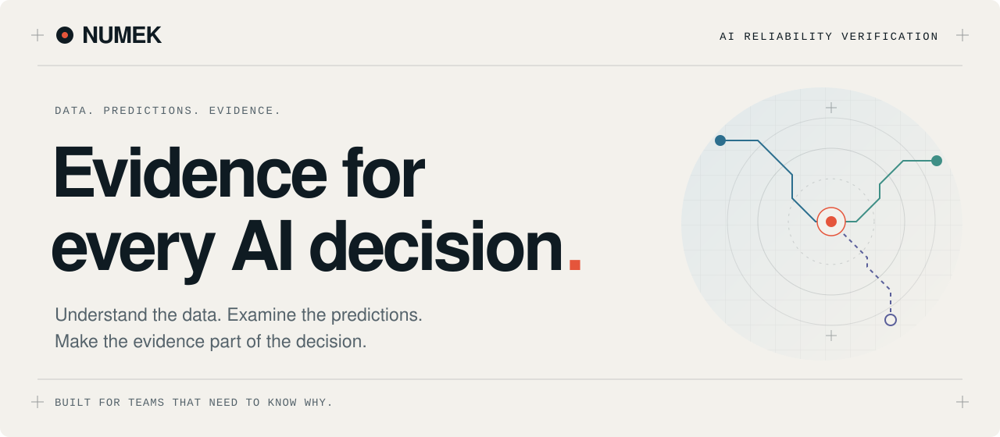
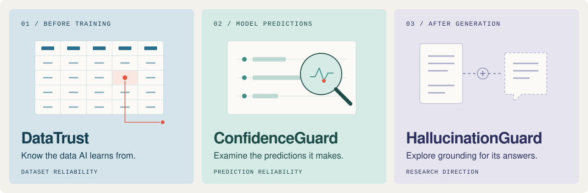

<p align="center">
  
</p>

# Numek

**AI reliability, backed by evidence you can inspect.**

Numek helps AI teams understand the data they learn from and the predictions
they rely on. Explore reliability findings, follow them back to their evidence,
and turn the results into reports that engineers and decision-makers can use together.

[Explore the products](#the-product-family) · [See the workflow](#from-input-to-insight) · [Get started](#get-started) · [Documentation](#explore-further)

<br />

## The product family

Three moments in the AI lifecycle. One standard: show the evidence behind the finding.

<p align="center">
  
</p>

### DataTrust

**Know the data before you build on it.**

Examine training, fine-tuning, and evaluation data in a local browser workbench.
DataTrust brings missing values, repeated records, conflicting labels, potential
leakage, and other reliability concerns into a readable, evidence-backed review.

| Work with | Explore |
| :--- | :--- |
| **Tables and outcomes** | Classification, regression, partially annotated data, multilabel and multi-output tasks, and unlabeled datasets. |
| **Splits and versions** | Training/evaluation separation, reference/current changes, and before/after preprocessing comparisons. |
| **Time and sequences** | Temporal coverage, timing, revisions, and target maturity. |
| **Text and images** | Text, annotations, conversations, retrieval evidence, images, and declared image annotations. |
| **Records and documents** | Explicit relationships between records and native PDF/DOCX, text, and image evidence. |

Each workflow ends on its own results page: its findings in the report's words, the evidence behind each one, and
what was and wasn't checked.

[Start with DataTrust →](docs/GETTING_STARTED.md)

### ConfidenceGuard

**Understand more than the headline accuracy.**

Examine model predictions against recorded outcomes. ConfidenceGuard helps you
investigate where performance changes, how confidence compares with observed
results, and what happens when a decision policy is applied.

- **Evaluate predictions.** Review binary classification, multiclass classification, and regression, including paired comparisons.
- **Study uncertainty.** Fit and independently assess supported calibration methods, prediction sets, and intervals.
- **Investigate behavior.** Explore reliability across cohorts and retained history, and assess frozen decision policies.
- **Test local predictors.** Run supported, explicitly trusted local models and investigate bounded robustness scenarios.

The evaluation workbench is available. Operational ingestion and monitoring are
under active development; the full operations interface is still being built.

[Explore ConfidenceGuard →](docs/GETTING_STARTED.md#confidenceguard-workbench-and-history)

### HallucinationGuard

**A research direction for answers and their sources.**

Numek's longer-term direction includes examining grounding, supporting evidence,
citations, and contradictions in generated answers. HallucinationGuard is a
research direction; an implemented product is not available yet.

<br />

## From input to insight

**01 · Bring your evidence**<br />
Supply a dataset, predictions with outcomes, or the sources supported by your workflow.

**02 · Make the context explicit**<br />
Choose the task and declare the roles, relationships, and assumptions that matter.

**03 · Follow the findings**<br />
Move from a readable overview to the supporting details. See what was assessed,
what was excluded, and what needs further investigation.

**04 · Share the review**<br />
Export standalone **HTML**, **PDF**, and **JSON** artifacts, with disclosure
controls for sensitive evidence where supported.

<br />

## Built around evidence

| Principle | What it means for your team |
| :--- | :--- |
| **Local workbench** | Run DataTrust and standalone ConfidenceGuard analyses on your machine. DataTrust needs no cloud upload or account. |
| **Guided start** | Say what you want to check, or start from a CSV and see which analyses fit it and why. Suggestions are explained and never applied for you. |
| **Inspectable findings** | Review supporting observations, relevant populations, declared assumptions, and the scope of each check. |
| **Readable reporting** | Give stakeholders a clear decision layer while keeping technical evidence available for deeper review. |
| **Explicit uncertainty** | Distinguish observed facts, potential issues, and unassessed areas. Scores are used only where a methodology defines them. |
| **Your judgment stays central** | Investigate and assess possible changes. DataTrust leaves source data unchanged; recommendations require your judgment. |

Findings describe the evidence and scope assessed. They do not establish future
model performance or guarantee that a dataset or prediction is reliable.

<br />

## Get started

Use **Python 3.12+**; **3.13** is the primary development runtime.
From a local checkout of this repository:

```bash
python3 -m venv .venv
source .venv/bin/activate
python -m pip install .
datatrust ui
```

The local DataTrust workbench opens in your browser. After installation, launch
the prediction workbench with `confidenceguard ui` instead.

[Installation, Windows setup, PDF dependencies, and first analysis →](docs/GETTING_STARTED.md)

<br />

## Explore further

| Find your next step | Guide |
| :--- | :--- |
| **Use the workbenches** | [Installation and workflows](docs/GETTING_STARTED.md) |
| **Understand a finding** | [DataTrust methodology](METHODOLOGY.md) · [ConfidenceGuard evaluation](docs/CG1_CONFIDENCEGUARD.md) |
| **Go deeper into predictions** | [Calibration and uncertainty](docs/CG2_CONFIDENCEGUARD.md) · [Decision policies](docs/CG5_CONFIDENCEGUARD.md) · [Local model execution](docs/CG6_CONFIDENCEGUARD.md) |
| **Explore the engineering** | [Architecture](docs/ARCHITECTURE.md) · [Measured scalability](docs/SCALABILITY.md) |
| **Review capabilities and evidence** | [Current state](docs/CURRENT_STATE.md) · [Validation](validation/README.md) |

---

<p align="center">
  <strong>NUMEK</strong><br />
  <sub>Evidence for every AI decision.</sub>
</p>
