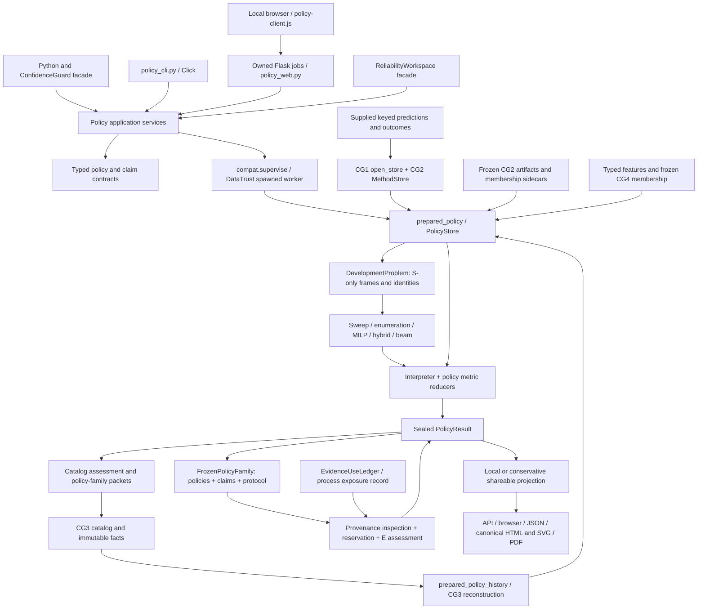
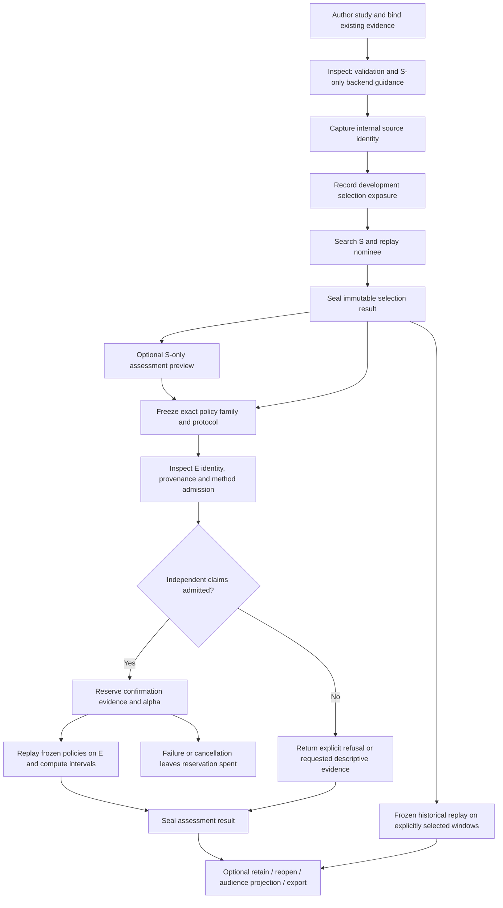

# NUMEK ConfidenceGuard CG5 — Final Corrected Implementation Explainer

Written 5 November 2026. This document teaches the implementation present in this checkout. It closes no acceptance gate and performs no new technical review. All numerical examples explicitly described as illustrative are teaching examples, not new experiments.

## Reading guide and source identity

CG5 turns supplied model outputs into reproducible **offline decision-policy evidence**. It can search a declared policy family, explain the selected policy's behavior and empirical feasibility, freeze the exact questions to be assessed, and assess those questions on independently reserved evidence. It can also replay the same policy across retained historical windows. These are separate operations with separate identities and conclusions.

The runtime identity requested for this explanation was:

```text
7d3f64affcbc9491223e23294482149848f3bd945a7aaefce33af4af7b3fc3b9
```

I recomputed the SHA-256 of the canonical UTF-8 JSON map of runtime paths to their current file SHA-256 values, using sorted keys and compact comma/colon separators, over the **190 paths** in `validation/cg5/defect-corrections-20261105/final-source.json`. The current identity is **exactly the value above**. There are **zero missing or changed files in that manifest**. This is a working-tree identity, not a Git commit identity. The checkout contains pre-existing modified and untracked work; comparison with committed HEAD would describe a different boundary.

The runtime manifest excludes this document, tests and ordinary documentation. Matching it confirms which implementation is explained; it is not a new execution or scientific qualification. No tests, statistical probes, benchmark workloads, browser sessions or report-generation campaigns were rerun for this writing task.

The source hierarchy used here is executable code first, strict contracts and schemas next, then retained verification/correction evidence, then explanatory documentation and planning. Principal documentary sources are:

- `docs/NUMEK_MASTER_CONTEXT.md`, `docs/CURRENT_STATE.md`, `docs/ARCHITECTURE.md`, and `docs/CG1_CONFIDENCEGUARD.md` through `docs/CG5_CONFIDENCEGUARD.md`.
- The saved **Full Revised Technical Plan**, at `/Users/drivyaanshyadav/.codex/plans/01a1a1f9-ba30-7342-b779-656908511d79/01a1a20e-0f8e-7952-8924-e06bb3333a7c/PLAN.md`. Its architecture and alternatives provide design intent; current code decides delivered behavior. The report is self-contained and does not require access to that local plan.
- `validation/cg5/implementation_baseline.json`, `VERIFICATION.md`, and `README.md`.
- `validation/cg5/review-corrections-20261104/REVIEW_CORRECTIONS.md` and its manifests/receipts.
- `validation/cg5/defect-corrections-20261105/DEFECT_CORRECTIONS.md`, `CG5_INDEPENDENT_RE_REVIEW_20261105.md`, `final-source.json`, and `verification.json`.

The latest user instruction says the review/correction cycle is closed and requests this understanding document. Older repository status text still says pending focused re-review/founder acceptance. That is historical workflow language; this document does not reopen the review or infer founder acceptance. CG1–CG4's accepted scientific boundaries remain in force.

Sections 1–2 build the mental model. Section 3 maps the code. Sections 4–7 explain semantics, algorithms and scientific boundaries. Section 8 follows four complete executions. Sections 9–13 explain operational behavior, decisions, corrections, usage and questions an evaluator could ask.

## 1. CG5 from first principles

### 1.1 A good prediction still leaves a decision to make

Imagine a classifier that supplies a probability of a costly failure. Two events receive probabilities 0.20 and 0.70. A model evaluation can tell you whether these probabilities are accurate, calibrated, well ranked, and stable across cohorts. It does not, by itself, tell an organization what action to take.

If missing a failure costs much more than an unnecessary intervention, acting at 0.50 may be inappropriate. If a review team can examine only a limited batch, escalating every uncertain event may be impossible. If one context has weak inputs, the sensible action may be to abstain or defer there. These choices combine model outputs with operational objectives, costs, information availability and requirements.

A **decision policy** is the reproducible rule that makes those choices. In CG5 it maps admitted decision inputs to exactly one hypothetical action for each planned opportunity. It is represented as typed data, interpreted by a fixed implementation. It can issue a label or number, abstain, defer to a named process, or record unavailable execution.

For a regression example, a model might predict demand of 12 units. Choosing an order quantity of 10, 12 or 15 is a separate decision. Under-ordering and over-ordering can have different losses. A prediction interval may tell us the uncertainty is unusually wide; a policy can use that information to choose whether to issue a quantity at all.

### 1.2 Why CG1–CG4 did not already solve this

The earlier capabilities supply the necessary evidence:

| Capability | Question answered | What remains for CG5 |
|---|---|---|
| CG1 prediction evaluation | How do supplied predictions behave on authoritative observed outcomes? | Choose among operational rules that alter issuance, actions and workload. |
| CG2 calibration and uncertainty | How can frozen probability maps or conformal outputs be fitted/applied/evaluated under explicit separation? | Decide how to use those outputs in a policy with objectives and constraints. |
| CG3 longitudinal reliability | How did behavior change across immutable historical selections, revisions and maturity states? | Stress one policy across history and preserve its requirements by window. |
| CG4 failure discovery | Which frozen regions identify adverse behavior, and which hypotheses have admissible confirmation? | Use those regions as context inputs to alternative actions, without learning the region again. |

CG1 already has fixed threshold/rejection replay and curves. Those are useful descriptive diagnostics. They are not the CG5 compositional language, general study contracts, multiple-choice solver, search coverage accounting, or frozen policy-assessment workflow. CG5 also adds full-opportunity accounting because an issued-only accuracy table can make a policy that rejects almost everything look attractive.

### 1.3 Evaluation, optimization and assessment ask different questions

**Prediction evaluation** measures supplied outputs under their existing interpretation. For example: among eligible issued predictions with labels, how often was the model correct?

**Policy optimization** compares policy definitions on development evidence S under declared objectives and constraints. For example: among the admitted rejection thresholds, which gives the highest correct-issue rate while issuing at least 70% of planned opportunities?

**Policy assessment** freezes a policy and a family of claims, checks provenance/exposure, reserves E evidence, and constructs registered intervals for those claims. For example: does independent evidence support an issued-coverage floor and a selective-risk ceiling simultaneously?

Searching many policies and then measuring the winner on the same data can exploit accidental patterns. S performance is still useful—it determines the selection—but it is not independent support. A solver certificate concerns the finite mathematical search model; it says nothing by itself about sampling uncertainty.

CG5 therefore separates four statements:

1. **Executable:** the definition and its inputs admit deterministic replay.
2. **Empirically feasible:** the replayed development metrics satisfy the specified constraints with their required support.
3. **Search standing:** exact within a finite family, optimal for an admitted encoded model, or best found in incomplete search.
4. **Independent support:** particular frozen claims are supported under registered methods and declared assumptions.

An executable policy can be infeasible. A feasible policy can come from incomplete search. A completely optimized policy can have inconclusive independent evidence. None of these states is an operational deployment instruction.

### 1.4 What an engineer can accomplish

An engineer can bring existing keyed predictions and outcomes, bind frozen calibrated or uncertainty outputs, add decision-time context or frozen CG4 membership, define costs and guardrails, compare supported policy compositions, inspect nomination and trade-offs, and preserve a complete decision record. The same work can proceed through Python, CLI or the local browser. A retained workspace adds durable evidence-use tracking and historical reconstruction.

The useful output is more specific than “this model is reliable”: it is an identified policy, its hypothetical actions, its empirical economics/workload/constraints, the scope of the search, independent claims where admissible, and explicit reasons where evidence cannot settle the question.

## 2. Complete architecture and data movement

### 2.1 The implementation is an extension of ConfidenceGuard

CG5 lives inside `src/confidenceguard`. It does not introduce a second prediction ingester, a new database service, a new worker framework, or separate browser analytics. Its new parts describe policies, adapt existing evidence into policy inputs/actions, search bounded families and orchestrate policy-specific assessment.

The principal runtime technologies have distinct jobs:

- **Python dataclasses and strict JSON contracts** describe tasks, inputs, graphs, studies, claims and limits. They prevent unsupported declarations from becoming ambiguous executable behavior.
- **DuckDB** holds disposable projected/normalized analytical relations. CG1/CG2 preparation and CG3 reconstruction remain the source of authoritative outcomes and existing prediction semantics.
- **Python arrays, dictionaries, Decimal and NumPy** implement bounded policy frames, exact typed comparisons, contribution arithmetic and finite inference. DataFrame registration in `compat.insert_rows` is an insertion mechanism, not an alternative analytical pipeline.
- **SciPy/HiGHS**, when the registered version pair is available, solves admitted sparse finite multiple-choice MILPs. It is optional for the rest of the policy system.
- **SQLite plus immutable evidence objects** provide the opt-in retained catalog. They record facts, ownership/dependencies, revisions, reservations and saved analyses. DuckDB is reconstructed scratch; SQLite is the persistent index/transactional authority.
- **Flask and the existing local transport** provide owned drafts, opaque handles and fixed jobs. **Click** provides CLI commands. Both call the same Python services.
- **JavaScript** authors declarations and renders completed evidence. **Jinja HTML/SVG** is the canonical report; the existing DataTrust PDF path derives PDF from it.
- **DataTrust supervision and filesystem utilities**, reached through `compat.py`, provide spawned execution, sampled resource monitoring, secure source access and publication.

### 2.2 Architecture diagram



`PolicyStore` can prepare either live or historical evidence. The optimizer does not receive that broad object: `policy_problem.admit` makes a narrower `DevelopmentProblem` with S-only frames and precomputed native ranking diagnostics. The interpreter itself receives outcome-free event dictionaries. Outcomes are passed separately to metric reducers. Those boundaries are central to understanding the architecture.

### 2.3 What moves between modules

An input specification references either a supplied `EvaluationSpec` or a retained `LongitudinalSpec` selection. Preparation yields normalized prediction relations, authoritative truth records, typed feature cells and frozen region states.

`PolicyStore.batches` separates each chunk into:

- **events:** event/entity keys, role, projected model inputs, typed features and region states;
- **records:** authoritative outcome validity/value, cohort columns, historical windows and other reducer context.

`Interpreter.apply(events)` returns an aligned action list and routing/capacity trace. `policy_metrics.metric_result` receives events, records and actions, and returns a scalar statistic with its denominator, basis, value state and optional private inference components. Search wraps those statistics into candidate records and constraints. Public orchestration adds study/search/selection identities, population lineage and protected provenance to a `PolicyResult`.

There is no HTTP call between these analytical modules. They communicate through typed objects and bounded in-process data inside supervised work. HTTP connects the browser to the local application boundary; it is not a numerical implementation layer.

### 2.4 Workflow and irreversible exposure



Identity preparation and final verification bracket the analytical phases. A caller may supply an earlier inspection fingerprint, but optimize/replay/history still capture and enforce their own reserved fingerprint when no earlier inspection was supplied. Reopening and exporting branch from completed evidence; they do not feed back into search or assessment.

## 3. File-by-file implementation walkthrough

### 3.1 How new and modified are classified

The classifications below compare current source bytes with `validation/cg5/implementation_baseline.json`, the captured modified/untracked pre-CG5 state. They do not use `git status` as a milestone classifier. A file can be untracked by Git and still be an unchanged CG4 dependency relative to that baseline.

There are **16 new CG5 runtime/assets files** and **16 modified existing runtime/assets/schema files** under the compared source scope. All are covered below. The substantive new Python implementation consists of 14 modules. Documentation and verification programs are mapped separately because they explain or check behavior rather than execute product analytics.

### 3.2 Contracts and executable behavior

#### New: `src/confidenceguard/policy_contracts.py`

This module defines the data language independently of HTTP, templates or analytical execution. That lets Python, CLI, imported artifacts and API requests agree on what a policy means.

Its validators have distinct levels:

| Symbol | Inputs → outputs and responsibility |
|---|---|
| `bounded_json` | A Python JSON-like value → shape/byte/depth/element admission or an error. Rejects executable objects and nonfinite floats before recursive copying/hashing. |
| `shape`, `finite`, `value_ref`, `predicate`, `action` | Small declarations → validated typed objects, without evaluating data. Enforce allowed fields, task compatibility and registered primitive kinds. |
| `validate_policy` | Task, nodes, root, fallback and unavailable action → graph admission. Checks references, reachability, cycles, path depth, total rule count and capacity resource separation. |
| `cost_table` | A categorical action/outcome table or registered numeric-loss declaration → cost-shape admission. Decimal-form costs remain finite and bounded in representation. |
| `referenced_runs` | Definition and feature declarations → secondary input-run dependencies. Used when projecting inputs and binding identities. |
| `validate_bound_references` | Executable definition plus input identity → feature/region/native-score semantic admission. A field or frozen region must actually be declared. |

`PolicySpec` owns task, primary run, graph, root, terminal fallbacks, decision costs and bound input semantics. Its `policy_digest` hashes its complete definition with `typed_policy_interpreter_v1`. `PolicyInputSpec` owns evidence/roles, frozen upstream methods, membership sidecars, typed context, regions, batches and run aliases. Exactly one live evaluation or retained history source is required. Explicit unique event-key declarations are required for live policy inputs.

`PolicyParameter` admits finite, node, cutpoint or decimal-generated grid domains. `PolicyFamilySpec` owns a parameterized prototype and backend request; its placeholder IDs must exactly match its declarations. `routing_parameters` identifies finite outer choices for hybrid search. A full `PolicySpec` cannot carry unresolved placeholders.

`PolicyMetricSpec`, `PolicyConstraint` and `PolicySearchSpec` define the requested question, requirement and ordering. A metric carries direction, basis, scope, target, units, cost reference, regression loss/level and optional true contribution bounds. A constraint adds `le`/`ge`, a bound and minimum support. Search controls lexicographic, weighted or Pareto mode, numerical nomination tolerance and optional epsilon schedules.

`PolicyStudySpec` combines those objects with candidates, families, baselines, evaluation economics and limits. `PolicyApplicationSpec` specifies a single frozen policy, replay role, metrics and optional constraints. `PolicyAssessmentSpec` owns frozen claims, design/declarations, confidence and alpha budget, plus scheduled looks. `PolicyClaim` identifies its policy, metric, operator, threshold, comparator, support floor, allocation weight and whether it is required.

`FrozenPolicy` and `FrozenPolicyFamily` validate content/digest bindings on import and defensively copy their data. Frozen policies require input semantics. Frozen families also validate policy/comparator membership, limits, nominated identities and recomputed required-constraint coverage. `required_constraint_claims` and `required_constraint_coverage` provide the shared matcher used at freeze, import and final support computation. An optional claim cannot impersonate a mandatory requirement.

Callers are virtually every CG5 module and schema/interface constructors. Dependencies are the existing base, method and feature contracts plus frozen membership validation. Keeping declaration validity here prevents a browser convenience path or an artifact import from creating an alternative policy language. Frozen dataclasses/deep copies support reproducibility; external packet digests and result reopening checks enforce sealed evidence integrity.

#### New: `src/confidenceguard/policy_runtime.py`

This is the outcome-free execution layer. It accepts a fully bound policy plus projected decision events, and emits hypothetical actions and traces.

- `Budget` owns countable counters, limits and materialization reservations. `charge` counts performed operations; `admit` checks an estimated next workload; `materialize` checks a proposed allocation; `reserve` accounts for memory retained across calls. Its effective allocation ceiling is `min(limits.materialized_bytes, config.max_rss_bytes // 4)`.
- `read_value` interprets registered input references. It reads typed field values, valid class probabilities, native scores, explicit selectors, supplied decisions, points, quantiles, sample summaries, uncertainty states and frozen membership. It returns `(value, state)`; absent data do not become numerical zero.
- `evaluate_predicate` implements exact typed comparisons and strong Kleene logic. It produces `True`, `False` or `None` for unknown. Explicit state predicates can intentionally resolve missingness.
- `Interpreter.act` turns a typed action into an action record. It handles supplied actions, labels, finite numeric values, argmax, binary thresholds, predictive expected costs and nonissuance.
- `Interpreter.node` executes rules, acceptance and capacity routes. It preserves unknown-precedence behavior and accumulates route, overlap, unresolved and fallback counts.
- `Interpreter.apply` first resolves capacity guards in graph order, then emits one action per event in original alignment. It returns `(outputs, trace)`.
- `action_key` maps an output to its economic key, such as a class, `abstained` or `deferred:review`. `numeric_loss` defines residual-loss arithmetic. `complexity` returns node count, rule count and digest for deterministic nomination ties.

The callers are candidate evaluation, assessment, replay, history and CG1 finalist diagnostics. Dependencies are only contracts and typed feature-value interpretation, with standard numerical utilities. Locating execution here ensures every backend and interface uses the same precedence, loss and action semantics. It does not have an outcome accessor or implement statistical claims.

### 3.3 Evidence preparation and information boundaries

#### New: `src/confidenceguard/policy_store.py`

`prepared_policy` is the context manager joining CG5 to existing live preparation. For retained input it delegates to `prepared_policy_history`. For live input it constructs a CG2 `ReliabilitySpec` containing frozen inputs, invokes `engine.open_store`, seals E labels, applies imported frozen methods if present, and only unseals evaluation labels for nonselection phases. It closes the disposable workspace in a `finally` block.

`PolicyStore` owns the prepared evidence adapter, not the numerical optimization method:

- `__init__` validates unique/nonmissing event keys, assigned roles, whole-entity role separation and consistent cross-run entity ownership. It creates keyed feature joins, captures supplied vector/key dependencies before reservation, checks source budgets and constructs the input fingerprint.
- `policy_identity` builds `policy_input_semantics_v2`. It includes model/task, upstream decision declaration, supplied prediction mapping, probability tolerance, prediction clock, probabilities/scores/selectors/intervals, representation/method identities, typed features, frozen regions and feature-time policy. Referenced secondary runs get their own bound semantics.
- `bind_policy` checks task compatibility, validates declared references and either binds an unbound definition or refuses an incompatible existing binding. It never silently rewrites a bound artifact.
- `project` determines necessary runs before materialization. `check_role` refuses non-S access during selection.
- `batches` streams anchor opportunities in event-key order, attaches available secondary inputs and features by key, applies frozen regions, and yields aligned outcome-free events and separate truth records. An absent secondary output does not delete an anchor opportunity.
- `_feature_cells` normalizes exact typed fields and applies decision-time/as-of availability. `_regions` applies frozen membership using supplied or retained representations and verifies captured external dependencies. It does not fit a region or download/encode a new representation.
- `materialize` caches a role frame with explicit allocation accounting; `identifiers` derives canonical and source aliases for exposure checks; `verify` rechecks source identities before completed publication.
- `uncertainty_interval` translates tagged frozen output endpoints into empty/finite/unbounded interval semantics.

Callers are identity/inspection workers, replay, optimization admission and assessment. Dependencies include CG1/CG2 preparation, CG4 features/membership/representations, secure capture and CG3 adapters. Preparation belongs here because neither the interpreter nor a solver should resolve paths, outcome authority or source ownership.

#### New: `src/confidenceguard/policy_problem.py`

`admit(pstore, study)` projects declared dependencies, materializes only S, precomputes any required native AUC/AP diagnostics on S, and constructs an immutable `DevelopmentProblem`. The object carries task, anchor, limits/budget, batch declarations, S frames and semantic identities. It carries no DuckDB connection, source reader or E accessor. Its budget's preparation-store reference is removed before backend execution.

`DevelopmentProblem.materialize` refuses any role other than S. `bind_policy` repeats task/reference/identity compatibility using admitted identities. `cutpoints` derives sorted finite distinct values from S only, preserving exact decimal field semantics. Callers are all search methods and inspection guidance. The small object provides a structural leakage boundary; the optimizer is not merely instructed to ignore E while holding an unrestricted database object.

### 3.4 Authoritative policy evidence

#### New: `src/confidenceguard/policy_metrics.py`

This module defines what a policy statistic actually counts. It is called by replay, every search backend, assessment, history and final result construction. It calls the interpreter's loss/action-key helpers, CG1 native reducers, and base contracts.

`registered` checks metric/task/basis compatibility. `scoped` resolves overall, canonical cohort, historical window and region scopes. `atom` produces a single event's eligibility, contribution and, for F1, confusion cells. It is the shared arithmetic used by generic replay and sweep/MILP sufficient statistics.

`metric_result` reduces aligned events, truth records and actions. It returns value/state, denominator, planned scope count, reason, basis, units, statistic kind, definition digest and sensitive counts. With `retain_components=True`, it also retains contributions, identities, acceptance indicators or confusion components needed for assessment. It composes worst-window and class summaries, constructs missing-label envelope ratios, and handles native ranking diagnostics.

Economic helpers separate table loss (`cost_value`), known charges (`charge_value`), categorical Decimal arithmetic (`decimal_cost`), canonical operational arithmetic (`decimal_operation`) and missing-label/model-implied interpretation (`_economic`). Unknown prices remain required-contribution unavailability. Utility negates cost with correctly reversed missing-label extrema.

`constraint_state` converts a scalar and support floor into feasible, violated or undefined, with signed slack. `public_stat` removes private component arrays without changing the scalar semantics. `bernoulli_contribution` registers whether the population contribution really is binary; D1 relies on this distinction. `claim_parameters` records the units/loss/level/material threshold necessary to identify an assessment question.

`_ranking` calls CG1's tie-aware ranking implementation; it is a native diagnostic, independent of hypothetical issuance. `native_measurements` creates a separate hypothetical action relation and invokes `analytics.Evidence` and `evaluate_scope`. `copy_store` creates a scoped adapter with descriptive native sampling. This keeps accepted CG1 reducer meaning intact while the policy-specific reducer adds opportunity/workload semantics.

Metrics belong in this shared layer so a solver, sweep, browser or statistical procedure cannot silently use its own definition of accuracy, precision or missing-label cost.

### 3.5 Search and numerical solving

#### New: `src/confidenceguard/policy_optimization.py`

This module orchestrates registered searches over admitted development problems. Its inputs are a `PolicyStudySpec` and S-only problem; its outputs are retained candidate evidence/definitions, per-family search records, nomination and retention accounting.

| Function group | Actual work |
|---|---|
| `substitute`, `bind`, `domains` | Replace typed placeholders, remove nodes made unreachable by a finite choice, construct validated executable policies, and derive finite/node/grid/S-cutpoint domains. |
| `all_metrics` | Merge objectives and constraint metrics with reserved action-accounting diagnostics, rejecting inconsistent metric IDs. |
| `evaluate_candidate` | Bind a policy, interpret S actions, compute all registered metrics, evaluate support/constraints/capacity, and construct a candidate record. |
| `objective_vector`, `selection_key`, `within_tolerance`, `choose` | Normalize min/max directions, form weighted or lexicographic keys, identify the literal reference, then nominate a structurally simpler/canonical policy inside the declared tolerance. |
| `frontier` | Compare feasible objective vectors under a dominance-pair budget; return nondominated retained policies and backend-calculated display coordinates. |
| `_sweep_admission`, `sweep` | Admit a single threshold/acceptance structure with incremental metrics; accumulate whole-score-group deltas and stream scalar candidates. |
| `_fixed_cells`, `_children` | Prove the admitted fixed residual-cell graph has one independent leaf parameter per cell and no cross-cell/capacity coupling. |
| `ordered_band` | Restrict two-cut enumeration to a lower negative boundary and upper positive boundary on the same input, with lower ≤ upper. |
| `milp_family`, `_terms` | Build per-cell option statistics, sparse linear constraints/objectives, solve priorities, decode/replay candidates, verify objective equivalence, and refine nomination choices. |
| `encoded_tie_bounds` | Transform a single signed weighted RMSE band into the corresponding signed weighted MSE band. |
| `pareto_milp` | Run bounded epsilon-constraint schedules and retain sampled trade-offs. |
| `hybrid_family` | Enumerate finite outer routes, solve admitted inner residual-cell models, and stream their global-nomination candidates under shared budgets. |
| `bounded_family` | Deterministic beam search over adjacent finite parameter indices, with explicit best-found standing. |
| `select_backend`, `family_guidance`, `milp_standing` | Choose registered backends, expose S-only preflight guidance, and translate solver/replay/tie evidence into honest standing. |
| `search` | Retain mandatory baselines; evaluate declared candidates/families; maintain analytical nomination separately from display detail; restore the nominee to the result pool. |

The important invariant is that fast statistics and solver encodings do not own policy meaning. Executable replay and the shared reducers remain authoritative. Resource exhaustion is distinguished from complete search; analytical contender memory is separately admitted so a tiny displayed candidate page cannot change the nominee. Sections 5 and 11 explain the nontrivial algorithms and corrections in detail.

#### New: `src/confidenceguard/policy_solver.py`

`availability` checks the exact registered SciPy 1.18.1 / bundled HiGHS 1.12.0 profile and records Python/NumPy versions. `solve` accepts numeric vectors, sparse rows, bounds, integrality and a shared budget. It checks model sizes and temporary allocation, scales rows/objectives by recorded powers of two, builds SciPy sparse arrays, supplies fixed internal options and remaining limits, and returns status/incumbent/objective/dual bound/gap/settings evidence.

`inspect_only=True` performs numerical/matrix preflight without solving. Execution refuses unregistered dependencies. `_warning_keys` parses only quoted option names from the expected wrapper-forwarding warning; it never evaluates warning text. Unexpected warnings and nonintegral/nonfinite decoding prevent usable solver standing. `solve` does not decide business feasibility: `milp_family` replays the decoded policy and checks original constraints/objectives.

This narrow adapter isolates version-specific numerical behavior. It provides neither arbitrary solver-option passthrough nor a user-loadable optimizer mechanism.

### 3.6 Public orchestration and statistical assessment

#### New: `src/confidenceguard/policies.py`

This is the main selection/replay application boundary called by Python, workspace, CLI and API.

- `arguments` validates/copies typed specs and config, resolves live source paths or freezes an omitted history catalog sequence, and determines authorized roots. `workspace_for` ensures retained evidence uses its declared workspace.
- `_identity_worker` prepares evidence, fingerprints it, obtains planned event/unit aliases and returns non-outcome identity/provenance checks.
- `_reserve` records development selection, confirmation or disclosure through the durable ledger when enabled, otherwise through process-scoped tracking.
- `_inspect_worker` binds candidates, checks registered metrics and obtains `family_guidance` using admitted S data. `inspect_policy_study` supervises it.
- `_optimize_worker` checks the reserved fingerprint, admits the S-only problem, calls `search`, recomputes the nominee with authoritative replay, constructs frontier standing and selection identity, and collects nominee action examples/native diagnostics. `optimize_policies` owns deadline, identity, reservation, supervision and final sealing.
- `_application_study` adapts replay declarations to common metric/constraint machinery. `_replay_worker` interprets one policy on the requested role, records metrics, capacity/constraint state and the protected action ledger. `replay_policy` wraps identity/reservation/supervision.
- `make_result` constructs shared run/measurement/population records and the protected study/config/source/policy manifest. `action_record` preserves upstream and feature/region states alongside the policy action.
- `_finish` seals and checks protected/portable byte budgets. `export_frozen_policy` extracts an explicitly protected executable packet with development membership provenance.

This layer owns execution sequencing because identity capture, reservation and publication must happen in order. They are not responsibilities of a metric reducer or HTTP handler.

#### New: `src/confidenceguard/policy_assessment.py`

`freeze_policy_family` accepts a completed protected selection result and chosen retained policies, defaulting to the nominee. It validates an optional S-only preview, adds retained comparators, matches required study constraints and seals exact policies/protocol/study/development membership into a `FrozenPolicyFamily`.

`preview_policy_assessment` is deliberately a completed-result operation. Its inputs are S evidence, a proposed protocol, caller-supplied planned E size and optional precision target. It has no source/E accessor. It reports component counts, allocated alpha, conditional-support scenarios and illustrative precision, with no alpha spent.

`_protocol_input_signature` and `_input` compare replacement assessment input against frozen role/population/observation semantics. They allow replacement evidence only within the frozen interpretation; changing a source path is not permission to change roles, event/entity bindings, cohorts or clocks.

`claim_alpha`, `component_count`, `metric_bounds` and `method_refusal` define allocation and statistical admission. `inspect_policy_assessment` performs observable overlap, upstream/region provenance, decision-time input, exposure-history and method checks before outcome-dependent claims. `_interval` invokes registered CP/Hoeffding/component constructions; `_entity_refusal` checks potential repeated observations before label filtering.

`_assess_worker` rechecks the reserved snapshot, binds frozen policies, interprets E actions, computes registered statistics, constructs simultaneous claim intervals, classifies each claim, and recomputes required policy support from actual matching claim states. `assess_policies` owns inspection, confirmation/disclosure reservation, supervision and completion.

`_scheduled_context`, `inspect_policy_restatement` and `restate_policy_assessment` implement the narrow predeclared historical-look path. They require the retained initial assessment, due frozen look, original reservation, same branch/continuity and unchanged planned membership. They do not grant a general repeat-assessment exception.

The module reuses CG4 finite numerical kernels but owns policy-specific estimands, comparators and claim matching. Fabricating a CG4 investigation merely to assess a policy would conflate different scientific questions.

### 3.7 History and immutable result projections

#### New: `src/confidenceguard/policy_history.py`

`prepared_policy_history` adapts CG3's `load_history`, `select_history`, `context_links` and `HistoryStore`. It reconstructs selected variants/windows, deduplicates overlapping-window opportunities, restores typed features/frozen uncertainty/representations and original-source aliases, and records source-object dependencies. `_roles` uses CG2's role meanings and deterministic whole-unit hash convention. Live keyed partition sources are refused in this retained adapter; roles come from retained context or seeded proportions.

`_policy_history_worker` replays one bound policy once across the admitted historical union, intersects each metric's original cohort/region restriction with each window, and builds timeline, comparisons, per-window constraint ledger, worst-window evidence, applicability, action disagreement and compatible CG3 mix/drift views. `analyze_policy_history` performs identity, disclosure reservation and supervision. `policy_restatement` derives a new outcome-only application while freezing prior prediction/context snapshot cutoffs and requiring a reason.

History belongs in an adapter to CG3 because authority, maturity, revision heads and catalog sequence must keep their established meanings. It does not create a second revision resolver or reoptimize per window.

#### New: `src/confidenceguard/policy_result.py`

`PolicyResult` extends `EvaluationResult`. `from_dict` validates local result/manifest binding, study and policy digests, allowed stages and assessment-family binding; a verified shareable projection returns `PolicyShared` instead. `source_paths` exposes protected source ownership to export collision checks. `resolve_evidence` dispatches retained historical locators or existing live-source resolution under explicit roots.

`to_dict` builds the shareable projection. It aliases policies/classes, removes executable behavior, paths, private economics and context, and jointly withholds dependent evidence when conservative disclosure requires it. `public_claim_parameters` reconstructs safe units and defining regression parameters; uninterpretable questions lose their conclusion/interval together. `PolicyShared.to_dict` refuses a local audience: public import cannot recover protected content.

This is a projection layer over completed evidence. It does not recalculate a metric or correct a stored historical assessment in place.

### 3.8 Interfaces and canonical presentation

#### New: `src/confidenceguard/policy_cli.py`

`register(main)` adds `confidenceguard policy`. `load` uses strict JSON; `open_result` uses shared result dispatch with the matching protected manifest. The command factories route inspect/optimize/replay/history and assessment operations to public services. Freeze and protected policy export publish data-only artifacts with source-collision protection. Revisit commands call retained workspace methods. Evidence resolution requires explicit roots and an optional reveal-values flag.

Commands are `inspect`, `optimize`, `replay`, `preview-assessment`, `freeze`, `inspect-assessment`, `assess`, `history`, `open`, `export`, `evidence`, `restate-history`, `inspect-look`, and `assess-look`. Path handling and audience choices are explicit. Errors preserve information about valid surviving artifacts. CLI owns serialization and invocation, never a second optimizer.

#### New: `src/confidenceguard/policy_web.py`

`register` extends the existing Flask blueprint and session store. Its `resolve` translates owned source/method/policy/region handles to typed specifications, resolves authorized workspace history and verifies compatible feature contracts. `roots` restricts execution to host/session/workspace grants. `item` delegates ownership checks.

Routes manage revisioned policy drafts, protected policy and family import/export/content handles, completed paginated evidence and retained reopening. `evidence` serves summary, candidates, constraints, trade-offs, claim planning, assessments, timeline, comparisons, constraint ledger and worst windows. `submit` admits only fixed job kinds, checks request idempotency/revisions/fingerprints, reserves the shared worker lock, and runs public services in a host thread whose analytical work is spawned/supervised. Completion stores an owned immutable result; errors are sanitized and the lock is released in `finally`.

#### New: `src/confidenceguard/policy_schema.py`

`extend` adds strict generated contract/API definitions, including recursive prototypes, policy graph primitives, frozen packets, transport handles and fixed jobs. `paths` describes CG5 endpoints. `examples` constructs synthetic task examples. `capabilities` publishes families, metric/solver availability, grammar/operation limits and incompatibilities. Semantic constructor checks remain authoritative; a JSON Schema match alone does not prove graph separability or statistical admission.

#### New: `src/confidenceguard/static/policy-client.js`

This browser controller owns the Decision policies workflow. `compose` authors supplied/expected-cost/finite-numeric/threshold/acceptance declarations; `save` creates a draft; `run` submits fixed jobs and polls status. `openResult`, `more` and `renderAssessment` render backend summaries, paginated candidates, claim evidence and precomputed frontier coordinates. `invalidate` discards stale authoring inspection state. Import handlers send original protected JSON text, preserving bound numeric representations. Export and retained reopening use owned API routes.

It supplies guided controls plus complete-spec editing for advanced structures. It does not compute losses, search policies, derive intervals or reconstruct historical facts. Its compact claim table is supplemented by exact evidence details; the canonical report additionally prints the defining regression parameters.

#### New: `src/confidenceguard/templates/policy_sections.html`

This canonical report fragment renders nomination, frozen behavior/economics, preview, search/certificates, trade-offs, candidate metrics, independent claims and historical constraints/worst windows. Assessment rows include units, outcome units, loss, pinball level and material threshold, with retained-definition fallbacks for older rows. It limits some presentation excerpts/candidate counts while retaining full admitted detail in matching protected JSON. Formatting omissions do not change analytical search coverage.

### 3.9 Every modified existing runtime file

These are extensions to established infrastructure, compared with the pre-CG5 captured baseline:

| Exact path | CG5 responsibility, important symbols and relationships |
|---|---|
| `src/confidenceguard/__init__.py` | Exports policy contracts/results/services and attaches static methods to `ConfidenceGuard`. Provides one discoverable Python surface; calls the new modules rather than duplicating execution. |
| `src/confidenceguard/cli.py` | Registers `policy_cli.register` on the existing Click entrypoint. Existing evaluation/method/history/investigation command families retain their own meanings. |
| `src/confidenceguard/result.py` | `EvaluationResult.from_dict` dispatches `policy_result/1.0` to `PolicyResult`; inherited sealing, private serialization and artifact entrypoints remain shared. |
| `src/confidenceguard/artifacts.py` | `view` annotates CG5 evidence basis; `generate_artifacts` reuses canonical rendering/publication and ensures a shareable CG5 export creates no protected bundle. Calls `PolicyResult.to_dict`, Jinja and `compat.pdf`. |
| `src/confidenceguard/templates/report.html` | Includes the policy decision record prominently in the shared report. The policy fragment and existing generic evidence sections use the same completed projection. |
| `src/confidenceguard/transport.py` | Dispatches fixed policy jobs to `confidenceguard_policy_submit`, registers policy routes, and applies the no-protected-bundle rule during hosted shareable export. Reuses session ownership, CSRF, worker locking and artifact controls. |
| `src/confidenceguard/workspace.py` | Adds policy service facade methods, frozen-family save/open, policy assessment listing and history/scheduled restatements. `freeze_policy_family` writes existing bounded packets; `_cg4_previous`/`_cg4_save` reuse idempotent retained-operation infrastructure. |
| `src/confidenceguard/history_storage.py` | `Catalog.add_assessment` recognizes CG5, records dependencies on retained source objects, origin selection, family and evidence reservation, and writes bounded assessment packets. `Catalog.assessment` dispatches reopening and restores workspace location. Existing deletion/backup/restore traverse the recorded dependencies. |
| `src/confidenceguard/investigation_storage.py` | `write_packet`/`read_packet` admit the additional `policy_family` kind in the existing bounded canonical-JSON packet format. Despite the historical module/schema name, CG5 reuses it. Large packets have bounded hashed parts, not a new codec. |
| `src/confidenceguard/evidence_use.py` | Extends incomplete historical replay-use recognition to policy replay/restatement purposes. Existing canonical/source aliases, process records, durable reservations, continuity and alpha accounting are reused. |
| `src/confidenceguard/schema.py` | Calls policy schema `extend`, `paths`, `capabilities` and `examples`. Keeps one `/api/confidenceguard/v1` metadata surface. |
| `src/confidenceguard/schemas/contracts.json` | Generated strict contract snapshot including policy structures and declarations. Consumers validate shapes; Python constructors enforce deeper semantics. |
| `src/confidenceguard/schemas/openapi.json` | Generated transport/API snapshot including owned policy endpoints/jobs. It documents the running shared host contract. |
| `src/confidenceguard/schemas/examples.json` | Generated synthetic policy examples alongside earlier capabilities. These are declarations, not measured outcomes. |
| `src/confidenceguard/static/index.html` | Adds navigation and Decision policies authoring/results/assessment/history/import/export controls, and loads the controller. It declares UI structure; backend evidence remains authoritative. |
| `src/confidenceguard/static/client.css` | Styles policy controls, candidate cards, tables and the workflow layout within the existing workbench. It changes presentation only. |

For a quick source-navigation checklist, the complete modified runtime-path inventory is:

```text
src/confidenceguard/__init__.py
src/confidenceguard/artifacts.py
src/confidenceguard/cli.py
src/confidenceguard/evidence_use.py
src/confidenceguard/history_storage.py
src/confidenceguard/investigation_storage.py
src/confidenceguard/result.py
src/confidenceguard/schema.py
src/confidenceguard/schemas/contracts.json
src/confidenceguard/schemas/examples.json
src/confidenceguard/schemas/openapi.json
src/confidenceguard/static/client.css
src/confidenceguard/static/index.html
src/confidenceguard/templates/report.html
src/confidenceguard/transport.py
src/confidenceguard/workspace.py
```

### 3.10 Important unchanged CG1–CG4 and DataTrust dependencies

“Unchanged” here means unchanged from the captured CG5 starting state, not unchanged throughout the entire project history.

| Paths | Reused symbols, input/output boundary and why reuse matters |
|---|---|
| `src/confidenceguard/contracts.py` | `TaskDefinition`, `EvaluationSpec`, `EvaluationConfig`, `DisclosureSpec`, `EvaluationError`, `digest`, `strict_json`. Policies reuse task/outcome/input identities and error/JSON conventions. |
| `src/confidenceguard/engine.py` | `preflight`, `open_store`: typed evaluation plus config/roots → supervised workspace and prepared store. Keeps source/row/class/probability admission and prediction normalization centralized. |
| `src/confidenceguard/sources.py` | `Store.ingest`, `prepare`, `normalize`, `keyed`, `verify`, `rows`, `number`: projected source data → normalized keyed predictions/outcomes/cohorts. Exact event joins and authoritative label eligibility remain CG1 responsibilities. |
| `src/confidenceguard/analytics.py` | `Evidence`, `evaluate_scope`, `ranking`: normalized relations → native metrics, populations and evidence locators. Used by finalist native diagnostics and fixed ranking metrics. |
| `src/confidenceguard/method_contracts.py` | `RoleSpec`, `ReliabilitySpec`, `RepresentationSpec`, `SeparationSpec`: F/S/C/E roles, supplied predictive representations and separation declarations. CG5 adds no substitute role vocabulary. |
| `src/confidenceguard/method_sources.py` | `MethodStore.roles`, `seal_evaluation_labels`, `unseal_evaluation_labels`, representation/sample preparation. Supplies correct upstream role and frozen-output relations. |
| `src/confidenceguard/methods.py` | `_fit_all` with empty new-fit/family lists applies imports; `_run_objects`, `_view`, `_apply_calibrator`, `_apply_conformal` retain frozen method behavior. The function name `_fit_all` does not mean CG5 fits methods. |
| `src/confidenceguard/fitted.py`, `membership.py` | Frozen method validation and `inspect_imports` check artifact semantics and protected F/S/C event/entity membership. Missing provenance blocks independent standing rather than preventing all descriptive application. |
| `src/confidenceguard/calibration.py`, `conformal.py`, `uncertainty.py`, `inference.py` | Existing numerical kernels, imported application and accepted earlier analyses. CG5 does not alter their scientific qualification or use every existing inference method for new policy claims. |
| `src/confidenceguard/feature_contracts.py`, `features.py` | `FeatureViewSpec`, typed fields, `normalize`, `value`, `apply_availability`, `outcome_bound_fields`, `FEATURE_TIME_POLICY`. Preserve exact decimal/integer values, provenance and decision-time cutoff interpretation. |
| `src/confidenceguard/investigation_membership.py` | `validate`, `apply`, `geometry_document`, model/geometry validation. Frozen artifact + typed features/representations → member/nonmember/unavailable. CG5 consumes frozen regions; it does not call discovery learners. |
| `src/confidenceguard/representations.py`, `investigation_history.py` | `supplied`, `subset`, `visible_heads`, retained cutoff/outcome-origin helpers. Supply verified vectors and retained feature provenance without rediscovery. |
| `src/confidenceguard/confirmation.py` | `binomial_interval`, `bounded_interval`, `f1_interval`: registered elementary data/bounds/alpha → finite intervals. CG5 owns method dispatch and policy claim orchestration. |
| `src/confidenceguard/history_contracts.py`, `history_capture.py`, `history_selection.py`, `history_metrics.py` | `LongitudinalSpec`, `load_history`, `select_history`, `HistoryStore`, `context_links`, retained identities and metric conventions. Preserve snapshot/authority/revision/maturity interpretation. |
| `src/confidenceguard/longitudinal.py` | `_mix`, `_drift`: compatible reconstructed policy-action/contribution views → descriptive historical mix and drift evidence. No automatic prospective conclusion. |
| `src/confidenceguard/compat.py` | `supervise`, `workspace`, `capture`, `secure_open`, `clock`, `publish`, `protect`, `pdf`, `insert_rows`. Single reuse boundary into mature DataTrust infrastructure. |
| `src/confidenceguard/private.py`, `disclosure.py` | Existing protected evidence resolution/disclosure contracts; CG5's specialized projection remains in `policy_result.py`. |
| `src/datatrust/worker.py`, `scalable.py`, `image_assets.py`, `renderer.py`, `pdf.py` | Spawned worker/resource supervision, private scratch, secure capture, source-collision protection, atomic byte publication and HTML-derived PDF. CG5 changes no DataTrust analytical engine. |

### 3.11 Documentation and verification source map

`docs/CG5_CONFIDENCEGUARD.md` is the product contract explanation. Existing README/architecture/current/master documents were updated during implementation/corrections. They are contextual evidence, not an execution path.

The CG5 verification sources are `tests/cg5/helpers.py`, `conftest.py`, `test_interpreter.py`, `test_metric_oracles.py`, `test_selection.py`, `test_solver_resources.py`, `test_assessment.py`, `test_scheduled.py`, `test_upstream.py`, `test_interfaces_history.py`, `test_three_task_interfaces.py`, `test_review_corrections.py`, and `test_defect_corrections.py`, plus the package marker. They cover interpreter, denominator/loss oracles, search/exhaustive references, solver/resource admission, inference/exposure, scheduled looks, upstream integration and interfaces/lifecycle. The two correction modules preserve R01–R09 and D1–D5 invariants.

`validation/cg5/measure.py`, `finite_diagnostics.py`, `qualify_schemas.py`, `audit_reports.py`, `serve.py`, `package_review.py`, the correction reproduction scripts and report/reopening qualification scripts preserve how engineering evidence was produced. `measure.fixture` is also a useful concrete source for multiclass residual-cell and regression numeric-action declarations. This report uses those records for explanation without rerunning them or changing completed artifacts.

## 4. The policy engine in depth

### 4.1 A definition is a small typed program expressed as data

`PolicySpec` is more expressive than a single threshold. It describes a bounded directed acyclic graph with one entry point. A node can be:

| Node kind | Interpretation |
|---|---|
| `action` | Produce an issued label/number or a nonissued action. |
| `accept` | Evaluate one predicate; go to `accepted` or `rejected`; unknown invokes the policy's unavailable action. |
| `rules` | Evaluate ordered conditions and take the first decisive true route, subject to unknown precedence. If none match, use `otherwise` or the terminal fallback. |
| `capacity` | Apply a complete-batch ranked resource guard, then take `admitted` or `overflow`. |

Nodes may share fixed descendants. Graph validation rejects cycles, absent targets, unreachable declared nodes and paths exceeding depth eight. A policy admits at most 128 nodes and 16 ordered rules in total. These limits bound interpretive complexity; they do not imply that every valid graph has an efficient optimization encoding.

Fallback and unavailable actions are mandatory and input-independent terminal actions. A numeric fallback must be a fixed finite number, not another input lookup that could itself fail. This makes failure routing terminate predictably. The unavailable action may itself abstain, defer or emit a fixed action; `input_unavailable=True` and a reason preserve the fact that the input-dependent route failed.

Illustrative definition fragment for accepting confident multiclass outputs:

```json
{
  "root": "gate",
  "nodes": {
    "gate": {
      "kind": "accept",
      "when": {
        "kind": "compare",
        "value": {"kind": "confidence"},
        "op": "ge",
        "constant": 0.8
      },
      "accepted": "classify",
      "rejected": "hold"
    },
    "classify": {"kind": "action", "action": {"kind": "argmax"}},
    "hold": {"kind": "action", "action": {"kind": "abstain"}}
  },
  "fallback": {"kind": "abstain"},
  "unavailable": {"kind": "unavailable"}
}
```

The complete object also needs its task and run. On valid probabilities `(0.1, 0.85, 0.05)`, it issues the second class. On `(0.3, 0.4, 0.3)`, it abstains. On an invalid probability vector, confidence is unavailable, so it takes the unavailable action. These are three distinct input/action cases.

### 4.2 Binding a family into an executable policy

Optimization prototypes can replace a value or node with `{"parameter": "cut"}` or another named placeholder. The family declares exactly those IDs and finite generation rules. `domains` obtains the choices; `substitute` deep-copies bindings into the prototype; `bind` removes descendants made unreachable by the selected option and constructs a strict `PolicySpec`. It then binds upstream semantics through `DevelopmentProblem.bind_policy` or `PolicyStore.bind_policy`.

The allowed domains are:

- **finite:** an explicit array of alternatives;
- **node:** an explicit array of node/subgraph entry alternatives;
- **cutpoints:** distinct finite values observed in S for a registered reference, optionally plus tagged all/none endpoints;
- **grid:** decimal arithmetic from lower to upper with a declared count, optionally removing endpoints.

Cutpoints contain no label-driven threshold invention. Outcomes determine policy scores, but the score domain is generated from admitted S inputs. A finite grid is a finite approximation with its own identity. It is not an unrestricted continuous domain.

For exact numeric context, feature values can remain Decimal or canonical integers. A comparison to a decimal string is interpreted in that numeric domain rather than round-tripping the feature through binary floating point. Ordinary prediction probabilities remain their admitted numerical values. Tagged cuts `{"cut":"all"}` and `{"cut":"none"}` control predicate membership on observed values without putting artificial infinities into a policy. A missing value still follows unknown semantics, even under an all cut.

### 4.3 Unknown is a third truth value

If a required feature is missing, invalid, unavailable at the decision cutoff or not retained, CG5 often cannot decide whether a comparison is true. That is represented as unknown (`None`), not false.

The implementation uses strong Kleene logic:

| A | B | A AND B | A OR B |
|---|---|---|---|
| true | unknown | unknown | true |
| false | unknown | false | unknown |
| unknown | unknown | unknown | unknown |

`NOT unknown` is unknown. These rules preserve useful decisive information. If a conjunction already contains false, an unknown other term cannot make the conjunction true. If a disjunction already contains true, an unknown other term cannot make it false.

Explicit `state` predicates ask a different, answerable question: “is this field missing?” A region predicate requesting `unavailable` similarly tests availability directly. A predicate asking whether an unavailable region is a member remains unknown.

### 4.4 Ordered precedence and residual routing

Consider illustrative rules:

1. If frozen region R is a member, defer to review.
2. If confidence ≥ 0.9, issue argmax.
3. Otherwise abstain.

If R is nonmember and confidence is 0.95, rule 2 applies. If R is unavailable and confidence is 0.95, the policy cannot safely skip rule 1: it could have taken precedence. Execution invokes the unavailable action with `unresolved_prior_rule`.

`Interpreter.node` evaluates conditions for overlap/unresolved diagnostics, then applies first-match precedence. A true earlier rule wins even if a later rule is also true. The trace records overlaps; it does not pretend the original predicates formed disjoint groups.

Optimization converts fixed ordered routes into **residual cells**. If conditions A and B overlap, cell 1 is A and cell 2 is “B after A did not match”; otherwise is the remainder. Unknown earlier routes form fixed unavailable behavior rather than being silently assigned to a later cell. This is why the MILP partitions by actual ordered interpretation, not by independently summing every matching cohort.

### 4.5 Task-specific actions

For classification:

- `label` emits one declared class.
- `supplied` replays the mapped supplied decision and its admissible issuance state. It cannot reconstruct a rule on new events from an incumbent trace.
- `threshold` emits binary positive/negative labels using `>=` for higher-is-positive and `<=` for lower-is-positive. Equality is inclusive.
- `argmax` uses valid complete probabilities or declared comparable class scores. Equal maxima abstain unless `action_order` explicitly selects the first tied class in declared order.
- `expected_cost` evaluates a finite declared action list using the complete class probability vector and complete decision-cost table. Equal minimum expected costs abstain unless explicit action order resolves the tie.

Comparable class scores support ranking/argmax; they are not converted to probabilities. An event-ranking score supports native-unit thresholding/ranking. It is not automatically a correctness-selection score: `validate_bound_references` enforces the explicit selector boundary, with the binary classifier/ranking contexts admitted by the implementation.

For regression, `numeric` emits a fixed finite value or reads an admitted point, identified quantile, sample mean/median or constant. `supplied` replays the supplied point when available. Expected-cost decisions can compare finite numeric actions against a predictive sample distribution using a registered numeric loss. A quantile reference names its level; CG5 does not interpolate a full predictive law or invent unknown tails merely because quantiles exist.

For all tasks, `abstain` produces no prediction, `defer` names a process/queue and nonnegative resource amount, and `unavailable` records a reason. Deferral supplies no reviewer label, accuracy or benefit. It can measure declared workload and known charges.

### 4.6 Decision costs and evaluation costs

Suppose illustrative binary actions are `no`, `yes` and abstain. Let false-positive cost be 1, false-negative cost be 9 and abstention cost be 0.8 for either outcome. Given model probability p of `yes`, predictive decision losses are:

\[
C(\text{no}\mid p)=9p,\qquad
C(\text{yes}\mid p)=1-p,\qquad
C(\text{abstain}\mid p)=0.8.
\]

At p = 0.05, `no` has expected cost 0.45; at p = 0.50, `yes` has expected cost 0.50. Changing these **decision costs** changes the action rule's definition and digest.

An **evaluation cost** table answers “how should these already replayed actions be scored?” Changing it changes study/scoring identity, without changing a definition that does not reference it. The implementation uses `decision_costs` inside `PolicySpec` and `evaluation_costs` in study/application declarations. There is no separate implemented `decision_utilities` field; utility-like behavior can use negative decision costs, while the evaluation metric `utility` is a separately identified sign-reversed cost statistic.

Known charges are another declaration. An absent fixed action charge is unavailable, not free. The optional queue resource price defaults to no additional resource-price term once a fixed action charge exists; this should not be confused with inventing a missing abstention/review cost or reviewer effectiveness.

### 4.7 Complete-batch capacity

A capacity node does not issue a streaming decision from a single event. It needs a declared batch with a field, closure declaration, expected member count and digest of sorted canonical event keys. `Interpreter.apply` checks complete membership in the requested role extract, not merely the routed subset.

It then:

1. Finds which events actually reach the guard under earlier routing.
2. Reads a finite ranking score and known nonnegative resource for every routed event.
3. Sorts by declared ranking direction, using event keys only as deterministic internal order within equal-score groups.
4. Processes **whole equal-score groups** as a ranked prefix.
5. Accepts a group only if cumulative Decimal resource remains within budget.
6. Once a group fails to fit, routes it and every later group to overflow.

Illustrative scores/resources are `(0.9,2)`, `(0.8,2)`, `(0.8,2)`, `(0.7,1)` with budget 5. The first group uses 2. The tied 0.8 group needs 4 more and cannot fit. Both tied events and the later 0.7 event overflow; the later small event does not jump ahead.

Missing/invalid ranking or resource makes that batch guard incomplete. A partial S/E extraction of a declared batch cannot be capacity-qualified: it fails count/digest completeness and yields unavailable guarded execution. Thus whole batches must remain in one role for a usable capacity application, in addition to whole-entity role separation. The closure timestamp is a declared batch identity/control input; it does not implement live arrival scheduling.

The graph validator prevents admitted and overflow routes from entering the same guarded defer queue. Capacity actions preserve per-guard resource accounting separately from the output's ordinary defer resource. Batch coupling excludes this structure from separable MILP and from ordinary IID event-risk claims.

### 4.8 Cohorts and frozen CG4 regions

Cohorts and policy context are related but distinct. A metric scope such as `cohort_0/category_0` restricts evidence to a canonical CG1 group. A policy predicate on `context.group` affects routing. Raw display values must not be substituted for canonical cohort IDs in metric scopes.

Region predicates reference the exact frozen artifact digest. `PolicyInputSpec` validates feature/representation contracts; `PolicyStore._regions` applies membership and retains member, nonmember and unavailable states. Supplied vectors and keyed metadata are captured before reservation and checked again at loading. Retained vectors preserve original model/normalization/content-availability semantics. CG5 requires upstream encoding; it does not train or re-encode the region during policy search.

Unknown region development membership can still permit descriptive replay, but cannot establish clean independent assessment. An external independence declaration cannot erase known overlap or replace missing region provenance.

### 4.9 Identities distinguish behavior from evidence

| Identity | What it binds in this implementation |
|---|---|
| `policy_digest` | Interpreter version and fully bound `PolicySpec`, including graph/actions, task/run/input semantics, decision costs, fallbacks and ties. |
| `study_design_digest` | Serialized study: evidence/role declarations, candidate families/domains, objectives, constraints, baselines, evaluation economics, search and limits. |
| Input fingerprint | Prepared input declaration, captured file hashes/bytes, history binding, outcome snapshot and feature-time interpretation. Probability tolerance also enters policy input identity. |
| `selection_record_digest` | Study design, prepared input fingerprint, retained candidate records, search records and nomination. Protected development membership is retained alongside it. |
| `assessment_family_digest` | Frozen policies, protocol, study, selection origin, development membership and provenance, excluding its own digest fields. |
| `assessment_digest` | Frozen family, actual prepared E fingerprint, reservation and completed claims. |
| Result/manifest binding | Sealed analytical payload/execution and matching protected manifest. |
| `projection_digest` | Particular shareable content after disclosure rules. |

Different E bytes can change an input fingerprint and selection-record identity even though E cannot adapt the selected policy. Policy input identity is behavioral semantics, not every source byte; the evidence fingerprint supplies the latter binding. Replaying an unchanged policy on another compatible population does not itself change its behavioral definition.

Frozen v1 input bindings remain readable as historical artifacts. Reapplication under changed v2 upstream semantics refuses incompatibility. Explicitly authoring/selecting a newly bound definition is a new operation; CG5 does not claim the old digest now means corrected behavior.

## 5. Optimization: mathematics, algorithms and code

### 5.1 Define the population before defining the objective

For one role and scope, let P be planned uniquely identified opportunities, L the subset with eligible authoritative outcomes, and I(π) the subset on which policy π issues an action. Let A_i be the issued indicator, D_i the defer indicator, and ℓ_i(π) a registered loss.

\[
\widehat{\mathrm{coverage}}(\pi)=\frac{\sum_{i\in P}A_i}{|P|},
\qquad
\widehat R_{\mathrm{selective}}(\pi)
=\frac{\sum_{i\in L\cap I(\pi)}\ell_i(\pi)}{|L\cap I(\pi)|}.
\]

Coverage counts every planned opportunity. Selective risk measures loss among issued, labeled eligible events. Their denominators answer different questions. If no action is issued with an eligible label, selective risk is undefined, not zero.

For target class c:

\[
\widehat{\mathrm{precision}}_c
=\frac{\#\{i\in L:a_i=c,\ y_i=c\}}{\#\{i\in L:a_i=c\}},
\quad
\widehat{\mathrm{opportunity\ recall}}_c
=\frac{\#\{i\in L:a_i=c,\ y_i=c\}}{\#\{i\in L:y_i=c\}}.
\]

An abstained true-c opportunity remains in opportunity recall's denominator. `issued_recall` instead conditions on issuance. `correct_issue_rate` counts correct issued labels over all labeled opportunities; it exposes rejection in a way conditional accuracy does not. Specificity/FPR similarly preserve their registered true-class bases. Each policy has its own predicted-positive precision denominator; intersecting two policies' positives would change the question.

`policy_metrics.atom` defines these bases. `metric_result` reduces them. Native ranking/probability/interval diagnostics may use fixed input support independent of policy issuance, which is why they must not be read as improvements produced by changing a label threshold.

### 5.2 Objectives, constraints and empirical feasibility

The abstract problem is:

\[
\text{choose }\pi\in\Pi\text{ to optimize }f(\pi)
\quad\text{subject to }g_j(\pi)\le b_j\text{ or }g_j(\pi)\ge b_j.
\]

Π is the admitted finite/bounded family, not every imaginable policy. Each requirement also has a support floor. `evaluate_candidate` requires defined objectives, complete capacity where applicable, and feasible required development constraints. `constraint_state` uses nonnegative slack to mean feasible: `bound − value` for upper constraints and `value − bound` for lower constraints. Undefined statistics or insufficient support yield undefined feasibility.

Business bounds are not relaxed by nomination tolerance. A precision floor of 0.80 is still 0.80. Numerical tolerances used for choosing nearly tied policies and for verifying solver equivalence serve different purposes.

### 5.3 Cost-sensitive and selective optimization

An observed-outcome cost objective averages declared action/outcome losses on its eligible labeled population. A model-implied objective averages expected losses under supplied predictive distributions. An operational objective measures known action/resource charges on planned support. Missing-label bounds construct an envelope rather than impute outcomes. These are different evidence bases even if the numerical units happen to match.

A selective policy can reduce observed error by rejecting hard events. CG5 therefore automatically records issued coverage, abstention, deferral, unavailable/input-unavailable rates, issued label availability, labeled issued share and selective risk. Classification also records correct-issue rate. A study can maximize correct-issue rate with a risk ceiling, or minimize selective loss with a coverage floor. A displayed low risk is accompanied by the opportunity/workload accounting needed to interpret it.

Risk need not improve monotonically as a selector tightens. The sweep evaluates admitted choices; it does not assume a monotone risk–coverage curve or search only until a desired crossing.

### 5.4 Exact whole-group threshold sweeps

**What it is.** A sweep computes metrics for every admitted scalar cut without replaying every event from scratch for every cut.

**Why this method fits.** For a single acceptance gate with fixed descendant actions, moving a threshold changes only which score groups take the accepted versus rejected branch. Additive sums, support counts and confusion cells can be updated incrementally. General percentile/ranking/class-summary/envelope-ratio requests do not automatically have this representation and fail sweep admission.

**Where.** `_sweep_admission` and `sweep` in `policy_optimization.py`, using `atom`, `decimal_cost` and `decimal_operation`.

**Steps.**

1. Verify a single varying `ge`/`le` comparison, optionally within fixed conjunction guards, and fixed action-only descendants.
2. Materialize S events once and obtain sorted distinct cut choices plus declared tagged endpoints.
3. For each event and metric, calculate its rejected contribution and the change if accepted. Preserve unknown-input behavior and fixed guards.
4. Group contribution deltas by the exact score value. Equal-score events are inseparable.
5. Begin with none accepted. Move whole groups into the accepted side as cuts advance in the proper direction.
6. Derive each metric from accumulated numerator/support/confusion/invalid counts, evaluate constraints, bind the exact policy and stream its candidate record.
7. After selection, orchestration replays the nominated executable definition with the authoritative general reducer.

Illustratively, S scores `[0.2, 0.4, 0.4, 0.9]` give one 0.4 group, not two arbitrary event-order cut choices. `ge 0.4` accepts both tied events and 0.9. None/all cuts expose endpoint behavior while unknown inputs remain unknown.

For n events, g score groups and m admitted metrics, the central work resembles sorting/grouping plus O(nm) initial contributions and O(gm) incremental updates, with bounded candidate binding/retention overhead. It is not O(ngm) full replay. The code records actual contribution cells, cutpoints and group updates; it does not promise that Python policy construction/export has zero cost.

The sweep can be complete even when only a bounded candidate detail pool is retained. That establishes an objective search result; a complete frontier additionally requires sufficient candidate retention and dominance coverage.

### 5.5 Finite enumeration and two-cut bands

**What it is.** Generate the Cartesian product of declared finite parameter choices and evaluate each legal bound policy.

**Why choose it.** It handles typed graphs and nonincremental metrics without inventing an unsafe algebraic encoding. It is transparent and useful for small families, regression quantity choices and capacity replay. Its limitation is combinatorial growth.

`search` obtains `domains`, visits products in canonical order, charges expanded states and candidate evaluation, calls `bind` and `evaluate_candidate`, and retains evidence. Explicit exhaustive requests exceeding candidate admission refuse. Bounded-code termination after admitted work yields incomplete best-found evidence where supported by the enclosing path.

A two-cut family defines a negative action below l, a positive action at/above u, and a rejection action between, with l ≤ u. `ordered_band` admits only that typed structure on one input and filters invalid boundary pairs. Equality removes the intervening band. Tagged endpoints use their all/none interpretation; they do not become stored numeric infinities.

If every member of a finite grid is evaluated, the result is exact **within that grid**. It says nothing about omitted continuous cut values or alternative rule vocabularies. If the family has 8 × 8 choices, enumeration evaluates up to 64 combinations; adding several independent parameters can quickly make a different registered method necessary.

### 5.6 Contextual multiple-choice MILP

**What it is.** A mixed-integer linear program uses binary variables to choose one finite policy option in each independent residual cell. It optimizes linear sums and admitted transforms/constraints without enumerating every combination.

**Why choose it.** If 12 fixed cells each have 8 options, exhaustive search has 8¹² assignments. The encoding needs 96 option variables plus any admitted auxiliary variables. It exploits separability while keeping policy replay authoritative.

**Structural admission.** `_fixed_cells` requires a fixed ordered-rules root with distinct cell targets and an otherwise cell. Each target contains exactly one node parameter. Every parameter appears only at its own cell entry, maps one-to-one to cells, and has finite node choices. A choice can reuse fixed descendants but cannot reach another variable cell, return through a cycle or introduce capacity coupling. Fixed nonlinear CG4 membership is acceptable as routing input; optimizing the region itself is not part of the encoding.

Let z_co be binary for option o in cell c:

\[
z_{co}\in\{0,1\},\qquad \sum_o z_{co}=1\quad\text{for each cell }c.
\]

For a registered metric, replay each option on its cell and store numerator N_co and denominator D_co. Fixed unresolved routes contribute N₀,D₀. Then:

\[
N(z)=N_0+\sum_{c,o}N_{co}z_{co},\qquad
D(z)=D_0+\sum_{c,o}D_{co}z_{co}.
\]

When D is fixed across options within every cell, N/D is a linear objective. When D changes, a general ratio objective is refused. The code does not average cell ratios or freeze a denominator to its incumbent estimate.

**Registered ratio constraints.** With positive denominator support, `N/D ≤ b` becomes `N − bD ≤ 0`; a lower bound reverses the inequality. Thus a selective-risk or precision constraint can be linear even when the same metric cannot be an objective.

For precision ≥ q:

\[
TP-q(TP+FP)\ge0,
\quad TP+FP>0,
\]

with an explicit eligible-support floor. For F1 ≥ q:

\[
2(1-q)TP-q(FP+FN)\ge0.
\]

The encoding enforces a positive formula denominator as well as the declared support floor. Empty precision/F1 support cannot pass by multiplying zero by zero.

**RMSE and bias.** With fixed issued labeled support n, minimizing RMSE is equivalent to minimizing MSE. A nonnegative RMSE upper bound r becomes SSE ≤ r²n. Absolute bias minimization uses an auxiliary t constrained above both signed mean bias and its negation. Absolute-bias upper constraints become two linear inequalities; nonconvex lower bounds/maximization are refused.

**Worst windows.** An adverse worst-window additive objective can use an epigraph: minimize t while requiring each window loss ≤ t, with its own fixed support. A beneficial worst-window objective uses the corresponding lower-envelope orientation. Worst-window constraints expand to per-window requirements when that conjunction is the requested meaning. Disjunctive/nonlinear cases refuse admission.

**Class summaries.** Fixed-class balanced accuracy is admitted when all required class denominators are defined and fixed. Macro F1 and general sums/differences of variable ratios do not get a generic MILP encoding. Native ranking, tail-loss, R² and other registered native diagnostics are also refused by this encoder, even though replay/enumeration can evaluate supported versions. The plan discussed narrow mathematical alternatives such as fixed-target R²/SSE equivalence; this implementation's MILP admission rejects its native metric set rather than advertising that additional encoding.

**Solve and replay.** `milp_family` constructs option statistics and sparse constraints, calls `policy_solver.solve`, checks one-hot integral decoding, reconstructs a strict policy, and calls `evaluate_candidate` on the original study. A decoded incumbent violating an original constraint cannot inherit feasibility. For objective solves, the encoded linear objective, solver objective and authoritative replayed objective must agree at `1e-9` absolute/relative equivalence tolerances. These are independent of the much wider tolerance a user may permit for nomination.

The solver may report a valid incumbent without completing optimization. The result can retain that policy as best found, with explicit incomplete standing. Numerical or structural incompatibility is a refusal, not a silent change to the objective.

### 5.7 Weighted and lexicographic ordering

The code represents each objective in minimization orientation. A maximization metric is negated. If the signed vector is f(π), weighted mode uses:

\[
K(\pi)=\sum_j w_j f_j(\pi),\qquad w_j\ge0.
\]

Lexicographic mode compares vectors in order: first objective dominates every later priority except when selecting within the declared nomination tolerance. In MILP priority optimization, each literal optimum is locked before the next priority is optimized. Business constraints remain separate.

For nomination, `choose` finds the literal best reference and admits candidates within:

\[
|v_j-o_j|\le a+r|o_j|,
\]

for each relevant component, where a and r are the declared absolute and relative tolerances. It then chooses fewer nodes, fewer ordered rules and finally canonical policy digest. Weighted mode applies this to the single weighted scalar. The record retains both `empirical_optimum` and `nominated_objective`, including whether the nominee differs within tolerance.

A zero-weight objective is constant in weighted selection. A single weighted RMSE objective is special: the solver works in weighted signed MSE units, while nomination tolerances are specified in weighted signed RMSE units. `encoded_tie_bounds` maps both endpoints through the correct monotone inverse. For positive w and minimization:

\[
T(v)=w\max(0,v/w)^2.
\]

Maximization uses the negative signed counterpart. Weight zero leaves all finite assignments eligible for structural/canonical refinement. Nonfinite transformed endpoints refuse scaling admission. A mixed weighted sum containing RMSE is not equivalent to a linear weighted MSE sum and is refused rather than approximated.

### 5.8 Global nomination and MILP tie refinement

Finding a family's literal optimum is insufficient to nominate across several families. A simpler policy slightly worse than its local optimum may be inside the global tolerance band, even if the family's locally nominated representative is not.

The corrected implementation streams objective incumbents and every potentially globally eligible assignment from MILP/hybrid branches into `search`'s analytical contender state. For relative tolerance r ≤ 1, the first-component upper envelope

\[
U(x)=x+a+r|x|
\]

is nondecreasing. A future global reference's first component cannot exceed a family's literal first optimum, so every globally eligible candidate lies below that family's U bound. Later lexicographic priorities remain unrestricted during this envelope enumeration: the local secondary optimum is not a valid global pruning reference. For r > 1, the monotonicity argument no longer applies, so the admitted whole one-hot family must be considered under the same budgets.

Refinement uses **no-good cuts**. After examining one selected assignment, add a constraint excluding exactly that one-hot combination, solve a zero objective for another eligible assignment, replay it, and repeat. An encoded infeasibility result establishes that the relevant remaining space is exhausted. A solver/candidate/memory/matrix/time limit leaves nomination coverage incomplete.

`milp_standing` distinguishes `solver_optimal_encoded_model`, `solver_optimal_objectives_tie_incomplete`, `validated_incumbent`, encoded infeasibility and no validated incumbent. Literal objective certification can survive incomplete tie refinement, but completed nomination cannot be claimed from it.

`search.track` maintains analytical contenders separately from the bounded displayed pool. It reserves their live memory, prunes only with the justified global envelope, and stops with explicit incomplete standing if nomination-state admission is exhausted. `keep` may omit candidate detail for report size without changing analytical selection. The final nominee is restored to retained evidence. `_optimize_worker` replays it and preserves `selection_tie_coverage` after that replay check.

### 5.9 Hybrid routing and leaf optimization

`PolicyFamilySpec.routing_parameters` marks finite outer route choices. `hybrid_family` enumerates their Cartesian product. For each route it partially substitutes those choices, leaves node-option parameters unresolved, creates an admitted inner fixed-cell family, and invokes the same MILP machinery.

Every branch shares the original counters, memory, solve-call/node/time allowances and candidate-retention state. Branch evidence includes routing digest/choices, solver runs, objective/tie standing and coverage. Complete hybrid optimization requires complete outer enumeration and complete relevant inner optimization/refinement. An excellent inner certificate for one route cannot establish a complete outer search.

Other graph compositions use enumeration or bounded search, or refuse the requested backend. “Hybrid” is a specific finite-routing-plus-independent-cells algorithm, not a universal graph optimizer.

### 5.10 Bounded composition search

`bounded_family` represents a parameter combination as a tuple of finite domain indices. It starts at the all-low, all-high and midpoint combinations, deduplicates visited states, ranks feasible candidates by the same selection key, and ranks infeasible states by constraint violations. From the best admitted beam it visits neighbors obtained by moving one parameter index by ±1.

The beam width and candidate/state budgets bound work. Parameter domain order therefore matters to this search's neighborhood. There is no stochastic global exploration despite the search contract carrying a seed; this registered beam implementation is deterministic in its own ordering.

When the neighborhood or budget is exhausted, standing is `bounded_best_found`. It does not prove the absence of a better disconnected or discarded combination. This method makes rich replayable compositions searchable within limits without pretending every graph has an exact algorithm.

### 5.11 Pareto trade-offs and why completeness is separate

A policy dominates another if it is no worse on every signed objective and strictly better on at least one. `frontier` compares feasible retained records under a dominance-pair budget. A nondominated point can still have low coverage, high workload or an unsupported population claim; Pareto status is empirical multi-objective geometry, not deployment merit.

Complete enumeration with complete detail and dominance comparisons can yield `complete_empirical_frontier`. Missing candidate detail or incomplete dominance qualifies the set. Complete MILP or hybrid priority optimization does **not** enumerate all nondominated policies. `_optimize_worker` therefore reports their frontier as `sampled_tradeoff_set` even when objective/nomination coverage is complete.

For Pareto MILP, `pareto_milp` uses declared epsilon schedules or constructs a bounded schedule from individual objective extrema and intermediate bounds. It optimizes one objective while constraining others at sampled values. Weighted sums alone can miss nondominated points of discrete/nonconvex families; the epsilon schedule is useful but still sampled. Plot coordinates are precomputed by Python, carry original ranges/axis definitions and are rendered as discrete points without an interpolated guarantee.

### 5.12 Solver admission and resource controls

The registered profile fixes one thread, Boolean `parallel=False`, seed zero, presolve, zero target MIP gaps, feasibility tolerances `1e-9` and small-matrix threshold `1e-12`. The adapter admits only the expected fixed-key SciPy forwarding warning. Other warnings invalidate the numerical path.

Rows/objectives use recorded power-of-two scaling. Meaningful nonzero coefficients must remain within the admitted numerical range `1e-9` to `1e9`. Integrality decoding uses tolerance `1e-9`; returned policies are replayed against original requirements. Zero target gap is a requested numerical termination condition, not exact-arithmetic proof. Time-limited incumbents need not repeat identically across machines.

Default countable limits are:

| Resource | Default |
|---|---:|
| Nodes / depth / total ordered rules | 128 / 8 / 16 |
| Finite candidate evaluations / scalar cutpoints | 4,096 / 1,000,000 |
| Expanded states / beam width | 1,000,000 / 64 |
| Predicate-event / action-input / contribution cells | 100,000,000 each |
| Retained metric records / dominance pairs | 65,536 / 10,000,000 |
| Fixed cells / options per cell | 32 / 256 |
| Solver variables / rows / nonzeros | 8,192 / 8,192 / 1,000,000 |
| Aggregate solver calls / nodes / seconds | 64 / 100,000 / 300 |
| Assessment policies / claims / elementary components | 8 / 256 / 4,096 |
| Materialized allocation ceiling | min(1 GiB, configured RSS limit / 4) |

Solver matrix accounting records peak per-model size separately from aggregate entries processed across calls. Tie refinement and hybrid branches consume the same budgets as primary solving. Policy/frame/contender reservations account for data remaining live across calls. No event × candidate × class tensor is constructed.

Existing source/row/class/probability/disk/result-byte limits and sampled worker RSS/deadline supervision still apply. Some counter exhaustion can return a completed incomplete-search record; invalid declarations, unsafe allocation/scaling, cancellation, hard supervision failure or unexpected analytics can abort atomically instead. Resource guards are safeguards, not universal capacity or hard real-time guarantees.

### 5.13 Empirical optimality is not statistical support

“Exact grouped empirical search” means all admitted score-group choices were considered for that development problem. “Solver optimal encoded model” means the registered finite encoding and replay checks justify numerical solver standing. Neither says the observed error rate equals the population rate, that a selected policy will generalize, or that action-dependent outcomes would stay unchanged after deployment.

Independent assessment supplies a different kind of evidence. Its uncertainty and provenance requirements remain necessary even for a mathematically complete search.

## 6. Statistical assessment and legitimate guarantees

### 6.1 Why selection data and assessment data are separated

Suppose 100 candidate policies all have similar true risk. Some will look unusually good on a finite development sample by chance. Selecting the best observed one makes its S estimate optimistic. A conventional interval computed as if that winner had been fixed before S was observed would not account for this search.

CG5 selects on S, freezes policies and claims, and uses E for independent assessment. It does not attempt a general correction for arbitrary adaptive reuse of the same S sample. This is visible in the code boundary: `DevelopmentProblem.materialize` rejects non-S roles; the interpreter's events exclude outcome values; preview accepts completed S evidence rather than an input store.

Full source capture and schema/identity checks may touch a file containing E rows. That is not the same as exposing E-dependent statistics to the optimizer. E source changes may alter fingerprint identity or validity/admission while selection remains analytically based on S. The guarantee is the implemented information boundary, not a claim that no E byte is ever read by the preparation infrastructure.

### 6.2 CG2 and CG4 roles are related but not interchangeable

CG2 roles are F for fitting, S for selection, C for final conformal calibration, and E for independent evaluation. CG5 uses the existing S/E meanings and consumes already frozen CG2 methods. CG2 F/S/C membership is upstream development provenance; those observations cannot be reclassified as clean policy E.

CG4 uses D/S/H for discovery, selection and held-out confirmation. These do not rename CG2 roles. A frozen CG4 region can become a policy input, but its development observations and any exposed confirmation outcomes must be excluded from fresh policy assessment. CG5 checks supplied region development event/unit membership, feature-time policy, feature/representation contracts and independence declaration. Known exposure is also checked through retained/process evidence-use records. It cannot discover unrecorded external use by magic; declarations and continuity limitations remain explicit.

Whole entities cannot cross policy roles. This protects separation between development and assessment, but does not make multiple events from the same entity independent within E. That second issue is checked claim by claim.

### 6.3 Evidence exposure is remembered before outcome disclosure

The system treats development selection and descriptive replay as uses of evidence, not harmless ways to inspect E before declaring independence. `_reserve` uses the existing purposes:

- `discovery_selection` for policy development;
- `confirmation` for admitted independent assessment;
- `outcome_disclosure` for descriptive replay/history or descriptive assessment.

`PolicyStore.identifiers` retains canonical namespace-based event/unit hashes plus known original-source aliases. Source-scope aliases help detect reuse through alternative local declarations. Historical replay recovers original aliases where retained and qualifies incomplete alias histories. These hashes are identifiers, not anonymization.

`inspect_policy_assessment` checks development/E intersections, upstream membership, region development provenance, known outcome-derived context, decision-time interpretation, prior retained exposure, process exposure and durable ledger continuity. Positive overlap cannot be overridden by checking “independent.” A current scoped declaration can qualify certain history gaps under existing rules, but does not erase actual known use.

The initial admitted E use is reserved before the analytical worker reveals claim evidence. A failed/cancelled attempt does not return its evidence to an untouched state. Saving a result and consenting to exposure tracking are separate decisions. Without a tracking workspace, process records provide narrower continuity; the result says cross-session history is not verified. There is no global coordination across arbitrary copied workspaces or external analyses.

### 6.4 What freezes before E

`freeze_policy_family` seals more than a winning threshold. It freezes exact bound policies, selected/nominated identities, retained comparators, the study/input rules, metric definitions/scopes/directions, operators and practical bounds, required/optional flags, support floors, sampling design, true contribution bounds, external/upstream declarations, claim weights, total/batch alpha and scheduled looks. It preserves the selection result origin and development membership, including imported policy development provenance where supplied.

Changing one of these after looking at E creates a different family; it is not a new export of the old family. A preview, if bound, must match the selection and protocol digests and assert that it accessed no E values and spent no alpha.

Assessment input replacement is also constrained. `_protocol_input_signature` binds role mappings, namespace/seed/unit/partitions, batches, run aliases, event/entity key declarations, outcome interpretation/as-of rules, cohorts/context and feature-time semantics. A caller can supply the appropriate replacement source snapshot without changing the frozen question. The narrow historical scheduled-look path separately admits outcome-only revisions with frozen prediction/feature/population semantics.

### 6.5 Clopper–Pearson for actual Bernoulli contributions

A Bernoulli contribution can take only 0 or 1 by the definition of the population quantity: an issued indicator, correctness/error indicator, or material-error indicator, for example. If k of n admitted independent contributions equal one, CG5 calls `confirmation.binomial_interval`, which uses SciPy's exact binomial proportion interval.

At two-sided error allocation α, its conventional beta-quantile form is:

\[
L=\begin{cases}0&k=0\\B^{-1}(\alpha/2;k,n-k+1)&k>0\end{cases},
\qquad
U=\begin{cases}1&k=n\\B^{-1}(1-\alpha/2;k+1,n-k)&k<n.\end{cases}
\]

Here the beta quantile is simply the numerical inversion used to obtain a confidence bound for the unknown success probability. The code delegates that numerical construction to the retained registered kernel rather than reimplementing it in CG5.

The important dispatch rule is semantic. `bernoulli_contribution(metric, task)` decides whether the registered contribution is binary. Seeing only zeros and ones in an observed sample is insufficient. An absolute regression loss can be zero on every observed event and still have positive probability of a large loss elsewhere. D1 corrected exactly that error.

Classification selective risk remains a Bernoulli error rate. Regression selective risk is Bernoulli only when its registered loss is the material-error indicator. Absolute, squared, signed and pinball regression selective losses use the bounded-mean procedure.

### 6.6 Hoeffding for bounded means

If independent contributions satisfy true bounds a ≤ X_i ≤ b fixed before E, CG5 uses:

\[
r=(b-a)\sqrt{\frac{\log(2/\alpha)}{2n}},
\qquad
[L,U]=[\max(a,\overline X-r),\min(b,\overline X+r)].
\]

The interval becomes narrower with more independent observations and wider with a larger legitimate loss range or smaller alpha allocation. It is conservative but needs no estimated normality or bootstrap approximation.

`metric_bounds` first honors explicit metric bounds. It otherwise obtains registered rate/Brier/economic/operational bounds where implemented. Those bounds remain assumptions about the actual contribution domain. In particular, the nominal `[0,1]` rate-family convention is not a universal domain bound for arbitrary regression losses; an absolute/squared/pinball selective-risk question must carry bounds that truly cover its domain, using explicit bounds when needed. CG5 cannot establish the truth of a user-supplied domain assertion from finite E data. It checks observed contributions against the declared bounds and refuses violations; it does not clip them or substitute observed extrema.

Categorical table-cost bounds derive from complete declared action/outcome values, with utility reversing their sign/order. Model-implied categorical bounds include the implementation's conservative expansion for admitted probability-sum tolerance rather than silently renormalizing probabilities. General unbounded mean losses have no registered formal interval.

The D1 retained example is instructive: 40 observed zero absolute losses with true bounds `[0,10]` produce corrected Hoeffding interval `[0, 2.147347041733688]` and an inconclusive `mean loss ≤ 0.1` claim. The former binomial interval was unjustifiably narrow. This numerical result comes from the correction report, not a new run for this document.

### 6.7 Multiplicity and simultaneous confidence

One family can contain several policies, scopes, constraints and comparisons. Using a separate unadjusted 95% interval for every question would not produce 95% simultaneous coverage for the family.

`claim_alpha` allocates frozen batch alpha equally across claims by default, using Decimal allocation arithmetic. Optional positive weights must be supplied for every claim and sum to at most one. A claim's components split its allocation further. Examples are four confusion proportions for F1, multiple classes for fixed-class summaries, two components for an envelope ratio, windows for a worst-window statistic, and separate sides of a conditional comparison.

If claim j receives α_j and its component allocations sum to at most α_j, the union bound gives:

\[
\Pr(\text{any allocated component interval misses})
\le\sum_j\alpha_j\le\alpha_{\text{batch}}.
\]

This composition does not require different claims to be independent of one another. The elementary intervals still require their own valid sampling assumptions. Refused, sparse, hidden or failed claims keep their original allocation. The family is not shrunk after seeing E, and privacy withholding does not donate alpha to visible claims.

Illustratively, five equally weighted claims in an initial 0.05 batch each receive 0.01. A four-component F1 claim uses its own 0.01 across those components. A claim that later has no eligible positives remains in the original five-claim family even though precision is unavailable.

### 6.8 Conditional contrasts and paired improvements

Two policies' selective-risk or precision populations can differ. CG5 computes each on its own authoritative denominator and composes simultaneous intervals conservatively. For maximization improvement, `[L_A,U_A] − [L_B,U_B]` becomes `[L_A−U_B, U_A−L_B]`. For a minimization metric, improvement is comparator minus candidate, so the orientation reverses.

For a registered fixed-base additive metric, `_assess_worker` can use paired event differences when identity sequences and contribution lengths agree structurally. It forms signed per-event improvement and applies Hoeffding with difference bounds. If candidate contributions are in `[a_A,b_A]` and comparator contributions in `[a_B,b_B]`, an A−B difference lies in `[a_A−b_B, b_A−a_B]`.

This pairing uses shared opportunities, not a forced intersection of predicted positives. Conditional precision cannot be made into a valid paired additive contrast simply by discarding every event on which the policies disagree about positivity. The registered fixed-base metric list and identity checks control when the tighter paired method is allowed.

### 6.9 F1, fixed classes, roots, absolute values and windows

F1 is a ratio of confusion quantities, not an average of per-event F1 values. `confirmation.f1_interval` bounds the confusion-cell probabilities simultaneously and propagates monotonic endpoints through `2TP/(2TP+FP+FN)`. It uses conservative endpoint conventions where a formula denominator cannot be resolved.

Fixed-class balanced accuracy and macro F1 compose their registered class components. Absent required classes do not silently disappear from the frozen question. Observed-class macro F1 and support-weighted F1 are available descriptively but are in the formal-unsupported registry for new CG5 claims.

RMSE inference bounds the mean squared contribution and takes the square root of interval endpoints. Absolute-bias inference bounds signed mean residual, then takes the interval's image under absolute value: the lower endpoint is zero if the signed interval crosses zero. Bounds must be in the underlying contribution domain—squared loss for RMSE and signed residual for absolute bias—not guessed from the final displayed estimate.

Worst-window inference divides alpha across frozen window components and takes the appropriate max/min of their interval endpoints. Overlapping windows do not become additional independent observations; simultaneous component composition handles overlap between claims, while each elementary claim still must meet its design.

### 6.10 Missing labels and partial identification

Missing outcomes are not failures, successes or negative labels. Observed-label mean loss answers a conditional question. If label observation depends on the action or outcome, it may be a poor estimate of full-opportunity loss.

CG5 can construct bounds without imputing labels. For each unknown outcome, let a_i and b_i be legitimate extrema of the chosen action's loss. Then:

\[
\widehat R_{\mathrm{lower}}
=\frac{\sum_{i\in L}\ell_i+\sum_{i\in P\setminus L}a_i}{|P|},
\qquad
\widehat R_{\mathrm{upper}}
=\frac{\sum_{i\in L}\ell_i+\sum_{i\in P\setminus L}b_i}{|P|}.
\]

For classification, a complete table can supply action-specific minima/maxima across possible true classes. For regression, valid declared contribution bounds are needed where the numeric loss has no finite action/outcome table. Utility bounds reverse cost extrema; D1–D5/R01–R09 corrections preserve the correct sign conventions.

`partial_lower`/`partial_upper` use all planned opportunities. `selective_partial_lower`/`selective_partial_upper` include zero accepted-loss numerator contribution for nonissued events and divide by the full issued count, including issued events without labels. They do not divide by only the observed labeled issued subset.

For population assessment of a selective envelope, `_interval` bounds the numerator mean and acceptance probability simultaneously. If acceptance has interval `[L_A,U_A]` with L_A > 0, it considers all endpoint quotients of the numerator/acceptance intervals. If L_A ≤ 0, a finite supported ratio cannot be established and the result is unavailable/insufficient support. Substituting the observed acceptance fraction as if known exactly would ignore denominator uncertainty.

An envelope can be wide and still be the strongest legitimate statement supported by supplied information. It does not identify causal outcomes under actions never observed.

### 6.11 Repeated entities and unsupported designs

`_entity_refusal` scans potential observations in the claim scope before filtering to labeled or issued rows. If an entity appears more than once, the registered IID/one-potential-observation design is not admitted for that claim. This prevents selective label availability from hiding repeated observations.

`independent_entity_arms` requires entity keys and at most one potential observation per entity in the relevant scoped arm. Whole-entity S/E allocation alone is insufficient. `independent_entities` is a recognized declaration but is not a registered general unequal-cluster policy-inference method. Known common shocks, unsupported temporal designs and capacity-coupled policies refuse new ordinary IID risk claims.

Formal-unsupported policy metrics include native ranking AUC/AP, R², median/P90/P95 absolute error, observed-class/support-weighted summaries and totals/counts as population interval claims. Many remain useful descriptive evidence. Earlier CG2/CG3 approximate analyses and CG4 negative qualification records retain their own meaning; CG5 does not promote them into a new policy-feasibility guarantee.

### 6.12 How a claim is classified

For a frozen upper requirement r ≤ c:

- supported if U ≤ c;
- contradicted if L > c;
- otherwise inconclusive.

For a lower requirement r ≥ c, support requires L ≥ c and contradiction U < c. Material improvement requires the lower improvement bound **strictly greater** than the frozen practical threshold; equality is not enough.

Other states explain why an interval or conclusion cannot be given: descriptive only, unsupported method/design, insufficient provenance/independence, insufficient support, observed bound violation, unavailable required output or undefined statistic. They are not interchangeable with a negative finding.

`required_constraint_claims` requires a direct mandatory claim for the same policy, identical metric definition/operator/bound and at least the required support floor. Comparator claims do not replace direct feasibility requirements. `_assess_worker` recomputes coverage from actual matched supported rows and requires all mandatory claims to be supported before returning `independently_supported_for_declared_claims`. A caller-supplied coverage flag cannot bypass this invariant.

### 6.13 What is and is not guaranteed

Under the declared fixed-family, true-bound, observation, provenance and sampling assumptions, registered finite intervals provide the stated simultaneous coverage construction and support the displayed questions. Structural interpreter invariants establish deterministic semantics. Complete finite search or an admitted numerical certificate establishes its explicitly bounded empirical optimization standing.

CG5 does not prove hidden training independence, arbitrary external nonexposure, IID sampling from timestamps, causal policy value, reviewer effectiveness, conditional conformal coverage, fairness, future stability or operational deployment readiness. It also does not make alpha reusable after a failed assessment. Those limits are part of the meaning of the evidence, not missing details to fill with a stronger-looking label.

## 7. Concrete integration with CG1, CG2, CG3 and CG4

### 7.1 CG1: retain prediction meaning and add action meaning

The live path is `prepared_policy` → `engine.open_store` → `MethodStore`/`Store.ingest` and `prepare`. The embedded `EvaluationSpec` still defines task/classes/units, model/run identities, keyed prediction inputs, authoritative outcomes, context/cohorts and clocks. Probability validity, hard-decision precedence and outcome eligibility retain CG1 interpretation. No policy operation overwrites a supplied prediction source.

CG5 interprets a new action relation. `native_measurements` creates an event-keyed temporary table of hypothetical decisions/points/states and adapts it into `analytics.Evidence`/`evaluate_scope`. Native issued-only accuracy/loss remains issued-only; new metrics such as coverage and correct-issue rate are supplied by `policy_metrics`. A deferral maps to native nonissuance for native prediction diagnostics while remaining a distinct deferred state in policy evidence.

Native AUC/AP use original ranking inputs and the CG1 tie-aware `ranking` reducer. Changing a threshold does not change the underlying ranking. Infinite log loss from true zero probability remains a value state, not an arbitrary finite penalty. The shared population ledger records metric-specific support instead of using one denominator for everything.

### 7.2 CG2: apply frozen methods without fitting

`PolicyInputSpec` accepts `representations`, `fitted_methods`, `membership_sidecars` and `separation`. `prepared_policy` constructs a `ReliabilitySpec` from these and invokes `_fit_all(store, extension, [], [])`. Its empty new-method/family lists mean **apply imported frozen methods**, not fit a calibrator inside CG5. `_run_objects` exposes the resulting identified variants; `policy_identity` binds their method digest.

`membership.inspect_imports` checks protected F/S/C membership against later E. A calibrator parameter file alone can be applied descriptively, but a declaration cannot replace missing membership evidence for independent standing. Original and calibrated variants remain separate inputs.

Quantile, sample, scale, interval and set outputs retain their own meanings. `PolicyStore.batches` builds `_quantiles`, `_samples`, `_intervals` and `_sets`; `uncertainty_interval` preserves tagged endpoint states. A supplied interval and a conformal interval are not reinterpreted as equal-tailed quantiles. Empty intervals can have zero width, so the guided UI's uncertainty gates include an explicit nonempty-state condition before width acceptance. Advanced policies execute their actual declared predicate; CG5 does not silently repair an incomplete gate.

Conformal marginal coverage belongs to the frozen upstream method under its assumptions. Filtering to a policy-selected subgroup does not transfer that guarantee into conditional coverage. CG5 can measure an interval diagnostic on its registered population or assess an admitted frozen question; it does not derive a conditional guarantee from the upstream artifact's label.

### 7.3 CG3: reconstruct once and replay one policy

`PolicyInputSpec.history` names the authorized workspace and a `LongitudinalSpec` selection. `prepared_policy_history` calls CG3 reconstruction with a fixed catalog sequence K and source-as-of cutoff A. Those answer different questions: what the workspace knew, and which source information was available by the reconstructed time.

`load_history`, `select_history` and `HistoryStore` resolve opportunity/variant/attempt identities, correction heads, outcome authority, withdrawals/invalidations, maturity and follow-up. CG5 consumes the resulting facts rather than rebuilding authority from a timestamp-sorted CSV. Overlapping windows are scopes on deduplicated opportunities, not duplicated observations.

Feature/representation heads resolve at the frozen prediction snapshot and preserve cutoff, ownership and known outcome-origin information. The adapter recovers original source aliases and detects historically exposed outcomes. Dependencies include the actual reconstructed source objects, feature/representation objects and authority/context evidence, enabling transitive lifecycle handling.

`_policy_history_worker` interprets one frozen policy over the union, then computes each window's evidence on the intersection of window membership and original metric restriction. It calls compatible `_mix` and `_drift` adapters on the resulting action/contribution views. A historical cohort constraint therefore remains the same cohort constraint in every window.

`policy_restatement` and workspace `restate_policy_history` admit later outcome revisions while pinning prediction catalog sequence/as-of and other frozen declarations. They produce a new result; earlier bytes remain unchanged. They do not retune thresholds or turn historical replay into fresh independent confirmation.

### 7.4 CG4: use the frozen region, not the discovery process

CG4 provides `MembershipArtifact`-style data, associated model/geometry documents, typed feature/representation contracts and development provenance. `PolicyInputSpec` validates those; `_regions` calls `investigation_membership.apply` and translates its masks into member/nonmember/unavailable.

Structured rules, frozen diagnostic models and geometric regions can thus inform policies through a common membership interface. Their nonlinear origin does not invalidate fixed routing: the optimizer sees admitted fixed membership. It cannot optimize a learned boundary by pretending the frozen artifact is a mutable parameter.

The API can resolve an owned frozen region-family handle, merge compatible feature contracts, attach models and development membership, and retain origin identity. Supplied/retained vectors must be available at the decision cutoff. Out-of-support or unretained input remains unavailable and participates in accounting.

CG5 reuses `confirmation.binomial_interval`, `bounded_interval` and `f1_interval`, but not the entire investigation orchestration. Policy feasibility, action-dependent conditionals and comparator definitions differ from adverse-region confirmation. The accepted CG4 refusal of general BCa/unequal-cluster/ranking-percentile/temporal claims remains intact.

## 8. Four complete execution walkthroughs

The following calculations are illustrative, deliberately small, and are not new verification results. They use actual contracts and call paths. Existing `validation/cg5/measure.py` and `tests/cg5/test_three_task_interfaces.py` provide retained concrete fixtures/interfaces; this section explains the flow without inventing new measured outcomes.

### 8.1 Shared entry and exit used by all scenarios

Python constructs a typed spec directly or calls `from_dict`. CLI uses strict JSON and resolves evaluation paths relative to its spec. The browser posts source handles and a revisioned draft; `policy_web.resolve` replaces handles with authorized inputs. Each route reaches the same public analytical service.

`arguments` copies declarations/config, resolves paths or freezes the historical sequence, and restricts roots. Identity preparation captures source evidence. The appropriate exposure use is recorded. A supervised worker prepares the same input and checks it against the reserved fingerprint. Analytical outputs are assembled by `make_result`; `_finish` seals payload/manifest and enforces byte admission. Persistence is optional: workspace facade calls save through the existing catalog, while plain Python can retain the returned object only in memory or export a protected bundle.

Completed API results are owned handles. The browser renders their summaries/pages. `generate_artifacts` uses the result's audience projection for JSON and canonical HTML/SVG, with derived PDF. The exit does not rerun analytics.

### 8.2 Scenario A — binary costs and an abstention band

**User question.** Minimize observed table cost while issuing on at least 60% of planned S opportunities. Compare finite rejection bands; missing inputs take unavailable action.

**Declarations.** `PolicyStudySpec` embeds a binary `EvaluationSpec` with classes `no/yes`, positive probability column, explicit event keys and authoritative labels. `PolicyInputSpec.roles` separates S/E. The family has `kind="two_cut"`, backend `enumerate`, finite lower choices `[0.1,0.3]` and upper choices `[0.7,0.9]`. The graph tests `p < lower` first and emits `no`, then `p >= upper` and emits `yes`, otherwise abstains. Its fallback is abstain and unavailable action is explicit.

The objective is `PolicyMetricSpec("cost", "empirical_cost", cost="loss", units="cost_units")`. The complete evaluation table prices false positive 1, false negative 9, correct labels 0, abstention 0.6 for either outcome, and unavailable 2 for either outcome. The required constraint is issued coverage ≥ 0.6. These are **evaluation costs**; the two-cut actions do not read a predictive expected-cost table.

Illustrative S data and the `lower=0.3, upper=0.7` replay:

| Event | p(yes) | Observed outcome | Policy action | Table cost |
|---|---:|---|---|---:|
| 1 | 0.05 | no | no | 0 |
| 2 | 0.20 | yes | no | 9 |
| 3 | 0.45 | no | abstain | 0.6 |
| 4 | 0.55 | yes | abstain | 0.6 |
| 5 | 0.80 | yes | yes | 0 |
| 6 | 0.95 | no | yes | 1 |

There are four issued actions, two errors among them and cost 11.2. Thus coverage is 4/6, issued error is 2/4, mean observed cost is 11.2/6, precision for yes is 1/2 and opportunity recall for yes is 1/3. These fractions should not be forced to share a denominator.

With lower 0.1 and upper 0.7, event 2 abstains rather than incurring a false-negative cost. Mean cost becomes 2.8/6, but only three events issue: coverage 0.5 violates the floor. Raising upper to 0.9 also reduces issuance below the floor for these values. In this four-member illustrative family, the first band is the feasible nominee despite its higher cost. The requirement is doing real work; CG5 does not relax it to select the cheapest rejected policy.

**Actual call trace.**

1. `PolicyStudySpec.from_dict` validates task, costs, metric and family placeholders. `validate_policy` is applied when each prototype is bound.
2. `optimize_policies` → `_identity_worker` → `prepared_policy` → `open_store` normalizes keyed predictions, roles and outcomes. It records development membership and source fingerprint.
3. `_reserve("discovery_selection", ...)` records the S use. `_optimize_worker` checks the reserved identity.
4. `policy_problem.admit` exposes only S frames. `search` retains conventional supplied/constant/abstain baselines, then derives finite domains.
5. `ordered_band` validates lower ≤ upper; `bind` constructs each graph; `evaluate_candidate` calls `Interpreter.apply` and `metric_result`.
6. `atom` produces all-opportunity issuance indicators and labeled cost contributions. Decimal table reduction preserves declared decimal economics. `constraint_state` marks the coverage failure or slack.
7. `choose` nominates from feasible declared candidates. Baselines remain comparisons unless also explicitly candidate definitions. `_optimize_worker` replays the nominee and builds its development profile/native diagnostics.
8. `make_result` creates selection/search/measurement/population evidence, definitions, source manifest and action examples. `_finish` seals it.
9. `ReliabilityWorkspace.optimize_policies`, if used, saves the completed result. API/browser users see candidate costs, coverage, feasibility/slack and nomination via completed endpoints. Local reports show exact economics; default conservative shareable output may jointly withhold this private economic comparison.

The policy is not independently validated merely because the family is small and completely enumerated. Freeze coverage/cost claims with legitimate bounds and assess clean E if independent support is requested. A one-dimensional fixed-action acceptance study could instead use `sweep`; this two-cut graph uses finite boundary-pair evaluation.

### 8.3 Scenario B — multiclass context with constrained MILP

**User question.** In three decision-time context segments, choose a low/high confidence gate for a fixed argmax action. Maximize correct issues, then coverage, while meeting global coverage and class-a precision floors.

**Declarations.** Three classes are `a/b/c`. A typed `FeatureViewSpec` declares `context.segment` available at decision time. Fixed ordered rules route `fast` to cell A, `standard` to B, otherwise to C. Each cell has one node parameter with two options: accept confidence ≥ 0.5 or ≥ 0.8, then call a shared fixed argmax node; rejected events abstain. No option can reach another parameterized cell. Backend is `milp`, kind `fixed_cells`.

The primary objective is `correct_issue_rate` maximize, with `issued_coverage` maximize as the second lexicographic objective. Constraints require coverage ≥ 2/3 and precision for class a ≥ 0.7. The precision objective would be variable-ratio and is not used; its constraint is registered algebra.

Illustrative S inputs:

| Context cell | Event | Maximum probability / argmax | True class |
|---|---|---|---|
| A: fast | 1 | 0.9 / a | a |
| A: fast | 2 | 0.6 / a | b |
| B: standard | 3 | 0.9 / b | b |
| B: standard | 4 | 0.6 / b | b |
| C: other | 5 | 0.9 / c | c |
| C: other | 6 | 0.6 / c | a |

Complete vectors would distribute the remaining probability over the other classes; this abbreviated table is for arithmetic only. Each cell has two binary option variables, giving six one-hot variables and three one-choice rows.

Low gating in A yields class-a precision 1/2 and fails the floor; high gating yields 1/1. Low gating in B issues two correct actions. Low gating in C adds an incorrect action but increases coverage. Under the stated priority ordering, high A + low B + low C yields four correct issues over six labeled opportunities and coverage 5/6. High C instead yields the same primary objective but lower coverage, so the second literal priority favors low C. These are illustrative calculations, not a solver receipt.

**Actual call trace.**

1. The strict input/family constructors validate keyed complete probabilities, typed feature declarations, metric targets and finite node alternatives. `PolicyStore._feature_cells` enforces field availability; unknown earlier context predicates become unavailable routing rather than silently entering C.
2. `inspect_policy_study` invokes `family_guidance`. `_fixed_cells` checks structural separability; `milp_family(..., inspect_only=True)` computes S-only option statistics and uses the same matrix/scaling preflight without solving.
3. `optimize_policies` captures/reserves the source identity and S membership. `_optimize_worker` admits the S-only problem and calls `search` → `milp_family`.
4. Fixed ordered routing partitions S into residual cells. Each option is replayed on its own cell through `Interpreter`; `metric_result` supplies correct-issue sums, coverage indicators and precision numerator/denominator/support coefficients.
5. The encoder adds one-choice rows, coverage support/ratio rows and `TP − 0.7(TP+FP) ≥ 0` with positive denominator support. Correct-issue rate has fixed labeled support; coverage has fixed planned support, so both objectives are linear.
6. `solve` checks the registered profile, sizes and scaling, solves the first signed objective and then the next under the literal lock. `decode` reconstructs/replays each candidate and checks original requirements/objective agreement.
7. Global nomination refinement streams potentially eligible assignments to analytical retention under shared limits. Complete refinement is required for complete nomination standing.
8. `_optimize_worker` replays the nominee, computes native diagnostics and reports objective/search standing separately from the sampled frontier. `make_result` and `_finish` seal the result.
9. Retention through workspace records the protected definitions and search evidence. API `/policy/candidates`, `/policy/constraints`, `/policy/trade-offs` and summary render the completed evidence; the report uses the same projection. A later independent assessment freezes both required constraints and any primary performance claim.

The retained workload fixture in `measure.fixture` uses fixed **argmax-class strata** with class-specific acceptance rather than these illustrative segment fields. Both reach the same residual-cell encoding; the example above demonstrates ordinary typed context without claiming an additional verified workload.

### 8.4 Scenario C — regression quantity decisions and uncertainty

**User question.** Choose a finite quantity under asymmetric under/over loss. Optionally abstain when an existing uncertainty output is unusable or too wide.

**Declarations.** A regression `TaskDefinition` has outcome units `items`; the input supplies keyed numerical outcomes and a point and/or identified predictive representation. A finite `node` parameter chooses numeric actions 2, 4, 6 or 8. `evaluation_costs["quantity"]` is a registered `numeric_loss` table with `loss="pinball"`, level 0.8 and explicit nonissued costs where used. The objective is empirical cost in stated units and, for assessment, legitimate true contribution bounds.

`numeric_loss` uses residual r = prediction − outcome:

\[
\ell_{0.8}(r)=\begin{cases}0.2r&r\ge0\\-0.8r&r<0.\end{cases}
\]

Underprediction therefore costs four times as much per unit as overprediction. For illustrative outcomes `[0,2,4,6,8]`, mean losses for quantities `[2,4,6,8]` are `[2.0,1.2,0.8,0.8]`. Quantities 6 and 8 tie in empirical objective. Their graph complexity is equal, so actual canonical policy digests decide the nominee after declared tolerance; this document does not invent which digest wins.

**Actual call trace.**

1. `PolicyStudySpec` validates regression actions and the numeric loss. `open_store` retains numerical outcomes and point/representation semantics; `PolicyStore` keeps role/population/key guarantees.
2. `optimize_policies` reserves S and `admit` constructs the S-only frames. `domains` returns the four node choices.
3. `search` → `bind` → `evaluate_candidate` interprets each fixed numeric action. `metric_result` → `_economic` → `cost_value` → `numeric_loss` computes the asymmetric loss on eligible labels.
4. `choose` records literal empirical optimum and any tolerance nominee. `_optimize_worker` performs authoritative replay and native regression diagnostics. The selected graph and economics are retained distinctly.
5. For a point/quantile/sample-functional acceptance variant, `read_value` obtains the registered numeric input. An uncertainty gate reads interval/set state and width/size separately; a nonempty requirement prevents empty outputs from appearing attractive merely because their width is zero.
6. A single gate with admitted additive metrics can use `sweep`; finite quantity alternatives use enumeration or admitted fixed-cell optimization. A selective regression ratio objective with changing accepted denominator refuses the linear MILP encoding.
7. `freeze_policy_family` seals the numeric policy, exact pinball level, units, bounds and requirements. `assess_policies` uses E; `_interval` applies bounded-mean Hoeffding for pinball/absolute/squared/signed regression selective loss, not CP based on an all-zero sample. Material-error indicators retain CP.
8. Workspace persistence stores the sealed result/family. API/browser display scalar evidence, support and method; canonical assessment tables preserve pinball level/loss/units. Public projection shares controlled units or an explicit safe units label; private/uninterpretable economics or units can withhold the whole related claim.

An `expected_cost` regression action is a different supported variant: it evaluates each finite numeric alternative against supplied predictive samples, using the registered loss, and chooses minimum expected loss per event. Sample mean/median and named quantiles can also be emitted directly. A few quantiles alone do not justify arbitrary expected-loss integration over unknown tails.

### 8.5 Scenario D — selection, independent assessment, history and reports

**User question.** Preserve a selected policy, independently assess its frozen requirements, replay it over historical windows, and reopen/report the evidence later without recomputation.

Use an authorized `ReliabilityWorkspace` with catalog v2 and declared saving/tracking choices. Prediction/outcome facts are ingested through existing CG3 contracts with explicit identities, clocks, retained context and suitable S/E assignment. Ingestion/capture is distinct from exposing outcome evaluation; any earlier evaluation exposure remains relevant to freshness.

**Selection and freeze.**

1. Construct `PolicyInputSpec(history={workspace_path, selection}, roles=...)` with `LongitudinalSpec` windows/variants/as-of. `arguments` freezes an omitted catalog sequence.
2. `ws.optimize_policies` invokes the public service. `prepared_policy_history` reconstructs authority/maturity/revisions, window membership and typed inputs. `_roles` restores a retained role field or deterministic unit allocation; `admit` passes only S into search.
3. `_reserve` records selection use. The resulting sealed selection retains development membership, history binding, source-object dependencies, search record and nominated policy definition.
4. `preview_policy_assessment` uses only that completed S result and an illustrative planned E size to show support/precision scenarios. It does not query actual E support or spend alpha.
5. `ws.freeze_policy_family` freezes the nominee, required constraints, optional comparator/material-improvement claim, scopes/support/bounds/design and alpha allocation. It saves a `policy_family` packet linked to retained origin objects. All required constraints must have direct mandatory matches to establish later feasibility.

**Independent assessment.**

6. `inspect_policy_assessment` reconstructs planned E identity and checks overlap/exposure/upstream/region/input semantics and registered methods. Assume, for this illustrative trace, clean declared independent evidence and no contradictory recorded use; this is a prerequisite, not an asserted verification result.
7. `ws.assess_policies` repeats protected inspection, checks expected fingerprint and reserves confirmation/alpha. `_assess_worker` rechecks the source fingerprint and replays exactly the frozen policy definitions on E.
8. `metric_result(..., retain_components=True)` supplies the actual conditional support and contributions. `_interval` computes the registered simultaneous bounds; `_entity_refusal` prevents repeated potential observations from being hidden by label filtering. Required support is computed from actual supported matching claims. The result may be supported, contradicted, inconclusive or refused according to its evidence; no state is preordained by the selected S policy.
9. `_finish` seals the assessment. The workspace saves its packet with family/origin/reservation/source dependencies. The original policy and selection are not modified.

**Historical stress.**

10. Create a compatible `PolicyApplicationSpec` using the already bound policy and retained inputs, metrics and constraints. A stable run alias can map to a retained variant through `run_bindings`, provided all bound upstream semantics match. A live-to-history transition must not silently rebind incompatible model/clock/representation semantics; using the same retained evidence model from the start avoids that ambiguity.
11. `ws.analyze_policy_history` reserves descriptive outcome disclosure and calls `_policy_history_worker`. The interpreter replays one policy across the deduplicated union of requested windows. The same actions feed each window's metrics, scoped constraints, applicability, comparisons and compatible mix/drift adapters.
12. An illustrative cohort precision requirement might be feasible in January, violated in February and undefined in March because eligible positives/support are absent. Those are per-window descriptive states. The original cohort restriction survives intersection with every window. Worst-window evidence remains undefined when a required window's metric is unavailable.
13. `ws.restate_policy_history` can later admit outcome revisions with a reason while keeping policy and prediction/context snapshots fixed. It produces new retrospective evidence. It does not renew E freshness. A formal scheduled look is available only through the separately frozen `restatement_schedule`, original reservation, identical membership and uninterrupted continuity; its preallocated alpha is spent.

**Reopen and report.**

14. `ws.open(analysis_id)` → `Catalog.assessment` → `read_packet` → `EvaluationResult.from_dict` → `PolicyResult.from_dict` verifies immutable bytes/bindings and restores the completed record. It does not need to rerun optimization or reopen original live sources just to view the saved result.
15. The browser can reopen through `/workspace/policies/{id}/open` and page completed evidence. Historical `constraint-ledger` and `worst-windows` endpoints expose retained records. New replay or exact source witness resolution can still require available authorized dependencies.
16. `result.generate_artifacts(..., audience="local" or "shareable")` constructs one projection, canonical HTML/SVG and JSON, then optional PDF. Protected export includes matching reopening data; shareable-only export creates no protected bundle. If PDF conversion fails, valid HTML/JSON are preserved with surviving-artifact information.

Selection, independent assessment and historical replay are distinct completed results, each exportable through the canonical report. CG5 does not automatically merge them into a newly analyzed universal report or rewrite one stage into another. Their origin/family/dependency identities connect the evidence story.

## 9. Persistence, security, privacy and interfaces

### 9.1 Immutable analytical artifacts

The inherited `EvaluationResult.seal` hashes the analytical payload including execution metadata, places the analysis digest in the protected manifest, and creates a binding containing analysis and manifest digests. `PolicyResult.from_dict` checks that both sides agree, then validates study/policy/family identities. This catches changing a frozen graph or result while retaining its old binding.

Protected local results contain exact definitions, economics, source fingerprints, metric populations, search/certificate evidence, reservation/provenance and private action/evidence detail. Portable projections contain only authorized content and an origin binding plus their own projection digest. A checksum establishes content integrity; it does not authenticate an outside artifact producer or prove scientific assumptions.

Catalog v2 already has generic fact/object/dependency facilities. CG5 adds policy-family/assessment payload kinds rather than a new SQL schema migration. An older catalog still requires the existing explicit backed-up migration to v2 before retaining extended evidence.

`investigation_storage.write_packet` keeps small payloads in ordinary facts and splits larger canonical JSON payloads into bounded base64 parts. The packet limit is 256 MiB, with at most 4,096 parts, each at most 1 MiB, additionally constrained by configured record limits. Header and parts carry logical/physical identity checks and are atomically visible through the existing capture commit. `read_packet` checks part order/identity/size/hash and the final packet digest before strict JSON parsing. This historical `cg4_packet/1.0` format is deliberately reused for CG5.

### 9.2 Dependencies, reopening and lifecycle

Saved assessment dependencies can include reconstructed historical objects, retained source copies matched by known byte identity, origin selection, frozen family and evidence-use reservation. Frozen-family packets link to their selection/source origins. Historical preparation retains feature/vector/authority/context objects actually used. Existing transitive deletion therefore includes dependent policy evidence rather than leaving a saved claim detached from required proof.

`Catalog.assessment` reads the fact receipt and packet, dispatches result validation and restores workspace location. Reopening, filtering, pagination and exporting operate on completed evidence; no fit, search, replay or assessment happens implicitly. A stopped draft can be deleted without deleting immutable results. Workspace object deletion has its existing dependency-preview/commit behavior and is a different action.

Backup/restore and recovery reuse the catalog's object codecs and integrity checks. Exposure continuity is separately tracked. Restoring a backup or deleting evidence does not make previously used outcomes fresh. Missing tracking objects or unreconciled restore state can prevent a later independent claim or scheduled look. There is no attempt to hide that uncertainty behind a reconstructed empty ledger.

### 9.3 Source fingerprints and source changes

Source capture binds file SHA-256 and byte size under authorized roots. The policy input fingerprint includes declarations, captured files, historical binding, authoritative outcome snapshot and feature-time policy. Supplied region matrices and their key sources join that identity **before** reservation. On actual materialization, their loaded captures must agree with the reserved identities.

Optimize, replay and historical replay enforce the internally captured identity even if Python callers skipped explicit inspection. Assessment checks its protected E inspection identity after reservation. Existing store verification/capture runs again before completed publication. This protects the interval between identifying what evidence is about to be used and actually analyzing it.

Different kinds of change have different effects:

| Situation | Implemented consequence |
|---|---|
| Prediction/outcome/context/vector bytes change between identity and worker materialization | Stale/source-changed refusal; the operation cannot silently analyze replacement evidence under the old reservation. |
| A policy's upstream decision threshold, supplied prediction mapping, clock, tie semantics or probability-admission tolerance changes | Bound `policy_input_semantics_v2` compatibility fails or a newly authored definition has a different digest. |
| Evaluation costs/objective weights change while executable behavior is unchanged | A different study/scoring identity; no implicit behavioral mutation. |
| E bytes change while S stays fixed | Input/assessment identities can change; the S-only optimizer cannot use E values to adapt domains or nominate a different policy through analytical access. |
| Original live sources disappear after a valid result was saved | Completed evidence can still reopen/export from its verified bundle/catalog; new replay or source witness resolution may be unavailable. |
| A required retained object is deleted/corrupt/unavailable | Existing lifecycle/integrity checks remove or refuse dependent evidence as appropriate; it is not reconstructed from an unrelated current source. |
| A historical outcome revision arrives | A new explicitly requested outcome-only restatement can use it while preserving pinned predictions/context; the old assessment stays unchanged. |

### 9.4 Local API jobs and worker supervision

The product is a local single-user workbench, not a hosted multi-tenant policy platform. `policy_web.py` extends the existing `/api/confidenceguard/v1` transport. It uses opaque owned handles for sources, methods, policies, families and results. Browser requests do not choose workspace/scratch/export filesystem paths or arbitrary solver options.

Draft creation validates the spec/config. Updating requires `expected_revision`, is refused during active work, increments revision and clears inspection state. Optimization requires the draft's current fingerprint; assessment requires the family's recorded assessment-inspection fingerprint. A `client_request_id` reuses an identical admitted request but conflicts if the same ID is reused with different content.

Only fixed policy job kinds are admitted:

```text
policy_inspect              policy_optimize
policy_replay               policy_history
policy_preview              policy_assessment_inspect
policy_assess               policy_restate
policy_inspect_look          policy_assess_look
```

The shared worker slot is acquired before job execution. Busy work is refused rather than queued in a new durable scheduler. The host thread owns job progress/state; analytical calls use `compat.supervise`, which translates into the existing spawned DataTrust worker. A common deadline is passed across identity, reservation and analytical phases where the service supports it. The supervisor samples RSS and monitors deadline/cancellation/disk, while analytical counters constrain specific algorithms.

States are pending → running → succeeded/failed/cancelled, with cancelling during an in-flight stop. Progress revisions are monotonic; unknown totals do not imply a calculated ETA. Sanitized errors identify the stopped operation code without exposing source values, paths or SQL. Workspace grants are checked before/after work, so detachment cannot authorize continued result access through a stale session grant.

### 9.5 Cancellation, failure and partial survival

There are two importantly different kinds of stopping:

1. **An admitted algorithm reaches a planned search/solver/counter limit.** It may return a validated incumbent and completed evidence labeled incomplete/best found. Without a validated incumbent, it has no nominee for that branch. Some admission failures abort rather than returning partial analytical evidence.
2. **The operation is cancelled, exceeds supervisor deadline/RSS/disk limits, or encounters unexpected analytical failure.** It publishes no completed analytical result for the failed operation. A reservation already made remains spent. Existing parent-owned commit rules decide late cancellation races; success is not retroactively undone after commit.

PDF conversion is presentation after a completed result. If conversion fails, valid canonical HTML/JSON and any correctly owned surviving artifacts are retained and reported. That is distinct from publishing half of a failed optimization or statistical assessment. Source collision protection prevents output paths from overwriting source evidence.

Sampled monitoring can overshoot nominal limits during native work, filesystem inventory or serialization. The implementation explicitly does not offer a hard real-time memory/latency or platform-capacity guarantee.

### 9.6 Ownership and CSRF

The existing transport validates Host/Origin and requires a session-bound `X-CSRF-Token` for mutations, including uploads/imports. Session cookies are SameSite/HttpOnly; private responses use `Cache-Control: no-store` and existing content/frame protections. There is no default broad CORS surface. Wrong-session handles fail ownership-safe lookup rather than revealing another session's evidence. Retained workspace access requires the existing launch/grant authorization path.

CG5 inherits these controls by registering on the same blueprint and session service. It does not implement a separate authentication scheme inside the optimizer. Filesystem roots and opaque handles are complementary: a valid handle does not permit a browser to name an arbitrary local path.

### 9.7 Conservative disclosure is relational

An exported aggregate can reveal protected information through a derived conclusion even after its source table is removed. For example, a nomination or “constraint feasible” label can encode the outcome of private cost comparisons. CG5 therefore protects related evidence jointly.

Under `conservative_aggregates_v1`, `PolicyResult.to_dict` withholds related policy evidence when private economics are present or sensitive nonzero components fall below the configured denominator/component thresholds. It removes executable graphs/cutoffs, decision/evaluation tables, cohort values/membership, paths, identifiers, vectors/examples and arbitrary private text. Public policies/classes become aliases.

An overall statistical claim is shown only if its question remains identifiable. Scoped cohort/region/window claims, private economic claims and protected output-target/interval-specific questions are withheld with their conclusions and intervals. Remaining public rows retain controlled metric/basis/operator/bound/direction, required flag, support, method, allocation and defining safe parameters. D5 preserves regression loss, pinball level, units/outcome units and material threshold.

Generic public unit vocabulary is `fraction`, `count`, `items`, `squared_items`, `dimensionless`, `native_loss_units`, `native_squared_units`. Custom text requires an explicitly configured `DisclosureSpec.display_labels["units:" + original_unit]` public label. If a required unit or threshold cannot be safely identified, the entire claim conclusion/interval is omitted. The original private mapping key is not echoed. Hidden claims keep original family size/allocation.

`exact_aggregates_v1` changes aggregate disclosure, but does not turn ordinary shareable output into an executable policy export. Policy graphs and protected payloads require the explicit local/protected operation. Shareable export creates no `.confidenceguard-private` bundle as a side effect. `PolicyShared` cannot be elevated to local evidence on import. None of these controls is differential privacy, anonymity or a guarantee against arbitrary auxiliary-data reconstruction.

### 9.8 Older artifacts

An older valid protected CG5 artifact retains its original definitions, digests and conclusions. The current loader can read compatible retained forms; changed bound semantics refuse reapplication rather than silently replacing the old identity. D5 can reconstruct missing convenience parameters from full retained metric/task definitions when making a new public projection or rendering an older local record.

Reprojection can produce a new projection digest while retaining the origin binding. It does not revise an old absolute-loss interval to the D1 method in place. New analytical assessment uses corrected dispatch; an old completed assessment remains historical evidence for the implementation that produced it. A public-only import contains no secret route to recover the removed graph, economics or local definitions.

## 10. Engineering decisions and alternatives

This section separates **documented decisions** in the revised plan/current contracts/correction records from **explanatory interpretation** of why their implementation is coherent. The latter is reasoning about the code, not invented evidence that a particular alternative was benchmarked or formally rejected in a meeting.

### 10.1 Typed policies instead of executable expressions

**Documented decision:** use bounded typed composition; exclude arbitrary Python/SQL/callbacks, loops, dynamic imports and user-loadable optimization plugins. The plan explicitly rejected both an underpowered set of hardcoded templates and a universal executable policy framework.

**Implemented consequence:** strict constructors can enumerate input dependencies, validate task actions, hash complete behavior, enforce acyclicity, preserve exact predicates and identify the subset a solver can encode. Imported data are validated as data, not executed as trusted user code. Browser conveniences are authors of the same contracts.

**Interpretation:** a smaller language makes “same definition, same interpretation” tractable. An arbitrary callable could hide source access, randomization, network calls, state or label leakage that a policy digest of visible JSON would not describe. Expressive graphs preserve useful composition without requiring arbitrary computation.

### 10.2 Bounded optimization instead of a universal optimizer

**Documented decision:** the policy language is broader than the optimizable subsets. Use exact methods where justified, finite/bounded search elsewhere, explicit refusal for invalid requests.

**Implemented consequence:** replay can execute valid graphs that `_fixed_cells` correctly refuses. Finite grids and beam neighborhoods state their coverage. Resource exhaustion cannot become a global optimum label. Complete-batch coupling does not get misrepresented as separable event optimization.

**Interpretation:** expressive composition creates combinatorial and nonlinear problems. Pretending one generic solver handles them would move complexity into unverified encodings. An honest best-found result is useful because the policy remains replayable and its evidence inspectable.

### 10.3 Multiple registered methods instead of one solver

**Documented decision:** grouped scalar sweeps, exhaustive finite enumeration, independent-cell MILP, bounded compositions and finite outer/inner hybrid search have separate admission and standing.

**Implemented consequence:** a scalar gate avoids thousands of full replays; a small nonlinear family avoids unsafe linearization; a separable contextual family avoids an exponential product. Solver availability is capability-specific and optional. Registered numerical settings/warnings are controlled in a narrow adapter.

**Interpretation:** each method exploits a different provable structure. Sharing the interpreter, contribution reducers and nomination order prevents those methods from becoming different definitions of the product. R01/D2/D3 show why mathematical equivalence and global nomination matter as much as obtaining a solver answer.

### 10.4 Frozen families instead of post-assessment question editing

**Documented decision:** freeze policies, required constraints, claims, comparators, scopes, bounds and allocations before E; do not shrink families after sparse/refused results.

**Implemented consequence:** `FrozenPolicyFamily` validates content and required-constraint matching on import. Assessment rechecks actual matching support rather than trusting provenance flags. Scheduled looks use preallocated alpha and durable original reservations.

**Interpretation:** an assessment is evidence about a named question. Removing unfavorable constraints or changing the loss level after seeing E would change that question while pretending to retain its old confidence accounting. Immutability connects statistical validity with software identity.

### 10.5 Independent assessment instead of resubstitution on S

**Documented decision:** select on S, assess frozen questions on E, retain upstream/development/exposure provenance, use development-only preview for claim planning.

**Implemented consequence:** backends have S-only frames; preview has no source accessor; E is reserved separately; known overlap refuses independent standing. General selective labels or unsupported dependence do not disappear through a confidence interval.

**Interpretation:** a completely optimized S winner is especially capable of exploiting S noise. Independent assessment keeps selection useful without mislabeling its optimism. Wide or inconclusive finite bounds can be the correct answer even when the code and optimizer are working perfectly.

### 10.6 Shared ConfidenceGuard architecture instead of a standalone engine

**Documented decision:** reuse normalization, outcome authority, methods, history, finite kernels, worker/catalog/publication and canonical reporting. Do not fabricate investigation specifications to run policies or extract a new runtime service.

**Implemented consequence:** `PolicyStore`/`prepared_policy_history` are adapters, `compat` is the DataTrust boundary, and all interfaces call shared services. CG1 native reducers remain authoritative for their existing meanings. New policy action/opportunity metrics are focused additions.

**Interpretation:** duplicating ingestion or authority resolution would create competing answers before optimization even began. Reuse preserves mature semantics while allowing CG5's genuinely different action and claim contracts to remain explicit. It also makes retained evidence and interfaces coherent across milestones.

### 10.7 Conservative reports instead of superficially redacted exact output

**Documented decision:** omit executable policies/private economics/context and protect dependent ranking/feasibility/nomination jointly; shareable export must not create private bundles.

**Implemented consequence:** local and public projections differ intentionally, public imports cannot regain private evidence, and interpretable claim parameters are retained only when safe. Canonical HTML/PDF/JSON consume the same projection.

**Interpretation:** removing the cost table while showing a precise ranking can still reveal its conclusions. Removing units while showing a statistical result can make it meaningless. CG5 addresses both problems by treating disclosure and interpretability as properties of the entire statement.

### 10.8 Conservative finite inference instead of promoting deferred research

**Documented decision:** inherit CG4's accepted finite-method boundary; do not reopen general unequal-cluster, BCa, ranking-percentile or temporal qualification as a CG5 prerequisite or silently promote them.

**Implemented consequence:** formal policy claims use registered CP/Hoeffding/component constructions; unsupported designs remain descriptive/refused. Existing earlier analytical results and kernels remain preserved with their own scope.

**Interpretation:** retaining an algorithm in source is different from qualifying it for a new class of claims. A policy interface cannot legitimately repair a failed statistical qualification by renaming the same procedure.

## 11. What independent review changed

These are explanations of completed corrections, not new review findings or proposed work. The original and corrected source identities remain distinct:

| Stage | Runtime identity |
|---|---|
| Original independently reviewed CG5 | `48dda6c6562cd30710e0ee03d21cc9774cc6122b17c55db31054cf9517497099` |
| R01–R09 corrected source | `cecde695823502f5744268d7bb5c62edfe223eb07c2cd819de2fe2e601ed1ef2` |
| D1–D5 corrected source explained here | `7d3f64affcbc9491223e23294482149848f3bd945a7aaefce33af4af7b3fc3b9` |

### 11.1 R01–R09: corrected invariants

| Finding | What was incorrect | What changed | Invariant now preserved |
|---|---|---|---|
| **R01: MILP separability/certificate transfer** | An option graph could depend on another variable cell, invalidating independent option coefficients; a solver answer could inherit standing without strict objective agreement. | `_fixed_cells` restricts parameter occurrence/reachability and excludes capacity; `milp_family` compares decoded/solver/replayed objectives using independent `1e-9` equivalence tolerances. | The encoded finite model represents the same replayed objective/requirements before a certificate transfers. |
| **R02: incomplete upstream identity** | Changing upstream decision thresholds/ties/issuance, prediction mapping or related semantics could leave policy identity insufficiently bound. | `policy_input_semantics_v2` binds decision/prediction/clock/probability-tolerance semantics; store/problem/import validation checks task and bound inputs. | A digest identifies the actual executable upstream interpretation; old bound artifacts are not silently reinterpreted. |
| **R03: assessment population substitution** | Replacement input could alter frozen role/population/observation meanings. | `_protocol_input_signature` binds roles, seed/unit/partitions, batches, run/event/entity bindings, cohorts/context and time semantics. | Independent evidence is assessed under the frozen population question, with only separately authorized outcome-look exceptions. |
| **R04: missing mandatory feasibility claims** | An omitted or optional claim could be treated as covering a required study constraint. | Shared `required_constraint_claims`/`required_constraint_coverage` are used at freeze, import and final actual support computation. | Independent feasibility needs direct mandatory supported claims for every required constraint. |
| **R05: display retention changing nomination** | Weighted ordering/tolerance ties could be lost when candidate display retention was small. | Shared selection ordering plus separately bounded analytical contender state; final nominee restored to retained records. | Report-size limits cannot silently change analytical nomination; exhaustion qualifies search instead. |
| **R06: utility envelope sign** | Negating cost did not always reverse missing-label extrema correctly; regression utility bounds could be negated twice. | `decimal_cost` and `_economic` apply correct sign/order and treat declared regression bounds as final contribution bounds. | Missing-label utility lower ≤ upper with consistent Decimal/floating interpretation. |
| **R07: historical scope** | Window reduction could drop the metric's original cohort/region restriction. | `_policy_history_worker` intersects original scope with window membership and binds both in evidence. | A cohort/window claim remains about the same cohort inside the named window. |
| **R08: uninterpretable public claims** | A conclusion/interval could remain after the protected question definition was removed. | Local rows retain full metric/comparator semantics; public projection shows interpretable controlled fields or withholds related conclusion/interval; canonical tables show question/support/allocation. | A visible statistical result still identifies its question without revealing protected scope/economics. |
| **R09: identity/reservation race** | Execution could use changed sources or external vector/key dependencies without enforcing the internally reserved identity. | Optimize/replay/history pass internal fingerprints; vector/key captures precede reservation and are checked at materialization. | Reservation and completed analysis refer to the same captured evidence, even without caller inspection. |

The same authorized correction pass completed plan reconciliation: typed replay constraints and per-window ledgers/worst windows; finite outer-routing hybrid optimization; structural/canonical MILP tie refinement; and S-only capability guidance using execution's real encoder/preflight. These are delivered paths, not prospective roadmap items.

### 11.2 D1: regression inference dispatch

The earlier dispatcher selected binomial inference when observed contributions happened to be zeros/ones. That confuses a sample pattern with the support of the random variable. In the retained counterexample, 40 zero absolute losses could occur with probability `.95**40 = .12851215656510312` under a loss distribution having true mean 0.5 and possible loss 10. A nominal upper bound about 0.088 incorrectly supported loss ≤ 0.1.

`bernoulli_contribution` now registers actual contribution semantics. Regression absolute/squared/signed/pinball selective risk uses true-bound Hoeffding; material-error and classification indicators retain CP. `_interval`, `method_refusal` and method names agree. The corrected retained example is inconclusive with `[0,2.147347041733688]`.

The preserved invariant is that inference is chosen from the **population estimand and its declared bounds**, not favorable observed values. This matters most for apparently perfect samples, where the wrong method can appear most convincing.

### 11.3 D2: global tolerance nomination across families/routes

Previously, a MILP family could return only its locally preferred tolerance nominee. That compression could discard a candidate needed for the global choice once another family established a better global reference.

The retained maximizing example has family policies scoring 0.6 at complexity `[4,1]` and 0 at `[3,1]`, plus an explicit score-1 policy at `[5,0]`, with absolute tolerance 0.65. The locally simpler score-0 choice is outside the eventual global band around 1, but score 0.6 is inside and simpler than the score-1 policy. Returning only the local nominee lost the correct global alternative.

`milp_family` now streams the complete potentially relevant first-objective envelope into bounded analytical selection, leaving later lexicographic priorities unrestricted. `hybrid_family` forwards the stream through outer branches. Relative tolerance above one requires whole-family coverage. Direct-helper candidate memory remains reserved while returned candidates live. The corrected result nominates 0.6 while retaining literal empirical optimum 1.0; limits yield incomplete standing.

The invariant is that **global nomination is computed from all potentially globally eligible candidates**, independently of local representative compression and display retention.

### 11.4 D3: weighted RMSE tolerance units

The solver optimizes MSE while the user-selected objective/tolerance may be weighted RMSE. Earlier weighted handling failed to transform band endpoints into encoded units, so an incorrectly empty band could be called exhausted.

`encoded_tie_bounds` applies the signed weighted square transformation with direction/weight, handles zero-weight constant objectives, and refuses overflow/nonfinite endpoints. Mixed nonlinear RMSE sums remain incompatible. The retained reproduction keeps literal optimum `2.4186773244895647` but correctly nominates the canonical tied policy at `3.2171415884290826` under absolute tolerance 0.9, with actual tie-space examination. A solve-call limit reports incomplete refinement.

The invariant is that **every solver band constrains the same quantity and units as the declared nomination tolerance**. Monotonic objective equivalence is insufficient if the endpoints are expressed in the wrong units.

### 11.5 D4: hybrid optimization does not enumerate a frontier

An 18-combination hybrid example reported a complete empirical frontier while omitting nondominated coordinates `(0.4,0.6)` and `(0.6,0.4)`. Complete priority optimization had been mistaken for complete multi-objective enumeration.

`_optimize_worker` now treats both MILP and hybrid frontier output as `sampled_tradeoff_set`. Their separately justified objective/nomination standing can still be complete. Exhaustive finite enumeration retains complete-frontier standing only when search/detail/dominance conditions all hold.

The invariant is that **objective optimality, nomination completeness and frontier completeness are different claims**.

### 11.6 D5: preserve the meaning of public regression claims

Earlier public projection could retain two pinball claims at levels 0.1 and 0.9, a squared selective-risk claim and a material-error claim while dropping the parameters that distinguished them. The visible estimates and intervals no longer identified their actual questions.

`claim_parameters` records defining local parameters; `public_claim_parameters` reconstructs controlled shareable semantics from the complete metric/task, including older protected rows. Public projection either includes safe/approved units, loss/level/material threshold or withholds the claim's result jointly. The canonical table prints them with retained-definition fallbacks. The original alpha allocation remains unchanged.

The invariant is that **a disclosed claim remains interpretable and privately safe at the same time**. A generic label “regression risk” is not enough to explain what a number and interval measure.

### 11.7 How to read the existing verification records

The original 549-pass gate and measured workloads belong to the original runtime and remain historical. R01–R09's final affected gate recorded **576 passed, one optional-validator skip**, with separate **107 schema checks**. D1–D5's final gate recorded **121 passed, the same optional-validator skip**, including **32 new D1–D5 cases** and the previous **27 R01–R09 cases**, with the separate **107 schema checks** retained for that pass. The skip concerns CG2's optional in-suite `jsonschema` dependency; the separate schema environment supplied the schema evidence.

These counts overlap and must not be added into a unique total. The correction receipts also distinguish completed gates from interrupted diagnostic runs. D1–D5 changed six runtime files; its manifest states that the other 184 retained baseline runtime files were unchanged. Source-specific report text/privacy/layout evidence is documented with its applicability boundary.

These records establish scoped engineering evidence already produced. They do not establish universal false-positive rates, power, capacity, causal effectiveness or acceptance. This document has not repeated them and does not relabel an old timing as a new corrected-runtime measurement.

## 12. Final capabilities, limitations and practical usage

### 12.1 Supported workflows today

| Workflow | Delivered behavior | Boundary to retain |
|---|---|---|
| Author/import a typed policy | Task-specific actions, ordered composition, explicit fallbacks, context/regions and capacity guards. | Data-only bounded grammar; no arbitrary executable expressions or randomized mixtures. |
| Replay a frozen definition | One action per planned opportunity, action ledger, native/policy metrics and typed requirements. | Hypothetical offline application; supplied trace is not a recovered production rule. |
| Optimize scalar gates | Exact admitted whole-group sweep with endpoints and incremental statistics. | Only compatible structures/metrics; no arbitrary score-to-probability conversion. |
| Optimize finite choices | Complete enumeration where admitted; exact within declared finite/grid family. | No claim about omitted continuous choices. |
| Optimize contextual leaves | Registered one-choice-per-residual-cell MILP. | Separability, denominator and numerical-profile restrictions; replay/certificate checks. |
| Optimize finite routing plus leaves | Explicit outer routes with shared-budget inner MILP. | Complete standing requires complete outer/inner/nomination coverage. |
| Search richer compositions | Deterministic bounded beam/neighborhood. | Best found; no general global optimality. |
| Inspect trade-offs | Nondominated retained empirical points and axis/population definitions. | MILP/hybrid/Pareto schedules are sampled frontiers; no statistical distinguishability claim. |
| Preview assessment | S-only support/multiplicity/precision scenarios and optional bound preview binding. | No E access, no passing probability and no alpha spent. |
| Independently assess | Frozen registered claims, exposure reservation, finite intervals and mandatory constraint matching. | True bounds/design/provenance/observation assumptions; unsupported designs refuse. |
| Replay history/restatements | Frozen policy, CG3 reconstruction, scoped per-window constraints, worst windows, compatible mix/drift. | Retrospective; outcome-only restatement does not retune or reset freshness. |
| Retain/open/report | Catalog packets/dependencies, protected reopening, local/shareable JSON/HTML/SVG/PDF. | Missing protected data cannot be recovered from public import; no implicit reanalysis. |

### 12.2 Practical Python sequence

The following is an invocation template using already authored dictionaries/paths. It illustrates the implemented API rather than supplying a new dataset or executing a study:

```python
from confidenceguard import (
    PolicyStudySpec, inspect_policy_study, optimize_policies,
    preview_policy_assessment, freeze_policy_family,
    inspect_policy_assessment, assess_policies,
)

study = PolicyStudySpec.from_dict(study_dictionary,
                                  base_directory=spec_directory)
inspection = inspect_policy_study(study, config)
selection = optimize_policies(
    study, config, expected_fingerprint=inspection["fingerprint"]
)

# assessment_dictionary specifies exact policy digests, questions,
# required constraints, sampling, declarations, bounds and alpha allocation.
preview = preview_policy_assessment(
    selection, assessment_dictionary, planned_e_size=planned_e_count
)
family = freeze_policy_family(
    selection, assessment=assessment_dictionary,
    assessment_preview=preview,
)
admission = inspect_policy_assessment(family, config)
assessment = assess_policies(
    family, config, expected_fingerprint=admission["fingerprint"]
)
```

For durable continuity and automatic retained-operation behavior, use corresponding `ReliabilityWorkspace` methods with the intended saving/exposure consent. A standalone function call's returned result does not imply it has been saved to a catalog. `selection.to_private_dict()` and `selection.private` are protected evidence; `selection.to_dict()` defaults to shareable content. Explicit protected executable export is `export_frozen_policy(selection, policy_digest)`.

The `ConfidenceGuard` facade exposes the same public services as static methods. `replay_policy`, `analyze_policy_history`, `inspect_policy_restatement` and `restate_policy_assessment` cover their distinct application/history/look operations. There is no automatic policy deployment method.

### 12.3 Practical CLI and browser use

Representative CLI forms, with file names serving as examples:

```sh
confidenceguard policy inspect --spec study.json
confidenceguard policy optimize --spec study.json --out selection.html --audience local
confidenceguard policy preview-assessment --result result.json --manifest manifest.json --assessment claims.json --planned-e-size 1000
confidenceguard policy freeze --result result.json --manifest manifest.json --assessment claims.json --out family.json
confidenceguard policy inspect-assessment --family family.json
confidenceguard policy assess --family family.json --out assessment.html --audience local
confidenceguard policy history --spec application.json --out historical.html --audience local
```

Use the actual result/manifest paths returned by artifact generation. Other commands reopen, export, resolve witnesses, restate history and inspect/execute scheduled looks. Fingerprint options bind earlier inspection where applicable; public services still perform internal identity checks. `export --policy-digest ... --audience local --manifest ...` is the explicit protected executable export.

In the existing local workbench, open **Decision policies**, use configured evaluation evidence or edit a full advanced spec, choose task actions/economics/objectives/constraints, inspect backend admission, optimize and inspect the nominee/trade-offs. Preview, freeze and inspect assessment before executing it. Complete-spec editing supports advanced routing, CG4 dependencies and retained selections. Retained records and protected imports use the same handles/services; browser defaults do not waive scientific assumptions.

### 12.4 Four kinds of conclusion to communicate

When explaining a result to an organization, preserve the nouns:

- **Empirical optimization:** best or certified choice within the recorded development family/encoding and limits.
- **Statistical support:** simultaneous evidence for specific frozen questions under registered assumptions.
- **Historical evidence:** retrospective behavior under fixed reconstruction/authority/maturity and one policy.
- **Operational deployment:** an external engineering/organizational action not performed or authorized by a CG5 analytical result.

These can coexist in one project without collapsing into a general “approved” badge. A policy can have a complete empirical search, inconclusive risk evidence and useful historical stress findings. That is a coherent result.

### 12.5 Boundaries that remain part of the delivered product

CG5 does not fit upstream predictors/calibrators/regions, recover hidden production logic from supplied actions, infer probabilities from native scores, invent reviewer effectiveness, infer missing labels or predictive tails, solve every composition globally, offer unrestricted nonlinear optimization, or qualify unsupported cluster/temporal/ranking population claims. It provides no causal policy-value estimator, propensity-weighted/doubly robust engine, deployment runner, online capacity scheduler, universal fairness guarantee or promise of future performance.

Missing inputs/prices/support/provenance remain unavailable/undefined/refused as appropriate. Search, display retention, dominance, statistical uncertainty and privacy withholding have separate states. Existing CG4 deferred research remains deferred; none of it is converted into a new requirement or a claim of successful qualification here.

## 13. Glossary and technical understanding questions

### 13.1 Glossary

| Term | Meaning in this implementation |
|---|---|
| Planned opportunity | A uniquely identified anchor event that remains in policy action accounting, including missing predictions or labels. |
| Prediction event / entity | Event identifies one opportunity/observation; entity groups potentially dependent events belonging to the same subject/unit. |
| Policy | A bounded typed graph mapping admitted decision inputs to hypothetical actions. |
| Policy family | A prototype plus finite generation domains and a registered search request. |
| Binding | Replacing every prototype placeholder and attaching compatible upstream input semantics. |
| Interpreter | The fixed execution implementation giving graphs/actions/predicates their meaning. |
| DAG | Directed acyclic graph; shared descendants are allowed but cycles are not. |
| Strong Kleene logic | Three-valued Boolean logic preserving true, false and unknown. |
| Residual cell | The disjoint route left after ordered earlier rules take precedence. |
| Fallback | Terminal action when no ordered rule matches and no explicit otherwise target exists. |
| Unavailable route | Explicit terminal action when required execution inputs cannot resolve the policy path. |
| Abstention | Deliberately issuing no prediction; distinct from deferring to a named process. |
| Deferral | Routing to a named queue/process with declared resource use, without inventing its downstream accuracy. |
| Capacity guard | Offline complete-batch ranked-prefix resource allocation with whole tied groups. |
| Decision costs | Costs used to choose actions inside executable behavior; affect policy identity. |
| Evaluation costs | Costs used to score already replayed actions; affect study/scoring identity. |
| Operational charge | Known declared processing/resource cost, separate from uncertain downstream effectiveness. |
| Evidence basis | Whether a statistic is observed-outcome, model-implied, operational or a missing-label envelope. |
| Estimand | The exact population quantity asked about, including loss, scope, denominator and interpretation. |
| Selective risk | Conditional loss among issued eligible labeled events, unless a separately defined full-issued envelope is requested. |
| Coverage | Issued share of all planned opportunities in scope. |
| Correct-issue rate | Correct issued classification share among all eligible labeled opportunities. |
| Opportunity recall | Emitted target-class successes over all observed target-class opportunities, counting nonemission as no target emission. |
| Partial identification | A legitimate lower/upper range when missing outcomes prevent a point answer. |
| S / E | Policy selection/development and independent evaluation, reusing CG2 role meanings. |
| F / C | Upstream fitting and final conformal-calibration roles from CG2. |
| D / S / H | CG4 discovery, selection and held-out confirmation roles; separate from CG2 role semantics. |
| Membership sidecar | Protected hashed upstream development event/entity membership bound to a frozen method. |
| Exposure reservation | Durable/process record that evidence is about to be used, made before claim disclosure. |
| Frozen family | Exact policies, claims, protocol, origin and provenance sealed before E. |
| Alpha | Error allocation used by a registered interval/claim family. |
| Bonferroni allocation | Dividing family error across claims/components so the union bound controls simultaneous misses. |
| Clopper–Pearson | Registered exact binomial confidence interval for semantically Bernoulli contributions. |
| Hoeffding interval | Registered finite bounded-mean interval using true predeclared range and independent contributions. |
| Empirical feasibility | Development replay satisfies named numerical constraints and support requirements. |
| Independent support | Registered simultaneous evidence supports specified frozen claims under assumptions. |
| MILP | Mixed-integer linear program; CG5 uses one-hot finite leaf-option choices and admitted linear algebra. |
| One-hot choice | Binary variables constrained to select exactly one option in a cell. |
| Epigraph | Auxiliary bound variable constrained above constituent values, used for admitted absolute/worst-loss objectives. |
| No-good cut | A constraint excluding one already examined one-hot assignment during finite refinement. |
| Lexicographic objective | Ordered priorities where the first differing objective determines literal preference. |
| Weighted objective | Nonnegative weighted sum of signed min/max objective values. |
| Nomination tolerance | Declared numerical band around the empirical reference within which complexity/digest chooses a nominee. |
| Certificate transfer | Accepting solver standing only after decoded executable replay matches original objective/constraints. |
| Hybrid search | Finite outer routing enumeration with admitted inner fixed-cell MILP under shared limits. |
| Beam search | Bounded deterministic neighbor exploration retaining a limited set of promising states. |
| Pareto dominance/frontier | Empirical no-worse-on-all/strictly-better-on-one comparison and the resulting nondominated set. |
| Search completeness | Whether the relevant declared search/objective/nomination space was fully covered. |
| Catalog sequence K | Immutable workspace knowledge cutoff for reconstructed historical selection. |
| As-of A | Source information-availability cutoff, distinct from catalog knowledge. |
| Outcome-only restatement | New result using later outcomes while freezing original prediction/context/population semantics. |
| Scheduled look | Predeclared future outcome assessment using original retained reservation/continuity and preallocated alpha. |
| Policy digest | Content identity of complete bound behavior plus interpreter version. |
| Input fingerprint | Prepared evidence/declaration/snapshot identity used to detect source substitution. |
| Protected manifest | Private source/policy/provenance/evidence data bound to a sealed analytical result. |
| Shareable projection | Restricted completed evidence with its own digest and no route to recover protected content. |
| Joint withholding | Suppressing related metrics/conclusions together when releasing one would reveal or misstate protected evidence. |

### 13.2 Fifteen questions with detailed answers

#### 1. If a policy is the exact empirical optimum, why is independent assessment still necessary?

Exactness answers a computational question: whether a better admitted development policy was omitted. It does not remove sampling noise. Searching S can select a policy that benefited from accidental S patterns, so the winner's S performance can be optimistic. `DevelopmentProblem` enforces S-only search; `FrozenPolicyFamily` fixes the selected behavior/questions; `assess_policies` uses separately reserved E and registered intervals. More complete optimization can strengthen the need to distinguish selection from independent evidence, because the search is better at exploiting every available S fluctuation.

#### 2. Why can a valid policy graph be refused by MILP but still replay correctly?

The graph language defines deterministic behavior more broadly than a linear separable encoding can represent. A cell option may depend on another variable cell, a capacity guard may couple events, or a metric may have a variable denominator/nonlinear combination. `validate_policy` can admit the graph while `_fixed_cells` or metric admission refuses the solver. Replay and suitable finite/bounded search still use the actual interpreter/reducers. This is an explicit separation between expressive execution and provably represented optimization, not conflicting policy meanings.

#### 3. Why can precision be a MILP constraint when it cannot generally be an objective?

Precision is TP/(TP+FP). If the denominator changes with option choices, directly optimizing that ratio is not linear. A fixed floor q is equivalent to `TP − q(TP+FP) ≥ 0` when positive support is separately enforced, which is linear in option counts. The encoder supplies denominator/support rows and authoritative replay checks. It does not substitute the incumbent denominator or average per-cell precision. An objective is admitted only when the required denominator is fixed across options.

#### 4. What happens if the first ordered rule is unknown and a later rule is true?

The unavailable action is taken because the earlier rule could have won. Skipping it would make missingness silently change precedence. `Interpreter.node` preserves that invariant while retaining overlap/unresolved diagnostics. An author can intentionally use an explicit state predicate to route missingness, but cannot rely on ordinary unknown comparisons behaving as false. Strong Kleene conjunction/disjunction can still resolve a compound predicate when another term is decisive.

#### 5. How can all-abstain look good, and how does CG5 prevent that interpretation?

All-abstain has zero issued coverage and undefined issued selective risk. It does not have zero error risk. Conventional abstain baselines remain visible even if their objective/constraints are undefined or infeasible. Automatic action-accounting metrics show issuance, abstention, deferral, unavailable inputs and label availability alongside conditional loss. Coverage/correct-issue/workload constraints can rule out an operationally useless low-risk policy. The system does not impose universal business floors; the study declares them.

#### 6. Does a calibrated probability justify the expected-cost decision as true business value?

It justifies calculating a named model-implied proxy under the supplied probability vector and decision-cost table. Calibration is evidence about probabilities on particular populations; it does not make them the exact conditional law for every event or prove counterfactual outcomes under an intervention. `expected_cost` chooses an action from that predictive calculation; observed cost, operational charges and independent population claims remain separate evidence bases. Deferral does not acquire reviewer effectiveness from a cost entry.

#### 7. Why do zero observed regression losses not justify a binomial interval?

Absolute/squared/pinball/signed losses are not Bernoulli merely because this sample is zero. Future population contributions may take values such as 10. D1's `bernoulli_contribution` registers the mathematical support of the contribution: classification error and material-error indicators qualify; ordinary regression losses use true-bound Hoeffding. Observed bound violations refuse the claim, and all-zero observations still yield uncertainty determined by the declared possible loss range.

#### 8. If each MILP branch finds its local tolerance nominee, why is that insufficient globally?

Tolerance is measured relative to the eventual global empirical reference. A locally simpler but much worse policy may be in a branch's local band yet outside the global band, while another branch policy remains globally eligible. Compressing to one local representative can lose the correct global nominee. D2 streams the justified first-objective envelope, leaves later lexicographic coordinates unrestricted, and uses bounded analytical retention. A complete literal objective alone does not establish complete nomination; exhausted refinement is labeled accordingly.

#### 9. Why do weighted RMSE ties require more than minimizing weighted MSE?

For one objective and positive weight, the literal minimizer is preserved by the square root. A tolerance interval in weighted RMSE units is not the same numerical interval in weighted MSE units. Both signed endpoints must be transformed with the weight and direction. `encoded_tie_bounds` performs that mapping; mixed RMSE sums are refused because the needed equivalence is not linear. Otherwise the solver could falsely call an empty wrongly scaled band exhausted and lose a simpler valid tolerance nominee.

#### 10. Why can complete hybrid optimization still have a sampled frontier?

Priority optimization identifies the best declared objective ordering and required ties for every admitted route. It does not enumerate all nondominated trade-offs. A policy inferior on the primary objective can still be nondominated because it is better on another. D4 keeps hybrid/MILP frontier standing sampled, even when their objective/nomination standing is complete. Complete empirical frontier needs appropriate full candidate coverage/retention and complete dominance checks, not just one optimum per branch.

#### 11. Does whole-entity S/E separation make row-level inference valid?

It prevents the same entity from contaminating both roles, but several E events from one entity can remain dependent. `_entity_refusal` checks potential observations within the claim scope before label/issuance filtering. The registered entity-arm design needs one potential observation per entity in that arm. General repeated/unequal clusters and temporal/common-shock designs are not repaired by a split or a larger row count; their new formal policy claims remain unsupported/descriptive.

#### 12. How do missing-label bounds differ from simply computing loss on available labels?

Observed-label loss conditions on eligible labels. Partial-identification bounds retain missing-label opportunities and insert legitimate loss extrema, yielding a range for the requested full population. Selective envelope ratios use the full issued denominator, not just labeled issued events. Population assessment also bounds acceptance uncertainty; it refuses a finite ratio if the denominator cannot be bounded away from zero. These methods preserve uncertainty without assuming unobserved labels resemble observed ones.

#### 13. Can an omitted or optional requirement be hidden by reporting only supported claims?

Not while claiming independent feasibility under the corrected invariant. The same required-constraint matcher runs at freeze, import and final support. It demands a direct required claim with identical metric/operator/bound and adequate support floor. Actual supported states must cover every required study constraint, and every mandatory claim must be supported. Hidden/refused claims retain their alpha allocation. A public report may withhold protected questions, but it does not redistribute their budget or turn missing feasibility evidence into a pass.

#### 14. Why can reopening/export work after source files disappear, while replay cannot?

A saved result and manifest contain completed analytical evidence and bound policy/provenance. `Catalog.assessment`/`PolicyResult.from_dict` verify that evidence without rerunning analysis. Export projects/renders it. New replay must prepare current compatible inputs and verify their identities, so missing sources can block it; exact witness resolution also needs authorized available dependencies. These are distinct operations. Reopening cannot secretly reselect a policy or update its old conclusions with new data.

#### 15. What should be said when a shareable report hides a valid local result?

The local result may be analytically valid but contain private economics, cohort definitions, small components or custom unit text that cannot be safely/meaningfully disclosed. `PolicyResult.to_dict` can withhold related conclusions jointly. D5 retains controlled defining parameters when safe, or removes the claim result/interval together. A public-only artifact cannot recover private content. The right explanation is that disclosure scope is narrower than local evidence, not that the omitted quantity is zero, unimportant or independently supported by an unspecified question.

---

This document describes the corrected implementation identified at the beginning. The requested work ends with this explanatory artifact; the next activity is the user's understanding gate, with no additional implementation or review initiated here.
