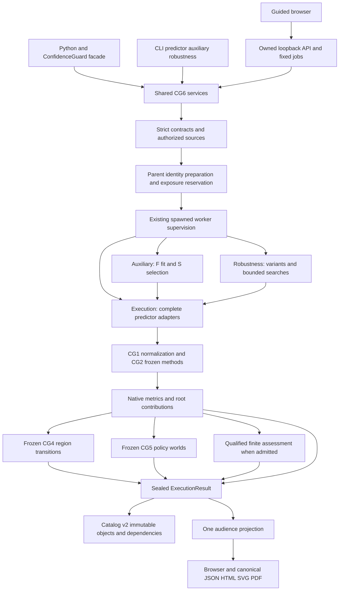
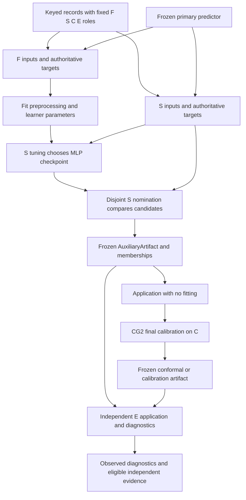
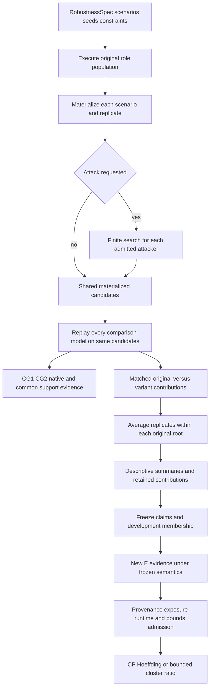
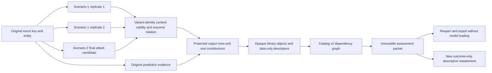
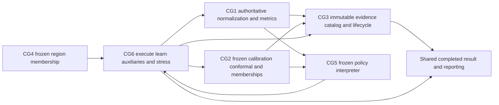

# NUMEK ConfidenceGuard CG6 — Final Corrected Implementation Explainer

**Implementation understanding and knowledge transfer · 8 November 2026**

This document explains the corrected implementation that exists in this repository. It is a teaching document, not a new review, qualification campaign or implementation proposal. **The founder confirmed CG6 is done and accepted on 8 November 2026. CG1–CG6 are complete within their approved scopes.** The R1–R6 correction cycle is closed. Earlier pending-review, pending-understanding and pending-founder-acceptance statements are superseded by that explicit decision. Scientific limitations and pending real NVIDIA hardware qualification remain unchanged.

## Reading guide and source identity

Read sections 1–2 for the mental model, section 3 for source navigation, sections 4–10 for implementation and mathematics, and section 11 for complete journeys. Sections 12–15 explain operational evidence, engineering choices, corrections, and practical boundaries. Section 16 is a glossary and technical question set.

All repository-relative paths below are rooted at `/Users/drivyaanshyadav/Desktop/Numek`. Function names refer to inspected source, not hypothetical interfaces. Numerical examples explicitly described as illustrative are teaching examples, not newly executed experiments.

### The implementation identity was confirmed

The current runtime/assets fingerprint is:

```text
aa72f09caa5bc5b174db5b4253add54a9fba8b3ecec3309c99f0beb0608fbf6a
```

It exactly matches the final R1–R6 identity supplied in the request and recorded in `validation/cg6/review-corrections-r1-r6/source-identity.json`. The check covered **230 files**: every file under `src/` with suffix `.py`, `.js`, `.css`, `.html`, or `.json`. There were **no changed, additional, or missing runtime files** relative to that recorded map.

The fingerprint procedure is the correction closure's procedure: sort the runtime paths, compute each file's SHA-256, serialize the path-to-hash map with sorted keys and compact JSON separators, and hash that serialization. This is a source-tree identity, not a Git commit, model digest, or claim that every historical test ran on this exact tree. Adding this Markdown document does not change that runtime fingerprint.

### Evidence used and how to read its standing

The source basis includes:

- Permanent context: `docs/NUMEK_MASTER_CONTEXT.md`, `docs/CURRENT_STATE.md`, and `docs/ARCHITECTURE.md`.
- Accepted foundations: `docs/CG1_CONFIDENCEGUARD.md` through `docs/CG5_CONFIDENCEGUARD.md`.
- Current CG6 guide: `docs/CG6_CONFIDENCEGUARD.md`.
- Engineering records: `validation/cg6/IMPLEMENTATION_REPORT.md`, `IMPLEMENTATION_STATUS.md`, `SCOPE_AND_EVIDENCE.md`, `VERIFICATION.md`, source maps, closure receipts, scientific receipts, hardware record, performance protocol, and performance summaries.
- The approved **“NUMEK ConfidenceGuard CG6 — Full Revised Technical Plan”** in the user instruction in the chat **“Plan CG6 predictor execution”**, chat ID `01a1af57-4d72-70a3-a9e2-dbd1591b2207`.
- The completed independent review in **“Review CG6 implementation”**, chat ID `01a1b692-cd18-7fc1-b7ad-880f8969d67e`, and the subsequent correction record `validation/cg6/review-corrections-r1-r6/REVIEW_CORRECTIONS.md` and its receipts.
- Actual implementation in `src/confidenceguard/`, relevant unchanged shared runtime code in `src/datatrust/`, and focused tests used to understand contracts and documented counterexamples.

Some older paragraphs in permanent documents still describe review or acceptance as pending. Their dated current-state additions and the user's current instruction establish the present boundary. Historical measurements and acceptance statements are not silently upgraded. In particular, original performance measurements are **historical source-bound observations**, not benchmarks rerun after R1–R6.

After this explainer was produced, living documentation was synchronized to the
founder's acceptance. Sealed correction/closure receipts and their documentation
hashes retain the earlier snapshots; they were not rewritten to match later prose.
The runtime fingerprint and all source-bound verification/measurement limits are
unchanged. The document-only scope described below refers to the original
explainer task; the subsequent authorized documentation update changes no runtime
code, tests or sealed evidence.

`agents/skills/verify/skills.md` was read. Its applicable principles here are source-based verification, proportional checks, and reuse of valid evidence. This task did not rerun the full suite, fit models, repeat simulations, run performance profiles, regenerate reports, or reopen technical review. The new checks concern source identity and this document's completeness and source references only. Production code, tests, existing evidence, and closure artifacts are outside the edit scope.

## 1. Understanding CG6 from first principles

### 1.1 Start with the practical problem

Imagine a team that predicts whether a transaction is fraudulent. They already have a spreadsheet containing a transaction ID, a probability, an issued decision, and a later fraud outcome. They can ask whether predictions were accurate, whether probabilities were overconfident, and whether performance differed by a declared cohort.

Now suppose the team wants to ask a different question: **what happens to this exact model when a merchant field disappears, a numerical amount is rounded, or a text description is misspelled?** The old spreadsheet cannot answer. Someone must construct the changed input, run the actual model and all its preprocessing, recover the new outputs, and compare the same transaction before and after the change.

A regression example makes the auxiliary-model problem clear. A delivery model predicts 30 minutes for two orders. One is a familiar short trip; the other crosses a congested area. A single prediction does not explain whether errors near those inputs are typically two minutes or fifteen minutes. A separate learned error-scale predictor can supply a positive scale that helps an unchanged conformal method build input-dependent intervals. That scale still needs calibration and independent assessment; learning it does not make it a guarantee.

CG6 supplies the execution and controlled-experiment machinery needed for these questions. It connects model behavior to the established evaluation, uncertainty, historical evidence, failure-region, and decision-policy machinery.

### 1.2 What CG1–CG5 already accomplished

| Milestone | Established capability before CG6 | What it needed from outside |
|---|---|---|
| CG1 | Evaluate supplied binary/multiclass probabilities, native scores, hard decisions, regression points, and intervals; preserve authoritative outcomes and denominators | Prediction artifacts |
| CG2 | Fit/apply calibration and conformal methods; separate F/S/C/E; evaluate uncertainty; retain fitted methods and membership evidence | Primary predictions and supplied auxiliary scales/quantiles where required |
| CG3 | Retain immutable projected facts and completed evidence; reconstruct historical/as-of views; handle later outcomes and restatements | Supplied/retained prediction observations |
| CG4 | Discover/investigate failure regions and apply frozen membership with independent confirmation only through admitted methods | Predictions plus declared features/representations |
| CG5 | Replay, select, and independently assess offline decision policies, including capacity and economic constraints | Compatible frozen model outputs and decision-time inputs |

They could study reliability extensively **conditional on supplied predictions**. They did not provide the general CG6 primary predictor executor or its controlled input-variant laboratory. Their limitations remain meaningful: calibration is not universal correctness; conformal coverage is marginal and assumption-dependent; a discovered region is an association; policy replay is hypothetical and does not identify causal business value.

### 1.3 Four activities that are easy to confuse

**Evaluating performance** compares available predictions with eligible authoritative outcomes. For example, CG1 computes error rate, Brier loss, MAE, or interval coverage on explicitly identified populations.

**Executing a model** turns inputs into predictions. This includes everything the producer relies on: column ordering, missing-value handling, categorical encoding, tokenization, image decoding, model weights, output-head selection, class order, and decision rules. Calling a neural network's `forward` method is only one part.

**Stressing behavior** changes declared inputs under a controlled scenario and reruns the complete pipeline. It can reveal a probability change even when the changed input's correct label is unknown. Behavior can be measured without inventing accuracy.

**Assessing operational decisions** runs a frozen policy on those outputs. A probability moving from .79 to .81 may cross a policy cutoff, create a deferral, change workload, or reorder a capacity queue. A large numerical output change may have no action effect if the policy still chooses the same action.

These are separate layers with separate evidence. CG6 connects them; it does not collapse them into a reliability score.

### 1.4 What a predictor execution system means here

A predictor is treated as a **complete, identified inference contract**. A model file alone is insufficient. A classifier with output columns `[fraud, legitimate]` means something different from one with `[legitimate, fraud]`, even if the same numbers appear in memory. An imputer fitted with a median of 10 is different from an imputer fitted with a median of 100. A raw logit is different from a probability.

The execution system admits files and declarations, checks source ownership and identity, prepares keyed inputs, loads an admitted adapter, executes bounded batches, validates named channels, and writes an event-level success/failure ledger. It then sends generated outputs through the same normalization and metric definitions used for supplied predictions.

It is an investigation executor. It is not a persistent model-serving system, a model-training platform for primary predictors, or a security sandbox for arbitrary uploaded programs.

### 1.5 Auxiliary predictors and robustness in ordinary ML terms

An **auxiliary predictor** predicts something useful about the primary prediction process rather than replacing the primary model's task. Implemented examples are conditional absolute-error scale, conditional quantiles of the outcome, and probability of a declared failure. An ensemble also supplies useful variability diagnostics, but its spread is not automatically calibrated uncertainty.

**Robustness testing** asks how an identified pipeline behaves when inputs depart from a chosen reference condition. Useful questions include: Does it reject a missing required feature? Does its confidence rise while errors rise? Does changing a group of correlated fields together expose dependence? Can a bounded attacker find a nearby feasible input that changes the issued decision? Does a frozen policy remain executable under the resulting outputs?

CG6 makes such investigations repeatable by identifying the inputs, transformations, constraints, seeds, outputs, failures, budgets, and retained evidence. It also distinguishes an observed result from an independent statistical claim.

### 1.6 What an engineer or organization can now accomplish

A team can register a trusted classical, ONNX, or Torch predictor; qualify its complete outputs against keyed references; execute original inputs; fit or attach auxiliaries; reuse CG2 calibration/conformal methods; construct matched variants; compare models on the same materialized candidates; inspect region and policy transitions; freeze a question before independent E assessment; and retain/reopen the evidence without running the model again.

That is the transition from **prediction evaluation** to **controlled reliability investigation**. The system can generate the experimental evidence it evaluates, while preserving the scientific and operational qualifications of the earlier milestones.

## 2. Complete architecture and data flow

### 2.1 The three new subsystems and the shared foundation

`confidenceguard.execution` owns admission and complete inference. `confidenceguard.auxiliary` owns restricted auxiliary fitting and frozen application. `confidenceguard.robustness` owns registered experiments, sensitivity, finite attacks, root-level contributions, frozen assessment, and adapters to regions/policies.

The foundation remains shared: `engine.open_store`, `sources.Store`/`method_sources.MethodStore`, `analytics.Evidence`, CG2 method kernels, the existing worker and scratch workspace, catalog v2, owned transport, and completed-result reporting. The analytical packages do not depend on Flask or browser rendering.



The interfaces converge before analysis. The worker supplies the controlled computational boundary; the catalog supplies the durable publication boundary. The boxes for region, policy, and finite assessment are optional consumers, not mandatory work for every prediction.

### 2.2 Predictor execution and evidence generation

```mermaid
flowchart LR
    F[Manifest and captured model files] --> L[Adapter load once per operation]
    Q[ExecutionSpec and source bytes] --> P[PreparedExecution]
    P --> E[Canonical keyed events and clocks]
    E --> H[Frozen preprocessing]
    L --> Y[Framework forward inference]
    H --> Y
    Y --> Z[Bound named outputs and declared postprocessing]
    Z --> O[Channels failures issuance and original outputs]
    O --> D[Generated DuckDB views and protected JSONL]
    D --> N[CG1 normalize and refresh losses]
    N --> M[Native metrics and populations]
    O --> R[Reference and batch parity comparisons]
    M --> S[Sealed result and optional persistence]
    R --> S
```



`PreparedExecution` establishes population identity before prediction. An adapter does not decide who counts as an observation. Normalized channels are retained alongside failures and producer outputs, so a valid probability vector can survive an invalid hard-label channel. Qualification compares the complete observable output contract, not only a raw tensor.

### 2.3 Auxiliary fitting, application, and independent assessment



The arrows show permitted information use. The fitting function receives F/S arrays; it has no C/E accessor. C belongs to the subsequent unchanged CG2 stage, not to CG6 learner training. Standalone auxiliary assessment reports diagnostics and observable non-overlap qualifications; formal uncertainty and robustness claims require their own admitted assessment paths.

### 2.4 Robustness orchestration



The experiment creates one candidate world per scenario/replicate/attacker, then gives that same candidate to the models being compared. An attack against model A and transfer to model B remain distinct from an attack optimized against B. Freezing records development evidence and runtime semantics; E assessment does not edit the scenario family.

### 2.5 Original observations, variants, and persistent evidence



Three variants still descend from one event. The catalog stores experiment-specific objects and dependencies; variants are not silently inserted as new ordinary historical customers. A restatement creates a new result that reuses sealed outputs. It does not overwrite the parent or execute its model.

### 2.6 Integration across CG1–CG6



This is a composition of accepted definitions. CG6 does not introduce a second definition of Brier loss, conformal rank, region membership, policy capacity, or catalog visibility. It supplies new inputs and experiment-specific evidence to those definitions.

### 2.7 Where supervision, devices, and persistence fit

The parent process validates requests, prepares identities through a supervised phase, records exposure before analysis, starts the analytical worker, checks cancellation and result sizes, and optionally publishes through the catalog. The existing daemon worker uses direct framework calls; there is no nested DataLoader process pool or persistent serving worker.

CPU work remains substantial even when Torch runs on MPS/CUDA: source hashing, CSV/Parquet preparation, DuckDB joins, transformation orchestration, normalization, most metrics, evidence serialization, SQLite publication, and report rendering. Device execution is a substage inside the same job. Models and tensors move to the chosen Torch device; ONNX uses explicit execution providers. The report records the requested and realized profile rather than treating “GPU requested” as evidence of actual GPU execution.

Persistence is optional and separate from transient execution. Catalog v2 publishes verified objects atomically. Completed reports read sealed evidence; they do not start prediction, fitting, attack search, or policy optimization.

## 3. File-by-file implementation walkthrough

### 3.1 How the change classification was established

“New” and “modified” here mean relative to the pre-CG6 file/hash inventory in `validation/cg6/implementation_baseline.json`, compared with the corrected current tree. They do not mean “untracked” and “tracked” in Git. The repository was already dirty with accepted milestone work; attributing every current Git modification to CG6 would be incorrect.

All files in the three focused packages below are CG6 additions. Shared modified files are listed separately. Important unchanged dependencies are identified as such. This organization follows responsibility rather than alphabetic order.

### 3.2 Execution declarations, source preparation, and adapters

**`src/confidenceguard/execution/contracts.py` — new; public data and admission contracts.**

`ArtifactFile` binds a safe relative artifact name, local byte location, and SHA-256. `DeviceSpec` distinguishes request kind, precision, fallback, determinism, ONNX placement, index, and memory. `ExecutionLimits` bounds batches, artifacts, variants, tokens, queries, candidates, fits, cache, and retained detail. `OutputBinding` names the analytical channel and producer source, optional indices/classes/quantile levels, activation, score meaning, direction, and discrete mappings.

`PredictorSpec` combines task, ordered `FeatureField` inputs, output bindings, model files, architecture, preprocessing, decision, runtime requirements, and provenance. Its `predictor_digest` excludes file locations and storage retention policy while binding mathematical declarations and file hashes. `ExecutionSpec` combines predictors with sources, event/entity/batch keys, roles, outcomes, cutoffs, auxiliaries, ensembles, and imported CG2 methods. Its validation rejects known identifier/outcome inputs, mismatched tasks/parents, duplicate identities, absent sources, and unsupported versions. R1's attached auxiliary checks live here; `design_fingerprint` adds operation options to the prepared input identity while excluding later reservation metadata.

These contracts are called by every public entry point and transport resolver. They call accepted nested contracts, auxiliary/fitted-method validators, provenance validation, and ensemble admission. They belong outside adapters so invalid declarations can refuse before model loading or independent-evidence reservation.

**`src/confidenceguard/execution/store.py` — new; `PreparedExecution` over the accepted store.**

The constructor creates a neutral `execution_population` declaration, calls `engine.open_store` with a `ReliabilitySpec`, projects every needed input/context/auxiliary field and clock, verifies unique explicit event keys, checks entity role consistency, and creates the output ledger. It does not implement another parser or outcome authority. `capture_external` captures model identities, authorized image assets, and tensor/key files; `validate_model_fields` catches prohibited fields including observable identical-byte outcome aliases.

`events(role)` yields canonical event dictionaries with `event_key`, `entity_key`, `ordinal`, `role`, authoritative `truth`, projected `record`, and `unavailable_fields`. `attach` binds captured assets and aligns admitted non-object NPY rows to unique explicit tensor keys; conflicting matrices for one field refuse. `start_view`, `append`, and `finish_view` construct generated raw relations, explicit `PredictionRunSpec`/representations, output rows, and normalized CG1 views. `finish_view` explicitly replaces any root-label join with each variant's declared truth and refreshes losses. `metrics` invokes accepted reducers and validates population references. `verify` rechecks live captured files before publication; `close` releases scratch state.

Execution, auxiliary, robustness, frozen-method, and restatement workers call this class. It calls `open_store`, source helpers, CG1 normalization, `analytics.Evidence`, and CG2 uncertainty reducers. Its placement makes source/population ownership independent of framework-specific inference.

**`src/confidenceguard/execution/adapters.py` — new; fixed trusted adapter implementations.**

`register_host_predictor` records an importable installed factory, exact source-file hashes, a code digest, gradient capability, and batch-independence declaration. `host_factory` verifies registered code before resolving it. Uploaded model JSON cannot populate that registry. `capture_artifacts` verifies root-authorized files, limits, hashes, copied snapshot bytes, and source stability.

`torch_architecture` constructs bounded built-in MLP/text/CNN networks or an already registered host architecture. `Adapter.__init__` captures bytes, resolves the device, records runtime/source identities, checks package requirements, and calls `_load`. `_load` contains reviewed skops admission, ONNX graph/external-data/provider checks, strict safetensors state loading, or installed custom construction. `numeric` implements the frozen numerical transform; `prepare` handles DataFrames, text tokens, images, and keyed tensors; `predict_raw` performs framework calls; `predict` bounds allocations, synchronizes, and records work; `finish` returns realization evidence and checks ONNX node placement. `normalize_outputs` validates named outputs and builds per-event channels/failures/issuance without silently repairing probabilities.

Workers and auxiliary composites call adapters. Adapters call device helpers, approved optional frameworks, and source protection helpers. Model-format errors, class/order mismatch, changed bytes, untrusted types, unavailable dependencies, malformed outputs, or unsupported gradients have distinct refusal paths. Framework loading belongs here, while population inference stays in the store and metrics.

**`src/confidenceguard/execution/devices.py` — new; device requests and realization evidence.**

`capabilities` reports package versions, host availability, implementation state, and explicitly unestablished qualification. `resolve` translates a `DeviceSpec` into a compatible actual kind and Torch device string. `configure_torch` configures threads, seeds, deterministic algorithms, precision-related behavior, allocator safeguards, and R6's CUDA startup prerequisite. `onnx_options` constructs explicit CPU/CUDA providers. `synchronize`, `memory`, and `check_memory` support measured completion and allocator evidence. Adapters and fitting call this module. Availability never becomes qualification merely because this helper returned a device.

**`src/confidenceguard/execution/batch_admission.py` — new; allocation estimates before materialization.**

`tensor_bytes(adapter,event,prepared)` estimates a row's tensor cost from text token caps, decoded/resized image dimensions, aligned tensor rows, or encoded numeric width/dtype. For composites/ensembles it examines members. `apply_events` calls it before accumulating a batch. Pixel or per-event tensor limits refuse instead of allocating first and hoping supervision catches the result. This is a planning estimate, supplemented by actual allocations and worker controls.

### 3.3 Shared orchestration, derived views, and provenance

**`src/confidenceguard/execution/services.py` — new; the common supervised application boundary.**

`arguments` converts/copies typed declarations, binds registered host code identity, and resolves authorized roots. `service` is the parent coordinator: R1 attaches a direct auxiliary before preparation; R2 repeats frozen assessment admission; idempotent receipts can reopen completed work; a protected staging directory is allocated; `identity_worker` prepares identities; exposure is reserved; `_worker` is supervised; the result is sealed and size-checked; optional `save_result` publishes it.

`_worker` recognizes admitted device failures and, only when allowed, discards partial staging and restarts the whole operation on CPU. `_worker_once` constructs `PreparedExecution`, checks confirmation identity, dispatches auxiliary/robustness work, or loads and applies predictors/derived adapters. `predict_batch` supplies a bounded identity-sensitive cache; `_predict_batch` handles unavailable fields and isolated input rejection. `apply_events` bounds batches, preserves complete coupled batches, records recognized OOM halvings, appends outputs, normalizes views, and invokes frozen CG2 application. `qualify` and `compare_row` compare batch/replay/reference outputs. `make_result` stages full protected predictions/media and constructs the public/private result; `measurement` adds explicit descriptive populations and value states. The public predictor services are thin wrappers.

All interfaces call this module. It owns operation ordering because source checks, exposure, cancellation, and atomic result production must be coherent across every framework and workflow. It does not own the mathematics of fitting or interval construction.

**`src/confidenceguard/execution/ensembles.py` — new; supplied ensemble semantics.**

`validate_ensembles` admits two to sixteen already admitted ordered members and compatible probability decisions. `ensemble_semantics` canonicalizes the fixed complete-common-support arithmetic mean and effective `DecisionSpec` defaults for R2. `EnsembleAdapter.predict_normalized` obtains aligned member outputs, refuses incomplete member support for the combined output, averages points/probabilities, normalizes the combined output, and attaches `variability` diagnostics. `attach_ensembles` adds job-local adapters. Execution and robustness workers call it; it calls the shared predictor/normalizer. There is no learned weighting, stacking, or member-dropout average.

**`src/confidenceguard/execution/frozen.py` — new; unchanged CG2 methods on generated views.**

`apply_frozen(prepared,view)` selects imported artifacts rooted in the view's predictor, temporarily binds a valid CG2 evaluation/representation context, invokes `methods._fit_all` with no new method family, and calls `membership.inspect_imports`. It builds derived execution views carrying calibrated probabilities or conformal outputs, preserves primary channels/failures, restores the surrounding store, and retains method membership checks. Despite the reused function's name, this path supplies frozen artifacts and does not fit missing methods. `apply_events` calls it after each completed base/auxiliary/ensemble view. Keeping it as a bridge avoids reimplementing calibration or conformal inversion in CG6.

**`src/confidenceguard/execution/provenance.py` — new; positive overlap and imported eligibility checks.**

`validate` checks exact declared training-membership hashes and namespace. `assessment_reasons` constructs protected E event/entity identities and propagates known primary overlap through auxiliaries and ensembles. For imported CG2 methods and parent chains it uses the unchanged `assessment_membership_passed` helper; contradicted, unavailable, or missing required membership blocks affected inference. Auxiliary assessment and frozen robustness assessment call it. It does not prove hidden training independence or reinterpret a declaration as a verified history.

**`src/confidenceguard/execution/exposure.py` — new; pre-analysis evidence-use reservation.**

`identity_worker` opens the shared preparation path, enumerates the operation's permitted role population, derives canonical and original-source aliases, verifies sources, and returns a bounded identity packet. `reserve` checks process history and, when enabled, `EvidenceUseLedger` in the authorized workspace; records confirmation, development selection, or outcome disclosure before computation; and returns a reservation plus continuity/overlap qualifications. `service` and restatement call it. Reservation belongs in the parent-owned boundary so a crashed/cancelled worker cannot erase the fact that assessment was attempted.

### 3.4 Auxiliary learning files

**`src/confidenceguard/auxiliary/contracts.py` — new; finite studies and frozen artifact definitions.**

`AuxiliaryCandidate` admits `constant`, `logistic`, `histogram`, `mlp`, and the `mlp_ensemble` convenience form, normalizing the latter to an MLP with five default members. It bounds parameters and member counts. `AuxiliaryStudySpec` binds target, frozen primary, features, candidates, quantile levels, failure threshold, scale floor, S split, and prediction-derived features; it requires explicit roles and limits candidate/fit counts. `AuxiliaryArtifact.create` and `artifact_basis` bind mathematical model specs, target, F/S memberships, selection, and fitting provenance while permitting byte-location rebinding. Constructors validate the digest. Fit/apply services and execution admission call these contracts; they keep scientific target definitions outside framework training code.

**`src/confidenceguard/auxiliary/fitting.py` — new; restricted numerical learner implementation.**

`preprocessing` receives eligible F events and declared fields, derives categorical vocabularies and numerical imputation/standardization, and excludes missing sentinels under R5. `matrix` reuses `Adapter.numeric` so fitting and inference share the transform. `loss` computes squared scale error, mean pinball loss, or Brier loss. `fit` receives F/S frames and targets, never a store or E accessor; fits constants, scikit-learn histogram/logistic models, or Torch networks; chooses MLP checkpoints on S tuning; scores candidates on S nomination; and returns model specs, objective, and training/member records. Errors include no feature/target support, crossing, insufficient S subroles, allocation/batch limits, or nonfinite fitting. `fit_worker` calls it. This narrow API is the main engineering separation between unrestricted prepared evidence and learner optimization.

**`src/confidenceguard/auxiliary/services.py` — new; targets, orchestration, application, diagnostics.**

`target` constructs residual, outcome, or explicit failure targets and returns `None` for unavailable supervised truth. `augment` adds only declared frozen prediction features or vector coordinates. `membership` hashes eligible F/S event/entity membership. `fit_worker` executes the primary on F/S, builds eligible frames, fits preprocessing/candidates, nominates by objective/model count/declaration order, and creates the frozen artifact. `apply_artifact` loads members, aligns frozen primary and auxiliary outputs, and aggregates only complete members. `application_worker` preserves primary outputs, checks observable F/S overlap, constructs the derived application view, and reports scale/quantile/risk diagnostics. `fit_auxiliary`, `apply_auxiliary`, and `assess_auxiliary` call the shared `service`; fitting projects extra fields, and direct application is admitted by R1 before preparation. This file owns lifecycle and target meaning; `fitting.py` owns learner arithmetic.

**`src/confidenceguard/auxiliary/composite.py` — new; reusable attached auxiliaries.**

`AuxiliaryAdapter` wraps one frozen primary and loaded auxiliary members for repeated original/scenario batches. `predict_normalized` enriches decision-time records, evaluates members, checks complete support/crossing, averages the declared auxiliary channel, and retains variance/postprocessing without overwriting the primary score or issuance. `attach_auxiliaries` matches exact parent digests. Execution/robustness workers use it to avoid repeatedly loading an auxiliary for every scenario. It calls shared adapters/prediction and `augment`; it does no fitting.

**`src/confidenceguard/auxiliary/diagnostics.py` — new; tie-safe descriptive failure-risk utility.**

`risk_diagnostics` takes observed binary failure targets and probabilities; groups equal scores; computes AUROC with half credit for ties, threshold average precision, prevalence, and low-risk acceptance/risk-coverage points. Calculations use all eligible data; at most 101 curve points are displayed. Missing class support produces undefined ranking evidence. `application_worker` calls it. These descriptive functions do not create a future-risk guarantee or a new independent-inference engine.

### 3.5 Robustness declarations, transformations, searches, and assessment

**`src/confidenceguard/robustness/contracts.py` — new; experiment, attack, and claim contracts.**

`OPERATIONS` is the fixed transformation registry. `TransformationSpec` binds operation, fields, parameters, constraints, affine relations, stage, and declared realism. `AttackSpec` binds finite algorithm, objective, access, norm, radius, step/restart/query budgets, domains, and constraints. `ScenarioSpec` adds replicates, filters, mixtures, metamorphic expectations, and explicit outcome relations. `RobustnessSpec` binds execution/comparison edges/regions/sensitivity and rejects mutations of identities, roles, outcomes, or undeclared inputs. `RobustnessClaim` admits a finite metric registry and bounds. `FrozenRobustnessProtocol.create` seals the full study, claims, development memberships, sampling, runtime profiles, and family confidence. `RobustnessAssessmentSpec` compares frozen semantics, including corrected ensembles; source locations can change while population/model semantics cannot. `PolicyStressSpec` binds a CG5 application and prevents changed batch ownership. Services and API/CLI constructors call these contracts before execution.

**`src/confidenceguard/robustness/transformations.py` — new; materialized changes and validity.**

`condition` evaluates bounded typed predicates with an unknown result for missing/unavailable inputs. `feasible` enforces immutability, categories, numeric/tensor bounds, integer/grid constraints, and affine cross-field relations; optional repair is recorded and rechecked. `canonical_image` securely decodes captured images. `transform` implements every registered scalar/tensor/text/image operation. `transformed_truth` handles unknown, explicitly label-preserving, exact authoritative-variant, or registered affine/class-map outcomes. `variant` applies ordered transformations with deterministic root/scenario/replicate RNG, computes content-bound identity, and records validity/outcome lineage. `materialized_content` replaces generated image locations by content hashes when identifying a final attack candidate. Robustness orchestration and attacks call this module; it cannot infer whether a domain declaration is scientifically realistic.

**`src/confidenceguard/robustness/services.py` — new; the experiment orchestrator.**

`run_worker` executes original views, attaches auxiliaries/ensembles, materializes scenarios and common attack candidates, evaluates every admitted comparison model, collects native and paired evidence, applies optional region/policy consumers, stages root contributions, and assesses eligible frozen claims. `_output` resolves keyed originals; `_loss` gives the registered per-event error/absolute-error functional; `_metamorphic` evaluates declared output relationships; `_contributions` constructs paired scenario metrics with explicit missingness. Root summaries average replicates in DuckDB and require complete contributing replicates for primary summaries/claims. Mixture summaries retain weighted numerators/denominators and descriptive standing. Public wrappers inspect/run/freeze/assess/stress through shared services. It calls all focused robustness modules and existing reducers. This file owns experiment ordering, while transformations, attacks, and interval kernels remain independently understandable.

**`src/confidenceguard/robustness/attacks.py` — new; finite numeric/tensor/discrete/text search.**

`decision` respects issuance, abstention, and explicit decisions. `objective` computes normal-output objective values and success rules. `search` checks baseline eligibility, reserves a final replay query, validates candidates, accounts for proposals/queries/gradients, searches the declared domain, retains strict best improvements, and finally reexecutes the selected candidate through normal inference. It dispatches image gradients to `search_image`. Numeric gradients use the R4 helper, then the chain rule back to raw units. Unsupported differentiable/discrete paths refuse. The orchestrator calls it for each root/attacker. Search is separate from inference so a finite search result cannot silently become a population or universal robustness claim.

**`src/confidenceguard/robustness/gradient_objectives.py` — new during R4; analytical output binding without graph detachment.**

`bound_channel` selects the exact named Torch tensor, indices, activation, full task class order, or binary complement, and checks scalar/probability shape, finiteness, and validity. `attack_objective` builds the registered point/log-probability/squared-error surrogate. `input_gradient` obtains a finite gradient connected to the input. Numeric/tensor and image attacks share these functions. Missing, detached, hard-only, logits-only, malformed, or nonfinite required analytical paths refuse with `gradient_unavailable`. This is the common fidelity boundary between an attack's differentiation and ordinary output semantics.

**`src/confidenceguard/robustness/image_attacks.py` — new; exact pixel-domain attack replay.**

`search_image` admits a single declared canonical-image field and L-infinity/L2 FGSM/PGD. It decodes/resizes RGB, differentiates declared normalized outputs, maps gradients back through channel scaling, projects within the pixel box/radius, rounds candidates to the actual 8-bit lattice, rechecks exact distance, materializes PNG candidates, and runs normal inference. It charges gradient/evaluation/final work and removes nonselected temporary image candidates. It cannot treat a relaxed floating tensor as an exact stored image witness. `attacks.search` calls it; it calls the shared R4 helper and authorized image transform/prediction paths.

**`src/confidenceguard/robustness/sensitivity.py` — new; local named-output derivative diagnostics.**

`validate` checks named point/logit/probability targets, class selection, root caps, and raw-gradient retention. `diagnose` evaluates admitted continuous Torch paths on a bounded canonical root prefix, computes a named derivative, converts it to raw numerical or canonical pixel units, and retains norm/mean-absolute/raw values or summary-only evidence. It refuses unsupported discrete/text paths and large undeclared raw-gradient retention. It is called by the orchestrator. It is a diagnostic path, distinct from `gradient_objectives.py`'s attack surrogates and final success logic; local derivatives are not causal explanations or global certificates.

**`src/confidenceguard/robustness/inference.py` — new; narrow finite statistical dispatch.**

`assess` receives root contributions, entity/batch identities, one frozen claim, and the frozen family. It applies support floors, genuine predeclared bounds, root/entity dependence checks, and CP versus Hoeffding dispatch selected from metric/design semantics. `cluster_ratio` constructs simultaneous bounded numerator/denominator intervals for independent complete bounded clusters and returns an event-weighted ratio only when the denominator lower bound is positive. The orchestrator calls it after provenance/exposure/runtime admission. It reuses `confirmation.binomial_interval` and `bounded_interval`; it does not enable the historically unqualified general bootstrap methods.

**`src/confidenceguard/robustness/regions.py` — new; CG4 frozen membership adapter.**

`validate_region` checks the frozen artifact and decision-time field bindings. `membership` normalizes typed features, binds optional vectors and availability, then invokes `investigation_membership.apply`. `transitions` compares original and transformed ternary membership in batches and reports member/nonmember/unavailable transitions with the artifact digest. No learner is trained or boundary rediscovered. Keeping this adapter separate preserves CG4's membership semantics inside a new experimental context.

**`src/confidenceguard/robustness/policy.py` — new; CG5 complete-world replay adapter.**

`run_policy_stress` requires an already bound frozen policy and materialized inputs, maps each scenario's generated runs into the declared CG5 input contract, includes already applied frozen uncertainty views where required, constructs `PolicyStore`, binds the exact policy, and calls `Interpreter.apply`. It computes unchanged CG5 metrics/constraints and action changes from the original world, reports capacity availability, and restores the surrounding store. Missing runs/methods or incompatible bindings refuse. It performs neither policy selection nor rebinding to make an incompatible world appear compatible.

### 3.6 Evidence, storage, reopening, and outcome restatement

**`src/confidenceguard/execution/result.py` — new; `ExecutionResult`, `ExecutionShared`, and disclosure.**

`ExecutionResult.from_dict` validates version/methodology, protected result/manifest binding, nested execution/artifact/protocol contracts, and supported stage; a shareable import validates its projection digest and remains shareable. `to_dict` produces CG6's deliberately conservative audience projection, aliases identities, jointly withholds dependent rare evidence, and withholds formal claim conclusions while retaining allocations where projected. `resolve_evidence` verifies the retained output artifact before locating a bounded witness and only reveals values explicitly. `retained_path` and `resolve_retained_assets` rebind immutable object locations after workspace relocation. Standard sealing and artifact generation are inherited from `EvaluationResult`. All interfaces and the catalog use this class. It contains reporting semantics, not model loading.

**`src/confidenceguard/execution/storage.py` — new; catalog-v2 persistence.**

`save_result` begins a parent-owned catalog operation, stages prediction/contribution/media/model/auxiliary bytes through `EvidenceWriter.add_blob`, verifies expected hashes, records dependencies including parent/reservation objects, seals the relocated manifest, writes the assessment packet, and commits atomically. It refuses catalog v1 rather than performing an implicit migration. Copy is the default; reference-only models record external dependencies. `retained_predictor` reconstructs an executable descriptor using retained paths without loading its model. Workspace/public services call these helpers, which reuse catalog and packet machinery rather than adding tables.

**`src/confidenceguard/execution/artifact_bytes.py` — new; byte-integrity checks for retained objects.**

`verify_artifact` captures an authorized retained file and compares its content hash/size. Retention can change inode/signature, so this deliberately distinguishes immutable byte identity from a live source's signature. Bridge, evidence resolution, and restatement call it. It never deserializes a model.

**`src/confidenceguard/execution/bridge.py` — new; completed evidence to CG1/CG2 contracts.**

`as_evaluation_spec` verifies the complete output artifact, chooses one or two completed views, writes protected no-replace CSVs (and sample sidecars where needed), propagates admitted source fields/clocks including R1's extra auxiliary fields, preserves channels/issuance/truth, and blanks F/S rows already used by auxiliaries from downstream fitting roles. Known contaminated C/E rows refuse. `as_reliability_spec` adds explicit `cg6_role` and representation declarations. Callers are Python, CLI, API, and downstream CG2/policy workflows. `outputs_and_recipes` cannot use this exact-input bridge. It exports completed evidence; it does not execute the predictor or redefine uncertainty methods.

**`src/confidenceguard/execution/restatement.py` — new; model-free later-outcome evaluation.**

`ExecutionRestatementSpec` binds new sources, authoritative outcomes, reason, and optional as-of clock. `inspect_restatement` fingerprints parent binding plus new outcome files. `restate_execution` validates protected evidence, retention, roots, idempotency, and inherited exposure, then supervises `_worker`. The worker reconstructs frozen input records and all admitted fields/clocks, reuses sealed channels/variants/uncertainty, replaces eligible root-linked truth, applies registered outcome transforms where declared, and recomputes native metrics. Unknown transformed truth stays unknown; exact authoritative variant labels stay with their sealed identity. New results have no reissued claims. No adapter/model/search is loaded. This separation makes new labels a new evidence statement rather than a hidden new model execution.

**`src/confidenceguard/execution/legacy.py` — new; explicit operator trust conversion.**

`convert_legacy_predictor` supervises `_convert`, which requires exactly one sklearn predictor and exact operator-trusted pickle/joblib SHA-256, loads those executable bytes through joblib, writes skops, records conversion provenance, and admits the converted artifact through the normal adapter. Python/CLI can invoke it. Browser/API jobs cannot. Conversion does not make untrusted code safe.

### 3.7 Interfaces, schemas, assets, and package exports

| File | Change | Important responsibility, callers, and boundary |
|---|---|---|
| `src/confidenceguard/execution/cli.py` | New | `register` adds predictor/auxiliary/robustness groups; `relative` resolves local operator paths. Commands call the same services and result artifact methods. Includes bridge, freeze, restate, protected auxiliary descriptor export, and explicit legacy conversion. Errors become Click errors; no CLI analytical engine. |
| `src/confidenceguard/execution/web.py` | New | `register` installs owned routes and fixed `KINDS`; nested resolvers convert opaque source/model/auxiliary/method/protocol handles to typed declarations. `submit` enforces workflow-kind compatibility, revisions, inspected fingerprints, idempotency, worker locking, grants, cancellation, and result ownership. `handles` rebinds retained artifacts. Imported paths never grant access. |
| `src/confidenceguard/execution/schema.py` | New | `extend`, `paths`, `examples` add strict contract definitions, handle-based transport forms, fixed job declarations, and synthetic examples to the existing schema surface. Constructors remain the executable semantic authority. |
| `src/confidenceguard/execution/__init__.py` | New | Exports execution contracts/services, result, registration, bridges, restatement, and legacy conversion. No analytics. |
| `src/confidenceguard/auxiliary/__init__.py` | New | Exports candidate/study/artifact and fit/apply/assess services. |
| `src/confidenceguard/robustness/__init__.py` | New | Exports scenario/attack/protocol/policy-stress contracts and public experiment services. |
| `src/confidenceguard/static/execution-panel.html` | New | Guided model, auxiliary, scenario, assessment, restatement, evidence, and export controls; supplements complete JSON authoring. It declares requests rather than calculations. |
| `src/confidenceguard/static/execution-client.js` | New | Builds contracts/handle bindings; invalidates stale inspection after edits; submits/polls fixed jobs; displays qualification/measurements; pages outputs; imports/freezes/reopens evidence; exports/cancels through the shared host. Browser functions such as `baseSpec`, `run`, `display`, and `more` do no metrics or fitting. |
| `src/confidenceguard/templates/execution_sections.html` | New | Canonical stage, hardware, parity, scenario, claim, auxiliary, policy-world, and qualification sections from the projected result. It does not execute analysis. |
| `src/confidenceguard/__init__.py` | Modified | Exposes CG6 types/functions and adds matching static methods to `ConfidenceGuard`. |
| `src/confidenceguard/cli.py` | Modified | Registers the CG6 command groups alongside accepted groups. |
| `src/confidenceguard/workspace.py` | Modified | Adds `_cg6_service`, matching execution/auxiliary/robustness/stress/restatement facades, CG6 `save_assessment` dispatch, and retained protocol freeze/open via existing packets and dependencies. |
| `src/confidenceguard/transport.py` | Modified | Routes CG6 fixed job kinds to `confidenceguard_execution_submit` and registers the CG6 routes inside existing ownership/CSRF/session machinery. |
| `src/confidenceguard/policy_web.py` | Modified | Exposes the existing owned policy resolver for CG6 policy stress and resolves owned frozen method handles/sidecars. Reuses CG5 contracts. |
| `src/confidenceguard/result.py` | Modified | Dispatches execution-result schema reopening to `ExecutionResult`; accepted result classes remain intact. |
| `src/confidenceguard/artifacts.py` | Modified | Includes CG6 in shareable-export rules that avoid protected bundles; reuses canonical projection/render/publication. |
| `src/confidenceguard/templates/report.html` | Modified | Includes CG6 sections and scoped presentation rules; shared metric/report rendering remains authoritative. |
| `src/confidenceguard/static/index.html` | Modified | Loads/hosts CG6 browser navigation and assets inside the existing workbench. |
| `src/confidenceguard/schema.py` | Modified | Calls execution schema extension, publishes paths/examples/capability metadata. |
| `src/confidenceguard/schemas/contracts.json` | Modified | Bundled generated strict data-contract metadata including CG6. |
| `src/confidenceguard/schemas/openapi.json` | Modified | Bundled generated API route/job metadata including CG6. |
| `src/confidenceguard/schemas/examples.json` | Modified | Bundled synthetic CG6 request examples, not verification outcomes. |
| `src/confidenceguard/feature_storage.py` | Modified | Adds `opaque_artifact_bytes_v1` → `.cgblob` to existing codec extension dispatch; vector/typed-feature codecs stay separate. |
| `src/confidenceguard/history_storage.py` | Modified | Adds `EvidenceWriter.add_blob`; verifies descriptor/object consistency, keeps binary objects out of fact decoding, reopens CG6 packets, and extends dependency/deletion closure over owned binary descendants. Existing catalog publication/lifecycle remains authoritative. |
| `src/confidenceguard/investigation_storage.py` | Modified | Extends bounded `write_packet`/`read_packet` kinds to `robustness_protocol`; CG6 assessment uses the existing assessment packet kind. Large canonical JSON packets can be chunked; model bytes are separately streamed blobs. |
| `pyproject.toml` | Modified configuration | Adds admitted `cg6` and `cg6-cuda` optional runtime sets; package data already includes the new static/templates/schemas. Actual versions/host qualification are separate. |

`constraints/cg6-runtime-macos-arm64-py312.lock`, `constraints/cg6-runtime-macos-arm64-py313.lock`, and `constraints/cg6-runtime-linux-x86_64-cuda-py313.lock` are the new exact runtime qualification/candidate locks. They are reproducibility inputs, not proof that every listed platform executed. `setup.py` is unchanged relative to the CG6 baseline. The source comparison finds no CG6 modification to `src/datatrust/`.

### 3.8 Important unchanged dependencies and why they matter

| Existing file(s), unchanged by CG6 | Actual reused responsibility |
|---|---|
| `src/confidenceguard/engine.py` | `open_store` performs secure admission, projected ingestion, normalization, scratch setup, and cleanup. |
| `src/confidenceguard/sources.py` | `records`, `key`, `rows`, `Store.normalize`, outcome/context preparation, and `refresh_losses` preserve keyed identity, probability/issuance/outcome semantics. |
| `src/confidenceguard/analytics.py` | `Evidence`, `evaluate_scope`, `distributions`, `compare`, and population validation supply established native and common-base metrics. |
| `src/confidenceguard/contracts.py` | Accepted task, source, decision, outcome, comparison, clock, disclosure, and evaluation configuration contracts. |
| `src/confidenceguard/compat.py` | Adapts existing worker, secure file capture/open, clocks, scratch workspace, bounded insertion, publication, and PDF helpers. |
| `src/datatrust/worker.py`, `src/datatrust/scalable.py` | Spawned daemon supervision, sampled RSS/deadline/disk controls, termination backstop, and scratch work checks. Trusted-code isolation is not added. |
| `src/datatrust/image_assets.py`, `src/datatrust/text_private.py` | Root-authorized secure capture/open and protected directories. |
| `src/confidenceguard/method_sources.py`, `method_contracts.py` | MethodStore role/representation relations and CG2 declarations. |
| `src/confidenceguard/methods.py`, `calibration.py`, `conformal.py`, `uncertainty.py` | Frozen method application, authoritative calibration/conformal ranks/inversion, and uncertainty losses/coverage/efficiency. |
| `src/confidenceguard/fitted.py`, `membership.py` | Fitted-method compatibility and exact imported membership eligibility, including upstream chains. R3 changes the CG6 caller, not these accepted helpers. |
| `src/confidenceguard/feature_contracts.py`, `features.py` | Typed fields, exact normalization, and decision-time availability semantics. |
| `src/confidenceguard/investigation_membership.py` | `MembershipArtifact` and `apply` implement frozen ternary region membership. |
| `src/confidenceguard/confirmation.py` | Existing exact binomial and Hoeffding kernels reused by CG6's finite inference dispatch. |
| `src/confidenceguard/evidence_use.py` | Protected source/canonical aliases, session overlap, durable use ledger, continuity, and reservations. |
| `src/confidenceguard/policy_contracts.py`, `policy_store.py`, `policy_runtime.py` | Frozen policy/input validation, compatible materialization, `Interpreter`, capacity, unknown/tie/action semantics. |
| `src/confidenceguard/policy_metrics.py`, `policy_optimization.py`, `policies.py` | Registered metric/constraint reducers, metric collection, and `_application_study` used for fixed replay; CG6 does not invoke optimization. |
| `src/confidenceguard/history_capture.py`, history selection/reconstruction modules | Accepted projected-fact and historical authority semantics; CG6's experiment objects complement rather than replace them. |
| `src/confidenceguard/disclosure.py`, `private.py` | Existing accepted-result disclosure/private evidence boundaries; CG6 has its own conservative result projection and uses shared rendering/publication. |
| `src/datatrust/renderer.py`, `src/datatrust/pdf.py` | Collision-safe publication and restricted HTML-derived PDF through `compat`. |

For navigation: begin with the contract, then the public service, then the worker, then the focused algorithm, and finally the result/storage consumer. That order reveals both what the caller promised and what actually executed.

## 4. Predictor execution in depth

### 4.1 Admission, registration, qualification, and execution are different operations

`inspect_predictor` prepares and verifies sources, identities, planned roots, effective declarations, capabilities, and device resolution. It does not load a model or execute forward inference. An inspection fingerprint binds the prepared sources, specification, configuration, outcome snapshot, and operation design where present.

`register_predictor` loads/admit-checks the complete declared predictor and returns registration evidence/handles, optionally retained in a workspace. It does not prove prediction parity or predictive usefulness. Registration is an operation over the supplied execution declaration, not an unrestricted system-wide model-plugin installation.

`qualify_predictor` executes the corpus and replays it to test batch behavior, and optionally compares external reference rows. `execute_predictor` executes and evaluates without representing the operation as that parity qualification. No external reference means reference parity is `not_supplied`, even when actual execution and batch checks succeed.

Every path goes through strict constructors and `service`. Browser workflows additionally require an inspected revision/fingerprint before action. Python can execute directly; the internal identity phase still binds what is about to run.

### 4.2 A complete classical classification example

Suppose a trained sklearn pipeline contains a numeric imputer, categorical preprocessing, and logistic classifier. The teaching example has inputs `amount` and `merchant_type`, task order `[legitimate, fraud]`, and producer class order `[fraud, legitimate]`.

1. The operator saves an admitted `.skops` artifact and supplies its exact SHA-256 in `ArtifactFile`. `PredictorSpec.inputs` declares the ordered source columns and missing values. The fitted sklearn pipeline owns its already fitted internal preprocessing; CG6 does not refit an imputer or encoder while applying it.
2. `ExecutionSpec` binds transaction keys separately from entity/batch keys and supplies the authoritative outcomes. IDs, role columns, outcomes, and known retrospective fields cannot be model inputs. Declared clocks require a cutoff.
3. `PreparedExecution` uses accepted source ingestion, derives unique canonical keys, resolves truth, projects required fields/clocks, and verifies sources. A duplicated/missing event identity refuses the execution population rather than silently dropping observations.
4. `Adapter._load` scans skops types against its reviewed policy. It admits only standard sklearn model families and task compatibility. If `feature_names_in_` exists, its exact order must equal the declared input columns.
5. `prepare` constructs an ordered DataFrame, converts declared numerical fields, and maps declared missing values to NaN. The loaded pipeline performs its own frozen imputation/encoding.
6. Bind `probabilities` to producer source `predict_proba` with classes `[fraud, legitimate]`; bind a supplied hard `prediction` to `predict` when desired. The probability binding must match the estimator's actual `classes_`. Simply declaring the opposite order produces `predictor_class_mapping` refusal.
7. If the producer returns `[.8,.2]`, `normalize_outputs` maps it to task order `[.2,.8]`. Any requested sigmoid/softmax must have been explicitly declared as part of the probability binding; no implicit probability conversion occurs.
8. A valid supplied label takes priority. If there is no supplied label, an explicit `DecisionSpec` can derive an argmax or inclusive threshold decision with declared tie behavior. A probability vector alone does not silently become a decision.
9. `PreparedExecution.append` writes the generated channels/state and protected producer outputs. `finish_view` invokes CG1 normalization, refreshes losses against authoritative truth, and makes native metrics available.
10. Qualification compares these complete normalized rows by predictor and canonical event key against producer reference rows and singleton/batch replay. The result preserves parity details and runtime evidence. Native metrics then describe eligible outputs/outcomes, not all possible deployment traffic.

**Illustrative result:** for authoritative label `fraud`, the mapped probability .8 has log loss `−log(.8) ≈ .2231`. That arithmetic does not establish that the pipeline's learned probabilities are well calibrated across a population.

The following is an **illustrative local script shape**, not a newly run example. It assumes the named files already exist and that the trained pipeline's actual class order is `('fraud','legitimate')`. The main guard matters because the shared worker uses multiprocessing spawn.

```python
from pathlib import Path
import hashlib
from confidenceguard import (
    ArtifactFile, DecisionSpec, ExecutionSpec, FeatureField, OutputBinding,
    OutcomeSnapshotSpec, PredictorSpec, SourceSpec, TaskDefinition,
    inspect_predictor, execute_predictor,
)

def main():
    model_path = Path('/authorized/models/fraud.skops')
    sha = hashlib.sha256(model_path.read_bytes()).hexdigest()
    task = TaskDefinition(
        'binary_classification', 'Observed fraud',
        classes=('legitimate', 'fraud'), positive_class='fraud',
    )
    predictor = PredictorSpec(
        id='fraud_model', task=task, adapter='sklearn',
        inputs=(
            FeatureField('amount', 'amount', 'float', role='model_input'),
            FeatureField('merchant_type', 'merchant_type', 'categorical',
                         role='model_input'),
        ),
        outputs=(OutputBinding(
            'probabilities', source='predict_proba',
            classes=('fraud', 'legitimate'),
        ),),
        files=(ArtifactFile(model_path.name, str(model_path), sha),),
        entry=model_path.name,
        decision=DecisionSpec(rule='probability_threshold', threshold=.8),
    )
    spec = ExecutionSpec(
        predictors=(predictor,),
        sources=(SourceSpec('events', '/authorized/data/events.csv'),),
        input_source='events', key_columns=('event_id',),
        namespace='fraud-events-v1',
        outcomes=OutcomeSnapshotSpec('events', 'outcome', ('event_id',)),
    )
    roots = ('/authorized/models', '/authorized/data')
    preview = inspect_predictor(spec, allowed_roots=roots)
    result = execute_predictor(
        spec, allowed_roots=roots,
        expected_fingerprint=preview['fingerprint'],
    )
    result.generate_artifacts('/new-output/fraud.html', audience='shareable')

if __name__ == '__main__':
    main()
```

This example explicitly derives a threshold decision because it supplies only probabilities. To preserve the producer's own hard decision instead, bind its `predict` output as `prediction`. A supplied decision takes priority; changing the hard-output/derivation contract is a real semantic choice, not a display preference. For qualification, call `qualify_predictor` with keyed complete reference rows and frozen tolerances instead of describing this execution as a parity check.

### 4.3 Exact adapter support and loading boundaries

The sklearn final-estimator allowlist contains `LinearRegression`, `Ridge`, `Lasso`, `ElasticNet`, `LogisticRegression`, `SVC`, `LinearSVC`, `SVR`, `LinearSVR`, decision trees, random forests, ExtraTrees, and histogram gradient boosting classifiers/regressors. A pipeline may contain admitted standard preprocessing, but every arbitrary serialized sklearn-like object is not supported. Output methods must actually exist and be one of `predict`, `predict_proba`, or `decision_function`. Binary decision-function orientation is checked against positive-class semantics where bound as a scalar event-ranking score.

Skops' untrusted-type inventory is not copied wholesale into a trust list. The extra reviewed types are narrowly named in `_load`; arbitrary types refuse. An estimator family being admitted does not guarantee every producer pipeline and runtime combination works without qualification.

ONNX loading reads graph metadata without first loading external data. It inspects nested messages/nodes/functions, rejects custom operator domains, requires safe enumerated external-data locations, and validates offsets/lengths against captured bytes. It creates an ORT session with explicit thread/provider choices and profiling, disables implicit runtime fallback, and checks actual providers. Input tensor names must match the graph inputs; dtype/shape compatibility is enforced by preparation and the runtime. Outputs bind actual graph output names. There is no automatic sklearn-to-ONNX conversion or download of custom operators.

Torch uses **safetensors state dictionaries plus architecture construction**, not uploaded pickled whole Python modules. Built-in architecture choices are bounded MLP, a small CNN, and an embedding/mean-pooling text model. Their dimensions, hidden widths/depth, and decoded parameter allocations are admitted. A host architecture uses an already installed registered factory. State loading is strict, so missing/unexpected weights or dimension mismatches fail. Weights load on CPU before explicit model placement and evaluation mode. This is broad enough for the implemented workflows but is not universal arbitrary `.pt`/`.pth` compatibility.

Custom execution uses an installed importable factory referenced by registration ID. Registration binds its source file and optional code files, code digest, gradient declaration, and batch behavior; runtime evidence records environment identity and can enforce declared package versions. The custom object supplies `.predict` under the same named-output contract. Uploaded manifests cannot choose an arbitrary module path, source file, or remote code. Continuous attacks are admitted through the actual Torch differentiable paths, not through a generic custom `.predict` promise.

The constant adapter is useful for baselines, fixtures, and dependency-light execution. It is CPU-compatible and produces declared fixed outputs. Its presence does not imply a persistent serving service.

### 4.4 Inputs and preprocessing are part of model meaning

For a numeric adapter, `numeric` visits declared fields in order. Missing values become NaN; declared categorical vocabularies become one-hot columns plus an unknown bucket; numerical fields become floats. Frozen `fill`, `mean`, and positive `scale` arrays are then applied:

\[
u_j = \frac{\operatorname{fill}(x_j)-\mu_j}{s_j}.
\]

All resulting numbers must be finite. These arrays are supplied/frozen at application time. CG6 auxiliary fitting can estimate them on F, but an ordinary prediction call cannot learn them from new application data.

For sklearn tabular input, the DataFrame preserves names/order and pipeline behavior. For sklearn text input, the declared text column is passed to the trained pipeline. For Torch/ONNX text, a captured offline tokenizer produces fixed-width `input_ids` and `attention_mask`, with padding ID, maximum token count, token-work budget, and truncation evidence. The built-in text network pools masked embeddings. This is targeted offline classification/regression execution, not an unrestricted generative-LLM evaluator.

Images are captured within allowed roots, decoded under pixel limits, EXIF-oriented, converted to RGB, optionally resized, scaled to `[0,1]`, normalized by declared channel mean/scale, and transposed to channel-first tensors. Decoded/model pixel coverage is recorded. Image corruption and pixel attacks have explicit stages; neither an image path nor a decoder silently grants arbitrary filesystem access.

Prepared fixed vectors use admitted C-order floating NPY matrices with object deserialization disabled. The source validator checks bounded headers, dimensionality, dtype, bytes, and row count. Explicit unique key metadata aligns vector rows to canonical events; file row order alone cannot align unrelated sources. A transformed tensor must retain the original shape and finite values. This is fixed-representation support, not encoder fine-tuning.

### 4.5 Output channels and availability semantics

| Channel | Meaning and validation |
|---|---|
| `prediction` | Discrete class label, optionally explicitly mapped from producer strings; must belong to task classes |
| `point` | One finite regression scalar |
| `probabilities` | Explicit class order, complete normalized task vector or admitted binary single-event probability plus complement; finite, within `[0,1]`, sum within tolerance |
| `logits` | Explicit class-aligned raw logits; not automatically probabilities |
| `score` | Native scalar or explicitly comparable class scores with direction and meaning; no automatic calibration |
| `scale` | Positive finite auxiliary scale; optional frozen floor is a recorded postprocessor |
| `quantiles` | Explicit strictly increasing levels and ordered finite values; crossing refuses unless declared rearrangement is enabled |
| `samples` | Finite predictive draws; draws do not become independent events |
| `issuance` | Declared issued/abstained/failed/missing state, optionally mapped |
| `risk` | Auxiliary failure probability in `[0,1]`, distinct from primary score/probability |

`OutputBinding.source` chooses the producer output; `indices` selects columns before processing; activation applies only when explicitly declared on probabilities; class reordering then maps to the task. `original_outputs` preserves the bound producer values, including tagged nonfinite states. Postprocessing records preserve floors/rearrangements and their original values.

Malformed batch alignment or absent bound producer outputs are operation-level output-schema failures. Per-row invalid numerical channels become `channel_failures` while other valid channels remain. An invalid probability is not clipped, renormalized, or replaced by a hard prediction. A hard label can remain usable while its probability is invalid, and latent probabilities can remain useful under abstention. CG1's final normalized issuance/decision remains authoritative.

Expected input rejection is different from an unexpected runtime crash. A batch-independent model's ordinary input rejection can be isolated to individual rows. Coupled custom batches cannot be split this way: one invalid required member can make the complete batch unavailable. Unrecognized framework exceptions abort the operation and publish no completed analytical result.

### 4.6 Batching, reuse, and parity

`apply_events` batches by tabular/modality row caps, estimated tensor bytes, and record bytes. Defaults are 1,024 tabular rows and 32 text/image items, with one-at-a-time images when no fixed size is declared. Actual tensor bytes are checked again after preparation. Models load once for an operation and are reused across its batches/scenarios, except recorded restarts. Separate registration, qualification, and execution operations each have their own lifecycle.

The bounded LRU cache applies to admitted pure deterministic profiles such as built-in Torch/sklearn/constant paths. Its identity includes predictor digest, realized device/index/precision, record content, relevant tensor event identity, and unavailable fields. It preserves proposal accounting even when repeated content reuses inference. It is disabled for qualification so the replay test does real work. Custom/batch-dependent behavior does not inherit inappropriate cache assumptions.

Qualification uses exact equality for execution state, decision, issuance, channel-failure mapping, and channel inventory. Numerical channels use:

\[
|a-b| \le \text{atol} + \text{rtol}|b|.
\]

Public defaults are `atol=1e-6`, `rtol=1e-5`; actual CPU/MPS checks use explicit device tolerances such as `1e-5`/`1e-4`. A hard decision crossing a cutoff still fails behavioral parity even if probabilities are numerically close. Batch-independent models are compared with singleton replay; explicitly coupled custom models replay complete declared batches. Reference rows are keyed, and absent/mismatched required reference rows fail reference parity.

### 4.7 Identity and reproducibility

The **predictor digest** identifies weights/files by content, architecture/code binding, preprocessing, task/output/decision declarations, and provenance; moving copied bytes does not change it. The **runtime realization** identifies packages, Python/platform, implementation hashes, device/provider, precision/determinism, batches/retries, and observed placement. The **execution fingerprint** additionally binds source bytes, specification, configuration, and operation design. The **result binding** seals analytical data and private manifest. Experiments and frozen protocols have their own design/content identities.

Separating these answers a useful question: “Did we run the same mathematical predictor under a different runtime?” It also prevents a moved model path from being mistaken for changed weights, or a passed old CPU result from being presented as a new CUDA result. Seeds and deterministic settings improve reproducibility inside admitted profiles; they do not promise universal bit-for-bit equality across libraries or hardware.

## 5. CPU, MPS, and CUDA execution

### 5.1 What the hardware terms mean

A **CPU** executes general-purpose control flow and numerical work. A **GPU** performs many numerical operations in parallel, especially dense tensor arithmetic. A framework still needs a backend that turns its operations into work for the available GPU.

**CUDA** is NVIDIA's computation platform and the associated backend used by Torch/ORT on compatible NVIDIA hardware. **MPS**, in this implementation, is PyTorch's Metal backend for Apple's GPU stack. An Apple M4 Mac can execute MPS; it does not acquire NVIDIA CUDA by installing a CUDA Python package. The retained Mac record has `cuda_build: null` and real MPS availability.

PyTorch exposes devices such as `cpu`, `mps`, and `cuda:0`. ONNX Runtime instead chooses **execution providers** for graph nodes. CG6 implements CPU and CUDA ORT providers; it does not treat MPS as an ORT provider. Optional CoreML discussion in the plan is not an implemented or qualified replacement for required Torch MPS support.

### 5.2 Actual selection and placement

CPU is the explicit default. `auto` resolves available compatible CUDA, then MPS, then CPU. Compatibility is adapter-specific: sklearn/constant remain CPU; ONNX auto does not choose MPS; Torch/custom can resolve a supported GPU profile. Explicit unavailable or incompatible device requests refuse unless `allow_cpu_fallback` was selected.

For Torch, `configure_torch` configures the admitted environment, safetensors load on CPU, and the model moves to the realized device/dtype. `predict_raw` places floating inputs on that same device using the declared precision; integer token IDs remain integer tensors. Forward prediction uses `.eval()` and `torch.inference_mode()`. Training and admitted attacks deliberately retain gradients. CPU DataFrames, tokenization, image decode, and most evidence processing remain outside the GPU.

For ONNX, `onnx_options` sets provider device index, memory limit, copy behavior, and TF32 setting. Strict CUDA disables CPU EP fallback and later refuses observed CPU graph-node execution. Explicit hybrid mode permits CPU provider participation and records mixed placement. Provider initialization and actual profiled node execution are separate evidence.

### 5.3 Inference, gradients, and auxiliary training

Forward inference computes outputs without storing a backward graph. A gradient computes how a selected differentiable output/objective changes with inputs or parameters. Auxiliary training uses parameter gradients to update the auxiliary model; FGSM/PGD uses input gradients while keeping primary weights fixed.

The MLP learner uses Torch on the selected backend; histogram/logistic learners use bounded CPU thread pools. Attached auxiliary ensembles may therefore combine a GPU primary/MLP with CPU histogram members, and the realization identifies member devices. A single “MPS selected” flag does not mean every stage executes on MPS.

### 5.4 Numerical behavior, precision, and deterministic startup

`DeviceSpec` admits `float32`, `float64`, and `float16`; MPS float64 is explicitly refused. Float32 is the required qualified GPU profile. A selectable float16 dtype is not automatic mixed-precision training, AMP, dynamic loss scaling, or proof of a separately qualified half-precision workflow.

`configure_torch` sets bounded CPU threads, seed zero for execution, and `torch.use_deterministic_algorithms` according to the request. Fitting then sets each candidate/member seed. CUDA configuration selects the index, seeds CUDA, disables cuDNN benchmarking and TF32, and records deterministic settings. Unsupported deterministic operations can refuse rather than silently relaxing the request. MPS implicit CPU fallback through `PYTORCH_ENABLE_MPS_FALLBACK=1` is refused; fallback must be an explicit CG6 profile.

R6 adds the precise deterministic CUDA startup contract: **the operator must set `CUBLAS_WORKSPACE_CONFIG=:4096:8` or `:16:8` before process startup**. The helper validates that setting before its own seeding/device/allocation calls, records it, and refuses absent/invalid values with `device_profile`. It does not change the environment after a caller might already have initialized cuBLAS. It cannot retroactively prove when some unrelated caller initialized CUDA; this is an operator startup prerequisite. The refusal is not converted into a CPU restart that silently disables deterministic requirements.

Floating operations can still differ by backend, reduction ordering, and library implementation. Same-weight parity checks use frozen tolerances. Matching optimizer trajectories, learned weights, or fixed predictive improvement seed by seed across CPU/MPS is not required or claimed.

### 5.5 Memory, OOM, fallback, and cancellation

Tensor allocations are batch-bounded. The implementation records CUDA allocated/reserved/peak allocated bytes where available and MPS allocated/driver bytes. Torch per-process allocator fractions are safeguards, not OS-enforced hard quotas. MPS driver allocation and RSS overlap on unified memory, so their sum is not exact total physical use. ORT provider limits/profile evidence do not establish complete device-wide telemetry.

Recognized inference OOM can cause at most three recorded batch halvings under `max_inference_retries`; complete coupled batches cannot be silently split. Auxiliary training does not silently alter batch size, because that changes the optimization procedure. A declared training batch exceeding admission refuses.

When permitted device fallback is needed, `_worker` identifies allowed device errors/recognized OOM/unsupported device operations, discards partial staged outputs/checkpoints, and restarts the **whole operation** on CPU. A fit restarts from its initial state, including candidate training and S selection. A result does not silently splice half GPU and half CPU execution as one homogeneous run. Load-time compatible per-adapter fallback is also recorded. An arbitrary model/schema/profile failure is not a blanket excuse to retry on CPU.

The existing parent supervisor samples worker RSS and disk, checks deadlines/cancellation, and terminates then kills an unresponsive worker if needed. Framework synchronization makes completion/timing meaningful. Resource checks may overshoot between samples; cancellation is a supervised operation boundary, not a hard realtime GPU interrupt. No completed result is published for failed/cancelled work before commit. Exposure reservations survive interruption.

### 5.6 Implemented versus qualified hardware

| Capability | Implementation | Actual evidence boundary |
|---|---|---|
| CPU adapters and fitting | Implemented | Real Mac CPU execution, producer/reference checks, fitting, integration, and separate Python 3.12 CPU compatibility within recorded profiles |
| Torch MPS forward/gradients/fitting | Implemented | Real Python 3.13.17/Torch 2.8 execution on CG6-MAC-01, same-weight objective/gradient/step checks, finite fitting/artifact round-trip, modalities, bounded allocator failure and cancellation |
| Python 3.12 MPS | Selectable implementation path | Sandbox skips in compatibility records do not qualify this runtime/device combination |
| Torch CUDA forward/backward/fitting | Implemented contracts | Hardware-independent selection/configuration/failure/accounting controls; real NVIDIA execution/parity/allocator/cancellation/performance pending |
| ORT CUDA strict/hybrid | Implemented contracts | Provider translation/placement/failure controls; actual NVIDIA graph execution pending |
| ORT MPS/CoreML | No implemented MPS provider; CoreML not the required delivered path | No claim of qualification |

An ordinary execution result may say runtime qualification is not established by that result. That does not erase separate source-bound host qualification receipts, and a capability probe does not import those receipts automatically.

### 5.7 Why a GPU does not automatically accelerate the whole workflow

The GPU accelerates eligible arithmetic. It does not remove parsing, keyed joins, source hashing, IPC, transformations, evidence writing, CPU metrics, model setup, or report construction. Small batches and repeated single-root gradients can spend more time in dispatch, transfers, synchronization, and orchestration than they save in matrix work.

Historical measurements on the named M4 host recorded approximately 176.87 seconds CPU versus 178.77 seconds MPS for the fixed-network complete workflow. The attack profile recorded 13.38 seconds CPU versus 61.06 seconds MPS, about **4.56 times longer on MPS**. Those observations are consistent with substantial small-operation overhead; the benchmark did not isolate causal timing components. They do not show a universal MPS disadvantage, and R4 means the old attack timings are not a new corrected-source throughput assertion. Section 12 records all 21 profiles and their limits.

## 6. Auxiliary predictors: mathematics, algorithms, and separation

### 6.1 The primary predictor stays frozen

Write the primary predictor as \(f(x)\). An auxiliary \(g(x,\phi(f(x)))\) predicts a quantity relevant to its reliability, using decision-time features and optionally declared frozen output features \(\phi\). CG6 never updates \(f\)'s weights during auxiliary fitting.

Supported prediction-derived features are `point`, `confidence`, `score`, and `entropy`. Confidence is maximum class probability; entropy is calculated from the frozen class vector. Fixed input tensors can be flattened into explicit `_cg6_vector_*` coordinates. These internal fields are identified, not confused with original raw source columns during completed-evidence export.

An auxiliary's usefulness is empirical. A well-implemented scale learner may fail to improve on a constant if the data contain no learnable scale pattern. A risk model can have poor calibration or discrimination. The system retains those outcomes.

### 6.2 Conditional absolute-error scale

For an eligible F event, the target is:

\[
r_i=|y_i-f(x_i)|.
\]

`auxiliary.services.target` constructs this only when truth and a point are available. Under squared-error fitting, the ideal population target is the conditional mean absolute residual:

\[
g^*(x)=\mathbb E[|Y-f(X)|\mid X=x].
\]

This is **not** conditional standard deviation. Predicting a log residual and exponentiating would target a different functional; CG6 does not silently describe that as the same method.

The constant baseline is the F mean residual, floored positively. Histogram scale fitting uses `HistGradientBoostingRegressor(loss='squared_error')`: successive trees approximate residual corrections using binned feature values, finite leaf capacity, shrinkage, and squared-error fitting. Defaults are 200 iterations, learning rate .1, 31 leaves, minimum leaf support 20, no internal early-stopping split, and a recorded seed. The application output is floored at the frozen positive `scale_floor`.

The MLP uses two default 128-unit ReLU hidden layers and a positive softplus head. Its training objective is mean squared error against absolute residuals. The deployed/selection scale is floored as declared; clipping/flooring is retained as postprocessing. The floor defaults to `1e-6` and is an explicit study value in this implementation. Broad plan discussion of an F-derived floor does not mean the code automatically estimates one.

Why these choices? The approved plan selected a constant reference, histogram learner for nonlinear tabular patterns, and bounded neural learner for fixed vectors/GPU paths. Squared-error fitting directly targets expected absolute residual scale. These are documented profile choices; any general belief that one family is always best is not an implementation guarantee.

### 6.3 How scale feeds normalized conformal uncertainty

After freezing the scale predictor, CG2 computes calibration scores on C:

\[
a_i=\frac{|y_i-\mu_i|}{s_i},\qquad s_i>0.
\]

For coverage \(c\) and \(n\) eligible C scores it uses exactly \(k=\lceil(n+1)c\rceil\), then the kth score when attainable, otherwise the admitted positive-infinite threshold. The interval is:

\[
[\mu(x)-q\,s(x),\ \mu(x)+q\,s(x)].
\]

**Illustrative:** with point 100, frozen scale 3, and calibrated threshold 2, the interval is `[94,106]`; scale 10 gives `[80,120]`. A better conditional scale can improve efficiency across heterogeneous inputs, but the formal interpretation remains finite-sample **marginal** coverage under exchangeability and upstream separation, not conditional coverage at every input.

CG6 exports the frozen point/scale through `as_reliability_spec`; CG2 owns rank and inversion. Stress applies the existing frozen threshold to new variant scales. It does not recalibrate on stressed E outcomes to make coverage look better.

### 6.4 Conditional quantiles and pinball loss

A conditional \(\tau\)-quantile is a value \(q_\tau(x)\) at which the conditional distribution reaches probability \(\tau\), with standard nonunique-quantile qualifications. At \(\tau=.9\), underpredicting the outcome is penalized more than overpredicting it.

With residual \(u=y-q\), pinball loss is:

\[
\rho_\tau(u)=\max(\tau u,(\tau-1)u).
\]

For \(u>0\) the loss is \(\tau u\); for \(u<0\) it is \((1-\tau)|u|\). Its expected-loss minimizer is a quantile. **Illustrative:** at .9, predicting 8 for outcome 10 costs 1.8; predicting 12 costs .2. CG6 averages loss over events and declared levels for fitting/nomination.

The constant baseline uses empirical F quantiles. Histogram quantiles train one `HistGradientBoostingRegressor(loss='quantile', quantile=level)` per level, each serialized separately; these separate fits consume fit budget. The MLP outputs ordered heads:

\[
q_1=z_1,\qquad q_j=z_1+\sum_{h=2}^{j}\operatorname{softplus}(z_h).
\]

Positive increments prevent crossing in the network's output construction. Independently fitted histogram quantiles can cross. The default refuses crossed candidates/outputs. An explicitly predeclared `quantile_rearrange` sorts values, records pre-repair crossing/postprocessing, and freezes that behavior before C. Sorting after seeing E would change the procedure.

There is no generic distribution estimator: a finite quantile grid does not define unknown tails or a probability density. `levels` defaults to `.1,.5,.9`, but the requested ordered grid is explicit.

### 6.5 CQR integration

CG2's conformalized quantile regression score is:

\[
a_i=\max(q_L(x_i)-y_i,\ y_i-q_U(x_i)),
\]

and the corrected interval is `[q_L−q, q_U+q]`. The score can be negative, so the calibrated correction can shrink an interval; empty intervals remain explicit. CG6's ordered quantiles enter CG2 through a `RepresentationSpec`, and the exact CG2 conformal rank/inversion is reused. A useful quantile learner and conformal coverage validity answer different questions.

### 6.6 Failure-risk targets and missing outcomes

Risk means probability of a **declared failure**, not a replacement for the primary task probability. Targets implemented in `target` are:

- Classification error: \(z_i=1\{\hat y_i\ne y_i\}\), requiring an actual available decision and truth.
- High-confidence error: the error indicator multiplied by \(1\{\max p_i\ge t\}\), with declared threshold (default .9).
- Material regression error: \(1\{|\mu_i-y_i|>d\}\), with a declared material-error threshold.
- Execution failure: \(1\{\text{execution status}\ne\text{completed}\}\), a distinct operational target that need not use outcome labels.

Missing truth returns no supervised error target; it is not encoded as a successful prediction. The execution-failure target specifically measures execution status, not every possible invalid analytical channel. A completed call with an invalid probability channel is therefore conceptually different from a failed execution.

The constant risk is F prevalence. Logistic risk uses sklearn's regularized `LogisticRegression`, default `C=1`, bounded iteration count, and no default class balancing. Its likelihood/link estimates a probability from a linear log-odds function:

\[
p(x)=\sigma(w^Tx+b),\qquad \sigma(t)=1/(1+e^{-t}).
\]

Histogram risk uses `HistGradientBoostingClassifier`, whose default classification fitting objective is log loss. Both require both target classes in F. Their fitted probability of failure class 1 is extracted explicitly. The MLP has a sigmoid output and **Brier/squared-error training**, not an invented cross-entropy training objective. Candidate nomination for every risk family uses Brier loss on S nomination.

There is no separate generic linear scale/quantile fitter in the admitted `AuxiliaryCandidate.family` registry, despite broad “constant/linear” wording in planning defaults. The implemented linear risk baseline is logistic. Imported primary linear regressors and classifiers are an independent adapter capability.

### 6.7 Probability quality, ranking, and selective utility

For binary failure target \(z\) and predicted risk \(p\), Brier loss is `(p−z)^2`; log loss is `−z log p − (1−z) log(1−p)`. A confidently impossible observed failure can produce genuine positive-infinite log loss. CG6 does not clip it away.

Calibration bins compare average predicted risk with observed failure frequency. AUROC measures pairwise discrimination, giving equal-risk ties half credit. Threshold average precision measures positive retrieval at whole tied-score thresholds and must be read with prevalence. Risk-coverage points sort low predicted risk first and report accepted support, accepted failure rate, and coverage. Equal scores stay together; arbitrary event ordering cannot fabricate a favorable selection curve.

**Illustrative:** if a frozen risk threshold accepts 80 of 100 events and five of those 80 fail, observed coverage is .8 and selective risk is .0625. That is a statement about eligible observed targets and this frozen selector. It is not a bound on the next 80 customers. The diagnostics are in `auxiliary/diagnostics.py` and `application_worker`; additional independent claims require the admitted assessment machinery.

A primary `score` remains a primary score. The composite adds a separate `risk` channel, mapped to a lower-is-safer selection representation. It does not replace a fraud score, change its native-unit decision threshold, or decide automatically how the CG5 policy should consume risk.

### 6.8 Preprocessing, optimization, checkpoints, and artifacts step by step

1. `fit_auxiliary` projects extra study inputs into context so preparation sees their values/clocks. `fit_worker` validates known prohibited fields and loads the frozen primary.
2. Only F and S events are passed to primary execution for target construction. Missing target or unavailable required auxiliary input is counted as excluded support; no invented target is inserted.
3. Eligible F records determine preprocessing. Numeric fill is the median of finite nonmissing F measurements; mean and population standard deviation also use those measurements, with scale at least `1e-12`. Categorical vocabulary is F-only, bounded at 256 entries per field, plus an unknown bucket. R5 excludes finite missing sentinels before these statistics.
4. `matrix` reuses inference's numerical transform. Learners receive F/S arrays and labels, not the database.
5. Constants and histogram/logistic learners fit on F. Histogram early stopping is disabled; there is no hidden validation partition. Optional MLP members use seeds `candidate.seed + member`, independent initialization, shuffled F minibatches, AdamW (`1e-3`, weight decay `1e-4` by default), at most 200 default epochs, and patience 15.
6. S is deterministically split by the hash of whole entity key (or event key) and `s_tuning_fraction` (default .5). MLP checkpoint loss uses S tuning; final candidate comparison uses S nomination. Both are required where used. F gradients never use S labels; S influences checkpoint/candidate selection.
7. MLP training objectives are finite-checked, gradients update only auxiliary weights, allocator/work checks run, and the best checkpoint is stored as CPU-cloned state. After training it is restored and serialized as safetensors. Histogram/logistic learners serialize as skops; constant models are data-only specs.
8. Ensemble S predictions are averaged; quantile crossing is checked; nomination minimizes finite objective, then fewer serialized models, then declared candidate order. Certain support/crossing failures disqualify a candidate; unrecognized/runtime/resource failures abort rather than silently altering the study.
9. The winning artifact records target semantics, primary digest, frozen preprocessing/model files, member ranges, F/S event/entity hashes, fit/selection data digests, objective, candidate family, no-F+S-refit flag, selected training evidence, and runtime/source provenance.

`AuxiliaryArtifact` is a strict frozen descriptor, not a file containing every possible runtime. Mathematical identity excludes relocatable paths but includes file hashes and fitting/selection provenance. Runtime realization is separately recorded when it is applied.

### 6.9 Ensembles and reference predictors

Fitted MLP ensembles default to five members via `mlp_ensemble`; ordinary `mlp` defaults to one. There is no bootstrap resampling by default: the members differ by initialization/shuffle seeds. Complete member outputs are averaged; missing members do not silently change the ensemble definition.

Supplied ensembles use a fixed arithmetic mean on complete common support. For regression, diagnostics include standard deviation and range. For classification, they include probability-argmax vote disagreement, entropy of the mean probability vector, and mean member entropy:

\[
H(p)=-\sum_{j:p_j>0}p_j\log p_j.
\]

Two models can agree and both be wrong. Large spread can reflect useful uncertainty, misspecification, or arbitrary member choices. Neither spread nor an entropy difference is automatically a calibrated prediction interval or an epistemic-uncertainty guarantee.

A reference predictor is another admitted model, evaluated through explicit comparison edges on matched materialized inputs and authoritative outcomes where available. Reference agreement is behavior evidence; it cannot create truth for unlabeled variants.

### 6.10 F/S/C/E separation and transitive leakage

| Role | Permitted influence | Prohibited use in this workflow |
|---|---|---|
| F | Auxiliary parameters, preprocessing, empirical constant targets | Selecting with C/E labels |
| S tuning | MLP checkpoint/early-stopping choice | Gradient updates or final conformal threshold |
| S nomination | Candidate/family choice from frozen outputs | Reusing this selection evidence as independent E |
| C | Final CG2 conformal scores/threshold after upstream freezing | Training or choosing the auxiliary to optimize C results |
| E | Independent diagnostics/assessment of the frozen chain | Human tuning followed by claiming the same E is untouched |

Whole entities stay within roles; descendants inherit root roles. Coupled operational batches must also remain complete and role-consistent when the execution requires it. The learner function has no C/E accessor even though the supervised source-preparation system must read/project source bytes to establish identity and normalize roles. “No C/E access” in fitting evidence means no C/E learner/selection use, not a claim that the entire source file was never read for ingestion.

Fitting residuals on primary-model training data can make the targets optimistic. Declared primary training membership and `known_overlap` propagate to affected E claims. Unknown primary membership cannot be proved clean by a hash comparison; independent/external assumptions remain explicit.

The completed bridge prevents auxiliary-used F/S rows from masquerading as fresh downstream fitting/calibration roles and rejects known contaminated C/E. Imported CG2 methods carry their own F/S/C membership sidecars, and R3 requires passed membership through parent chains for affected formal claims. An imported parameter-only method can still apply descriptively. Missing provenance is not repaired by the mere existence of a result file or an independence checkbox.

### 6.11 What the scientific controls established

The retained CPU positive-control protocol used seeds 11, 29, 47, 71, and 97; 5,000 rows per design with F=2,000, S=1,000, C=500, E=1,500; and constant comparisons on the same E roots. The fixed criterion was improvement in at least four seeds and at least 5% median relative improvement on the registered primary loss.

| Required profile | Improved seeds | Recorded median relative improvement |
|---|---:|---:|
| Scale histogram | 5/5 | 38.28% |
| Scale MLP | 5/5 | 43.10% |
| Quantile histogram | 5/5 | 84.20% |
| Quantile MLP | 5/5 | 84.85% |
| Failure-risk logistic | 5/5 | 60.85% |
| Failure-risk histogram | 5/5 | 56.13% |
| Failure-risk MLP | 5/5 | 60.35% |

Source: `validation/cg6/results/positive-controls/receipt.json`. These deliberately learnable synthetic envelopes qualify scoped method integration. They are retained historical evidence whose reuse rationale is recorded in the correction report: the fitting objectives/role mathematics are unchanged, ordinary numeric controls contain no finite missing sentinels, and affected corrections received focused checks. They do not promise these improvements on customer data or every hardware profile. Hardware parity checks test execution arithmetic and finite fitting separately.

## 7. The robustness laboratory in depth

### 7.1 Clean performance does not describe every input condition

Suppose a model handles a clean application correctly with probability .85. A sensor outage removes income, a measurement system rounds debt, or an image compressor changes a scan. The model may abstain, reject the input, flip its decision, become less confident, or become confidently wrong. These are different outcomes. A laboratory needs to record which change occurred, whether the altered input is admissible, and whether anyone knows the correct outcome for it.

`RobustnessSpec` describes the execution population and models. Each `ScenarioSpec` describes one named experimental condition, its transformations, replicates, filter, optional mixture/metamorphic/attack declarations, and outcome relation. A transformation is data selecting a registered implementation, not executable uploaded code.

### 7.2 Transformation sequence and identity

For an event \(i\), scenario \(s\), and replicate \(k\), `variant` seeds PCG64 from the study seed and canonical root/scenario/replicate identity, then applies transformations in their declared order. The resulting variant ID binds root, scenario, replicate, and materialized content. Generated image content is identified by SHA-256 rather than a temporary path. Attack variants additionally bind the attacker and exact final content.

Repeated content may reuse deterministic inference, but replicate/proposal identity and charged search work remain. A scenario's second replicate is not deleted merely because it happens to generate the first replicate's input. The output ledger keeps original event/entity/role and variant metadata together.

### 7.3 Five different validity questions

1. **Structural validity:** Is this a processable value—numeric when required, finite tensor of the correct shape, decodable image, or supported text operation?
2. **Domain feasibility:** Does it obey declared bounds, immutable fields, categories, grids, and cross-field relations?
3. **Applicability:** Can this scenario/model meaningfully run on this event? A structurally valid but infeasible candidate is not an applicable observation.
4. **Outcome relation:** Does the original label remain authoritative, is the variant labeled independently, or is truth unknown?
5. **Realism:** Is this artificial stress or declared realistic? A declaration does not prove real-world frequency or plausibility.

A salary of −10 may be a valid float and an infeasible application. A salary of 50,000 can obey scalar bounds yet conflict with debt-to-income relationships. A feasible altered application can represent a different person or intervention whose outcome is unknown. These dimensions cannot be substituted for each other.

`feasible` uses exact Decimal arithmetic for registered scalar constraints and affine relations. It supports fixed mutability, lower/upper limits, integer values, grid step relative to a declared origin, allowed categories, and bounded linear relationships with tolerances. Tensor constraints support finite same-shape values and continuous bounds; discrete tensor constraints are explicitly unavailable. Repairs are optional declared operations, retained and revalidated. A repair is not an unreported “best effort” input change.

### 7.4 Missingness and numerical/categorical corruption

| Method | Question and mechanics | Parameters/source/output | What it cannot establish |
|---|---|---|---|
| Independent missingness | What happens when each declared field is removed with a fixed probability? One Bernoulli draw per selected field | `missing`, `rate`, default `mode='independent'`; writes empty missing value; `transform`/`variant` retain applicability/failures | Real missingness mechanism or label preservation |
| Block missingness | What happens when a group of fields fails together? One draw controls all fields in that transformation | `missing`, `mode='block'`, fields/rate | Every correlated outage distribution |
| Conditional missingness | Does a frozen covariate condition change outage effects? Removal only when a registered predicate is true | `condition` with eq/ne/order/in/missing; unavailable conditioning inputs make the relevant transformation inapplicable | General MAR/MNAR identification or outcome-dependent missingness modeling |
| Numerical noise | Sensitivity to additive or multiplicative Gaussian perturbation | `noise`, scale/mode; scalar or explicitly declared tensor stage; constraints rechecked | Plausible measurement-error distribution without domain evidence |
| Rounding | Effect of coarser measurement resolution | `round`, positive step; scalar Decimal rounding or tensor numerical rounding | Harmlessness of rounding outside the tested grid |
| Censoring | Effect of saturation/truncation at bounds | `censor`, lower/upper | Correct imputation of censored truth |
| Category corruption | Effect of allowed category substitutions | `category`, frozen transition lists and rate | Natural category-change rates or correct labels for new categories |
| Fixed replacement | Response to a declared value/grid point | `set`, per-field values | Causal response to changing a real-world feature |

**Illustrative:** a two-field block outage with rate .2 makes either both fields missing or neither missing for a root/replicate. Independent rate .2 can remove only one. Those are different stress distributions even though marginal missingness is the same.

Unavailable or rejected model outputs remain operational findings. A pipeline with a trained imputer may produce valid predictions; a numeric path without a compatible fill may reject them. Neither rejection nor imputation is automatically scored as a successful prediction.

### 7.5 Local sensitivity, response curves, gradients, and grouped permutation

**Finite differences** ask how much a declared output changes for a feasible step. A one-sided point derivative diagnostic is:

\[
\frac{f(x+h e_j)-f(x)}{h}.
\]

`finite_difference` transforms the declared field using step and direction; `_contributions` records `directional_finite_difference` for a single finite-difference transformation. **Illustrative:** a point changing from 10 to 10.6 after a .2 step gives a local slope of 3. Constraints and actual preprocessing remain in the path. This finite-scale secant is not a global derivative, causal effect, or robustness bound.

**Response curves/global exploration** are assembled from explicit fixed-value/severity scenarios, categorical substitutions, or finite-difference scenarios over the admitted population. There is no separate automatic causal PDP engine. A curve can show that a model reacts sharply over a tested range; it can also include unrealistic feature combinations if constraints do not capture their dependence. Per-root and aggregate responses retain different interpretations.

**Named gradients** in `sensitivity.diagnose` differentiate a selected continuous Torch point/logit/probability target. The caller specifies a class for a vector output and a bounded `max_roots`; the default diagnostic samples the first admitted canonical roots, not a random population survey. Gradients are converted through frozen affine preprocessing into raw units or canonical pixel units. Large raw vectors require explicit summary-only retention. Non-differentiable/text/discrete paths refuse rather than substituting gradients from another representation. This diagnostic is distinct from the R4 attack objective implementation.

**Grouped permutation** asks how behavior changes when a declared group of fields is taken from another empirical event. One seeded permutation moves those fields together, preserving their within-group joint values. Multiple transformation groups can have separate frozen permutations. It measures dependence on the supplied empirical relationship, not conditional feature importance in a causal sense. Correlation between moved and unmoved fields can make combinations out of support. Keeping original labels for a permutation is only justified by a declared outcome relation; `reference_label_diagnostic` explicitly labels an original-label reference functional without claiming transformed truth.

### 7.6 Distribution/scenario stress and mixtures

A scenario filter selects a fixed declared subset using admitted input/context fields. Missing/unavailable predicate information is not silently interpreted as a successful true condition. Comparisons remain scoped to selected events. Policy stress additionally retains unchanged nonselected members so the world stays complete.

Mixtures assign frozen target masses \(\pi_g\) to declared cohort values. If cohort \(g\) has \(n_g\) planned roots, each root receives weight \(\pi_g/n_g\). For available complete-root contributions:

\[
\hat\theta=\frac{\sum_i w_i z_i}{\sum_i w_i}.
\]

**Illustrative:** two equally populated groups with mean loss .1 and .3 have ordinary mean .2; target masses .8 and .2 give .14 with complete support. No rows are duplicated to manufacture the new mix. Missing outputs change the available weighted denominator and are disclosed. Positive target mass with no planned group support makes the requested mixture unavailable. The implementation labels mixture intervals unavailable/descriptive; it does not attach automatic population confidence bounds or transport validity.

Composed scenarios can combine outage, noise, and category changes in a frozen order. They investigate declared conditions, not estimate their real deployment incidence.

### 7.7 Metamorphic testing

Sometimes one can state an expected relationship without knowing a new ground-truth label. Examples: collapsing whitespace should leave a text classifier unchanged; increasing a quantity might be expected to produce a monotone response; a class permutation might require the corresponding output permutation.

`ScenarioSpec.metamorphic` declares channel, relation, and tolerances. `_metamorphic` compares aligned outputs:

- `invariant`: exact labels or numerical allclose under `atol`/`rtol`.
- `monotone`: directional differences cannot exceed the declared adverse tolerance.
- `equivariant`: compare with an explicit output permutation or affine factor/offset.

Output absence/shape incompatibility is unavailable, not a zero violation. A violation shows disagreement with the declared expectation. It is not automatically a supervised error or evidence that the expectation itself is scientifically correct.

### 7.8 Text and images

Registered text operations are whitespace collapse/expansion, Unicode normalization in NFC/NFD/NFKC/NFKD, bounded character deletion/transposition/replacement, character truncation, and ordered disjoint registered span replacement. Span positions are checked against the actual input; arbitrary uploaded expressions do not execute. They run before tokenization, so final evidence includes actual truncation/token coverage. A spelling edit can alter meaning, and Unicode normalization can affect tokenization; label preservation is never automatic.

Registered image operations are Gaussian noise with clipping, Gaussian blur, brightness/contrast factors, JPEG compression, bounded occlusion, horizontal flip, and rotation. Generated results are materialized PNGs with content identity, then the normal predictor pipeline decodes/resizes/normalizes them. A horizontal flip may preserve a generic object class but reverse a digit or medical laterality; CG6 requires the outcome declaration rather than guessing. Image feasibility in pixel space is separate from semantic realism.

### 7.9 Outcome authority and what unknown means

`outcome_relation='unknown'` is the default. It enables output changes, failures, confidence, metamorphic evidence, and suitable behavioral attack objectives; it does not enable transformed accuracy, Brier calibration against invented truth, or loss degradation.

`label_preserving` explicitly reuses authoritative root truth for a justified corruption. `authoritative_variant` requires an exact variant-ID entry with observed/final status, valid task value, and authority. `registered_transform` admits only data-only affine regression-unit changes or a complete class map. `reference_label_diagnostic` keeps transformed truth unknown while separately evaluating an original-label reference loss diagnostic.

For attacks, a label attached to the pre-search input cannot label every searched candidate. The orchestrator clears candidate truth for candidate-specific authoritative outcomes, then rebinds a supplied exact label only after computing the final attack variant identity. Such unknown candidate labels cannot guide a ground-truth search objective. Reference models and ensembles never create authoritative outcomes.

### 7.10 Matched models and confidence/uncertainty under stress

`RobustnessSpec.comparisons` names explicit left/right models. `run_worker` gives them shared materialized candidates and calls `analytics.compare` for each matching scope. Native metrics remain separate from paired common-support metrics and side-specific conditional denominators.

Root contributions include absolute-error/classification-error delta, signed point delta, maximum class-probability change, decision flip, output failure, confidence delta, Brier/log-loss delta when truth exists, and confidently-wrong transition at the implementation's .9 threshold. Frozen uncertainty outputs add coverage, efficiency, and availability deltas at each coverage level. Zero-probability infinite log loss remains native evidence; a nonfinite paired contribution does not become a finite artificial penalty suitable for a bounded claim.

Confidence rising is not itself degradation; confidence rising while correctness falls is a different finding. Interval width and coverage are different: wider intervals may improve coverage while reducing efficiency. Unknown variant truth permits width/availability changes but cannot establish coverage change. Existing CG2 methods are applied frozen, so stress reveals degradation without opportunistic recalibration.

## 8. Adversarial robustness algorithms

### 8.1 What makes a perturbation adversarial

Ordinary noise is sampled without choosing it for a harmful model response. An adversarial search actively uses model behavior or gradients to seek a declared objective inside an allowed region. It models a particular attacker with particular information and computational resources.

For original input \(x\), define a feasible set \(\mathcal F(x)\) using mutable fields, legal values/relations, and a distance budget. An attack seeks a candidate \(x'\in\mathcal F(x)\) with a large registered objective \(J(x')\). A finite algorithm finding no success says only what that algorithm found within its budget.

CG6 records attacker identity, baseline eligibility, access, algorithm, fields/stage, norm/radius, budgets, best effects, invalid proposals, and final replay. It does not label a failed attack as proof that no feasible counterexample exists.

### 8.2 The four implemented objective names

| Objective | Normal-output score and success |
|---|---|
| `output_change` | Regression: absolute point difference from baseline, success strictly above threshold. Classification with probabilities: maximum absolute probability change, with zero-threshold success defined by decision change; positive threshold uses the numerical difference. Hard-output fallback compares decisions. |
| `misclassification` | Requires authoritative truth and an originally correct baseline; score is `1−p(true)` when available, otherwise decision error; success requires an actual incorrect decision. |
| `targeted` | Requires a frozen target class and baseline not already target; score is target probability or hard target indicator; success is actual target decision. |
| `loss_increase` | Implemented normal success is increased absolute regression error relative to baseline truth, strictly above threshold; requires valid truth and point outputs. |

These are the actual finite attack objective registry. Confidence inflation, uncertainty change, and downstream policy-action change can be measured by experiment/policy consumers, but they are **not additional named attack objectives in this implementation**. A flip is not the same as increased error; a wrong baseline is excluded from the conditional misclassification attack-success estimand.

### 8.3 Black-box algorithms

**Finite enumeration** visits the Cartesian product of declared domains for all attack fields. Every candidate passes constraints and norm checks and then the complete predictor. If all combinations are visited before the proposal/query budget, the ledger says `complete_declared_finite_domain`. Otherwise search remains bounded. Exhaustiveness concerns only that explicit finite set, fixed context/model, validity, and objective; the returned ledger still does not issue a universal robustness guarantee.

**Constrained random search** draws declared domain values or uniform raw numerical changes around the original input. Feasible evaluated improvements replace the current best. It tests the actual joint feasibility rather than assuming independent scalar bounds define a valid customer.

**Coordinate search** starts from the best current candidate, chooses one mutable field, proposes a domain value or bounded numerical value around the original coordinate, and accepts strict objective improvement. It can miss interactions that require jointly changing several fields before any one change improves the objective.

**Bounded text search** chooses a declared text field and deletes a random character per proposal from the original event in the implemented `text` search path. Richer bounded edits/spans are registered transformation operations; there is no general semantic paraphrase, language-model adversary, or automatic span-optimization engine. Final text still goes through tokenization and normal inference.

All these methods are in `attacks.search`. Invalid proposals consume attempted-proposal budget even when no model query is issued. A candidate outside the feasible set cannot become a reported successful witness merely because it changes the model.

### 8.4 FGSM from the derivative to the implementation

For a differentiable objective that the attacker maximizes, L-infinity FGSM takes:

\[
x'=\Pi_{\mathcal F(x)}\left(x+\epsilon\,\operatorname{sign}(\nabla_xJ(x))\right).
\]

The sign chooses the largest first-order increase allowed by an independent per-coordinate absolute bound. For L2, the implemented direction is the normalized gradient instead of its sign. Projection restricts the perturbation radius and continuous boxes; exact candidate feasibility is checked afterward.

**Illustrative numerical example:** let a regression point be `f(x)=2x+1`, original `x=1`, and epsilon .1. The increasing-point surrogate gradient is 2, so FGSM proposes 1.1. The point moves from 3 to 3.2, an absolute output change .2. If a feasibility bound requires `x≤1.05`, projection yields 1.05 and the actual change is .1. The final normal replay, not the linear approximation, determines the recorded score.

For a classifier with baseline predicted class A, `output_change` uses the smooth surrogate `−log p(A)`; misclassification uses `−log p(true)`; targeted search maximizes `log p(target)`. The final discrete success rule remains in `objective`, so a probability change without a decision change need not be a successful zero-threshold flip attack.

### 8.5 PGD and multiple starts

Projected Gradient Descent is historically named as loss minimization; for CG6's maximized attack objective it performs projected gradient **ascent**:

\[
x_{t+1}=\Pi_{\mathcal F(x)}(x_t+\eta d_t),
\]

where `d_t=sign(gradient)` for L-infinity or `gradient/||gradient||₂` for L2. `step_size` is \(\eta\), `steps` bounds updates, and `restarts` bounds starting attempts. The first start is the original input; later starts use seeded random initialization. L-infinity projection clips each coordinate of \(x_t-x\) to `[−epsilon,epsilon]`; L2 projection rescales the displacement to the radius when needed. Box constraints are applied, and the candidate then receives exact feasibility/norm admission.

**Illustrative:** for `f(x)=2x+1`, start 1, eta .04, epsilon .1, three positive steps reach 1.04, 1.08, and projected 1.10. More steps cannot leave the allowed ball. For two coordinates with displacement `[.3,.4]` and L2 radius .2, projection rescales by `.2/.5`, yielding `[.12,.16]`.

Multiple starts reduce dependence on one local trajectory; they do not make a nonconvex search globally complete. The implemented regression `output_change` surrogate increases the point directionally; it does not optimize both signs of the absolute output change. Squared error is the smooth surrogate for regression loss increase. Those registered surrogate choices and final normal score are intentionally distinct.

### 8.6 The actual gradient processing sequence and R4

For numeric/tensor attacks:

1. Admit an actual Torch model and continuous numeric/tabular or explicitly declared tensor stage. Categorical encoding, discrete fields, integer paths, and unsupported stages cannot inherit a continuous gradient attack.
2. Assemble a candidate record and invoke the same frozen `Adapter.prepare` used for inference.
3. `predict_raw(..., gradients=True)` creates a floating input tensor requiring gradients and performs the model forward pass without detaching its output graph.
4. `gradient_objectives.bound_channel` selects the exact declared point or probability output source. It applies output indices, explicit sigmoid/softmax, full class reordering, and binary complement as required. It checks one-row shape, finite values, complete probability semantics, and graph connectivity.
5. `attack_objective` selects the target class/point and registered smooth surrogate. A missing probability binding cannot be replaced by unrelated raw logits or a hard label. Exact zero probabilities can make a log surrogate nonfinite; this refuses rather than silently clipping it.
6. `input_gradient` obtains a finite connected input derivative. For numeric affine preprocessing, division by frozen scale maps the derivative to raw units; tensor gradients remain in the declared tensor basis.
7. Apply a norm-specific step, radius/box projection, exact constraints/relations, and normal candidate evaluation. Keep a strict best improvement.
8. Reexecute the final best candidate through normal inference and recompute success using the declared analytical outputs.

R4 matters because a network can return multiple heads or reversed class order. Suppose raw heads are `[x,−x]` but the probability binding selects columns `(1,0)`. Differentiating raw column zero attacks the wrong class. In multi-output regression, an unrelated opposing head can reverse a naïvely aggregated gradient. The corrected helper differentiates the same head/class/activation that ordinary analysis sees. Final replay had already protected witness validity; R4 also makes the search procedure faithful.

### 8.7 Exact image attacks

The image path uses the declared resized canonical RGB pixel domain in `[0,1]`. It differentiates the actual bound output after declared image normalization, maps derivatives back by dividing channel scales, projects the pixel perturbation, and materializes a rounded 8-bit PNG. Distance is remeasured **after** quantization. A float candidate at radius .01 that rounds beyond the exact radius is rejected rather than reported as a valid image attack.

The complete pipeline then decodes/processes the candidate as normal. This matters because an attack on a relaxed tensor is not necessarily an attack on the actual stored image and preprocessing contract. Unsupported scalar field constraints on images refuse; the pixel threat model uses its explicit box and norm.

### 8.8 Budgets, controls, and final evidence

Defaults in `AttackSpec` are 40 steps, five restarts, 1,000 queries per root, epsilon .1, and step size .01, subject to global `ExecutionLimits.max_queries` and worker resources. These are upper bounds/declared procedure parameters, not promises every loop finishes when a tighter budget is reached.

Numeric/tensor search separately records model evaluation queries and gradient steps; both charge global work, and attempted proposals are capped. A final end-to-end query is reserved. Image search charges its forward-gradient and candidate calls into its local query accounting as well as global work. The implementation also retains a seeded random-input control for gradient searches where admitted, the original objective, up to a bounded best-so-far history, invalid proposals, eligibility, and search coverage. Cache hits do not erase conceptual query/proposal accounting.

Constraints are tested after candidate construction. A finite budget can expire with only the original input retained. Reported success belongs to the final complete replay, not a surrogate's predicted success or a failed intermediate proposal.

### 8.9 Own-model and transfer evidence

For black-box attacks, each admitted model/derived adapter can be an actor. Gradient actors are actual supported Torch models; models without a differentiable path can still receive transfer candidates. The orchestrator identifies each attacker, materializes its final candidates, and replays all models on those candidates.

Thus there are distinct questions: “Can A's own search fool A?”, “Does the candidate optimized against A also affect B?”, and “How do A and B behave on this common input?” They must not be pooled as independent fresh events or interpreted as one universal worst-case ranking.

Changing a prediction, increasing predictive loss, raising confidence, altering uncertainty, and changing a policy action are separately measured consequences. A policy may abstain on an adversarial input even after the underlying model flips; conversely a tiny probability change can reorder a complete capacity batch.

## 9. Statistical assessment and scientific guarantees

### 9.1 Observations first, population claims second

“The procedure found 12 successful attacks on these 100 eligible original events” is an experimental observation. “The population success probability of this frozen finite-budget procedure is below .2 at the stated simultaneous confidence” is a statistical claim requiring a sampling design, independent evidence, and a valid interval. “No feasible perturbation can ever change this model” is a formal robustness property requiring a different proof or complete specialized domain analysis.

CG6 distinguishes:

1. **Verified experimental behavior:** identified model/runtime/input/scenario/budget evidence and final witnesses.
2. **Qualified statistical inference:** frozen claims under registered finite procedures and stated sampling/provenance/bounds assumptions.
3. **Specialized formal properties:** only where actually established, such as complete examination of an explicitly finite domain under its exact conditions. CG6 does not implement a universal neural robustness certificate.

Passing code tests, completing an attack, and supporting a statistical claim are different forms of evidence.

### 9.2 Original events are the sampling units

Let \(d_{isk}\) be a paired transformed-minus-original contribution for event \(i\), scenario \(s\), replicate \(k\). The implemented additive summary first forms:

\[
\bar d_{is}=\frac1{K_s}\sum_{k=1}^{K_s}d_{isk},
\qquad
\hat\Delta_s=\frac1n\sum_{i=1}^{n}\bar d_{is}.
\]

Each original root receives equal weight in this view, rather than more weight because it has more generated descendants. `cg6_contributions` stores per-replicate contributions; the grouped SQL in `run_worker` computes root averages and counts available versus planned contributions. Incomplete contributing replicates are disclosed, excluded from complete-root descriptive means, and refuse the affected frozen claim.

**Why twenty variants are not twenty independent events:** all twenty share the same customer's original features, outcome history, and latent difficulty. If a hard customer generates twenty flips, it is still one sampled hard customer. Treating them as twenty IID trials can shrink uncertainty by roughly a factor of `sqrt(20)` in simplistic calculations without adding independent information.

For a one-replicate flip indicator, each root contributes 0 or 1. With twenty replicates, a root might contribute .35. Even if the observed averages happen to be only 0/1, the procedure selects bounded-mean inference from the frozen replicated design rather than pretending those are Bernoulli trials.

### 9.3 Paired model comparisons and nonadditive metrics

Pairing preserves the same original opportunity and transformed input for both models. It avoids confusing a model difference with a changed population. CG1 `compare` recomputes metrics on the appropriate common base while preserving each conditional denominator.

For additive quantities, differences can become per-root contributions with genuine bounds. Nonadditive metrics such as AUROC, F1, RMSE, or calibration summaries cannot generally be inferred by averaging a made-up per-row version. CG6's `RobustnessClaim.metric` registry is narrower than all descriptive native metrics. It does not automatically create formal intervals for every displayed model comparison or pooled scenario metric. Native per-scope metrics and root-average degradation metrics remain distinct.

### 9.4 Clopper–Pearson and Hoeffding

For genuine independent Bernoulli root indicators, `confirmation.binomial_interval` uses SciPy's exact binomial proportion interval (`binomtest(...).proportion_ci(method='exact')`), the Clopper–Pearson construction. It inverts binomial tail probabilities; its finite-sample coverage is conservative under the binomial assumptions. Zero observed successes does not imply a zero upper bound.

Equivalently, for `s` successes among `n` trials, the nonboundary endpoints are beta-distribution quantiles `BetaQuantile(alpha/2; s,n−s+1)` and `BetaQuantile(1−alpha/2; s+1,n−s)`. At zero successes the lower endpoint is zero; at all successes the upper endpoint is one. These are tail inversions for the unknown Bernoulli probability, not a claim that the population parameter itself is a random beta draw.

For independent bounded root contributions \(Z_i\in[a,b]\), the two-sided Hoeffding interval is:

\[
\bar Z\ \pm\ (b-a)\sqrt{\frac{\log(2/\alpha)}{2n}},
\]

intersected with `[a,b]`. It does not estimate a variance or assume normality, but true bounds and independence matter. Observed sample minima/maxima are not legitimate universal bounds selected after E.

`assess` supplies natural bounds for indicators/probability changes and selected bounded deltas; losses, signed points, efficiency, and other quantities need appropriate explicit bounds when not automatically registered. Observed violations refuse. The default claim support floor is 30, a computational/design admission rule that does not itself prove independence, completeness, or useful precision.

**Illustrative precision:** with n=100, alpha .05, and `[0,1]`, Hoeffding radius is about .136. With five claims, each alpha .01, it is about .163. Conservative evidence can remain inconclusive even when observed rates look favorable.

### 9.5 Entities, batches, and the bounded cluster-ratio construction

Several events from one person can be dependent. Declaring `independent_roots` while potential E records repeat entities refuses (`repeated_entities_before_label_filter`), including repeats that later lose their labels. Filtering outcomes first would conceal dependence.

For independent complete entities or batches, the implemented alternative is a narrow finite cluster-ratio method. Let cluster \(u\) contain \(D_u\le M\) original-event contributions \(Z_{ui}\in[a,b]\), with a genuine predeclared maximum size \(M\). Define \(A_u=\sum_iZ_{ui}\). The event-weighted estimand is:

\[
\theta=\frac{\mathbb E[A_u]}{\mathbb E[D_u]},
\qquad
\hat\theta=\frac{\sum_uA_u}{\sum_uD_u}.
\]

This is not the unweighted mean of entity averages, which would answer a different question when large entities have different risk.

Because `A_u/M` lies in `[min(0,a),max(0,b)]` and `D_u/M` lies in `[0,1]`, `cluster_ratio` constructs a Hoeffding numerator interval and denominator interval at alpha/2 each. A union bound gives joint coverage at least `1−alpha`. If the denominator lower endpoint is positive, every possible endpoint ratio is considered and the result is intersected with `[a,b]`. If the lower endpoint is nonpositive, the result is insufficient support; no unstable division is promoted.

**Illustrative weighting:** one entity with one event of loss 0 and another with nine events of loss 1 produce event-weighted mean .9, whereas mean entity loss is .5. The implemented ratio preserves the .9 estimand. It still needs independent complete clusters and a valid population size bound; the observed maximum of nine cannot by itself supply that bound.

`independent_batches` additionally requires a declared batch context field and refuses entities crossing batches. Common shocks across supposedly independent entities/batches are not fixed by the label “cluster.” The method is not a general unequal-cluster bootstrap, temporal correction, or reopening of deferred CG4 research.

The retained qualification used six predeclared designs × 2,000 trials: equal-size shared Bernoulli, unequal-size independent risk, size-dependent risk, signed paired differences, zero-size clusters, and violated true-size bounds. The five valid designs recorded 2,000 covered available intervals each; the invalid-size control refused 2,000/2,000. These are finite numerical integration checks plus a written construction, not proof that arbitrary user sampling declarations are true. Source: `validation/cg6/results/cluster-qualification.json`.

### 9.6 Frozen protocols, independent E, and adaptive search

`freeze_robustness` takes a protected completed development experiment, records its event/entity memberships and runtime profiles, and seals the exact study plus claim family. Models, ordered ensembles, auxiliaries, methods, scenario definitions, filters, replicates, outcomes, budgets, device/precision, limits, metrics/bounds/thresholds, sampling, and confidence cannot change covertly at E.

`RobustnessAssessmentSpec` allows new source locations/evidence while comparing effective frozen semantics. R2 adds canonical ordered ensemble membership/aggregation/decisions. The service repeats admission before staging or E reservation, so direct service callers cannot bypass this boundary.

A frozen attack can adapt **within one event's query budget**. The statistical procedure evaluates that fixed algorithm on new sampled roots, including its adaptive search behavior. A human who changes epsilon, target, constraints, model, or objective after seeing E has created a new exploratory procedure; the same exposed E is not newly independent merely because a different protocol file is written.

### 9.7 Multiple comparisons and refusal states

For family confidence `c` with `m` frozen claims, each claim keeps alpha `(1−c)/m`. This Bonferroni allocation controls the family via a union bound under each valid marginal procedure; it does not require independent claims. Refused/hidden claims retain their allocation. R3's affected derived claim can refuse while an unaffected base claim still uses its original alpha; the family does not shrink opportunistically.

For a `le` requirement, an upper interval bound at/below threshold supports it; a lower bound above threshold contradicts it; overlap is inconclusive. For `ge`, reverse the directions. Insufficient support, unavailable provenance, incomplete outputs, changed runtime, unsupported design, and violated bounds have explicit reasons. Refusal is a legitimate scientific result, not a missing result to replace with a looser method.

### 9.8 Exposure reservations and transitive provenance

Before computation, `identity_worker` enumerates the role population and source/canonical aliases. `reserve` checks process-scoped exposure and optionally the consented durable workspace ledger. Development F/S use, disclosure, and confirmation reservations are recorded before work. A crash/cancellation cannot create untouched evidence. Workspace tracking continuity and external declarations remain separate; no local ledger can establish absence of hidden prior analysis in another organization.

Provenance follows dependencies: primary training overlap can contaminate its auxiliary, an ensemble member can contaminate the combined predictor, and an imported method's parent chain must pass required membership checks. Missing imported CG2 membership under R3 blocks affected inference while retaining descriptive application. Known overlap cannot be erased by renaming, copying source bytes, an independence declaration, deletion, or restoring an old workspace branch; missing continuity remains qualified rather than proof of freshness.

### 9.9 Missing predictions, missing outcomes, and shift

Output failures remain in planned operational accounting. Available-output performance is conditional on having the required outputs and truth. A failure is not assigned zero loss, a universal worst-case penalty, or an inferred correct label. Frozen claims refuse incomplete required contributions rather than silently changing the primary estimand.

Unknown variant truth cannot support transformed accuracy/calibration/coverage. Selective labels support eligible observed-label statements, not unobserved population performance. Nonfinite loss contributions cannot be forced into a bounded interval without a separately legitimate functional and bound.

Distribution shift can break the exchangeability supporting CG2 conformal interpretation and the sampling assumptions supporting population claims. Stress measures what happened under the declared shift; it does not repair those assumptions or establish future coverage. Finite confidence statements are about their specified population/procedure and assumptions, not a deployment-safety or legal certification.

## 10. Integration with CG1–CG5

### 10.1 CG1: generated predictions become ordinary authoritative evaluation inputs

CG6 prepares its original population with a neutral `PredictionRunSpec`, then constructs one generated view per predictor/scope. `start_view` binds `ModelIdentity` to the predictor digest and preprocessing identity; maps complete probabilities, native scores, auxiliary selection risk, point/label channels, and issuance into accepted run declarations; and keeps event/entity ownership.

`append` writes bounded generated records. `finish_view` calls `store.normalize`, `extras`, `roles`, and `refresh_losses`. It then overrides the root-key outcome join with each output ledger row's explicit truth so an unknown transformed outcome cannot inherit the original label accidentally. This is a crucial integration invariant, not a new metric definition.

`metrics` calls `distributions`, `evaluate_scope`, and, where representations exist, unchanged uncertainty reducers. `Evidence.validate_populations` checks denominator identities before result construction. Explicit model edges call `analytics.compare` with compatible paired scopes. CG1 public requests still admit their established base-run shape; larger CG6 collections use per-view processing and explicit edges rather than widening CG1 silently.

The result therefore preserves known CG1 distinctions: supplied versus simulated decisions; issued versus latent output; observed labels versus all planned events; native versus paired bases; invalid probabilities versus valid labels; and genuine infinite log loss versus missing evidence.

### 10.2 CG2: auxiliary representations and frozen methods

`finish_view` constructs `RepresentationSpec` values for scales, quantiles, logits, and samples. It names scale/quantile model identities, explicit quantile levels, and sample key/draw/value bindings. `as_reliability_spec` can export completed original or scenario views into a normal CG2 study without rerunning models. The exported `cg6_role` keeps the actual role assignment; known auxiliary-used F/S rows cannot be reused as new fitting evidence, and known contaminated C/E refuses.

CG2 `fit_methods` can then calibrate probabilities or compute normalized/CQR thresholds on their correct roles. Its returned `FittedMethod` and protected membership sidecars can be attached to a later `ExecutionSpec`. `apply_frozen` uses `_fit_all`'s imported-artifact application path, `inspect_imports`, and unchanged calibration/conformal inversion. It creates derived views containing actual frozen outputs and preserves method failures/uncertainty states.

R3 makes `assessment_reasons` call `assessment_membership_passed` for every imported method and upstream chain. A method can produce descriptive probabilities/intervals even when imported membership is unavailable; its affected formal claim refuses. A scale or quantile artifact can be applied without being independently useful, and conformal assumptions remain separate from its fitted loss.

Failure risk is a distinct selection channel. An explicitly authored policy or downstream consumer may use it. CG6 does not replace a primary probability map or auto-author a selective decision rule because a risk model exists.

### 10.3 CG3: durable experiment evidence and history

CG6 reuses catalog v2's immutable object inventory, data-only facts, dependencies, operations, and lifecycle. Its staged prediction JSONL, root contributions, media, and weights are opaque binary objects with descriptors. The assessment packet references them. `ReliabilityWorkspace.open`/catalog reopening dispatches through `EvaluationResult.from_dict` to the execution result class and binds the current workspace location.

These are experiment-specific records. A transformed variant does not automatically become a new historical opportunity or ordinary prediction event. If a user deliberately bridges completed outputs into an accepted historical ingestion workflow, the existing `PredictionBatchSpec`/historical identity and authority rules still govern that separate operation. CG6 does not invent a second longitudinal ingestion engine.

CG3 historical information cutoffs and outcome authority remain intact. In the new execution path, availability is checked against `information_cutoff`; a missing/invalid/late required input becomes unavailable for affected models. Outcome-only `restate_execution` reconstructs sealed inputs/outputs and admits later eligible outcomes with a parent binding. It creates descriptive evidence and does not reissue old inferential claims, mutate original objects, or rerun predictor/transform/attack logic.

### 10.4 CG4: frozen failure regions on original and changed features

A region declaration supplies a `MembershipArtifact`, explicit mapping from its frozen feature IDs to admitted `FeatureField`s, optional model material needed for that gate, and optional representation binding. `regions.membership` uses accepted typed normalization and `investigation_membership.apply`; missing/late inputs remain unavailable rather than nonmembers.

`transitions` compares original membership with transformed membership under the same frozen gate. A root can stay a member, leave, enter, remain a nonmember, or become unavailable. This answers whether stress moves observations across an established failure-region boundary. It does not rediscover a new boundary on transformed E outcomes, establish causality, or promote unqualified CG4 confirmation methods.

### 10.5 CG5: exact frozen policies and complete capacity worlds

`PolicyStressSpec.application` is a real `PolicyApplicationSpec`; `run_policy_stress` requires a policy with `input_identity`. `PolicyStore.bind_policy` compares the existing `policy_input_semantics_v2`: task, model identity, probabilities/native scores/selection, upstream decision and issuance semantics, methods/representations, units/classes/ties, feature/region bindings, cutoff policy, and referenced runs. A mismatch refuses. Rebinding would create a different policy and is not hidden inside stress.

The adapter maps each generated scope into the same declared run IDs and applies required frozen uncertainty views already produced for that world. It calls `Interpreter.apply`, then unchanged `metric_result`, `public_stat`, and `constraint_state` for the application's requested metrics/constraints. It preserves issued labels/numerical actions, abstention, named deferral, unavailable actions, workload/resource quantities, and declared economic bases. There is no new optimizer call.

Capacity is jointly determined by a complete batch. The CG5 interpreter verifies expected count and sorted event-key digest, routes events through the exact graph, requires available ranking/resources, and admits whole equal-score groups within the resource budget. An unavailable ranking can make capacity unavailable even if all original members are present.

**Why variants cannot be put in one original batch:** if ten applicants compete for two reviews, adding twenty variants of one applicant changes the competition to thirty rows and counts that applicant repeatedly. It answers a different operational question. CG6 instead builds isolated worlds: one replacement per original member, plus unchanged members outside the scenario filter. Each scenario/replicate/attacker has its own complete world. A subset attack sample cannot establish a full-batch capacity claim.

Action transitions compare `(state,value,queue)` against the original world. Costs are computed only from declared mappings and proper populations; missing reviewer effectiveness or missing labels are not filled in. Model-implied expected costs, observed-outcome proxy costs, and operational charges remain separate. The result explicitly describes frozen **hypothetical** policy replay, with no causal value or reviewer-effectiveness claim.

## 11. Complete end-to-end execution walkthroughs

All numbers in the following stories are **illustrative**, unless a referenced saved test/receipt is explicitly named. They are not additional verification results. Persistence is shown as optional `workspace=ws`; without it, protected session/scratch evidence is available for its retained lifetime. Every report is generated from completed evidence using the same audience projection.

### Scenario A — Classical classifier, producer parity, and evaluation

**User question:** “Run this trained fraud pipeline exactly as its producer does, verify its outputs, and evaluate the resulting predictions.”

**User input → validation.** Supply an `ExecutionSpec` containing a sklearn `PredictorSpec`, `.skops` `ArtifactFile`, ordered fields, explicit `predict_proba` class mapping, optional `predict`, event keys, namespace, outcomes, and CPU device. Use `inspect_predictor`, then `register_predictor` or `qualify_predictor` with the inspection fingerprint where applicable. The constructor checks fields/task/files; `arguments` establishes allowed roots.

**Preparation → actual modules.** `service` runs `identity_worker`, reserves disclosure/use, and supervises `_worker`. `PreparedExecution` calls `open_store`, projects columns and clocks, resolves authoritative labels, and requires unique keys. `Adapter._load` checks skops policy, final-estimator family, feature order, output methods, and producer class order.

**Execution → calculations.** `apply_events` builds bounded DataFrames, calls the frozen pipeline, and `normalize_outputs` maps producer probability columns into task order. For a producer `[fraud,legitimate]` vector `[.8,.2]`, task `[legitimate,fraud]` receives `[.2,.8]`. CG1 normalizes issuance/decision and computes proper scores, errors, cohorts, and denominators.

**Qualification.** `qualify` compares singleton versus batched complete outputs and keyed external reference rows with frozen tolerances. A reversed declared sklearn class order refuses at load; a numerically mismatched reference produces failed parity evidence rather than a fabricated pass. Missing external references leave reference parity unestablished.

**Evidence → persistence → product.** `make_result` stages full `predictions.jsonl`, bounded witnesses, native measurements, qualification, and runtime profiles. `ExecutionResult.seal` binds data/manifest; `save_result` optionally commits blobs/packet in catalog v2. The CLI equivalent is `confidenceguard predictor qualify --spec ... --reference ...`; the browser uses an owned execution draft and `cg6_qualify`. `generate_artifacts` renders the same completed evidence. A later `execute_predictor` is a new execution, not a mutation of qualification evidence.

Relevant retained controls include `tests/cg6/test_execution.py::test_sklearn_pipeline_class_mapping` and the producer/reference tests. These citations identify existing behavior evidence; they were not rerun for this report.

### Scenario B — The same Torch predictor on CPU and Apple MPS

**User question:** “Use the same weights on my Mac's CPU and Apple GPU, check complete parity, and show what happened if fallback was needed.”

**User input → validation.** A Torch `PredictorSpec` binds safetensors, built-in or host architecture, numeric preprocessing, and output channels. Construct CPU execution with `DeviceSpec(kind='cpu')`; construct the MPS request by changing only the device profile and use explicit reference tolerances. The model's mathematical digest stays the same when only the execution device changes.

**Preparation → execution.** `service` binds input identities and exposure, then `Adapter` captures files and uses `devices.resolve`. `configure_torch` checks deterministic/profile settings, sets threads/seeds, builds the architecture, loads strict state, and moves model/tensors to CPU or MPS. `apply_events` batches under row/tensor limits. `predict_raw` uses inference mode and returns CPU NumPy outputs after device execution; `predict` synchronizes and records allocation.

**Calculations and parity.** For an illustrative `f(x)=2x+1`, `x=.5` yields 2 on both devices within the declared tolerance. `qualify_predictor(mps_spec, reference=cpu_rows, atol=1e-5, rtol=1e-4)` compares channels plus exact state/decision/issuance. It does not require a training trajectory or GPU speedup.

**Failure/fallback.** Explicit unavailable MPS with fallback off refuses. With fallback preselected, admitted failures can restart coherently on CPU, discard partial staging, and record requested versus actual profile. `PYTORCH_ENABLE_MPS_FALLBACK=1` is not accepted as an invisible substitute. OOM splitting is bounded; a complete coupled batch is never silently fragmented.

**Evidence → persistence → product.** `make_result` records loads/batches/retries, runtime identities, and actual device evidence; optional catalog saving retains weights/outputs. Python/CLI/API all call the same service, and browser/report hardware panels present those states. The retained real-device control is `tests/cg6/test_devices.py::test_real_device_execution_fit_and_backward`, supplemented by objective and failure tests. The source-bound correction integration includes real MPS. No part of this story implies CUDA execution on the Mac.

### Scenario C — Scale/quantile learning, CG2 calibration, and independent assessment

**User question:** “Learn input-dependent uncertainty around a frozen regression model and assess it without leakage.”

**User input → validation.** Supply explicit F/S/C/E membership and an `AuxiliaryStudySpec(kind='scale', base_predictor=...)` or `kind='quantiles'`, declared fields, finite candidates, scale floor/levels, and optional predeclared rearrangement. Constructor checks task, roles, target, candidates, and fit limits. Extra fields are projected before preparation.

**Preparation → fitting.** `fit_worker` executes the frozen primary on F/S only, constructs residual/quantile targets, excludes unavailable targets, fits F-only preprocessing, and calls `fitting.fit`. MLP checkpoint selection uses S tuning; candidate nomination uses S nomination. Histogram quantiles fit separately per level. The artifact freezes selected models, target semantics, memberships, preprocessing, and selection/runtime provenance. C/E labels cannot influence the learner.

**Application → CG2 calculations.** `apply_auxiliary` admits the direct artifact under R1 before source preparation, preserves primary outputs, and adds frozen scale/quantile channels. Use `as_reliability_spec(result, scope='auxiliary_application', ...)` to export completed evidence. Configure a real CG2 `MethodSpec` of kind `normalized` with input `normalized`, or `cqr` with input `quantiles` and chosen lower/upper levels, then call `fit_methods` on the correctly separated CG2 specification.

For illustration, a point 20, scale 2, and C threshold 1.5 yield `[17,23]`; quantiles `[17,24]` with CQR correction .5 yield `[16.5,24.5]`. Those are examples of unchanged CG2 inversion, not observed results.

**Independent assessment and stress.** Assess the frozen auxiliary on E with `assess_auxiliary`; assess the complete uncertainty chain through CG2's independent evaluation path with sidecars. Attach the auxiliary artifact, fitted methods, and membership sidecars to a later execution for stress. `apply_frozen` reuses the thresholds on each generated view; coverage/efficiency/availability deltas reflect new outputs. Missing imported membership refuses affected formal claims under R3 without deleting descriptive intervals.

**Evidence → persistence → product.** Fit/application/CG2 assessment remain distinct immutable records. Catalog saving retains auxiliary bytes and descriptors; the API returns an owned auxiliary handle; CLI `auxiliary fit/apply/assess` and the browser call these same services. The completed bridge propagates extra features/clocks under R1. Existing integration behavior is demonstrated by `tests/cg6/test_integration.py::test_fitted_auxiliary_into_unchanged_cg2`.

### Scenario D — Tabular missingness, feasible perturbations, and two models

**User question:** “Compare two credit classifiers under a grouped field outage and a bounded numerical corruption.”

**User input → validation.** Declare both predictors in one compatible `ExecutionSpec`; separate customer/event/batch keys; add input/context fields and cutoffs. A `RobustnessSpec` names explicit comparison edges. One scenario uses block missingness; another uses noise or fixed replacement with positive-income bounds, immutable fields, and an affine relation such as `debt ≤ k*income`. Declare label preservation only for a justified measurement-corruption experiment; otherwise retain unknown outcomes.

**Preparation → materialization.** `run_robustness` goes through `service`, identity/exposure, and `PreparedExecution`. `run_worker` executes both original models, then `variant` creates deterministic per-root/replicate inputs. `transform` and `feasible` separately record structural validity, domain constraints, repairs, and applicability. Scenarios never modify customer IDs or role fields.

**Execution → calculations.** The same materialized variant is passed to both adapters. Suppose, illustratively, model A changes from .8 to .6 and B from .75 to .74. Their confidence deltas and decision changes can be measured without truth. If justified authoritative variant truth exists, native error/proper-loss deltas also become available. Input rejection remains an output failure, not a successful zero-loss row. `analytics.compare` supplies native/common-support model comparisons; `_contributions` computes original-paired changes and averages replicates within roots.

**Assessment option.** Develop on S, call `freeze_robustness` with a fixed claim family/bounds/independence declarations, and call `assess_robustness(RobustnessAssessmentSpec(protocol,new_execution))` on E. Compatibility, overlap, runtime, completeness, support, and bounds determine whether a finite claim can be supported, contradicted, inconclusive, or refused.

**Evidence → persistence → product.** Full variant lineage/outputs and root-contribution artifacts are staged, sealed, and optionally committed. Browser scenario authoring and paginated evidence show the same results as CLI `robustness run/assess`; canonical exports use audience projection. A successful descriptive model comparison is not automatically a formal replacement claim.

### Scenario E — Bounded PGD with faithful gradients and final verification

**User question:** “Can a bounded continuous change to this Torch model's inputs alter a declared outcome?”

**User input → validation.** A `ScenarioSpec` contains `AttackSpec('pgd', fields, access='white_box', norm='linf', epsilon=..., steps=..., restarts=..., queries_per_root=..., step_size=...)`. Choose an actual registered objective. Misclassification/loss-increase needs authoritative truth and relevant baseline eligibility; unlabeled behavior can use output change or targeted behavior. Constraints/stage must match a continuous admitted path.

**Preparation → search.** Original outputs are computed first. `run_worker` identifies supported Torch actors and passes each root/baseline to `attacks.search`. A seeded random control is charged. Each gradient step prepares the candidate through normal affine preprocessing, calls `predict_raw(...,gradients=True)`, projects the exact R4 output binding, constructs the surrogate, differentiates, converts back to raw units, takes a norm-specific step, projects, and checks feasibility.

**Illustrative calculation.** With `f(x)=2x+1`, original .5, epsilon .1, and increasing-point surrogate, the maximal positive boundary has point 2.2 versus original 2.0. The recorded objective is the actual .2 absolute output change, subject to declared numerical tolerances and exact final replay. A classifier's success is evaluated through its actual decision semantics, not just a high surrogate loss.

**Common candidates and final evidence.** The selected candidate receives a final ordinary predictor call. Its actor-specific ID binds exact final content; all comparison models replay it for transfer evidence. Unknown final truth cannot be inherited from a pre-attack label. Query/gradient/proposal counts, invalid candidates, eligibility, best-so-far, and final success are retained. No success means no found success under this procedure, not proof of robustness.

**Persistence → product.** Attack rows and selected image media where applicable are protected evidence; optional catalog retention and canonical reports preserve finite-budget qualifications. The browser uses the same `cg6_robustness` job, while CLI uses `robustness run`. Existing linear and mapped-output tests supply algorithm oracles; no attack was newly run for this document.

### Scenario F — Frozen policy stress with complete batches

**User question:** “What happens to a fixed review policy's actions and workload under changed predictions?”

**User input → binding.** Start from completed execution/bridge evidence and a real `PolicyInputSpec` with fixed features/batches. A batch declaration binds each expected count and digest of original event keys. Create/replay a `PolicySpec` through CG5 so it has `input_identity`; retain that exact policy in `PolicyApplicationSpec` with requested metrics, constraints, costs/charges, and role. Supply it to `PolicyStressSpec` with robustness scenarios. Batch ownership cannot be transformed.

**Preparation → complete worlds.** `run_worker(operation='policy_stress')` executes originals, replaces selected members with variants, and retains unchanged nonselected members. Each replicate/attacker is a separate scope. `run_policy_stress` maps generated runs/methods into CG5, calls `PolicyStore.bind_policy`, materializes inputs, and invokes the unchanged `Interpreter`.

**Illustrative calculation.** A ten-event batch with a two-review budget has one replacement per original event in each world. A probability shift can move one event above another, changing which two receive the declared action. Three tied highest scores requiring three resources cannot be arbitrarily split to fill two slots under whole-tie semantics. An unavailable ranking can make capacity unavailable rather than silently reducing the batch to nine candidates.

**Metrics and meaning.** CG5 computes issued coverage on all planned opportunities, selective error on eligible issued labeled support, deferral/workload from actual action states, and costs only where complete declared mappings/populations permit. `constraint_state` reports feasible/violated/undefined descriptive constraints. Action transitions compare state/value/queue with the original world. There is no policy optimization or inferred reviewer effectiveness.

**Evidence → persistence → product.** `cg6.policy_stress.worlds` records exact policy digest, planned support, action changes, capacity trace, metrics, and constraints. The protected stress specification is retained; optional catalog saving supports reopening. Browser/API `cg6_policy_stress`, CLI `robustness policy-stress`, and reports show those same worlds. `tests/cg6/test_policy_stress.py::test_frozen_complete_batch_worlds` records both complete-shift and capacity-unavailable outage behavior.

### Targeted text/image workflow

For text, register an admitted sklearn text pipeline or offline tokenizer plus Torch/ONNX contract. Capture tokenizer/model bytes, bind the text column, padding/truncation, and output classes. Use whitespace/Unicode/edit/truncation/span scenarios with unknown truth by default. The complete pipeline retokenizes each variant, records token coverage, and exposes behavior/metamorphic changes; ground-truth performance requires a justified relation. Bounded text attack search is character deletion, not generative paraphrasing.

For images, capture root-authorized assets and declare RGB decode/resize/normalization plus the admitted predictor. Corruption scenarios materialize image bytes; canonical pixel FGSM/PGD uses R4's bound output, exact 8-bit radius checks, and final decode/replay. Variant media are retained as blobs if selected. CPU/MPS modality evidence is source-bound; ONNX/CUDA availability does not inherit MPS qualification. Browser handles and source roots control access, and shareable reports do not expose raw content/witnesses.

### Retained-evidence reopening and later-outcome restatement

Save a completed execution/experiment through `workspace=ws` or `ws.save_assessment`. `save_result` stages outputs/contributions/media/weights, writes descriptors and assessment dependencies, and atomically commits. After restart, `ws.open(analysis_id)` validates the retained packet and rebinds object locations. `generate_artifacts` reads completed values; no model load is necessary even if original source/model locations have disappeared.

For later labels, supply `ExecutionRestatementSpec` with new authorized outcome sources, exact key/status/availability declarations, reason, and optional as-of cutoff. `inspect_restatement` binds parent plus new files; `restate_execution` preserves inherited root membership/exposure. Its worker reconstructs frozen inputs including auxiliary fields/clocks, reuses channels/variants/uncertainty and their identities, updates eligible root-related truth, and recomputes native metrics. Unknown variants remain unknown, and original inferential claims are not reissued. Catalog parent dependencies make deletion propagate to dependent restatements. Reexecuting an unavailable reference-only model is a separate operation requiring its original unchanged external bytes; reopening a report is not that operation.

## 12. Persistence, security, performance, and product operation

### 12.1 Why catalog v2 was sufficient

Catalog v2 already knows immutable objects, encodings, generic facts, dependencies, hidden pending operations, publication visibility, recovery, and deletion. A new kind of model/media object does not require a new relational invariant. The approved plan explicitly removed a mandatory v3 migration after inspecting these capabilities.

`EvidenceWriter.add_blob` streams bytes to an owned `.cgblob` object, hashes them, checks byte budgets and source stability, fsyncs the result, and adds a `cg6_artifact_descriptor` fact. The descriptor records object ID, format, SHA-256, bytes, and dependency. The physical object's encoding is `opaque_artifact_bytes_v1`; it has no pretend JSONL records. Ordinary fact readers do not deserialize binary weights as JSON.

Versioned semantic formats distinguish predictor artifacts, auxiliary models, variant media, prediction JSONL, and root contributions inside opaque storage. The catalog verifies descriptor/object consistency before commit. Unsupported codecs/payloads refuse affected operations instead of dropping their dependencies. A catalog-v1 workspace still needs the established explicitly backed-up v1-to-v2 migration; CG6 does not perform it implicitly.

Large canonical assessment/protocol JSON can use existing bounded packet parts. Those parts may use base64 for bounded JSON packet chunks. This is different from embedding large executable weights/media in result JSON: those bytes use the streaming blob path and separate inventory.

### 12.2 Hashes and identities protect different things

Source capture records bytes, SHA-256, and live-file signatures; later verification detects changes while execution is in flight. Model manifests bind expected content before loading. Retained artifacts may have new inodes/locations, so `verify_artifact` checks size/content instead of requiring the original signature. Logical predictor/auxiliary identities exclude relocatable file paths; runtime/execution/assessment bindings retain their distinct provenance.

An object hash establishes byte integrity. It does not authenticate a producer, establish trust in code, prove scientific validity, or anonymize hashed membership. A data-only descriptor can refer to trusted executable bytes without itself executing them.

### 12.3 Atomic publication and lifecycle

`save_result` holds the existing catalog operation boundary, begins pending inventory, stages and verifies objects, writes sealed assessment facts and dependencies, and calls `commit_capture`. The accepted catalog publishes immutable objects without replacement, fsyncs, then activates facts/inventory/receipt in a SQLite transaction. That transaction is visibility. A failed precommit job does not become a saved completed result; a commit that wins a late cancellation remains committed.

Dependencies include outputs, weights, auxiliary bytes, media, root contributions, relevant exposure objects, and parent assessments for restatements. Corrected deletion closure expands owned binary/packet descendants until stable. Deleting only a report/assessment and purging reusable evidence are distinct established lifecycle operations. A preview freezes the dependency scope; deletion does not revoke copies already exported to someone else.

Backup uses the accepted verified catalog/object workflow, not a live SQLite main-file copy. Restore validates committed objects into a new workspace instance while preserving analytical identities; `retained_binary_paths` and workspace location rebind copied bytes. Recovery removes pending/orphan material and continues durable deletion, rather than adopting an uncommitted orphan as completed evidence. Missing/corrupt required objects refuse reconstruction. Old immutable result bytes are not rewritten to use corrected algorithms.

Copy retention is the default for durable model saving. Explicit `retention='reference'` retains unchanged-external-file dependencies rather than copying weights. Reports reopen from completed evidence without loading either kind of model; a new execution of a reference-only model still requires its external bytes/runtime. Exact materialized inputs are retained by default. `outputs_and_recipes` discloses weaker reopening and refuses exact input bridging/restatement. Limits refuse excessive retention instead of silently reducing it.

### 12.4 Trust and source protection

Supervised execution is **trusted local execution**, not a malicious-code sandbox. A registered host factory or explicitly trusted legacy pickle can run operator-authorized code with the process's privileges. Process termination, hash binding, file-root admission, and format restrictions reduce accidental misuse and improve accountability; they do not make hostile native libraries or programs safe.

Skops trust is reviewed, ONNX external references/operators are bounded, safetensors separate weights from architecture code, and uploaded manifests cannot request arbitrary imports/downloads. Legacy conversion requires exact local operator trust and is absent from browser/API job kinds. All external source/model/media/tensor paths pass the authorized capture/open boundary; uploads become owned opaque handles. Known outcome/identifier/time restrictions protect analytical inputs, but no rule can detect every undisclosed upstream transformation or hidden training dataset.

### 12.5 Resource and failure behavior

The shared `EvaluationConfig` defaults include two threads, 2 GiB DuckDB memory, sampled 6 GiB RSS, a 30-minute deadline, 64 GiB scratch workspace, and 2 GiB free reserve. CG6-specific limits additionally bound artifacts, predictors/derived views, batches/tensors, variants/output cells, tokens/pixels, queries, candidates/fits, cache, and retained detail. These are configurable safeguards and admission criteria, not a promise that every workload up to a nominal ceiling completes.

| Event | Actual consequence |
|---|---|
| Model optional package unavailable | The affected load refuses with dependency/runtime evidence; no automatic installation |
| Model bytes differ from manifest or change during capture | `model_changed`/`source_changed` refusal; no completed evidence from mixed bytes |
| Source changes after inspection or identity preparation | Fingerprint/source verification refuses stale confirmation or changed sources |
| Required feature late/missing/invalid clock | Affected model output unavailable; unaffected primary/auxiliary paths can retain valid outputs according to required fields |
| Ordinary invalid prediction channel | Channel failure is retained; other valid channels survive where meaningful |
| Unexpected model/schema/runtime failure | Whole operation fails without publishing completed analytical evidence |
| Recognized inference OOM | Bounded recorded batch halving if allowed; otherwise device failure/coherent permitted CPU restart or refusal |
| Training OOM | No silent batch-size change; permitted whole-fit CPU restart or refusal |
| Deterministic CUDA startup invalid | `device_profile` refusal; no silent CPU fallback that disables the contract |
| Variant/query/output/disk/time/RSS budget exceeded | Explicit failure/refusal, partial staging discarded; no hidden sample/truncation presented as full completion |
| Cancel before publication | Worker termination/cleanup, no completed result; reservation remains |
| Cancel after commit | Committed success remains success |
| Frozen policy incompatible | Frozen replay refuses; it is not automatically rebound |
| Batch incomplete or ranking/resource unavailable | Capacity-unavailable evidence under unchanged CG5 semantics |
| Model unavailable after a result was retained | Completed report reopening/export remains evidence-only; new execution needs admitted bytes/runtime |
| Later outcomes arrive | Explicit new descriptive restatement; original result and claims remain unchanged |

### 12.6 Python, CLI, API, browser, and reports

Python functions and `ConfidenceGuard` static facades call the same services. `ReliabilityWorkspace` adds explicit retention/tracking/opening/protocol methods. The CLI's `predictor`, `auxiliary`, and `robustness` groups expose those operations with local spec-relative path resolution and ordinary report/audience flags. Local executable exports and legacy trust conversion are distinct from shareable reports.

The API root is `/api/confidenceguard/v1`. CG6 routes include `/execution/capabilities`, `/execution/files`, revisioned `/execution/drafts`, owned protocols/auxiliaries, `/results/{id}/execution/{section}`, completed bridge creation, and retained-workspace reopening. Fixed `cg6_*` jobs run through the existing `/jobs` boundary. There is one shared worker slot, bounded busy responses, no durable serving queue, and idempotent request IDs bound to exact requests.

Owned handles resolve source/model/auxiliary/method/protocol bytes. A browser cannot choose arbitrary scratch/workspace/output paths or imports. Mutations require the existing session CSRF token; Host/Origin, loopback, SameSite/HttpOnly, no-store, ownership-safe unknown IDs, and workspace grants remain shared. Draft revisions/fingerprints prevent executing stale authored settings. Detach/restart invalidates relevant workspace access. These are local OS-user protections, not hosted multi-tenant isolation or encryption.

The guided browser authors complete contracts, offers advanced JSON, submits/polls/cancels jobs, pages evidence, and renders returned measurements. It does no analytics. Protected output paging verifies retained bytes. Saved predictor/auxiliary handles rebind retained files after restore.

`ExecutionResult.to_dict` drives shareable JSON and canonical HTML/SVG, with PDF derived from that HTML. Exact local export includes protected bundles; shareable CG6 export does not. The CG6 conservative projection is intentionally broad: rare dependent counts can trigger joint withholding, raw content/paths/definitions/memberships/witnesses remain protected, and formal claim conclusions are withheld in its public claim projection. Withheld numbers are not zero. Even an explicit aggregate disclosure choice does not export executable models or turn a portable import into protected evidence.

Rendering consumes sealed results only. `artifacts.generate_artifacts` validates bindings, prevents source/destination collisions and unsafe replacement, checks reserve, renders one projection, and preserves valid HTML/JSON if derived PDF conversion fails. The report may show a subset of details while protected analytical populations remain complete.

### 12.7 Actual Mac performance: all 21 admitted profiles

The hardware record `validation/cg6/CG6-MAC-01.json` identifies an Apple M4, 10 CPU and 10 GPU cores, 16 GiB unified memory, macOS 27.0.1 ARM64, primary Python 3.13.17, Torch 2.8.0, NumPy 2.4.6, sklearn 1.9.1, skops 0.16.0, ONNX 1.23.2, and ORT 1.26.0. It records disk/power observations; Torch's CUDA build is null and MPS is built/available. Measurements are bound to that host, not all Apple Silicon machines.

The frozen performance protocol used two threads, 6 GiB sampled RSS, 16 GiB workspace, 1 GiB free reserve, 128 MiB private packet, 32 MiB public result, and profile-specific deadlines after one bounded calibration. The table reproduces historical elapsed time and peak worker RSS from `results/performance-summary.json` and per-profile receipts. **All 21 passed their admitted elapsed/RSS envelopes on their measured source. They were not rerun after R1–R6.**

| Profile | Actual admitted workload | Elapsed seconds | Peak worker RSS GiB |
|---|---|---:|---:|
| `tabular-25k` | 25,000 × 50 fields, two models, original + eight scenarios; 450,000 output records | 621.01 | 2.684 |
| `streaming-100k` | 100,000 × 32 fields, one model, original + one scenario; 200,000 outputs | 227.55 | 2.513 |
| `device-cpu` | 100,000 × 128 inputs, fixed 512–512 hidden network, CPU | 176.87 | 2.679 |
| `device-mps` | Same declared fixed-network workload, MPS | 178.77 | 2.528 |
| `text-cpu` | 2,000 texts under fixed 256-token cap, CPU | 4.50 | .423 |
| `text-mps` | Same named text workload, MPS | 4.30 | .456 |
| `image-cpu` | 1,000 RGB 224×224 images, CPU | 42.69 | .714 |
| `image-mps` | Same named image workload, MPS | 43.47 | .477 |
| `attacks-cpu` | 200 roots, 50 fields, PGD on `x0`, five × 40 steps, local query cap 250 | 13.38 | .375 |
| `attacks-mps` | Same declared attack workload, MPS | 61.06 | .401 |
| `capacity` | 10,000 events in 100 complete 100-event batches, original + three scenario worlds | 157.42 | 1.215 |
| `scale-histogram` | 100,000 source rows × 50 fields across F/S/C/E, histogram scale fit | 92.57 | 1.609 |
| `scale-mlp` | Same role/source envelope, CPU MLP scale | 91.18 | 1.441 |
| `quantiles-histogram` | Same envelope, histogram quantiles with predeclared rearrangement | 92.77 | 1.640 |
| `quantiles-mlp` | Same envelope, CPU ordered MLP quantiles | 91.71 | 1.576 |
| `failure_risk-logistic` | Same envelope, CPU logistic risk, both target classes within roles | 91.12 | 1.637 |
| `failure_risk-histogram` | Same envelope, CPU histogram risk | 91.14 | 1.701 |
| `failure_risk-mlp` | Same envelope, CPU MLP risk | 91.09 | 1.665 |
| `scale-mlp-mps` | Same role envelope, MPS MLP scale and equivalent frozen Torch primary | 96.25 | 1.652 |
| `quantiles-mlp-mps` | Same role envelope, MPS MLP quantiles and equivalent frozen Torch primary | 95.95 | 1.714 |
| `failure_risk-mlp-mps` | Same role envelope, MPS MLP risk and equivalent frozen Torch primary | 92.18 | 1.761 |

The auxiliary envelope has **25,000 F fitting rows and 25,000 S selection rows**, with C/E excluded from learner/selection use. “100,000 rows” is source size, not 100,000 gradient-training examples. The fit operation's retained primary outputs cover F/S, not all four roles. CPU fitting used a constant primary; MPS fitting used an equivalent frozen Torch primary because an explicit MPS request correctly refused the CPU-only constant adapter. Early stopping also changes actual optimizer-step counts. These are end-to-end timings, not equal-step GPU kernel comparisons.

The tabular profile's source throughput is about 40.26 rows/s; streaming is about 439.47 source rows/s. Output records are more numerous because originals/scenarios/models are retained. One cannot substitute output count for customer throughput without stating the difference. Fixed-network throughput is about 565.40 CPU versus 559.37 MPS source rows/s. Small modality differences do not establish a universal backend ranking. The slower MPS attack result remains a historical observation; R4 changed the differentiated path, so old timings do not assert corrected-source attack throughput.

### 12.8 Excluded workloads and measurement limitations

The original `tabular-100k` reference—100,000 × 50 fields, two models, eight scenarios—was **not admitted before measurement**. Calibration suggested roughly 22.9 GB staging for 1.8 million output rows, above the frozen 16 GiB workspace envelope. `tabular-25k` is a separately named profile, not the failed larger profile renamed.

The original `streaming-1m` reference was also not admitted: one million canonical/original-source exposure identities exceeded the protected parent packet envelope. Batch-bounded tensor execution does not remove control-plane identity/storage limits. The 100k profile therefore does not qualify million-row capacity.

Existing records preserve a source-change interruption, premeasurement risk-fixture correction so F/S contain both classes, reuse of thirteen completed profiles, eight remaining fresh-process measurements, and an interrupted unreceipted quantile run restarted at the same size. They also preserve the correct refusal of the CPU-only constant under explicit MPS before the fixture changed. Sizes, learner criteria, and envelopes were not weakened to relabel a failed measured workload.

The measurements contain host load observations and one named acceptance run per profile, not repeated-run timing uncertainty or universal low latency. RSS is sampled; MPS allocation overlaps unified RSS; disk/control packets remain substantial. Correction records explicitly limit reuse: unchanged resource observations, exclusions, and slower-MPS history remain informative; corrected functional/device checks establish affected correctness, not new performance benchmarks. CUDA timing is unmeasured.

### 12.9 Verification evidence actually available

| Evidence stage | Recorded result and interpretation |
|---|---|
| Original comprehensive engineering gate | 655 passed, 11 skips in 884.25 s; ten CUDA hardware skips plus optional validator skip; reused with scoped later checks, not one exact final-tree run |
| Original affected integration | 68 passed, ten CUDA skips; additional provenance/device, lifecycle, batch, schema, wheel, and report checks recorded separately |
| Original Python 3.12 compatibility | 57 passed, 19 explained skips; CPU compatibility, not skipped MPS qualification |
| Original scientific controls | Seven CPU profiles passed fixed five-seed criterion; cluster six-design qualification retained |
| Original product/report evidence | Guided actual browser stories; eight representative PDFs, 55 pages all visually inspected, plus four browser-export pages; not regenerated here |
| R1–R6 before correction | 21 failed / four passed focused controls reproduced the findings on reviewed source |
| R1–R6 affected Python 3.13 integration | 135 passed, ten NVIDIA skips in 355.80 s, including actual MPS; source before final two-writer R1 follow-up |
| R1–R6 Python 3.12 subset | 53 passed in 82.88 s; same two-writer later difference explicitly recorded |
| Exact final-source R1 lineage follow-ups | 17 passed on 3.13 in 86.83 s; nine passed on 3.12 in 56.32 s |
| Corrected final wheel comparison | All 230 runtime/assets match the final wheel; distinct from the original 126-file ConfidenceGuard-only wheel comparison/base-only installed-wheel campaign |
| NVIDIA runtime | `not_run_hardware_unavailable`; contract checks do not qualify execution/parity/allocator/cancellation/performance |

Counts overlap and must not be added as unique test totals. The correction report explains which unchanged scientific/lifecycle/browser/rendering evidence was reused and which affected paths were executed. This educational document adds no new test or qualification outcome.

## 13. Engineering decisions and actual alternatives

The approved revised plan and implementation records explicitly document the choices in the first two columns. The explanatory reasoning column connects them to observed code responsibilities; where it goes beyond those documents, it is an architectural interpretation rather than a newly discovered design meeting or benchmark result.

| Documented choice | Actual alternative rejected or excluded | Why it fits the implementation |
|---|---|---|
| Fixed admitted adapters and installed host registrations | Generic arbitrary model-execution plugin framework and uploaded imports | Complete contracts, bounded loading, output normalization, and trust accountability stay inspectable; operator-installed extensions remain possible through identified registration |
| Complete inference declarations | Raw prediction calls without preprocessing/class/issuance semantics | Fidelity requires the same inputs and analytical outputs as the producer; parity must cover the whole pipeline |
| Separate mathematical/runtime/execution/assessment identities | One digest that confuses moved bytes, changed hardware, and new evidence | Same weights can execute on CPU/MPS while actual runtime and claim evidence remain distinct |
| Job-local reuse and bounded streaming | Persistent model serving, distributed execution, nested worker pools | Fits existing spawned daemon supervision, preserves atomic operations, and avoids adding a serving lifecycle; startup/evidence overhead remains visible |
| F/S/C/E plus disjoint S subroles | Automatic F+S refit or reusing C/E for tuning | Learner parameters, selection, final conformal threshold, and independent evidence have different information rights |
| Histogram learners and bounded MLPs | AutoML/general primary training/encoder fine-tuning | Delivers selected auxiliary targets with finite candidates/fits and identifiable artifacts; no universal learner superiority follows |
| Registered transformations and bounded predicates | Arbitrary Python/SQL transformation callbacks | Operation meaning, work, constraints, and outcomes can be frozen as data; domain realism still requires external justification |
| Root/variant lineage and frozen experiments | Counting variants as ordinary independent observations or changing the family after E | Preserves estimands, dependence, multiplicity, and exposure provenance |
| Bounded search with final complete replay | Universal robustness certification or unchecked relaxed attacks | Produces valid empirical witnesses and honest negative search evidence within declared threat models |
| Existing CG1–CG5 engines | Parallel metric/calibration/region/policy definitions | Generated and supplied outputs retain the same scientific meanings and refusal conditions |
| Catalog v2 plus versioned binary objects | Mandatory v3 migration solely for new artifact types | Existing encoding/inventory/dependency/atomicity invariants already suffice; code changes codec dispatch and payloads rather than relational schema |
| Hardware-specific qualification | Requiring NVIDIA access to finish unrelated Mac work, or claiming CUDA from mocks/MPS | Separates implemented contracts from actual device execution and keeps pending NVIDIA evidence explicit |
| Named-host admission after one calibration | Universal fixed capacity/speedup claims or shrinking a failed measured workload | Retains excluded reference sizes and source-bound observed resource envelopes |
| Conservative canonical reporting | Embedding executable/private payloads in shareable output or separate numerical report engines | One evidence projection controls every format; withholding and analytical absence remain distinct |

Two further implementation observations are useful interpretations. Keeping `fitting.fit` free of a store makes leakage restrictions easier to reason about than a convention inside a large training function. Keeping `gradient_objectives` shared between numeric and image attacks makes output fidelity consistent without redefining normal prediction. These explanations follow the code structure; they do not claim a separate historical evaluation of every possible architecture.

The plan's broader wording is not treated as delivered behavior. There is no separate generic linear scale/quantile learner, automatic F-derived floor, AMP subsystem, semantic text adversary, CoreML qualification, universal formal certificate, or new CG7 monitoring workflow hidden behind these choices.

## 14. What R1–R6 changed and why it matters

The independent review was performed against runtime `4ecc25d08f89a5983939e789ac8d1d13a46216bdf3253d9e1fa17b6ec6f723eb` and returned **CORRECTIONS REQUIRED**. The bounded corrections produced the current `aa72f09c...` source. The following explains the closed findings using the saved review/correction evidence; it does not conduct a new review or request further correction.

### R1 — Direct auxiliary admission and retained-field propagation

**Original behavior and root cause.** Direct `apply_auxiliary`/`assess_auxiliary` passed an artifact in operation options. `PreparedExecution` projected auxiliary inputs only from `ExecutionSpec.auxiliaries`. A direct artifact's extra feature and clocks could therefore be absent during preparation even though the later application loaded its model.

**Concrete failure.** A primary uses `x`; the auxiliary additionally needs `z`, available at `z_available`. Before correction, `z` could disappear from projection and the auxiliary could use frozen imputation as though the value were missing. The clock/prohibited-field checks also did not see that artifact input. This was both an execution-fidelity and information-boundary failure.

**Corrected sequence.** `execution.services.service` validates a direct artifact and attaches it before `arguments`, inspection, identity preparation, or reservation. Identical attachment reuses the direct artifact's supplied byte locations; a conflicting artifact digest refuses. `ExecutionSpec.__post_init__` checks attached auxiliary identifiers, parent, prohibited known fields, and required dated-input cutoff. Existing preparation now projects all fields/clocks, performs identical-byte outcome alias rejection, and marks late/missing/invalid availability for affected outputs while preserving unaffected primary outputs.

The extra-field path exposed a related completed-evidence omission: bridge/restatement field enumeration still listed only primary/context fields. `execution/bridge.py` and `restatement.py` now carry admitted auxiliary raw source fields and clocks, excluding internally generated prediction/vector feature names. Frozen outputs are reused; no model rerun was added.

**Invariant and verification.** Every applied artifact enters the same source/clock/prohibited-field admission path, and completed reuse preserves its admitted raw information. Saved controls cover additional `z` application/assessment; identifier/entity/role/outcome rejection before preparation; late/missing/invalid/valid clocks; missing cutoffs; byte-identical aliases; owned API saved-handle use; and final bridge/restatement preservation. The final two-writer follow-up has exact-source 3.13/3.12 receipts in the correction directory.

### R2 — Frozen ensemble definition compatibility

**Original behavior and root cause.** `RobustnessAssessmentSpec` compared base predictor, auxiliary, and fitted-method identities but omitted ensemble definitions. Runtime metadata could stay identical when membership changed.

**Concrete failure.** Freezing `mean=[a,b]` for constant members 0 and 1 gives .5; replacing it by `[a,c]` with c=100 gives 50. Before correction this could pass frozen semantic admission under the same ensemble ID.

**Correction.** `ensemble_semantics` canonicalizes ordered members, fixed complete-common-support arithmetic mean, and effective decision defaults. Assessment compares that canonical definition. `service` repeats the constructor admission before staging/identity/E reservation, including direct consumers.

**Invariant and verification.** A frozen ensemble cannot change members, order, aggregation meaning, or effective decisions after development. Omitted versus explicitly serialized default decisions remain equivalent. Saved negative controls cover replacement/reordering/decision changes and prove changed membership never reaches evidence reservation. This freezes the procedure rather than relying on a superficial same-runtime check.

### R3 — Imported CG2 provenance and membership eligibility

**Original behavior and root cause.** CG6 `assessment_reasons` rejected imported membership only when explicitly `contradicted`. Missing or `unavailable` checks could pass, although unchanged CG2 required passed imported/upstream membership.

**Concrete failure.** An imported calibrator with `matching_prior_membership_not_supplied` could produce descriptive predictions but lacked evidence that its F/S/C events were disjoint from E. Treating “no known contradiction” as “passed” could allow an unsupported derived formal claim.

**Correction.** CG6 calls the existing `membership.assessment_membership_passed` for every imported method and parent chain. Contradiction retains an overlap refusal; unavailable/missing required checks refuse the affected claim. Descriptive derived outputs and the original claim-family alpha allocation remain.

**Invariant and verification.** CG6 cannot weaken accepted CG2 independence eligibility by importing its artifacts. Saved unit controls cover missing/unavailable/contradicted/passed states and parent chains. Real imported CG2 artifact cases cover missing refusal, passed assessment, and positive-overlap refusal. An unaffected base claim remains supported and both frozen claims retain alpha .025. No exposure ledger was cleared to manufacture independence.

### R4 — Gradients match actual declared analytical outputs

**Original behavior and root cause.** Numeric/tensor/image attacks differentiated raw model tensors while ordinary inference applied named sources, indices, class order, and activation semantics. The search could optimize the wrong head/class even though final replay still checked witness validity.

**Concrete failure.** Two equivalent classifiers—raw `[x,−x]` with binding indices `(1,0)` and direct `[-x,x]`—had identical baseline probabilities. At x=.2 and FGSM radius .4, the old mapped path could follow the wrong direction and report failure while the direct equivalent succeeded. Multi-output regression could be driven by an unrelated opposing head.

**Correction.** New `robustness/gradient_objectives.py` projects the actual point/probability tensor without detaching its graph; applies source, indices, activation, complete class order/binary complements; and enforces aligned finite/valid outputs and connected finite gradients. Both attack paths call it. Missing/detached/malformed/nonfinite/unsupported paths refuse with `gradient_unavailable`; logits/hard outputs cannot stand in for an absent differentiable probability channel.

The increasing-point directional surrogate for regression absolute output change remains registered; squared error/log probability remain smooth surrogates. Final ordinary candidate replay, exact feasibility, best-found accounting, and success rules stay authoritative.

**Invariant and verification.** Equivalent complete output semantics induce the intended attack objective despite raw-head layout. Saved controls compare direct/indexed/named/class-reordered/binary-sigmoid/already-probability classifiers, targeted/misclassification search, mapped multi-output regression/loss increase, unsupported paths, and a real decoded-image 8-bit candidate. Final objective/success are independently recomputed from ordinary replay. Affected real MPS attack/modalities integration is recorded; old attack timings were not relabeled corrected-source benchmarks.

### R5 — Numeric missing sentinels in auxiliary fitting

**Original behavior and root cause.** Numeric F preprocessing converted finite values without first applying `FeatureField.missing_values`, while inference did treat declared sentinels as missing.

**Concrete failure.** F lexical values `["1","3","-999"]` with `-999` declared missing yielded median 1, mean about −331.67, and standard deviation about 471.88. Fitting had interpreted the missing marker as a measurement.

**Correction.** `auxiliary.fitting.preprocessing` excludes `None` and declared missing sentinels before finite-value imputation/mean/std estimation. Other learner objectives, role separation, and inference transforms remain unchanged.

**Invariant and verification.** Fit-time measurement semantics match application semantics. Saved controls produce fill/mean 2 and standard deviation 1, giving frozen transformed values `[-1,1,0]`; all-sentinel support still refuses `auxiliary_features` instead of inventing measurements. The positive-control envelopes contain no finite missing sentinels, so unchanged scientific evidence is reused with its stated scope.

### R6 — Deterministic CUDA/cuBLAS startup prerequisites

**Original behavior and root cause.** Default deterministic Torch configuration enabled deterministic algorithms but omitted cuBLAS's required startup workspace setting. Mocked CUDA calls could pass without exercising that native prerequisite.

**Concrete failure mode.** An operator selecting deterministic CUDA for matrix-heavy inference/training could encounter a native deterministic-operation error without a declared startup requirement. This was a configuration-contract defect established without claiming an observed NVIDIA runtime failure.

**Correction.** `execution.devices.configure_torch` validates `CUBLAS_WORKSPACE_CONFIG` as `:4096:8` or `:16:8` before its seeding/device/allocation calls. It records the accepted setting and never mutates the environment late. Absent/empty/invalid settings refuse `device_profile`; that failure is not converted into a CPU restart. CPU/MPS and explicitly nondeterministic CUDA behavior remain separate.

**Invariant and verification.** The default deterministic CUDA profile has an explicit operator startup prerequisite and cannot silently weaken determinism. Hardware-independent tests accept both values and reject missing/empty/invalid values before native configuration calls; a worker failure control checks refusal is not treated as fallback. These tests qualify the contract only. Real NVIDIA execution, parity, memory, cancellation, and performance remain pending hardware.

### Correction evidence and historical integrity

`review-corrections-r1-r6/closure.json` records R1–R6 implemented and engineering-verified with no unresolved blocking issues. It links exact source/test/log maps and scoped evidence reuse. The original 655-test, scientific, 21-profile performance, browser, PDF, and base-only installed-wheel campaigns were not rerun. The 135/53-test gates precede only the final two R1 reuse-writer changes; exact-source 17/9-test lineage gates cover those changes. All 230 final runtime/assets match the corrected wheel.

The corrected source identity does not rewrite old mathematical artifacts, old observations, or old qualification claims. Contract versions/catalog v2 remain unchanged while admission/reuse behavior is stricter. Engineering closure is recorded. The later founder decision that CG6 is done and accepted is recorded at the start of this document; it does not retroactively alter those engineering receipts or create a new verification result.

## 15. Final capabilities, limitations, and practical usage

A user can perform a complete local investigation today: admit trusted supported predictors, check complete-pipeline parity, execute keyed inputs, learn/freeze auxiliary scale/quantile/risk models, integrate unchanged CG2 uncertainty methods, create registered tabular/text/image stress, run bounded black-box/gradient searches, compare shared candidates, inspect frozen failure-region transitions, replay exact compatible policies in complete worlds, conduct admitted frozen finite assessment, and retain/reopen/export/restated evidence.

The useful practical distinctions are:

| Question | Correct interpretation of CG6 today |
|---|---|
| Is a framework implemented? | Specific admitted adapters/contracts exist; arbitrary producer models/pipelines still need compatibility and parity checks |
| Is this hardware qualified? | CPU/MPS have recorded Mac/runtime evidence; CUDA contracts are implemented but real NVIDIA runtime qualification is pending |
| Did an auxiliary fit? | An executable frozen artifact exists; independent usefulness and downstream coverage remain separate |
| Did a scenario find a change? | Verified experimental behavior under its identified input/constraints/outcome relation/budget |
| Is a population claim supported? | Only through frozen eligible evidence and registered assumptions/bounds/multiplicity; otherwise descriptive/inconclusive/refused |
| Did an attack fail? | No success found by that finite procedure; no universal robustness proof |
| Is a transformed row labeled? | Only through justified declared relation or authoritative exact-variant outcome; reference agreement cannot supply truth |
| Is a policy executable? | Frozen semantic compatibility and complete required inputs/batches permit replay; this is distinct from feasibility, usefulness, or causal value |
| Is a result historical? | Its original source/runtime/observation scope remains; hypothetical variants do not become actual deployment events |
| Is a report shareable? | It is a conservative projection of evidence, not executable model export or recoverable protected content |

Current boundaries include single-target regression and declared binary/multiclass tasks; local/offline model and asset loading; fixed supported architectures/registrations; bounded candidate/search/storage/resource envelopes; no remote serving, primary training, encoder fine-tuning, distributed execution, generic AutoML, unrestricted generative evaluation, monitoring/alerts, or universal formal certification. Those are scope facts, not a proposed roadmap.

Scientific claims require justified sampling, outcome authority, exchangeability where applicable, fixed upstream choices, true contribution/cluster bounds, and independent evidence. Local provenance checks cannot prove undisclosed training independence or absence of common shocks. Selective labels constrain performance meaning. Conservative intervals may be wide or unavailable. Trusted code remains trusted code; local protections are not a hostile-code sandbox.

The operational posture is an investigation workbench. It supplies inspectable evidence for an engineer's reasoning; it does not automatically approve production deployment, select an organization's policy, certify safety/fairness/compliance, or turn reported implementation completion into universal model compatibility. Pending NVIDIA hardware qualification is explicit and does not reopen completed Mac work.

## 16. Glossary and technical understanding questions

### 16.1 Glossary

| Term | Meaning in the corrected implementation |
|---|---|
| Admitted adapter | One of the fixed supported execution paths after format, task, schema, dependency, and resource checks; admission is not universal producer compatibility |
| Analytical output | The declared point/probability/score/etc. after source selection, indices, class order, and explicit postprocessing; attacks must target this meaning |
| Architecture factory | Code that constructs a Torch network whose strict state is then loaded; built-in or operator-installed/registered, never selected by an arbitrary uploaded import |
| Artifact | Identified model weights, fitted method, auxiliary descriptor, output object, or report; the precise type/version determines meaning |
| Artifact digest | Content binding for a mathematical/data-only artifact; does not authenticate a producer or prove scientific validity |
| Authoritative outcome | The declared eligible truth source resolved by key/status/availability, distinct from copied labels or model agreement |
| Auxiliary predictor | A separate frozen learner for scale, quantiles, or declared failure risk, with the primary predictor unchanged |
| Availability clock | When a feature/outcome is available; compared with the declared information/as-of cutoff rather than guessed from file order |
| Batch independence | A declaration that an event's output should not change with other batch members; qualification uses singleton/batch replay |
| Batch coupling | A model or policy depends jointly on the declared complete batch; splitting/filtering cannot silently preserve its semantics |
| Binary complement | Construction of the other binary class probability as `1−p` when an explicitly bound single-event probability is admitted |
| Bonferroni allocation | Splitting a frozen family error budget across claims/components; unavailable claims do not free alpha for the others |
| Bounded contribution | A per-root metric with a genuine predeclared population range, required by Hoeffding inference |
| Bounded cluster ratio | The registered finite interval for event-weighted numerator/denominator expectations over independent complete clusters of true bounded size |
| Brier loss | Squared binary probability error; CG1 multiclass Brier is the unhalved full-vector sum, while auxiliary failure risk is binary |
| C | Final conformal calibration role after upstream model/selection freezing |
| Cache identity | Binding of model mathematics, realized device/precision, record/tensor identity, and availability used for bounded deterministic reuse |
| Canonical event key | Exact normalized keyed identity for matching; separate from entity key and from row position |
| Canonical JSON | Deterministic data serialization used for hashes/packets; extended numerical values use explicit tagged states rather than invalid JSON infinity/NaN |
| Capacity world | One isolated replay containing one replacement per original batch member plus unchanged members, with the frozen policy and batch identity |
| Checkpoint | A saved auxiliary weight state selected by S tuning; not a new primary model fit |
| Class mapping | Explicit relation between producer output columns/labels and declared task class order |
| Clopper–Pearson | Conservative exact binomial proportion interval for genuine independent Bernoulli root outcomes |
| Common support | The actual eligible overlap on which a paired/ensemble calculation is defined; not permission to conceal planned failures |
| Complete pipeline | Source values, frozen preprocessing, framework inference, output binding/postprocessing, and issuance/decision semantics together |
| Conformal score | A calibration nonconformity value such as absolute residual/scale or signed CQR score |
| Conformal threshold | Exact finite-rank calibration score or an admitted unbounded threshold; not a normal-distribution standard error |
| CQR | Conformalized quantile regression using ordered lower/upper predictions and signed calibration correction |
| CPU | General-purpose processor; performs control/data/evidence work and supported numerical model execution |
| CUDA | NVIDIA backend/platform; implemented in Torch/ORT contracts but unavailable as native NVIDIA execution on the recorded Apple Mac |
| Decision | An actually supplied or explicitly derived categorical output; probabilities alone do not automatically constitute an issued decision |
| Deferred action | A CG5 action routed to a named process/queue; does not imply that process resolves cases correctly |
| Determinism | Requested supported execution constraints/seeds; does not guarantee all cross-device/library outputs are bitwise identical |
| E | Independent assessment role for frozen choices; exposed E cannot be reused as untouched selection evidence |
| Ensemble | Fixed complete-member arithmetic aggregation or independent-seed fitted MLP collection, with diagnostic variability and no automatic calibration claim |
| Entity | A person/account/device/etc. that can contribute multiple dependent original events; distinct from event and batch |
| Epistemic uncertainty | Uncertainty about the model/knowledge; CG6 does not identify it merely by reporting ensemble disagreement |
| Exchangeability | Symmetry assumption on calibration/future scores supporting ordinary split-conformal marginal coverage; shift/dependence can invalidate it |
| Execution fingerprint | Binding of prepared source bytes, specification/configuration, and operation design before execution |
| Execution realization | Actual devices/providers, runtime versions, batches/retries, placement/allocation evidence, and outputs of an operation |
| Exposure reservation | Pre-analysis record that evidence is being used/disclosed/assessed, surviving worker failure/cancellation |
| F | Parameter/preprocessing fitting role; learner gradients use this role |
| Failure risk | Probability of a precisely declared failure event, separate from the primary task probability/native score |
| Feasible region | Inputs satisfying the declared mutable fields, bounds, domains, norm, and relationships; scientific realism is separate |
| FGSM | One norm-directed input-gradient step with projection and final complete replay |
| Frozen protocol | Content-bound experiment/claim/sampling/runtime/development definition that cannot adapt covertly at E |
| Gradient | Local derivative of a selected differentiable quantity; coordinate basis and output binding determine its meaning |
| Hoeffding interval | Finite bounded-mean interval using independence and true contribution bounds without a Gaussian approximation |
| Information cutoff | Latest permitted decision-time information, explicitly declared and clock-validated |
| Issuance | Whether an output is issued, abstained, failed, or missing; latent probability/uncertainty availability is separate |
| Job-local reuse | Loaded models reused within one supervised operation; no persistent serving state across all jobs |
| Label preservation | An explicit justified statement that transformed truth equals original truth; not implied by feasibility or small distance |
| L-infinity / L2 | Maximum-coordinate absolute displacement / Euclidean displacement, respectively; radius applies in the declared input stage |
| Logit | Unnormalized class evidence; sigmoid/softmax conversion requires explicit probability semantics |
| Marginal coverage | Coverage averaged over the specified exchangeable population; not a pointwise, subgroup, batch, or future-period guarantee |
| Membership sidecar | Protected hashed F/S/C event/entity provenance binding imported CG2 methods; unavailable checks cannot count as passed |
| Metamorphic relation | Declared expected output relationship under a transformation, usable without new truth but not automatically a supervised correctness criterion |
| Missing sentinel | A lexical/numerical marker declared to mean absent, excluded from F statistics under R5 and treated consistently in application |
| MLP | Multilayer perceptron; the bounded Torch feedforward auxiliary/primary architecture with declared heads |
| MPS | PyTorch Metal backend for compatible Apple GPUs; distinct from CUDA and ONNX providers |
| Native metric | Accepted reducer applied on one view's own eligible population, distinct from a paired common-base contrast |
| Opaque blob codec | `opaque_artifact_bytes_v1`, verified streamed binary bytes with data-only descriptors, not model deserialization during reopening |
| Output binding | Contract selecting producer source/indices and class/activation semantics for a named analytical channel |
| Parity | Agreement of complete aligned outputs/states with replay/reference under exact semantic and explicit numerical criteria |
| PGD | Repeated projected input-gradient updates with bounded starts/steps/work, giving best-found empirical evidence |
| Pinball loss | Asymmetric quantile loss whose expected minimizer is the specified quantile |
| Population ledger | Evidence identifying eligible records, denominator meaning, lineage, and measurement references; unavailable/withheld values are not zero |
| Primary predictor | The frozen model for the original task; auxiliary fitting and attacks do not train its weights |
| Projection | Either an explicit input/candidate mathematical restriction or an audience disclosure transformation; context distinguishes the two |
| Provenance | Source/model/method/role/exposure/dependency history used to interpret evidence and detect known contradictions |
| Query | An accounted model/objective evaluation in finite search; gradient work also consumes declared/global computation |
| Reference predictor | Another admitted comparison model, not an authoritative label generator |
| Residual scale | Here, a positive predictor of conditional absolute primary error, not conditional standard deviation |
| Restatement | New immutable outcome-only descriptive evidence reusing sealed predictions/variants without model execution |
| Root | Original event anchoring all its dependent variants and root-averaged contributions |
| S | Selection role, deterministically partitioned into tuning and nomination where required by auxiliary fitting |
| Safetensors | Weight storage that does not supply arbitrary pickled architecture execution; compatible architecture code is separately admitted |
| Scenario | Named frozen condition combining transformations, replicates, scope, outcome relation, and optional attack/mixture/metamorphic declarations |
| Selective risk | Failure/loss conditional on accepted/issued support, read alongside coverage/workload and label availability |
| Supervision | Existing process resource/cancellation/termination controls; not isolation from malicious trusted code |
| Transfer attack | Candidate optimized against one actor and replayed against another, preserving actor and common-candidate identity |
| Variant | Transformed content and experimental lineage descending from one original event; not a new independent customer |
| Verified behavior | What the identified complete procedure actually produced on recorded evidence; weaker than a universal population/formal claim |

### 16.2 Fifteen technical questions with detailed answers

**1. Why is verifying only the neural network's raw output insufficient for model-execution fidelity?**

The producer may impute, standardize, tokenize, resize, select one head, reorder classes, and derive decisions. Two identical raw arrays can therefore mean different predictions, while two differently ordered arrays can mean the same prediction. CG6 binds these steps in `PredictorSpec`, captures model/tokenizer bytes, prepares inputs through `Adapter.prepare`, and maps channels in `normalize_outputs`. Qualification compares keyed complete channels, failures, issuance, and decisions as well as numerical values. A pass is scoped to that model/runtime/corpus; it does not prove fidelity for every possible future input or undisclosed producer behavior.

**2. If CPU and MPS use the same safetensors, what stays the same and what changes?**

The mathematical predictor digest stays the same if task, weights, architecture/code, preprocessing, outputs, decisions, and provenance stay fixed. The execution request/realization changes: device, dtype/profile, allocator, backend arithmetic, runtime evidence, and possibly outputs within tolerance. Qualification explicitly compares the complete results. MPS can execute forward, backward, and auxiliary updates on Apple's GPU; CUDA requires NVIDIA hardware. Identical seeds do not require identical trained weights or trajectories. Neither a matching CPU result nor real MPS execution qualifies CUDA.

**3. Why validate cuBLAS configuration instead of setting it automatically during deterministic CUDA execution?**

The workspace setting must be established before relevant native initialization. A library caller may already have initialized CUDA/cuBLAS before invoking CG6; mutating an environment variable then would create misleading evidence. R6 requires the operator's startup value to be `:4096:8` or `:16:8`, validates it before `configure_torch`'s native setup calls, records it, and refuses otherwise. The contract cannot retroactively inspect every earlier native call. Its tests are hardware-independent configuration controls, and actual NVIDIA runtime qualification remains separately pending.

**4. How can an auxiliary learn error patterns without leaking evaluation labels?**

The primary is frozen. F/S-only primary execution constructs permitted targets; F alone supplies preprocessing and parameter updates. MLP checkpoints use S tuning, and final candidate choice uses disjoint S nomination, both partitioned by whole entity/event identity. `fitting.fit` receives arrays rather than a database/E accessor. C is reserved for final CG2 calibration after freezing; E assesses the chain. Artifacts retain exact eligible F/S membership and upstream provenance. This prevents known in-system leakage but cannot prove hidden primary training independence; missing or contradicted provenance limits affected claims.

**5. Does a positive error scale automatically make a 90% interval valid?**

No. A positive scale supplies a useful normalization, not a coverage guarantee. CG2 must compute `abs(y−point)/scale` on independent eligible C, choose the exact finite conformal rank, and apply the resulting frozen threshold. Marginal coverage requires exchangeability and upstream separation. A poor but positive scale may preserve the formal marginal construction under assumptions while producing inefficient intervals. Shift can invalidate that interpretation. E coverage/efficiency are separate empirical evidence; they must not be used to tune the scale and then described as untouched assessment.

**6. Why use pinball loss and ordered quantile heads instead of predicting a mean plus/minus a fixed multiple of scale?**

Pinball loss targets a specified distributional quantile without assuming symmetry or Gaussian errors. The ordered MLP head uses a free first quantile and positive increments, preventing its levels from crossing. Histogram fits target levels independently and can cross, so the default refuses or a predeclared rearrangement sorts them with retained repair evidence. These are distinct from a mean/scale interval. CG2 CQR then calibrates the ordered lower/upper pair with signed conformity scores. Neither a quantile grid nor ordering establishes exact conditional coverage or a full density.

**7. Why is a feasible perturbation not necessarily a valid labeled example?**

Feasibility checks only declared constraints. An altered income can satisfy bounds and debt relationships while changing the real outcome; a flipped image can alter its class; deleting a word can reverse sentiment. CG6 separately records structural validity, domain feasibility, applicability, outcome relation, and realism. Unknown truth is the default. Label preservation needs explicit justification, and authoritative variant truth must bind the exact materialized ID. Behavior/metamorphic evidence remains useful without truth, but transformed accuracy, calibration, or loss cannot be fabricated from the original label or reference agreement.

**8. How did R4 change the meaning of FGSM/PGD on multi-output models?**

Before R4, ordinary inference could use a named/indexed/reordered head while differentiation used the raw tensor, so the search could follow another output's gradient. The corrected helper selects the actual differentiable point/probability binding, applies indices/activation/class order/binary complement without detachment, validates it, and differentiates the registered surrogate. Missing or unsupported analytical paths refuse. Final normal replay still determines success. Thus a valid final witness and a faithful search algorithm are both needed; replay alone could not repair an incorrectly directed search.

**9. If PGD finds no adversarial success after five starts, what may be concluded?**

Only that the declared finite procedure found no final verified success on its eligible roots under those constraints, objective, stage, starts/steps, and budgets. It may miss a better local trajectory, another feasible region, a discrete interaction, or a different objective. Regression output-change optimization also has the documented increasing-point surrogate. The evidence includes original/random controls, query/gradient/invalid-proposal accounting, and final replay. A frozen algorithm can have a statistically assessed population success rate, but that still concerns that algorithm, not existence of every possible attack.

**10. Why can't 100 customers with twenty variants each be analyzed as 2,000 independent Bernoulli trials?**

Variants share root features, latent difficulty, and usually outcome information. Generating more perturbations adds experimental detail about those customers, not independent sampled customers. CG6 averages replicate contributions within each root, then averages roots. Multiple-replicate indicators use bounded-mean Hoeffding inference selected from the frozen design, even if observed values happen to be zero/one. Repeated entities across original roots require further dependence handling. Treating all descendants as independent would overstate support and make confidence intervals artificially narrow.

**11. What does bounded cluster-ratio inference preserve that averaging entity means would change?**

It preserves the event-weighted estimand `sum contributions / sum event counts`, corresponding to a ratio of cluster expectations. Averaging entity means instead gives equal weight to a one-event and a hundred-event entity, answering a different question. The method bounds cluster numerator and denominator using a true predeclared maximum size and Hoeffding/union-bound composition. It refuses a nonpositive denominator lower bound or violated size/contribution bounds. It assumes independent complete clusters; it is not a general correction for serial dependence, common shocks, or arbitrary unknown cluster sizes.

**12. Why does missing imported CG2 membership block only affected formal claims rather than all outputs?**

A frozen calibrator/conformal artifact can be mathematically applied without knowing its training membership. What is unavailable is evidence that its fitting/calibration chain is independent of E. R3 reuses CG2's exact eligibility helper through parent chains. Derived outputs remain descriptively useful, but affected independent claims refuse. An unrelated base predictor claim can remain eligible; the original family size and alpha allocation stay fixed. This avoids both inventing provenance and deleting valid descriptive evidence, while preventing “unknown” from becoming “passed.”

**13. Why must frozen policy stress use one replacement per original member in separate complete worlds?**

A capacity policy allocates a scarce resource jointly. Multiple variants of one person in the same batch would duplicate that person's competition and workload and violate the frozen expected member count/key digest. CG6 creates a world per scenario/replicate/attacker, retains unchanged nonselected members, and invokes the same CG5 interpreter. Complete membership alone is not sufficient if ranking/resources are unavailable; capacity can honestly remain unavailable. Exact input identity also prevents silently changing score units, method outputs, ties, or feature semantics. The result remains hypothetical replay, not causal business value.

**14. How can evidence be reopened or restated if the original model is unavailable?**

Completed results retain outputs, variant lineage, uncertainty, populations, and hashes; copied model/media artifacts have catalog object mappings. Reopening/export verifies these records and renders them without constructing an adapter. Outcome-only restatement uses frozen input/output evidence plus new authorized labels, preserving memberships/variants and recomputing native metrics without execution. It requires materialized inputs and necessary retained evidence; outputs-plus-recipes cannot provide the exact bridge. New model execution is different: a reference-only model still needs its unchanged external bytes and compatible runtime. Old inferential claims are not reissued by restatement.

**15. What does “CG6 complete” legitimately mean given the performance and hardware limits?**

It means the approved implementation and bounded engineering correction/verification work are recorded complete, with real CPU/MPS evidence within named profiles, implemented CUDA contracts, and pending real NVIDIA qualification. The founder has explicitly accepted CG6 as done; that project decision is separate from and does not broaden the technical evidence. The 21 admitted Mac workloads passed their measured historical envelopes; excluded 100k/eight-scenario and million-row references were not qualified. Later corrections did not rerun that performance campaign, especially the changed attack gradient path. Completion does not imply every model loads, every auxiliary improves, every statistical claim is supported, every attack fails, or every workflow is low latency.

### 16.3 A compact teaching route through the code

To explain CG6 to another engineer, follow one original event through `ExecutionSpec` → `service` → `PreparedExecution.events` → `Adapter.prepare/predict_raw` → `normalize_outputs` → generated CG1 view. Then follow one auxiliary through `target` → F preprocessing → `fit` → S checkpoint/nomination → `AuxiliaryArtifact` → frozen application/CG2. Finally follow one scenario through `variant` → `search` where requested → shared model replay → `_contributions` → root averages → frozen finite assessment or CG5 complete-world replay → `ExecutionResult` → catalog v2/report projection.

At every boundary ask three questions: **What information was permitted? What exact population/output was produced? What strength of conclusion does that evidence support?** Those questions connect the architecture, algorithms, and scientific limitations of the final corrected implementation.
