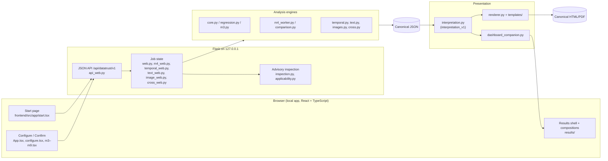
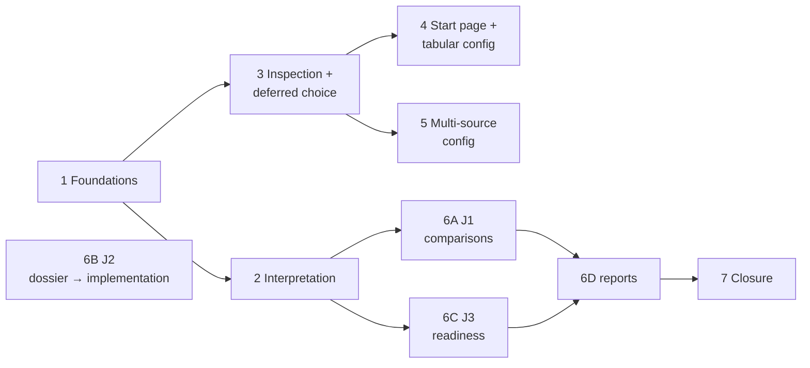
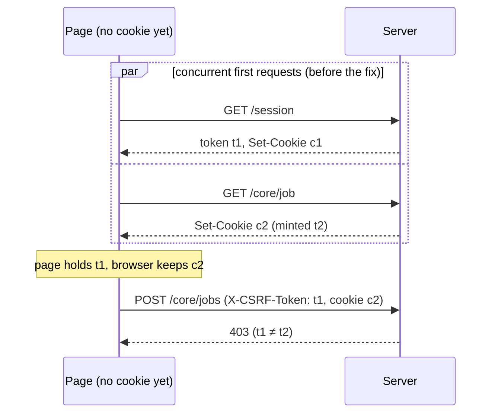
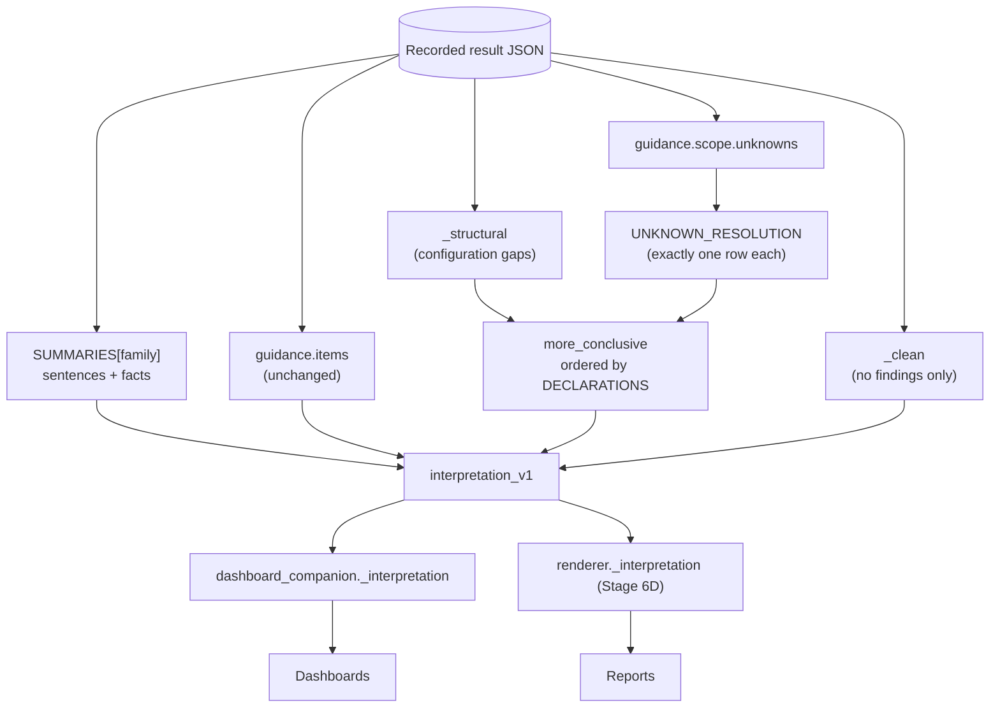
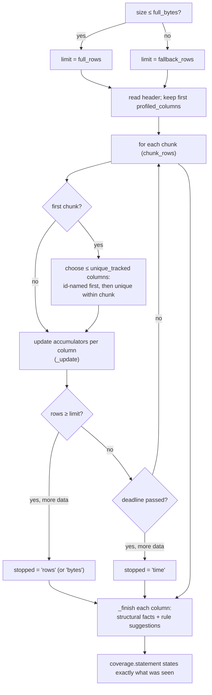
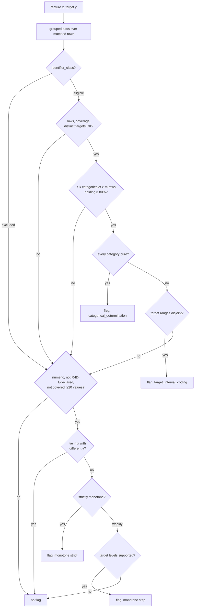

# DataTrust: Guided Analysis & Evidence Intelligence, a technical report

*Written 2026-11-26. It covers the work done in this conversation (2026-11-25): the plan, Stages 1–7, the review of
Stages 6A/6B, and the closure. It opens with a short account of the dashboard redesign that came immediately before.
All of this work is uncommitted on branch `cg7/s9-product`.*

---

## How to read this report

This report is for someone who wants to understand the implementation deeply, not just know that it exists. Each
major topic is built up in three layers:

1. **Intuition**: what problem is being solved, with a small example.
2. **Formal or algorithmic explanation**: the rule, the equation or the algorithm.
3. **Implementation**: where it lives, and what the code actually does.

The parts are ordered so that later ones build on earlier ones. Part 2 introduces the vocabulary the rest relies on.

### What kind of claim each statement is

Not every sentence carries the same evidential weight. Claims are labelled where it matters:

| Label | Meaning |
|---|---|
| **Observed** | Read directly from the code in this repository. |
| **Recorded** | Taken from retained evidence: a test run, a stage note, the J2 dossier or a capture. The source is named. |
| **Reasoning** | A mathematical or logical argument that follows from the observed code; not separately measured. |
| **Conditional** | True only under a stated condition. |
| **Illustrative** | An example built to explain an idea. It is not a measured result unless it says so. |

Test counts and timings are quoted with their **source identity**: the stage, the command or file, and the date.
They are not re-run for this report.

---

## Contents

0. Starting point: the dashboard redesign, and what is different now
1. What DataTrust is, and what this initiative set out to change
2. Vocabulary: results, findings, evidence, guidance, families, identities
3. How the work was organised: plan, founder decisions, seven stages
4. Stage 1: foundations (the CSRF race, live inspection, an export defect)
5. Stage 2: one deterministic interpretation (`interpretation_v1`)
6. Stage 3: bounded input inspection, and choosing the analysis after upload
7. Stage 4: the Start page and guided tabular configuration
8. Stage 5: guided configuration for multi-source workflows
9. Stage 6B: the regression dependency search (`regression_dependency_v1`)
10. Stage 6A: direction-preserving comparisons
11. The independent review of 6A and 6B
12. Stage 6C: readiness v2, prerequisite evidence without a verdict
13. Stage 6D: interpretation in the canonical reports, and the deliberate re-pin
14. Stage 7: closure
15. Verification record, with source identities
16. File index and glossary

---

## 0. Starting point: the dashboard redesign, and what is different now

The initiative in this report started from the *workflow-specific results dashboards*, an earlier redesign completed
(uncommitted) on 2026-11-25. It is recorded in `docs/CURRENT_STATE.md`, under "DataTrust — workflow-specific results
dashboards", and in `validation/dashboard/README.md`. That redesign was presentation-only: no analysis, score,
schema, report template or saved artifact changed.

### What it changed (Recorded, `docs/CURRENT_STATE.md`)

**One results shell for every workflow.** `frontend/src/app/results/shell/ResultsShell.tsx` draws, for any
completed result:
- a header and an outcome band;
- a findings ledger;
- the workflow's own tiles and chapters (the "Modules" design language, with the Deep Water palette and coral reserved
  for evidence);
- a coverage ledger;
- one report bar.

**One composition per workflow.** `frontend/src/app/results/resolve.ts` picks a pure builder in
`results/compositions/` from the recorded `methodology_id`. Each workflow has its own lead tile, for example:
- classification leads with the score, guardrails and sub-scores;
- readiness leads with feature geometry and "No model fitted; no readiness verdict";
- M5 leads with a timeline.

Unknown methodologies fall back to a generic view.

**A presentation companion.** `src/datatrust/dashboard_companion.py` (`dashboard_companion_v1`) gives the dashboard
the report's own words: finding titles and ranks, concept entries, and the names of families and outcomes. It also
gives report locators that are verified against the exact HTML served. So the dashboard never invents a label the
report does not use.

**Defects fixed.** The redesign fixed a defect ledger, D1–D16. Examples:
- invented M6/M7 priorities;
- coral used for class colours;
- a score tile shown on unscored runs;
- "N of 14 checks";
- a history page that waited forever on an unknown saved workflow.

### What is different after this initiative

The redesign left three things open, and this initiative changed each of them:

| Left open by the redesign | Now |
|---|---|
| A CSRF race on first load, worked around by reloading | Fixed in Stage 1 (§4) |
| Live private inspection not re-driven in a browser | Re-driven in Stage 1 (§4), which also found and fixed an export defect |
| Dashboards rendered no per-finding guidance, although every report did | Stage 2 (§5): one shared interpretation renders guidance, summaries and "what would make this more conclusive" in every dashboard; Stage 6D (§13) renders the same object in every report |

Beyond the dashboards, the app's front door changed (§7). Step 1 is now **Start**, organised around what you want to
check, with suggestions drawn from the file itself. The redesign's visual identity was kept throughout.

---

## 1. What DataTrust is, and what this initiative set out to change

### 1.1 The product in one paragraph

DataTrust is a **local** tool for reviewing the reliability of a dataset *before* a model is trained on it. A user
supplies data, such as a CSV, a set of files, image folders or documents. DataTrust runs a workflow-specific analysis
and produces:
- a **canonical result**: strict JSON;
- a **canonical report**: HTML, optionally PDF;
- an interactive **dashboard** in the local app.

It runs on the user's machine (Flask bound to `127.0.0.1`), sends nothing to a cloud service, and changes no source
data.

### 1.2 The workflows

DataTrust has grown in modules. Their internal names (M1–M9) appear throughout the code:

| User-facing name | Internal | Where the analysis runs |
|---|---|---|
| Category outcome (classification), numerical outcome (regression), dataset profile | core (M1/M2) | `src/datatrust/core.py`, `regression.py` |
| Partially labelled, several outputs, multilabel, clustering and anomaly readiness, profile with roles | M3 | `src/datatrust/m3.py` |
| Comparisons: splits, versions, before/after, deeper structure of one file | M4 | `src/datatrust/m4_worker.py`, `comparison.py` |
| Data over time | M5 | `src/datatrust/temporal.py` |
| Text | M6 | `src/datatrust/text.py` |
| Images | M7 | `src/datatrust/images.py` |
| Records and documents | M9 | `src/datatrust/cross.py` |

### 1.3 System shape



**Observed.** Four things in this picture are new in this initiative:
- **Advisory inspection.** It feeds suggestions, but never the analysis.
- **The interpretation module.** One function serves both the dashboards and the reports.
- **The Start page.**
- **Three analytical changes:** the opt-in regression dependency search, direction-preserving comparisons and
  readiness v2.

### 1.4 The two problems the initiative addressed

The plan (`.claude/plans/datatrust-workflow-specific-da-expressive-sun-of-25376ace-…md`, founder-approved
2026-11-25) named two problems.

1. **Getting to the right analysis required prior knowledge.**
   - The analysis mode had to be chosen before the file was seen.
   - Five workflows sat behind an "Other workflows" menu.
   - Target help was strong only for classification: regression assessed candidates from **10 preview rows**.
   - The temporal configuration exposed about 80 fields.
2. **The product did not fully explain what its evidence means.**
   - Every result already recorded structured per-finding guidance (`finding_guidance_v1`, `src/datatrust/guidance.py`),
     and every report rendered it. The new dashboards rendered none of it.
   - Some analyses establish less than a reader would assume. Classification checks leakage by column name and by a
     bounded search. Regression searched only exact copies, linear rescalings and sums of two columns. Readiness had a
     single finding.

The constraints were strict:
- preserve the visual identity, the CLI and Python contracts, historical immutability and local-only execution;
- add no new composite scores and no runtime LLM;
- ConfidenceGuard is out of scope.

---

## 2. Vocabulary

Everything later depends on a few concepts. Each is introduced from first principles.

### 2.1 Result, methodology, schema

An analysis produces a **result**: one strict JSON document. Two fields identify how it was computed.
- `methodology_id` names the analytical method version, e.g. `tabular_regression_v1` or
  `tabular_clustering_readiness_v2`.
- `schema_version` names the document shape, e.g. `"1.2"` for M3 or `"1.3"` for M4.

**Why both exist.** A method can change while its JSON shape stays the same, and the reverse. Keeping them separate
lets an old result be read, and rendered, exactly as it was produced. This initiative relies on that repeatedly. When an
analysis changed (§10, §12), it got a **new `methodology_id`**, and old results keep the old id.

### 2.2 Checks, evidence records, findings

Inside a result:
- A **check outcome** (`CheckOutcome`, `src/datatrust/contracts.py`) says whether a check applied and whether it ran:
  completed, skipped, failed or not applicable.
- An **evidence record** (`EvidenceRecord`, with fields `id`, `check_id`, `measurement_refs`, `population`, …) points,
  by JSON Pointer, at the measured values and states the population they describe.
- A **finding** is a review prompt, with a code or title, a priority (High, Moderate or Low) and links to evidence.
  Findings are *evidence for review*: not proof of a defect, and not a model-performance claim.

**A JSON Pointer** is a path into a JSON document. For example, `/profile/regression/target_statistics/finite_count`
walks `profile → regression → target_statistics → finite_count`. In a segment, `~1` stands for `/` and `~0` for `~`.
The interpretation code resolves pointers with `_at` in `src/datatrust/interpretation.py` (Observed):

```python
def _at(value, pointer):
    node = value
    for part in [p for p in pointer.split('/') if p][:64]:
        part = part.replace('~1', '/').replace('~0', '~')
        node = node[int(part)] if isinstance(node, list) else node[part]
    return node
```

### 2.3 Guidance (`finding_guidance_v1`)

When an analysis finishes, `guidance.py` attaches a **guidance block** to the result. For each finding it records:
- `observed`: recorded values only;
- `impact`: why it may matter;
- `investigate`: what to check first;
- `options`: each with its prerequisites, contraindications and how to verify it;
- `unknowns`: what is not established.

It also records a `scope` (the conclusion, what was not completed, and unknowns) and a `policy` (the review thresholds
the method used).

Findings are matched to catalogue entries in three ways:
- core, regression and M3 findings by code, through `CODE_KEY`;
- M6, M7 and M9 findings by family, through `FAMILY_KEY`;
- M4 and M5 findings by title, through `TITLE_KEY`.

### 2.4 Presentation families and report identity

A **presentation family** is a report type: classification, regression, unlabeled, m3, m4, temporal, text, image or
cross. `src/datatrust/report_identity.py` defines them in `FAMILIES`, and `family_of(value)` dispatches mainly on
`schema_version`.

A **presentation identity** is a digest over everything that can change a family's rendered report:
- its template closure (every included template);
- its Python presentation modules;
- the concept-catalogue entries it uses;
- the print-policy version.

The identities are **pinned** in `tests/fixtures/presentation_identities.json`. A test fails if any of them changes.
This makes report changes deliberate: one cannot change a report by accident (§13).

### 2.5 Dashboards, compositions, companion

A **composition** is a pure TypeScript function that turns a result and the companion into a `Dashboard` model, with
tiles, a route from each finding to a tile, and coverage. "Pure" means it only reads its inputs. That property is why
the dashboards can be tested in Node, through `tests/dashboard_harness.py` and `tests/dashboard_entry.ts`, without a
browser.

### 2.6 Jobs and stages in the local app

A **job** is server-side session state for one analysis in progress: the uploaded file path, configuration and
inspection. `src/datatrust/api_web.py` `job_view(job)` serialises it for the app. `stage_of(job)` derives the step
from what the job holds:

```python
def stage_of(job):
    if job.get('mode') is None:
        return 'choose'  # uploaded and inspected; no analysis chosen yet
    if 'summary' in job and artifact_owned(job, 'html'):
        return 'report'
    return 'confirm' if 'target_info' in job else 'configure'
```

The `'choose'` stage is new in Stage 3 (§6).

---

## 3. How the work was organised

### 3.1 Plan mode and the founder's feedback

The work began in plan mode. The first plan draft had 13–14 stages. The founder's review asked for several changes:
- **Inspection safeguards:** enforceable row, column, memory and time budgets, with a disclosed fallback.
- **Parsing consistency:** a provisional parse profile, revalidated by fingerprint.
- **Bulk availability declarations:** they must require deliberate confirmation.
- **Three analytical proposals:**
  - J1 (comparison direction) approved in principle;
  - J2 (regression dependencies) approved for *research and validation only*;
  - J3 (readiness) approved in principle.
- **One deterministic interpretation source** for dashboards and reports.
- **Proportional verification:** focused tests per stage, and the full suite only at integration boundaries.
- **Fewer stages.**

The approved plan has **seven stages**. Stage 6 is split into four independently reviewable sub-stages: 6A (J1), 6B
(J2), 6C (J3) and 6D (report integration).



### 3.2 Founder decisions recorded during the work

| When | Decision |
|---|---|
| Planning | Assigning roles in classification only through an explicit "Switch to role-aware classification"; intent catalogue plus "Start from a CSV" |
| Stage 3 gate | Rule catalogue and budgets approved |
| Stage 4a gate | Regression target grouping, user-facing names and Start-page structure approved; R-ENTITY-1 to be tightened in Stage 5 |
| Stage 6B | Dossier approved as recommended: D0 implement, D1 m = 5, D2 no tolerant variants, D3 declared-available is Low |
| Stage 6C | Thresholds and wording approved |
| Throughout | Use cheaper models (Sonnet or Haiku) for subagents |

### 3.3 Verification discipline

Each stage ran its focused tests. The full DataTrust suite ran only at boundaries: after Stage 2, after Stage 3,
after 6A/6B, after 6C, after 6D and at closure. The command, from the stage notes, excludes ConfidenceGuard and
platform suites:

```bash
NUMEK_PLATFORM_DSN=skip PYTHONDONTWRITEBYTECODE=1 PYTHONPATH=src:. .venv/bin/python -B -m pytest -p no:cacheprovider tests --ignore=tests/cg1 --ignore=tests/cg2 --ignore=tests/cg3 --ignore=tests/cg4 --ignore=tests/cg5 --ignore=tests/cg6 --ignore=tests/platform --ignore=tests/m9 -W ignore
```

M9 and CG1 run together, separately, and are expected to give 80 tests.

---

## 4. Stage 1: foundations

### 4.1 The CSRF first-load race

**Intuition.** A CSRF token is a secret the server gives the page. Every state-changing request must echo it back, so
a request forged by another site, which cannot read the secret, is refused. The server stores the token in the user's
session cookie.

The bug was a race. On a cold load the page fires several API requests at once. None of them carries a session
cookie yet. Before the fix, the API guard *minted* a token whenever the session lacked one. So each concurrent request
minted a **different** token and returned a **different** cookie. The browser kept whichever cookie arrived last,
while the page had been told one particular token. The first mutation (an upload, for example) then failed until the
user reloaded.

**Formal view.** Let requests $r_1, r_2$ arrive concurrently without a cookie. Each executes
`session.setdefault('datatrust_api_csrf', token())`, producing $t_1 \ne t_2$ and cookies $c_1, c_2$. The page received
$t_i$ from `/session`, but the browser's jar holds $c_j$. When $i \ne j$, the check
`compare_digest(header, session_token)` fails.



**The fix** (Observed, `src/datatrust/api_web.py`).
1. **Mint once, with the document.** `shell()`, which serves the app's HTML, calls
   `session.setdefault('datatrust_api_csrf', secrets.token_urlsafe(32))` before any script runs. Every API request the
   page then makes already carries a cookie holding that token.
2. **The guard only reads.** `guard()` now does `token = session.get('datatrust_api_csrf')` and never mints. A
   mutation without a matching token gets `failure(403, 'csrf', …)`, a response with a machine-readable code, *before*
   it does anything.
3. **The client retries once.** `frontend/src/app/api.ts` `call(…, retried=false)` recognises that code, fetches the
   current token from `/session`, and resends exactly once:

```ts
if (res.status === 403 && json?.error?.code === 'csrf' && !retried) {
  const s = await call<SessionInfo>('GET', '/session');
  csrf = s.csrf_token;
  return call<T>(method, path, body, true);
}
```

**Why the retry is safe** (Reasoning). The guard refuses before any side effect, so a resent request cannot double an
action. The `retried` flag bounds the retry to one attempt, so a genuinely invalid token cannot loop.

**Tests** (Recorded, `tests/test_app_api.py`):
- `test_the_csrf_token_is_minted_with_the_app_document_never_by_concurrent_api_requests`;
- `test_a_missing_or_stale_csrf_token_is_refused_with_a_code_the_client_can_recover_from`.

### 4.2 Re-driving live private inspection, and an export defect

Some workflows let the user look at private content locally: revealing text (M6), viewing image pairs (M7) and
inspecting evidence (M9). That content must never reach the URL, browser storage, history or standard exports.

Stage 1 re-drove these paths in headless Chromium. An in-process server ran over local fixtures, and the browser used
the page's own session cookie. Recorded (`validation/guided/README.md`, Stage 1):
- Revealed text rendered markup inertly; `` showed as text and never ran.
- Nothing revealed appeared in the URL, `localStorage` or `sessionStorage`.
- Standard JSON and HTML downloads contained no private text or images.

**Defect found.** On an image set without annotations, choosing "Show compatible supplied overlays" and then "Export
examples" crashed the export route with a generic 500. Viewing the same pair already refused it cleanly. The fix
(Observed, `api_web.py` `m7_export`) catches the failure and returns the same clear refusal:
`failure(409, 'changed_or_unavailable', 'Evidence changed, is unavailable, or has an unresolved overlay frame.')`.
The export button now shows the server's message. Test:
`tests/m7/test_app_api.py::test_overlay_export_without_a_compatible_frame_is_refused_clearly`.

### 4.3 Guidance keys for comparison and temporal findings

M4 and M5 findings are matched to guidance by *title*, which is fragile: a reworded title would silently lose its
guidance. An existing test, `tests/test_guidance.py::test_every_finding_kind_has_an_explicit_entry`, already
extracts every emitted title from the source. It asserts that each maps to a specific catalogue entry, and that only
`generic_review` goes unused. No new test was needed. Later stages extended exactly this guarantee whenever they added
a finding code (§9.6).

---

## 5. Stage 2: one deterministic interpretation (`interpretation_v1`)

### 5.1 Intuition

A result is precise but hard to read. A reader needs, for example:
- one sentence saying what was found;
- why each finding may matter;
- which declarations would let the analysis say more.

Before Stage 2, reports showed the recorded guidance but dashboards did not. Two surfaces that explain the same result
independently will eventually disagree. The founder's requirement was therefore *one deterministic interpretation
source* for both.

**Small example (Recorded, a Stage 6D capture of the Bike Hour report).** The interpretation of the Bike Hour
regression result begins:

> 17,379 of 17,379 target values are finite.
> 1 input relationship reproduces the target (cnt = casual + registered); availability of 1 relationship at prediction time is unknown, so it may be leakage or a legitimate rule.

Every number in those sentences is a value or a count read from the result.

### 5.2 Formal definition

`interpret(value, family)` in `src/datatrust/interpretation.py` is a **pure function** of a recorded result. It never
creates, removes, re-ranks or recomputes a finding or a value. It returns (Observed):

```python
{'version': 'interpretation_v1', 'family': family, 'guidance_recorded': guidance is not None,
 'summary': summary, 'findings': findings, 'more_conclusive': ..., 'clean': ..., 'states': STATES}
```

**Facts and the traceability invariant.** Each summary sentence carries a list of *facts*. A fact is a pointer plus a
derivation rule. `resolve_fact(value, fact)` recomputes it from the result. The derivations are:

| `derived` | Meaning (Observed, `resolve_fact`) |
|---|---|
| `value` | the value at the pointer |
| `count` | the length of the list at the pointer (or the number of findings) |
| `rank:<r>` | the number of findings with that rank |
| `where:f=v&g` | items of the list whose field `f` equals `v` and whose `g` is truthy |
| `state:<s>` | mapping entries whose state equals `s` |
| `sum:p1,p2` | the sum of recorded integers at several pointers |

The invariant enforced by `tests/test_interpretation.py` is, for every case and every sentence $s$:

$$
\forall f \in \mathrm{facts}(s):\ \mathrm{resolve}(\text{result}, f) = f.\text{value}
\qquad\text{and}\qquad
\mathrm{numbers}(s) \subseteq \{\, f.\text{value} \mid f \in \mathrm{facts}(s) \,\}
$$

That is: every fact re-derives to its stated value, and no number appears in the text that is not a stated fact.
Integers are also matched in their thousands-separated form, so "17,379" counts as the fact value 17379. This is why
later stages could not, for example, print computed percentages in a sentence (§10.4).

**Summaries by family.** A table `SUMMARIES` maps each family to a builder. The order of sentences follows what a
reader needs (Recorded, Stage 2 notes):
- **Classification:** the score and band, worded "a review-policy score, not a probability", then the governing cap,
  findings by priority, and the prediction-point and availability status.
- **Regression:** finite targets, then input relationships that reproduce the target and their availability state,
  then findings.
- **Comparison:** the split intent and declared violations; or "fewer findings do not establish improvement"; or
  "changed is not worse".
- **Temporal:** declared violations, then investigation candidates, worded "not validated defect criteria".

**Per-finding guidance.** `findings` re-exposes the recorded guidance items unchanged, keyed by their own reference.
A result saved before guidance existed gets an empty mapping: nothing is back-filled.

**"What would make this more conclusive".** `_more_conclusive(value, family, unknowns)` merges two sources into
entries `{key, label, why, resolves, pointer}`, ordered by `ORDER = list(DECLARATIONS)`.
1. **Structural gaps in the recorded configuration** (`_structural`). Examples:
   - no prediction point declared;
   - suggested codes left undeclared;
   - target expectations unspecified;
   - scale sensitivity undeclared;
   - no evaluation intent or identity keys;
   - no schedule;
   - models not selected.
2. **Recorded unknowns**, mapped through a regular-expression table `UNKNOWN_RESOLUTION`. Each row maps a pattern to
   a declaration key, or explicitly to `None` ("no declaration resolves this").

**Why a table, and why "exactly one"** (Reasoning). If an unknown line matched no row, it would silently disappear from
the "more conclusive" list. If it matched two rows, the outcome would depend on table order. The test
`test_every_recordable_unknown_maps_to_exactly_one_resolution` enumerates every unknown the guidance catalogue and
method tables can record. It asserts exactly one match each. `resolution(line)` itself raises `KeyError` on a miss,
"a test failure, never a silent default". At run time an unmatched line from an older or newer catalogue is skipped,
not guessed. Stages 6B and 6C each added catalogue unknowns, and each had to extend this table (§12.5).

**Clean results.** When a result has no reviewable finding, `_clean` reports:
- checks completed out of recorded;
- the policy thresholds that were not met;
- what is not established.

So a clean result states its scope instead of implying "nothing is wrong".



### 5.3 Implementation and delivery to the dashboards

- **Companion.** `src/datatrust/dashboard_companion.py` `_interpretation(family, value)` calls `interpret` for known
  families. It returns `None` for unknown methodologies, or if interpretation fails. The result is cached with the
  rest of the companion.
- **Frontend context** (`frontend/src/app/results/shell/Interpretation.tsx`). An `InterpretationContext` exposes the
  object to every composition.
  - `SummaryLead` replaces the recorded statement in the outcome band.
  - `GuidanceFor` renders the guidance layers inside every finding block (tabular, text, image, records, temporal,
    comparison).
  - `MoreConclusive` opens the coverage ledger for results with findings.
  - For clean results, the ledger states completed scope (`Ledger.tsx`).

**Recorded verification** (Stage 2 notes, 2026-11-25):
- New `tests/test_interpretation.py`: 167 tests.
- All 75 dashboard cases were captured at five sizes, with every chapter at 1440 px (710 chapters), with no render
  failures.
- **Integration boundary 1:** the full suite gave **1,727 passed**.

---

## 6. Stage 3: bounded input inspection, and choosing the analysis after upload

### 6.1 Intuition

To *suggest* things, such as "this column looks like a date" or "this one is unique, maybe an identifier", DataTrust
must look at the file before the user configures anything. But a file can be gigabytes. And a suggestion must never
silently become part of the analysis. Stage 3 builds a look-ahead that is:
- **bounded:** it cannot run away in memory or time;
- **honest:** it says exactly what it covered;
- **advisory:** it never enters a specification, fingerprint or result.

### 6.2 What an inspection contains

`inspect_table(path, options, budget, *, frame=None, frame_complete=True, clock=…)` in `src/datatrust/inspection.py`
returns `input_inspection_v1`:

```text
{version, profile{fingerprint, delimiter},
 coverage{complete, stopped, rows_inspected, bytes, columns_total, columns_profiled, columns_listed, statement},
 columns[{name, dtype, observed{non_missing, missing, distinct, distinct_capped, minimum, maximum},
          structural[...], suggestions[{rule, role, text}], not_profiled?}],
 table[...R-MULTI-1...], rules, unknowns, budget}
```

Items have one of four **classes**:
- **observed** counts;
- **structural** facts, stated with their denominator and scope;
- **suggestions** with a named rule, never applied;
- **unknowns**, such as meaning or availability.

### 6.3 Budgets: how "bounded" is enforced

`InspectionBudget` is a frozen dataclass. Its defaults were approved at the Stage 3 gate:

| Field | Default | Enforcement |
|---|---|---|
| `full_bytes` | 64 MiB | file size is checked before reading; a larger file gets the fallback |
| `full_rows` | 500,000 | rows are counted while reading; the pass stops at the limit |
| `fallback_rows` | 50,000 | the first rows only, when bytes exceed the budget |
| `profiled_columns` | 500 | later columns are listed by name only |
| `listed_columns` | 2,000 | later columns are counted, not listed |
| `chunk_rows` | 50,000 | the file is read in chunks into per-column accumulators |
| `distinct_cap` | 10,000 | exact distinct tracking up to this many values, then "capped" |
| `unique_tracked` | 16 | exact uniqueness tracked for at most this many columns |
| `deadline_seconds` | 4.0 | checked between chunks |

**The algorithm** (Observed, `inspect_table`):



**Accumulators** (`_Column`, `_update`) keep, per column:
- non-missing and missing counts;
- a distinct-value set, which is discarded and marked `capped` once it exceeds `distinct_cap`, so memory stays bounded;
- numeric min, max, a finite count and "all integral";
- text length statistics, for R-TEXT-1;
- date-parse counts, for R-TIME-1: the first 2,000 values of each chunk are parsed with `format='ISO8601'`.

**Exact uniqueness with bounded memory.** Testing whether a column is unique needs to remember every value seen.
`_update` keeps 64-bit hashes instead of values, via `pd.util.hash_pandas_object(..., index=False)`. It concatenates
them across chunks and compares `len(np.unique(hashes))` with `len(hashes)`. At the first duplicate the column is
marked non-unique and its hashes are freed.

*Reasoning: why hashing is safe in the conservative direction.* Two different values can share a hash (a collision).
By the birthday bound, for $n$ values and a 64-bit hash, the probability of any collision is approximately

$$
P_{\text{collision}} \approx \frac{n^2}{2^{65}}
$$

which for $n = 500{,}000$ is about $6.8 \times 10^{-9}$. A collision can only make a unique column *look* non-unique;
it can never make a column with repeats look unique. The error therefore suppresses a suggestion rather than inventing
one.

**Partial passes never claim whole-file facts.** `_finish` words structural facts with `scope = 'in every row' if
complete else 'in the inspected rows'`. Coverage statements are explicit, for example "Inspected the first 50,000
rows only (the inspection limit); suggestions describe those rows."

### 6.4 The rule catalogue

The catalogue (Observed, `RULES` in `inspection.py`; documented in `docs/ARCHITECTURE.md`, "Input Inspection
Boundary") is shown below as amended later in the initiative:

| Rule | Suggests | Condition (condensed) |
|---|---|---|
| R-ID-1 | identifier | identifier-like name token (id, uuid, guid, key, index, identifier) **and** unique in the inspected rows |
| R-ID-2 | identifier | unique in the inspected rows, in a whole-number or text column (amended in Stage 4a, §7.6) |
| R-TIME-1 | clock | ≥ 99% of tested values parse as ISO 8601; no locale guessing, so `03/04/2024` is never suggested |
| R-TIME-2 | clock | integers in the epoch-seconds or epoch-milliseconds range |
| R-BIN-1 | indicator | exactly two values from {0,1}, {true,false}, {yes,no}, {y,n} |
| R-MULTI-1 | multilabel set | two or more R-BIN-1 columns |
| R-CAT-1 | category | between 2 and $c$ distinct values, not unique |
| R-NUM-1 | numeric | numeric, finite, not constant |
| R-TEXT-1 | free text | at least half of the values have 40 or more characters or 5 or more words |
| R-STATUS-1 | annotation status | at most 10 values, at least half from an annotation-status vocabulary |
| R-ENTITY-1 | entity | redefined in Stage 5 as a pair test on the clock (§8.3) |

The small-set ceiling $c$ reuses the classification target-guidance rule:

$$
c = \min\!\bigl(20,\ \max(2,\ \lfloor \text{rows} / 2 \rfloor)\bigr)
$$

### 6.5 Parse profiles and fingerprint caching

**Intuition.** The same bytes can parse differently: a different separator, encoding or missing-value policy. A
suggestion made under one parse can be wrong under another. But re-reading a large file on every page load would be
wasteful.

**Mechanism** (Observed).
- `profile_fingerprint(options)` hashes `ingestion.parsing_options_dict(options)`.
- Before an analysis is chosen, inspection runs under the **provisional profile**: the detected separator with every
  other option at its default. That profile equals each core workflow's default.
- `web.refresh_input_inspection(job, frame=None)` returns the cached inspection when its fingerprint matches the
  job's current parse fingerprint. Otherwise it reruns once, and a failure is *recorded*, never raised.
- To parse exactly like the analysis, the pandas arguments were factored out of `ingestion.read_csv` into
  `csv_read_kwargs(options)` and `apply_column_types(data, options)`, unchanged in behaviour.

**Single read on the default path.** Classification already reads the whole file at upload.
`profiler.inspect_csv_dataset(..., frame_sink=...)` hands that parsed frame to the inspection, which then profiles it
instead of reading again. `tests/test_inspection.py::test_the_default_classification_path_reads_the_file_once`
instruments `pd.read_csv` to check this.

### 6.6 Choosing the analysis after upload

Before Stage 3, `POST /core/jobs` required `mode` at upload time. Stage 3 added a second path (Observed, `web.py`,
`api_web.py`):

```mermaid
sequenceDiagram
  participant App
  participant API as api_web
  participant W as web.py
  App->>API: POST /core/uploads (file, delimiter=auto)
  API->>W: start_upload(store, file, delimiter)
  W-->>API: job{mode: None, inspection (preview), input_inspection}
  API-->>App: job (stage 'choose')
  App->>API: POST /core/job/analysis {mode}
  API->>W: choose_analysis(job, config, mode)
  Note over W: validate mode; inspect under the mode's parse profile;<br/>clear declarations (target, target_info, task_spec, …);<br/>invalidate artifacts; refresh inspection (reused if fingerprint equal)
  W-->>App: job (stage 'configure')
  App->>API: POST /core/job/configure / generate
```

Safeguards:
- `choose_analysis` restores the previous state if the new mode's inspection fails.
- An `analysis_job()` guard makes configure and generate refuse a job with no analysis: "Choose an analysis for this
  file first."
- The classic routes redirect such a job to upload.
- The one-call `POST /core/jobs` path is unchanged.

**Path parity** (Recorded, `tests/test_app_api.py`). For all nine core and M3 modes, the test runs upload-only,
chooses another analysis, switches back, then configures and generates. The analysis JSON equals the one-call path's
after normalising volatile fields (generation time, elapsed time).

**Measurements** (Recorded, Stage 3 notes, dev machine, test suite running alongside):

| File | Coverage | Time |
|---|---|---|
| Bike Hour, 17,379 rows | full | 0.04 s |
| 60 MiB, 240,000 rows × 15 columns | full | 1.1 s |
| 121 MiB and 242 MiB | fallback (first 50,000 rows) | 0.22 s |

**Integration boundary 2:** the full suite gave **1,756 passed**.

---

## 7. Stage 4: the Start page and guided tabular configuration

### 7.1 Intuition

A user rarely knows which internal mode fits their goal. They do know one of two things:
- **what they want to check**, for example "Is my data ready for a prediction model?";
- **what file they have.**

Stage 4 makes both the front door. It never decides for the user. Every suggestion is explained, and every analysis
stays choosable.

### 7.2 "Which analyses fit this file?" (`applicability.py`)

`applicable_analyses(inspection)` in `src/datatrust/applicability.py` takes the input inspection and returns one entry
per analysis, `{analysis, state, reason, rules}`. The state is one of `can_run`, `needs_input` or `unlikely`. The
rules, from the code (Observed):

| Analysis | `can_run` when… | otherwise |
|---|---|---|
| `unlabeled`, `role_profile` | always | — |
| `classification` | some column is R-CAT-1 or R-BIN-1 | `unlikely` |
| `regression` | some column is in the *outcome-word* or *numeric* group (§7.3) | `unlikely` |
| `multioutput` | at least two such columns | `unlikely` |
| `multilabel_classification` | an R-MULTI-1 set exists | `unlikely` |
| `annotation_classification` | a small value set exists; the reason names an R-STATUS-1 column if present | `unlikely` |
| `clustering`, `anomaly_detection` | at least two R-NUM-1 columns that are **not** identifiers | `unlikely` |
| `temporal` | `needs_input` when an R-TIME column exists (its own workflow) | `unlikely` |
| `comparison` | always `needs_input` (a second file) | — |
| `text` | `needs_input` when an R-TEXT-1 column exists | `unlikely` |

**Why identifiers are excluded from the distance features** (Reasoning). An identifier's numeric value is arbitrary.
Distances computed over it measure nothing about the rows. Counting it would say "2 numeric columns could describe each
row" when only one does.

### 7.3 Grouping numerical outcomes (`regression_target_groups`)

Before, the regression picker assessed candidates from 10 preview rows. `target_guidance.regression_target_groups`
(Observed) instead groups *every* column from the full-file inspection:

| Group | Rule |
|---|---|
| **outcome_word** | numeric with more than $c$ distinct values, not identifier-like, the name contains an outcome token (price, cost, amount, total, count, cnt, sales, …), and no suppressing token (prior, previous, score, prediction, …) |
| **numeric** | the same, without the name signal |
| **review** | numeric, but identifier-like, epoch-like, constant, at most $c$ distinct values, a code/class/category name, or fewer than 4 values |
| **unavailable** | not read as numbers, or no finite values |

$c$ is the same ceiling as in §6.4. Nothing is preselected.

**Consistency guarantee** (Recorded, `tests/test_input_suggestions.py`). On eight retained datasets, every column that
the confirmation step's own assessment (`assess_regression_target`) would flag for an acknowledgement lands in
*review* or *unavailable*, never in the first two groups. The groups only reorder and explain; they never contradict
the confirmation.

**Example** (Recorded, Stage 4 proposal):

| Dataset | outcome_word | review |
|---|---|---|
| Bike Hour | `cnt` | `instant`, `season`, `holiday`, … |
| Energy | `heating_load`, `cooling_load` | the 8 design inputs (2–12 values each) |

### 7.4 The Start page (`frontend/src/app/start.tsx`)

**Observed structure:**
- **`ANALYSES`** lists every analysis under its user-facing name, for example "Category outcome", "Several labels per
  row", "Compare two image sets".
- **`INTENTS`** groups them: understand, predict, readiness, compare, time, text, images, records. The multi-source
  intents link to their own flows.
- **`Start`** shows, before a file is read, "Start from a CSV" (a drop zone) beside the intents. After a file is read,
  it shows a compact file bar, an intent filter, and three lists: can run now, needs more input, probably not useful.
  Each list item shows its reason and rule IDs.
- **Choosing first still works.** Picking an analysis before the file sets `pending`. When the file is read, the app
  calls `chooseAnalysis` and opens Configure: the old mode-first path, reproduced.
- **`AllAnalyses`** is a searchable list, opened from the header's "All analyses" link.
- **`AnalysisBar`** on Configure offers "Change analysis", which keeps the file.

### 7.5 Layered configuration, availability and the review panel (Stage 4b)

**Layers** (`frontend/src/app/configure.tsx`, `Layer`). Each tabular Configure screen is split into three layers:
- **Essential;**
- **Recommended context;**
- **Advanced** (collapsed).

Each layer states *why* it matters and *what is lost* without it. The form fields sent to the server are unchanged.

**Availability at the prediction point (G0)** (`Availability`).

*Intuition.* A column is a fair model input only if it is known *when the prediction is made*. A call's duration is
known only after the call. Declaring it "available" would hide a leakage concern.

*Mechanism.*
- Every column starts `unknown`. Columns can be set one at a time.
- Declaring several "available" at once opens a `Dialog`. It lists them, states the consequence, and stays disabled
  until "I checked each listed column against the prediction point" is ticked.
- Bulk-declared columns are sent as `availability_bulk`. `web.record_bulk_availability` stores them on the job only,
  never in the configuration or the analysis, and the review lists them separately.

**What will run** (`api_web.review_view`). Once configured, the job view carries `review`:
- the methodology;
- whether a composite score is computed;
- targets, prediction point and availability counts, with the bulk list and its consequence;
- code meanings declared;
- "not established by this run".

The methodology comes from the same `effective_policy` resolution the analysis uses.

**Why this matters, and how it is tested** (Recorded). In the M3 code, declaring roles, meanings or annotation
expectations can move an analysis from the scored classification method to a role-aware method. Before Stage 4 this
happened silently. `tests/test_app_api.py::test_the_review_names_the_methodology_the_run_records` asserts, for all
nine modes, that the review's methodology equals the generated result's `methodology_id`.

**The role-aware switch** (`RoleNotes`). On the scored paths, columns that look like identifiers, dates or labelling
status are shown as *information only*. A "Switch to role-aware …" dialog:
- names the destination analysis;
- carries the chosen outcome as the target (`POST /core/job/analysis` with `target`);
- clears other declarations.

The test shows the review is honest in both directions:
- with label expectation `expected` and nothing else declared, the **scored** method runs, and the review says so;
- otherwise `tabular_partial_classification_v1` runs.

**Role suggestions in M3** (`suggestedRole`). Chips such as "metadata? R-TIME-1" are applied one at a time. Every
column still starts as a feature.

### 7.6 A bug and a rule amendment found during inspection

1. **Uniqueness across chunks.**
   - *Symptom:* Beijing's `time` column was reported unique, although 12 stations share each timestamp.
   - *Cause:* if no column qualified for uniqueness tracking in the first chunk, the code re-chose on later chunks.
     The last, short chunk happened to have no repeats.
   - *Fix:* the tracked set is chosen once, on the first chunk (`tracked = None` until chosen).
   - *Test:* `test_uniqueness_is_never_claimed_from_a_later_chunk_alone`.
2. **R-ID-2 amended.**
   - *Symptom:* `total_amount` (a unique decimal measurement) was suggested as an identifier, which pushed it out of
     the outcome candidates and the clustering count.
   - *Change:* R-ID-2 now applies only to whole-number and text columns. A fractional unique column gets no identifier
     suggestion.
   - *Documentation:* the change is in `RULES` and `docs/ARCHITECTURE.md`, and was reported to the founder.

**Recorded verification:**
- Stage 4a focused set: 78 passed.
- Stage 4b focused set: 197 passed.
- Browser walkthroughs at 1440 and 375 px, with captures in `validation/report_experience/work.nosync/guided/visual/stage4/`.

---

## 8. Stage 5: guided configuration for multi-source workflows

Multi-source workflows take several files, folders or documents, often from a **data root**: a folder the user allowed
at launch, which may hold very large files. Stage 5 brings the same advisory pattern to them.

### 8.1 Bounded source inspection (5a)

`inspection.SOURCE_BUDGET = InspectionBudget(full_bytes=8 MiB, full_rows=20_000, fallback_rows=20_000)`. That is the
whole file up to 8 MiB and 20,000 rows, otherwise the first 20,000 rows, disclosed.

`inspect_source(path, fmt, delimiter)`:
- **CSV:** calls `inspect_table`.
- **Parquet:** reads only the schema metadata and the first row batch (`pq.ParquetFile.iter_batches(batch_size=…)`),
  then profiles that frame with `frame_complete=False` when rows remain. The coverage then says "Inspected the first
  20,000 of 30,000 rows". Column names from the schema now fill the source headers, so column selects work for
  Parquet too.

The inspection is stored per source (`m4_web.advisory_inspection`). The job views show a compact form
(`api_web.compact_inspection`). It never enters a specification or fingerprint.

### 8.2 Comparison suggestions: keys and name mappings

**R-KEY-1** (`identity_key_candidates`): a column present in every source and unique in each source's inspected rows.

**R-MAP-1** (`name_mapping_candidates`): names that are equal after normalisation, but not as spelled:

$$
\mathrm{norm}(s) = \mathrm{lower}\bigl(s \text{ with } [\text{whitespace}, \_\,, -] \text{ removed}\bigr)
$$

For example, `age` in the current file maps to `Age` in the reference.

**In the app** (`m4.tsx`), Configure is question-led:
- "Which file plays which part?"
- "What must not be shared between splits?", with evaluation intents in plain words (`INTENT_TEXT`);
- identity-key and mapping chips;
- "Columns that do not align", listed **before** the run from the headers and the declared mapping.

**Recorded walkthrough.** Train and test files shared 20 customers, with differently cased columns. Applying the key
and both mapping chips aligned every column. With "entity disjoint" declared, the run reported a High "Declared
evaluation separation is violated".

### 8.3 Temporal suggestions: clock, entity, spacing (`time_structure`)

For each clock candidate (R-TIME-1 or R-TIME-2), `time_structure(path, inspection, fmt, delimiter)` makes one bounded
read of the clock and small-value-set columns over the inspected rows.

**Clock interpretation.**

| Values | Suggested `kind` | `encoding` |
|---|---|---|
| all numeric, minimum ≥ 1e12 | `instant` | `epoch`, unit `ms` |
| all numeric, otherwise | `instant` | `epoch`, unit `s` |
| all `YYYY-MM-DD` | `civil_date` | `iso` |
| all end with `Z` or `±hh:mm` | `instant` | `iso` |
| otherwise | `local_datetime`, flagged `naive` | `iso` |

*A correction recorded in this stage.* Timestamps without an offset were first suggested as "local date-time, needs a
timezone". The temporal contract refused this ("Timezone resolution requires an instant clock"). The suggestion now
says: keep it as a local date-time, or choose `instant` and declare an IANA timezone if the values are instants.

**Entity: the redefined R-ENTITY-1.**

*Intuition.* A panel dataset holds several series, for example one per weather station, and each time appears once per
station. The original rule ("text values repeated with a time column") also matched wind direction, which repeats but
does not identify a series.

*Formal rule* (Observed). Over the inspected rows, let $T$ be the parsed clock. Its number of repeats is
$\mathrm{rep}(T) = |T| - |\mathrm{unique}(T)|$. A candidate column $E$ is an entity suggestion when

$$
\mathrm{rep}(T) > 0
\quad\text{and}\quad
\mathrm{dup}\bigl(\{(E_i, T_i)\}\bigr) \le 0.01 \cdot \mathrm{rep}(T)
$$

That is, times repeat, but each (value, time) pair is unique, up to 1% of the repeats. Candidates are ranked by
$\lvert \mathrm{distinct}(E) - |T| / |\mathrm{unique}(T)| \rvert$: one series per value means as many values as each
time repeats.

*Conditional limitation, stated in the app.* In a file sorted by station, the first 20,000 rows may hold one station
only. Times then never repeat in the inspected rows, and the page says one series versus several "is not established
by the inspection". This is the Beijing case.

**Spacing.** Over the sorted distinct times, the consecutive gaps $g_i$ are computed. The modal gap $m$ and its share
are reported:

$$
m = \operatorname{mode}\{g_i\},\qquad \text{share} = \frac{|\{i : g_i = m\}|}{|\{g_i\}|}
$$

The chip offers "expect a record every $m$ from the first time". It sets `schedule=fixed`, `cadence` in nanoseconds and
`anchor`, only when clicked.

**Recorded test.** `tests/test_source_suggestions.py`: a specification built only from the chips' values, for a
3-station hourly panel, **runs to completion**.

### 8.4 Text, images, records (5b)

**Record discovery** (`discover_selectors(records)`).
- *Intuition.* JSONL records can be nested, so a field is addressed by a JSON Pointer such as `/meta/lang`.
- *Algorithm.* It walks the first 128 records the workflow already reads, top-level keys plus one level of nesting.
  For each selector it counts presence and value kinds, then applies:
  - R-TEXT-1, content;
  - R-ID-1 and R-ID-2, identity; not when the column is a path;
  - **R-SPLIT-1**, at most 10 values including a split word such as train, test or validation;
  - R-CAT-1, label;
  - **R-PATH-1**, image file extensions;
  - **R-LIST-1**, lists of short values;
  - **R-BOX-1**, lists of objects with four-number boxes.

**Box evidence** (`box_evidence(boxes)`). *Intuition.* `[2, 3, 12, 15]` could be corner coordinates (x1, y1, x2, y2)
or origin-plus-size (x, y, w, h). The values alone rarely decide.

*Rule.* With $u$ boxes having every value in $[0,1]$, $o$ boxes with $b_2 > b_0$ and $b_3 > b_1$, and $n$ boxes in
total:
- `normalized_cxcywh` is consistent when $u = n$;
- `xyxy` is consistent when $o = n$ (a single violation rules it out);
- `xywh` is always consistent.

The text ends "the format is not established by the values". The page offers each consistent format as a chip.

**Images.**
- The new preset "Several labels per image" is a manifest with task `multilabel_classification`.
- The new preset "Compare two image sets" sets roles automatically, reference then current. Guided configure builds
  `ImageComparisonSpec(reference, current, align_logical_keys=…)`. Before this, it was reachable only through
  hand-written JSON.
- Manifest discovery is stored *beside* the specification's own source dicts (`j['discovery']`), because those dicts
  are fed back to `from_dict`.

**Text.** Presets carry objective names. `TextSuggestions` applies content, label, identity and split chips.
`addRow` fills a list row with the page's own column defaults. One bug was found in the browser: a label chosen
*before* the content field pointed at a field name that did not exist. The label now links to the declared or suggested
content field.

**Records and documents.**
- `cross_web.record_discovery` lists columns and identifier candidates for structured sources; the association builder
  offers key chips.
- `cross_web.model_status()` reports each optional model's qualification state **before** selection, read-only. The
  rule:
  - `qualified` only when the stored qualification has `status == 'passed'`, its `algorithm_identity` equals
    `cross_models.algorithm_identity()`, and its revision matches the publisher's;
  - `stale` when it passed under different code;
  - otherwise `not_qualified`.

*Why "stale" arises* (Observed). `algorithm_identity()` hashes the source of `cross.py`, `cross_models.py`,
`cross_documents.py`, `cross_diagnostics.py`, `cross_sources.py` and `cross_contracts.py`. Any edit to them invalidates
a stored qualification. Stage 5b therefore changed only `cross_web.py`, which is not hashed, and confirmed with
`git status` that none of the hashed files changed. In this build both models report *stale*, so their judgments
abstain; re-qualification is an open founder decision.

**Recorded verification:**
- Stage 5a focused set: 200 passed; M6 and M7 app API tests passed.
- Stage 5b focused set: 180 passed.
- Captures in `work.nosync/guided/visual/stage5/`.

---

## 9. Stage 6B: the regression dependency search (`regression_dependency_v1`)

### 9.1 Intuition

A numerical target can be reproduced by an input in ways the original search did not look for.
- **A lookup.** A product code that fixes the price, like a price list.
- **A binned copy of the target.** For example an "income band" column when predicting income.
- **A monotone recoding.** The target equals some increasing function of a feature (a log, a cube, a rank), or a
  step function of it (a tariff tier from a quantity).

The existing search (`regression.relationship_steps`) verifies only exact copies, affine identities and sums of two
columns. A text feature that determines the target was never examined.

**The central caution.** *Determining the target is not the same as leakage.* A price list legitimately determines
price, and a unit conversion is monotone. Whether a dependency is leakage depends on **when the feature becomes
known** relative to the prediction. Data alone cannot establish that.

### 9.2 Research first: the dossier (a separate session)

The founder approved J2 for *research and validation only*. A separate session produced
`validation/regression_dependency/DOSSIER.md` (2026-11-25), with a prototype (`prototype.py`), fixtures and
`validate.py`, and changed no product code. Its headline results (Recorded, quoted from the dossier §0, with that
source identity):

| Question | Dossier result |
|---|---|
| Permutation null | 0 flags in 43,500 permuted feature checks (77 datasets × 100 seeds) |
| Retained negative corpus | 108 feature checks over 23 datasets; 4 flags, all hand-reviewed as real monotone relationships built into synthetic fixtures |
| Planted positive corpus | precision 1.00 (18 TP, 0 FP); recall 0.93 on clean plants (14/15), 0.27 under 0.1%-of-sd noise, 0 under 1% label noise; overall 0.40 (18/45) |
| What the gates buy | without support and identifier gates: 12,801 flags on pure noise |
| Budget | bike_hour uses 0.139% of the row-work limit; 1M rows × 4 features took 1.06 s |

**Founder decisions (2026-11-25):**
- **D0:** implement `regression_dependency_v1` as specified: strict families, opt-in, evidence only.
- **D1:** support size $m = 5$.
- **D2:** no tolerant ("nearly determines") variants.
- **D3:** a dependency on a feature declared available is **Low**. This differs deliberately from the older regression
  relationship findings, which emit nothing in that case.

### 9.3 The method, formally (`src/datatrust/regression_dependency.py`)

**Population.** For target $y$ and feature $x$:
- $N$ is the number of rows with finite $y$ (the population).
- The matched rows are those with finite $y$ and present $x$ (finite if numeric, non-null otherwise); there are $n$
  of them.
- Coverage is $n/N$.

The search is **not assessable** if $y$ has no finite values, or fewer than 5 distinct ones.

**One grouped pass.** The matched rows are grouped by the exact value of $x$. Each group $j$ yields its size $s_j$,
whether it is *pure* (one distinct target, $\mathrm{pure}_j$), its target minimum and maximum, and its first target. All
three families come from this single pass. That is why one feature–target pair counts as one *check* in the budget.

**Gates** (`Gates`, Observed):
- `min_matched_rows` 100;
- `min_target_coverage` 0.8;
- `min_distinct_targets` 5;
- $k$ = `supported_categories_k` 5;
- $m$ = `category_support_m` 5;
- `supported_row_share` 0.8;
- `near_unique_share` 0.5;
- `identifier_unique_share` 0.98;
- `monotone_min_distinct` 20;
- `monotone_min_rows` 30.

**Identifier exclusions** (`identifier_class`). A column that is unique per row trivially "determines" any target, so
identifiers must be excluded from the categorical families. The checks, in order:
1. `declared_identifier`: the user declared the column an identifier;
2. `R-ID-1`: an identifier name token **and** at least 98% of values distinct;
3. if the user declared the column categorical, it is not excluded;
4. `R-ID-2`: every value distinct;
5. `near_unique`: at least 50% of values distinct.

The monotone family excludes only `R-ID-1` and declared identifiers. A continuous measurement is naturally near-unique
and must stay searchable.

**F1: categorical determination.** Let $S = \{j : s_j \ge m\}$ be the *supported* categories. F1 holds when:

$$
\underbrace{\forall j:\ \mathrm{pure}_j}_{\text{no category with two targets}}
\ \wedge\ |S| \ge k
\ \wedge\ \frac{\sum_{j\in S} s_j}{n} \ge 0.8
\ \wedge\ n \ge 100 \ \wedge\ \frac{n}{N} \ge 0.8 \ \wedge\ \mathrm{distinct}(y) \ge 5
$$

Singletons ($s_j = 1$) are pure by definition but never count toward $k$ or the share.

*Reasoning: why the support rule matters.* Without it, a column with many small categories is "pure" by chance: a
category of one row has one target. This is the 12,801-flags-on-noise ablation in the dossier.

**F2: target interval coding.** Sort the categories by (target minimum, target maximum). F2 holds when consecutive
ranges are strictly separated:

$$
\max_j < \min_{j+1}\quad\text{for consecutive categories in that order}
$$

It uses the same support and population gates as F1, and is reported only when F1 does not hold. When F1 holds and its
values are distinct, F2 is implied.

**F3: monotone mapping** (numeric $x$ only). It requires $n \ge 30$, coverage ≥ 0.8, at least 20 distinct $x$ and at
least 5 distinct $y$.
- **A tie in $x$ with different targets breaks the mapping:** that is not a function. The check is `conflicting
  ties = 0`.
- Order the categories by $x$, and let $\Delta_i$ be the differences of their first targets.
- **Strict:** every $\Delta_i > 0$, or every $\Delta_i < 0$.
- **Step:** the mapping is only weakly monotone (some $\Delta_i = 0$), **and** the *target levels* have repeated
  support: at least $k$ levels of at least $m$ rows holding at least 80% of rows.

The form of the function is never named.

**Redundancy rule** (`covered_features`). A feature that the existing search already verified as `exact_copy` or
`affine_identity` (single column) is not tested for monotonicity. It is recorded as
`covered_by_existing_relationship`, so the same relationship is not reported twice.



**Budget** (`search`). The features are ordered with name cues first (they share a token with the target, or carry an
outcome word), then file order. Each check adds the full row count to the row work. The search stops, with status
`bounded` and the unsearched features named, when:
- a new feature would exceed `max_features` (64);
- checks would exceed `max_checks` (128);
- or row work would exceed `max_row_work` (2e8).

Multi-output regression shares one budget across outputs.

**Severity follows declared availability only:**

| Declared | Severity | Code |
|---|---|---|
| unknown | Moderate | `regression_dependency_availability_unknown` |
| unavailable at prediction | High | `regression_dependency_unavailable` |
| available at prediction | Low | `regression_dependency_declared_available` |

Each finding's wording (`wording`) has three parts: the observation with rows and coverage, a family caveat (for
example "A monotone relationship is not by itself leakage"), and an availability clause. "Leakage" appears only as a
possibility unless the user declared the feature unavailable. A test checks this.

### 9.4 A worked trace (Illustrative data; Recorded outcome)

The data is 600 rows, a `product` column with 8 values, `price = 10 + 3·i` for product `p_i`, and a noise column. A
recorded check run printed `('product', 'categorical_determination', None, 'Moderate')`.

1. Target `price` has 8 distinct finite values (≥ 5), so it is assessable.
2. Features are ordered: `product`, then `noise`, …
3. For `product`: $n = 600$, coverage 1.0. Each of the 8 categories has about 75 rows, so $|S| = 8 \ge 5$ and the share
   is 1.0. Every category maps to exactly one price, so F1 holds.
4. No availability was declared, so the severity is Moderate. The wording begins "product determines price in this
   file: each of its 8 supported categories …".
5. For `noise`: categories are mostly singletons, so there is no support; there are conflicting ties, so it is not
   monotone. No flag.

### 9.5 Opt-in without changing anything when off

**Contract** (Observed, `src/datatrust/contracts.py`):
- `RegressionOptions.dependency_search: RegressionDependencyOptions | None`, keyword-only and `None` by default.
- `RegressionDependencyOptions(limits=DependencyLimits())`.
- `__post_init__` accepts `True` (defaults), a dict with `limits`, or `False` (off).
- `from_dict` accepts `true | false | {"limits": …}` and still refuses every other unknown key.

**The byte-identity problem** (Reasoning). `dataclasses.asdict` includes *every* field, even one that is `None`. The
regression options are serialised into the M3 declarations, the job view and the M3 specification fingerprint. Merely
adding the field would therefore change every existing fingerprint and record.

**The fix** reuses an existing mechanism. `omit_default_delimiter` already dropped a default value from records, so
that comma-separated files kept their old fingerprints. It now also pops `dependency_search` when a dict has the
regression-option keys and the value is `None`.

**Acceptance** (Recorded). The dossier suggested comparing against the stored historical results. That proved invalid:
all 33 stored files differed even for cases 6B cannot touch, because earlier stages had changed unrelated keys. A
baseline was therefore built from **the same code with the 6B changes removed**, in a scratch copy. All 33 retained
regression and M3 cases were re-run under both, and the normalised analysis JSON was **identical** for every case.

**On.** The retained corpus raises exactly the dossier's four hand-reviewed flags and none elsewhere:
- mutation `sum` (`a`);
- `missing_nonfinite` (`input`);
- `constraint_union` (`input`);
- `presentation/partial` (`qa_optional_failure`).

**Interfaces:**
- CLI `--regression-dependency-search`.
- A config JSON key.
- The app's Advanced toggle, for "Numerical outcome" and the multi-output M3 section.
- The review panel states which relations are searched.
- The interpretation adds a summary sentence when the search ran, and a "more conclusive" entry when it did not.

**Tests** (Recorded): `tests/test_regression_dependency.py`, 31 at first, later more (§11).

### 9.6 A report-identity lesson

The first full run after 6A and 6B gave **1,835 passed and 2 failed**. Adding the new codes to
`report_catalogue.FINDING_CONCEPTS` changed the regression family's presentation identity, because that catalogue is
part of the identity digest. It also changed a frozen M2 report hash. Both were reverted to wait for 6D's single
deliberate re-pin (§13), and both tests then passed.

---

## 10. Stage 6A: direction-preserving comparisons

### 10.1 Intuition

Compare two versions of a file. If `age` was 30% missing and is now 0% missing, something material happened:
imputation, back-fill, a fixed source, or filtered rows. The old comparison tested only *increases*, so a decrease was
invisible.

A decrease is not necessarily bad, either. Calling it a warning would be wrong. The founder's position was to preserve
the direction, and to call a decrease a **material change, not a warning**.

### 10.2 Formal rule

For a column with $m_r$ missing of $n_r$ rows in the reference and $m_c$ of $n_c$ in the current, the signed change is:

$$
\Delta = \frac{m_c}{n_c} - \frac{m_r}{n_r}
$$

With threshold $\tau = 0.05$ (`ComparisonConfig.missingness_change`) and minimum population $p = 100$
(`minimum_population`):

| Condition | Recorded as | Finding? |
|---|---|---|
| $\Delta \ge \tau$ and $\min(n_r, n_c) \ge p$ | `missingness_review`, unchanged | yes: the existing "Supported input or annotation populations differ" |
| $\Delta \le -\tau$ and $\min(n_r, n_c) \ge p$ | `missingness_material_decrease`, plus a `material_changes` measurement | **no** |
| otherwise | direction and magnitude only | no |

Non-finite values follow the same rule.

### 10.3 Implementation (`src/datatrust/comparison.py`)

- `_direction(measure, change, na, nb, config)` returns `{measure}_direction` (increase, decrease or none),
  `{measure}_magnitude` $= |\Delta|$ and `{measure}_material_decrease`.
- A `directional` flag is true unless `config.methodology == 'm4_local_2026_10_10'`.
- After the existing populations finding, the decreases are collected into a separate measurement through
  `e.add(scope, 'material_changes', {...})`, with `evidence_type: 'material_change'` and the stated causes
  (`MATERIAL_MEANING`). No finding is created.

**Versioning.**
- Comparisons record a new `methodology_id`, `m4_local_2026_11_25`, from `ComparisonConfig.methodology`.
- Setting it to `m4_local_2026_10_10` reproduces v1 output exactly, with no direction fields; a test checks this.
- Advanced single-source analysis keeps `m4_local_2026_10_10`.
- The companion's known methods, `resolve.ts` and the dashboard-case composition helper accept both ids.

### 10.4 Presentation

- The populations table gains a direction column (↑/↓, percentage points, "material change") for v2 results only.
- The interpretation adds "1 material decrease (missing values in age). A decrease is a material change, not a defect:
  …".
- Under the traceability invariant (§5.2) the sentence **cannot** print computed percentages, which are not recorded
  facts. It names the columns instead, and its only number is the recorded count.

**Tests** (Recorded): `tests/test_comparison_direction.py`, 6. With the M4, before/after, comparison-dashboard,
guidance and interpretation suites, 240 passed.

---

## 11. The independent review of 6A and 6B

A read-only reviewer (a Sonnet subagent) checked both stages against the dossier and the plan. It ran 60 randomized
datasets through the prototype and the port, and confirmed **parity**: identical status, checks, flags, exclusions and
budget. It reported three important and six minor issues. Each was verified and fixed, with tests:

| Issue | Cause | Fix |
|---|---|---|
| Declared identifier and categorical semantics never reached the search (important) | callers did not pass `declared_identifiers` or `declared_categorical` | both call sites pass `config.features.semantic_types`. Declaring a meaning moves a run to the M3 path, so the multi-output path carries them too |
| Single-target findings had no evidence link (important) | finding paths `…/dependency_search/flags/{i}` never matched the evidence record at `…/dependency_search` | findings point at the record path; the evidence denominator now counts checks |
| Segment-level material changes summarised as if global (important) | the summary looped over every `*.material_changes` key | only source-pair scopes (`a:b.material_changes`); segment records say "rows of this segment" |
| Multi-output ignored availability declared in context | — | context availability merged |
| M3 recorded no check outcome for the search | — | one per output |
| The `partial` status was never produced | — | a cooperative interruption keeps what was searched |
| `dependency_search=False` raised an error | — | now means off |
| Material-change tile order and summary | — | ordered after Populations, "N material decreases" |
| A non-string methodology raised a `TypeError` | — | it is refused with the intended `ValueError` |

After the fixes, search-off output was still identical to the pre-6B code on all 33 cases, and the affected suites gave
467 passed.

---

## 12. Stage 6C: readiness v2, prerequisite evidence without a verdict

### 12.1 Intuition

Clustering and anomaly detection measure distances between rows. Two prerequisites quietly affect them:
- **Complete rows.** A distance needs every feature. Rows with a gap are dropped or imputed, and either changes the
  population analysed.
- **Redundant features.** If two features carry nearly the same information, the distance counts that dimension twice.

Neither is a defect, and neither yields a "ready or not" verdict. The plan kept the policy: *no model fitted, no
readiness verdict*.

### 12.2 Formal rules (`src/datatrust/unsupervised.py`)

**Complete-case coverage** (`complete_case_coverage`):

$$
\text{share} = \frac{\#\{\text{rows with every quantitative feature finite}\}}{\#\{\text{rows}\}}
$$

| Share | Result |
|---|---|
| < 0.5 | Moderate finding `limited_complete_case_coverage` |
| < 0.8 | Low finding |
| ≥ 0.8 | no finding |

*Justification* (stated in `guidance.policy`): 0.8 is the coverage gate used by the dependency searches, and 0.5 is the
column-missingness High boundary.

**Redundant quantitative features** (`redundant_features`). For features $a, b$ with pairwise finite overlap of $n$
rows:

$$
r = \frac{\sum_i (a_i - \bar a)(b_i - \bar b)}{\sqrt{\sum_i (a_i-\bar a)^2}\,\sqrt{\sum_i (b_i-\bar b)^2}}
$$

The pair qualifies when $n \ge 100$ and each column has at least 10 distinct values in the overlap. It is flagged when
it is an **exact duplicate** (identical presence masks and identical values), or when $|r| \ge 0.98$, the existing M4
dependency gate. The finding `redundant_quantitative_features` is Low, worded "may be intended", never a defect.

**Bounded search.**
- At most 64 features, which is $\binom{64}{2} = 2{,}016$ pairs, and $2 \times 10^{8}$ row work (`DependencyLimits`).
- Declared quantitative features go first, then source order.
- Each pair adds the row count to the row work. *Reasoning:* the complete 2,016-pair search therefore fits only when
  $2016 \cdot \text{rows} \le 2\times 10^8$, about 99,200 rows. Beyond that the status is `bounded`, and
  `unsearched_pairs` is reported.

### 12.3 Pre-registration and results

Expected results were written to `validation/guided/readiness_v2_expectations.md` **before** any 6C code ran on the
retained cases. They were derived from the public datasets' known properties. The run matched them exactly (Recorded):

| Case | Complete rows | Redundant pairs | Findings |
|---|---|---|---|
| energy_clustering, energy_anomaly | 768 of 768 | `relative_compactness` ≈ `surface_area`, $r = -0.9919$. The other inputs have fewer than 10 distinct values | `redundant_quantitative_features`; scale review unchanged |
| linnerud_clustering, linnerud_anomaly | 20 of 20 | none (below the 100-row gate) | scale review only |

### 12.4 Versioning and presentation

- New runs record `tabular_clustering_readiness_v2` or `tabular_anomaly_readiness_v2` (`annotations.effective_policy`).
- v1 results render unchanged.
- The coverage finding routes to the missing-values tile, and redundancy to the geometry hero. The geometry chapter
  lists the near-duplicate pairs with their $r$.
- `guidance.POLICY` states every threshold.

### 12.5 The resolution table, again

The first full run after 6C gave **1,851 passed and 1 failed**. The two new guidance catalogue entries introduced two
new "unknown" lines, which the interpretation's `UNKNOWN_RESOLUTION` table must map exactly once (§5.2). Both were
mapped to `None`, since no declaration resolves them, and the tests passed (205).

---

## 13. Stage 6D: interpretation in the canonical reports, and the deliberate re-pin

### 13.1 One object, two surfaces

`renderer._interpretation(value, result)` computes `interpret(value, family_of(result))`. Every report template now
receives it as `I`. A shared macro, `guidance_layers.html` `interpretation(I)`, renders it right after the guidance
scope box in all nine families:
- **"In brief":** the summary sentences;
- **"A clean result, and its scope":** for clean results;
- **"What would make this more conclusive":** with "Supply these in a new run";
- the interpretation version.

The dashboard companion carries the same object.

`tests/test_report_interpretation.py` renders all 74 dashboard-corpus cases. It asserts that each report contains every
summary sentence and every "more conclusive" item of `interpret()` unchanged, and that the companion's interpretation is
identical.

### 13.2 Why every identity changed, and how the re-pin was kept honest

A family's presentation identity is a digest over:

$$
\text{identity} = H\bigl(\text{template closure} \,\|\, \text{presentation modules} \,\|\, \text{concepts used} \,\|\, \text{print policy}\bigr)
$$

Stage 6D changed two shared inputs:
- the shared template partial;
- `_SHARED_MODULES`, which gained `datatrust.interpretation`, so future wording changes are visible in the identity.

So **all nine identities changed by design**. It also added the catalogue entries deferred from 6B and 6C.

The re-pin used `validation.report_experience.repin`. For every golden case it first **re-asserts the analytical
result** against the fixture, then replaces only `html_sha256`. If any other field differs, it aborts. Recorded:
- 18 of 18 M2 report hashes and 3 of 3 M1 hashes changed;
- all 9 identities changed.

The re-pin is named in `docs/CURRENT_STATE.md`.

**Saved reports are not re-rendered** (Observed). `history.py` serves the stored `report.html`, bound by its SHA-256,
and never calls the renderer.

---

## 14. Stage 7: closure

- **Documentation:**
  - `docs/ARCHITECTURE.md`: shared interpretation, guided start and configuration, plus the earlier stage sections;
  - `docs/GETTING_STARTED.md`: the Start page, the dependency search, direction-preserving comparisons, readiness v2;
  - `README.md`: a "Guided start" line;
  - `docs/CURRENT_STATE.md`.
- **Closure matrix:** `validation/guided/CLOSURE.md` maps each row of the plan's verification matrix (§O) to its
  evidence: met, partly met or not met.
- **Walkthrough:** in a fresh browser session, Start from a CSV → Category outcome → review (scored method) → generate →
  dashboard. All four "In brief" sentences of the served report also appear on the dashboard. Each multi-source entry
  point opened its flow.
- **Final runs** (Recorded):
  - DataTrust suite **1,926 passed**;
  - M9 with CG1 **80 passed**.

**Known gaps, as recorded in `CLOSURE.md`:**
- several declarations remain JSON under Advanced;
- the summary has no multilabel cardinality sentence and no cohort-contrast sentence;
- the dashboard has no per-feature table for the 6B search;
- finding order was not changed;
- M9 model qualification remains a separate founder decision.

---

## 15. Verification record (source identities)

All dates are 2026-11-25. "Full" means the DataTrust suite command in §3.3.

| Stage | Run | Result |
|---|---|---|
| 2 | full (boundary 1) | 1,727 passed |
| 2 | dashboard captures | 75 cases at 5 sizes; 710 chapters at 1440 px |
| 3 | full (boundary 2) | 1,756 passed |
| 4a | focused | 78 passed |
| 4b | focused | 197 passed |
| 5a | focused; M6/M7 app API | 200 passed; 7 passed |
| 5b | focused | 180 passed |
| 6B/6A | full | 1,835 passed, 2 failed (catalogue identity; reverted) → 88 passed |
| 6B | search off vs pre-6B code | 33 of 33 cases identical |
| 6A | M4 and related suites | 240 passed |
| review | affected suites after fixes | 467 passed |
| 6C | full | 1,851 passed, 1 failed (resolution table) → 205 passed |
| 6D | full | 1,923 passed, 3 failed (pin tests during a wording fix) → 179 passed after the final re-pin |
| 7 | full (boundary 3); M9 with CG1 | 1,926 passed; 80 passed |

Historical results keep their identities:
- v1 comparison results stay `m4_local_2026_10_10`;
- v1 readiness results stay `tabular_{clustering,anomaly}_readiness_v1`;
- saved reports keep their stored bytes.

---

## 16. File index and glossary

### New modules and tests

| Path | Role |
|---|---|
| `src/datatrust/interpretation.py` | `interpretation_v1` |
| `src/datatrust/inspection.py` | input inspection, source inspection, time structure, record discovery, box evidence |
| `src/datatrust/applicability.py` | which analyses fit a CSV |
| `src/datatrust/regression_dependency.py` | `regression_dependency_v1` |
| `frontend/src/app/start.tsx` | Start page, All analyses, regression target picker |
| `frontend/src/app/configure.tsx` | layers, availability (G0), role switch, review panel |
| `frontend/src/app/results/shell/Interpretation.tsx` | interpretation in dashboards |
| `tests/test_interpretation.py`, `test_inspection.py`, `test_input_suggestions.py`, `test_source_suggestions.py`, `test_regression_dependency.py`, `test_comparison_direction.py`, `test_readiness_v2.py`, `test_report_interpretation.py` | the stage tests |

### Notably changed

| Area | Files |
|---|---|
| Server | `api_web.py` (CSRF, routes, views, review), `web.py` (upload, choice, configure), `ingestion.py`, `profiler.py` |
| Contracts | `contracts.py` (`RegressionDependencyOptions`, `omit_default_delimiter`), `m4_contracts.py` (`methodology`) |
| Analysis | `core.py`, `regression.py`, `risks.py`, `m3.py`, `comparison.py`, `unsupervised.py`, `annotations.py` |
| Guidance and reports | `guidance.py`, `report_catalogue.py`, `renderer.py`, `report_identity.py`, `templates/guidance_layers.html` and the nine report roots |
| Multi-source | `m4_web.py`, `temporal_web.py`, `text_web.py`, `image_web.py`, `cross_web.py` |
| Frontend | `App.tsx`, `api.ts`, `m3.tsx`–`m9.tsx`, `results/roles.tsx`, `results/compositions/readiness.tsx`, `results/resolve.ts`, `finding-routes.json` |

### Records

- Stage notes: `validation/guided/README.md`.
- Proposal: `validation/guided/stage4_proposal.md`.
- Pre-registration: `validation/guided/readiness_v2_expectations.md`.
- Closure: `validation/guided/CLOSURE.md`.
- J2 dossier: `validation/regression_dependency/`.
- Captures: `validation/report_experience/work.nosync/guided/visual/`.

### Glossary

| Term | Meaning |
|---|---|
| **Advisory** | Shown to help the user; never written into a specification, fingerprint or result. |
| **Availability (at the prediction point)** | Whether a feature's value is known when a prediction is made; only the user can declare it. |
| **Bounded** | A search that stopped at a stated limit and names what it did not search. |
| **Check** | One feature–target evaluation in the dependency budget. |
| **Composition** | A pure builder that turns a result into a dashboard model. |
| **Coverage statement** | The sentence saying exactly which rows and columns an inspection saw. |
| **Fingerprint** | A digest of parse options or of a specification, used to detect change. |
| **Material change** | A recorded decrease in missing or non-finite share; evidence, never a finding. |
| **Methodology id** | The versioned name of the method that produced a result. |
| **Presentation identity** | A digest of everything that can change a family's report, pinned by tests. |
| **Re-pin** | A deliberate update of pinned report hashes after re-asserting analytical values. |
| **Rule ID** | The name of an inspection heuristic (R-ID-1, R-TIME-1, …), shown with each suggestion. |
| **Traceability invariant** | Every number in an interpretation sentence re-derives from the recorded result. |
